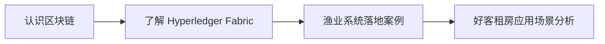

# 好客租房 day20 开场：用一天认知课搞懂区块链能替项目解决什么

提到区块链，多数人的第一反应是比特币和行情软件，这是好客租房第 20 天要先纠正的偏差。项目课进行到这个阶段突然插进一整天区块链，不是要赶时髦，而是前面 19 天搭出来的系统始终有一个没碰过的问题：多方都关心、谁都不该改的数据，放在自家数据库里凭什么让人信。

day20 不写代码、不搭环境，专门讲理论与认知：区块链是什么，Hyperledger Fabric 是什么，以及最关键的一问，它能解决租房项目里的什么问题。

## 先给结论

- day20 是认知课而不是实操课：不搭链、不写链码，重点是建立对区块链的正确认识，学会判断哪些场景值得用它。
- 比特币只是区块链的一种实现，Hyperledger Fabric 是面向企业协作的另一种实现，技术同源、定位完全不同。
- 课程走四步：认识区块链、了解 Hyperledger Fabric、看一个渔业系统的落地案例、回到好客租房分析应用场景。
- 定位是「了解」级别：能说清概念、能在方案评审时判断该不该上链即可，深入开发属于另行展开的专题。

## 一、项目课为什么要插一天区块链

租房业务里有一类数据天然满足「多方都在乎、谁都不该改」：房东与租客签的电子合同、房源的真实信息、双方留下的互评。这些数据现在全部躺在自家数据库里，修改一条记录只需要一次 update，运营有权限、DBA 有权限，出了纠纷就说不清。

数据越是深度参与交易，被质疑「后台是不是改过」的概率越高。区块链提供的价值，是把「数据没被改过」从一句承诺变成一个可以验证的技术事实：多方各持一份账本，历史记录改动一处，后续所有块的校验全部失败，篡改从「很难发现」变成「必然暴露」。day20 要训练的就是这个判断力：哪些数据值得付出上链成本去换这个性质，哪些数据留在数据库里更划算。

## 二、认识区块链：先拆掉「区块链等于比特币」

一句话定义：区块链本质是分布式账本技术。参与的多方各存一份完整账本，数据按时间顺序打包成块，每一块记录前一块的哈希值，块与块因此前后咬合：

```json
{
  "index": 105,
  "timestamp": "2026-11-03T10:00:00",
  "data": {
    "type": "lease_contract",
    "contractNo": "HT-2026-1103",
    "houseId": "HZ10086",
    "tenant": "user_2048"
  },
  "previousHash": "9f2a1c",
  "hash": "00b7e3"
}
```

`previousHash` 指向上一块，`hash` 是本块全部内容的摘要。想改第 100 块的数据，它的 hash 就变了，第 101 块里的 `previousHash` 对不上，链条当场断掉。这就是「链」字与「不可篡改」四个字的全部来源。对一条合同记录算摘要的动作本身并不神秘：

```java
// 示意代码：对一条租房合同记录计算 SHA-256 摘要，演示链式哈希防篡改的原理
MessageDigest md = MessageDigest.getInstance("SHA-256");
byte[] digest = md.digest(contractJson.getBytes(StandardCharsets.UTF_8));
String hash = HexFormat.of().formatHex(digest);   // 下一个区块的 previousHash 指向它
```

有了「块 + 哈希链」还不够，多方记账还要回答「谁的账算数」，这是共识机制的工作；比特币用全网竞争记账解决它，代价是极低的吞吐量。这层差异正是 Fabric 登场的原因。

## 三、Hyperledger Fabric 是什么，在这门课里扮演什么角色

Hyperledger Fabric 是开源的企业级区块链框架，由 Linux 基金会托管。它与比特币同属「区块链的实现」，但一个面向公开网络，一个面向需要准入的企业联盟：

| 维度 | 公有链（比特币） | 联盟链（Hyperledger Fabric） |
|---|---|---|
| 参与者 | 任何人可匿名加入 | 成员经许可认证才能入网 |
| 典型场景 | 数字货币转账 | 企业间的业务协作与数据存证 |
| 共识代价 | 全网竞争记账，吞吐量低 | 授权节点达成共识，吞吐量高得多 |
| 数据可见性 | 全网公开 | 按通道与成员控制可见范围 |

课程走的是四步路线：



前两步补概念，后两步回答「怎么用」。渔业系统作为实际案例，展示一条真实业务链路里区块链站在哪个位置、替代或加固了哪些环节；回到好客租房后，把同样的分析方法换到租房数据上：合同、房源信息、互评记录，逐项评估是否满足「多方在乎、不可篡改、能承受成本」三条件。

对这一天的预期也要摆正：它是了解性质的一课，目标是能说清概念、能判断适用场景；Fabric 的网络搭建与链码开发是另一门深水功夫，不在这一天展开，需要时再按专题学习。

## 四、带着问题进正课

三个问题值得先带着听。第一，合同数据不上链就不安全吗？多数情况答案是「够用」，区块链只负责解决「多方互不信任」的场景，别为不存在的问题付成本。第二，Fabric 没有数字货币，怎么激励节点记账？联盟链的节点由成员组织运营，记账是义务与权利的组合，不需要代币激励。第三，链上数据能删吗？设计上就不支持，这既是它防篡改的来源，也决定了敏感数据、个人隐私数据上链前要先想清楚合规问题。这三个问题在后续案例里都会再遇到。

## 常见误区

- **把区块链等同于炒币。** 比特币只是区块链的一种实现，区块链是可以承载业务数据的账本技术，与投机行为无关。
- **期待 day20 动手搭链。** day20 明确是理论认知课，环境搭建与编码不在范围，先把「是什么、为什么、用在哪」想透。
- **认为什么数据都该上链。** 上链有写入与存储成本，只有多方互不信任、需要防篡改存证的数据才值得上链，普通业务数据留在数据库里更合适。
- **把 Fabric 当数据库用。** 链上数据不可改、查询能力有限，历史数据与复杂查询仍靠传统存储，链上只放需要可信存证的关键记录。

## 面试可能被问到的问题

1. 面试官追问：「区块链和比特币是什么关系？」
   答：区块链是一种分布式账本技术，比特币是它最著名的一种实现。区块链可以承载合同、存证、溯源等业务数据，不等于某种数字货币，两者是技术与具体产品的关系。
2. 面试官追问：「Hyperledger Fabric 这类联盟链与公有链的主要区别是什么？」
   答：联盟链需要许可认证才能入网，参与方是已知的成员组织，共识在少数授权节点间达成，吞吐量远高于公有链；公有链任何人可加入，靠全网竞争记账与代币激励维持，性能低但完全开放。
3. 面试官追问：「区块链解决的核心问题是什么？」
   答：在多方互不信任的环境中，用分布式账本与哈希链提供不可篡改、可验证的数据记录，把「数据没被动过」从口头承诺变成技术事实，降低信任成本。
4. 面试官追问：「租房项目里哪些数据适合上链，为什么？」
   答：电子合同、房源关键信息、双方互评这类多方关心、事后易起纠纷的数据，适合上链存证；普通业务数据如浏览记录、缓存数据没有防篡改诉求，留在数据库即可。
5. 面试官追问：「企业项目为什么普遍选联盟链而不是公链？」
   答：企业场景参与方已知、数据要求可控可见，联盟链的准入机制、通道隔离与高吞吐正好匹配；公链的匿名参与、公开账本与低吞吐都不符合企业内协作的需求。

## 配套资料

- 本教学日无源码包：`materials/code/03/day20-了解区块链以及Hyperledger fabric/` 下仅有解压清单 `_extracted.json`，解压文件数为 0；区块结构与 SHA-256 摘要两段代码为讲解概念的示意示例，按本课写法补全，非课程源码。
- 课程大纲（什么是区块链、了解 Hyperledger Fabric、区块链在项目中的应用）抄录自本课画面线。
