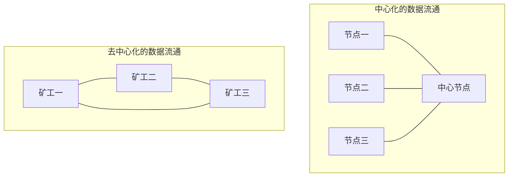

# 中心化与去中心化：从圣诞老人记账到矿工共同记账

去中心化是区块链最出圈的词，也最容易被说玄。用一个斗地主的输赢记账故事，把两种架构的差异、中心化的六类风险、去中心化的代价一次摆清，再给出工程上的折中路线联盟链，为后续课程铺路。

## 先给结论

- 中心化：所有人把账交给唯一可信的中介，数据流通全部经过中心，中心既是信任来源，也是瓶颈与风险集合点。
- 中介式记账的六类风险：中介宕机、被黑客攻破、坐地起价、挪用资金、泄露隐私、并发量上来后忙不过来。
- 去中心化：账本交给每个参与节点，由记账的群众（矿工）各自持有一本相同的账，一人记错立刻与多数不一致。
- 对比一句话：中心化是垄断，去中心化是平等互联。
- 工程落地的主流是折中方案联盟链：只对许可成员去中心化，兼顾性能与多方互信，后续课程的 Hyperledger Fabric 就属于这一类。

## 一、一个斗地主记账故事：中心长什么样

商务男、老爷爷和小男孩在一起斗地主，地主赢了得 10 块钱，农民赢了每人得 5 块。为了避免赖账，三人约定每人先拿出 100 块存到圣诞老人那里，圣诞老人负责记账。于是中心出现了，圣诞老人手里的总账长这样：

| 成员 | 金额 |
|---|---|
| 商务男 | 100 |
| 老爷爷 | 100 |
| 小男孩 | 100 |

圣诞老人是三人共同信赖的中心，每局打完把结果报给他，他负责计算。商务男当地主赢下第一局，账本变成商务男 110、老爷爷 95、小男孩 95。这套流程没有问题，效率还很高：账只有一本，结果永远以圣诞老人为准，出账快、口径统一。

## 二、中心的六张面孔：中介模式的风险清单

问题不在第一局，在时间与规模。讲义列了六问，每一问对应一类生产环境里真实存在的风险：

| 讲义之问 | 对应的风险类型 |
|---|---|
| 圣诞老人年迈，突然挂了怎么办 | 单点故障，服务不可用 |
| 村里有黑客把钱偷走了怎么办 | 单点被攻破，资产损失 |
| 坐地起价，每次记账收手续费怎么办 | 定价权垄断 |
| 挪用 300 块放贷没及时收回怎么办 | 中心作恶，资金挪用 |
| 记录了每个人的私有数据，卖掉怎么办 | 隐私泄露 |
| 同时给一万桌斗地主记账，忙不过来怎么办 | 性能瓶颈 |

六问的共同结构：风险全部集中在一个点上。这个点被信任，所以所有人向它提交数据；被信任的东西一旦变质，或者单纯忙不过来，整条链路跟着出问题。中心化架构下，中心节点就是整个架构的瓶颈，它出问题就是大问题。

## 三、去中心化：把账本还给每个人

换一种玩法：不再存在圣诞老人这个角色，账目交给参与记账的群众，也就是矿工。每个矿工都持有一本账，每笔交易在矿工之间同步，各自记录。一人记错了，他那本立刻与其他人的不一致，错误直接暴露，谁也瞒不住。

两种架构的数据流通结构画出来是这样：



图里的差别一目了然：左图所有节点只和中心对话，中心一挂全网停摆；右图节点两两相连、互相同步，任何单点退出，账本仍在其他节点手里。讲义给这对结构的关键词，中心化是垄断，去中心化是平等互联。

day20 资料包无源码，下面按本课写法补全两种架构的最小实现（示例，可直接运行）。中心化版本用一个服务掌管全村的账：

```java
// 示例：中心化记账，所有交易请求都打到同一个服务上
@RestController
public class LedgerController {

    // 圣诞老人手里的账本：只有中心能改
    private final Map<String, Integer> accounts = new ConcurrentHashMap<>();

    public LedgerController() {
        accounts.put("商务男", 100);
        accounts.put("老爷爷", 100);
        accounts.put("小男孩", 100);
    }

    // 中心串行处理，保住一致性，也意味着并发能力被中心锁死
    @PostMapping("/settle")
    public synchronized String settle(@RequestParam String winner,
                                      @RequestParam int amount) {
        accounts.merge(winner, amount, Integer::sum);              // 赢家入账
        accounts.forEach((name, balance) -> {
            if (!name.equals(winner)) {
                accounts.merge(name, -amount / 2, Integer::sum);   // 农民各扣一半
            }
        });
        return accounts.toString();
    }
}
```

去中心化版本则是每个矿工持有一本全量账本并独立校验：

```python
# 示例：去中心化记账，每个矿工持有一本全量账本并独立校验交易
from dataclasses import dataclass, field

@dataclass
class Miner:
    name: str
    ledger: dict = field(default_factory=dict)

    def verify(self, tx: dict) -> bool:
        # 用自己那份账本校验：付得起才认可这笔交易
        return self.ledger.get(tx["from"], 0) >= tx["amount"]

base_ledger = {"商务男": 100, "老爷爷": 100, "小男孩": 100}
miners = [Miner(f"矿工{i}", dict(base_ledger)) for i in range(1, 4)]

tx = {"from": "老爷爷", "to": "商务男", "amount": 10}
votes = [m.verify(tx) for m in miners]
print(votes)   # [True, True, True]
# 多数矿工认可后，这笔变更才写进各自账本，账本继续全员一致
```

两份代码的差别不在写法，在权力：Java 版的 `accounts` 只有中心能改，Python 版的每个 `ledger` 各有一份、任何一笔变更都要过多数校验。中心可以单方面改账，矿工不可以。

## 四、折中路线：联盟链为什么是工程上的答案

两个极端各有代价。完全去中心化用性能换信任：每个节点存全量账本、每笔交易等共识，吞吐上不去；完全中心化性能最好，但信任全押在一个机构身上，第二节那六类风险一个不少。

工程上更常见的落点是联盟链：参与节点是经过准入的机构成员，比如几家银行、一条供应链上的几家公司。它保留多方共同记账、副本一致、篡改要过多数这几条区块链的核心价值，又因为成员有限、身份已知，共识效率远高于公有链。信任不能外包给单一机构、参与方数量又可控的场景，联盟链是默认选项，本课程后续要讲的 Hyperledger Fabric 就是一条联盟链，也是企业里最常选的路线。

选型时可以拿两个问题当筛子：记账的参与方是否互不信任？参与方数量是否可控？两个都答是，联盟链合适；只有一个互不信任的机构在场，用普通数据库就好。

## 常见误区

- **把去中心化理解成没有中心。** 去中心化去掉的是唯一权威，不是所有管理机制；共识规则、多数认可仍然在，只是「说了算」的对象从一个人变成多数派。
- **以为去中心化一定优于中心化。** 中心化在性能、响应速度、责任主体清晰度上有天然优势，大多数业务系统仍然应该中心化；只有在多方互不信任又需要共同记账的场景，去中心化才划算。
- **把矿工理解成特殊职业。** 矿工就是参与记账的节点，持有账本、校验交易、同步变更；比特币体系里矿工通过记账获得奖励，这与「记账群众」的本义是一回事。
- **以为联盟链是不彻底的区块链。** 联盟链牺牲的是开放准入，保留的是多方互信的记账结构；企业场景里成员本来就该可控，准入机制反而是工程优点。

## 面试可能被问到的问题

1. 面试官追问：「中心化架构的核心风险是什么？」
   答：风险集中在唯一中心。中心宕机则服务不可用，中心被攻破则资产与数据损失；中心还握有定价权、隐私数据与资金支配权，作恶或收费都无从制衡；并发增长时中心又是性能瓶颈。单一信任来源既是效率优势，也是风险集合点。
2. 面试官追问：「去中心化怎么解决这些风险？」
   答：把记账权分散到每个节点，每个矿工持有一本相同账本，交易在节点间同步并由多数认可。单节点出错或作恶会与多数派不一致而暴露，不存在能单独决定账本的点，单点故障与单点作恶同时被消除。
3. 面试官追问：「去中心化有什么代价？」
   答：每个节点存全量账本，存储与同步开销大；交易要等共识确认，性能远低于中心化系统；出了分歧也缺少中心化的快速仲裁主体。所以去中心化不是普适方案，只在多方互信成本高的场景值得。
4. 面试官追问：「联盟链是什么，为什么企业多用它？」
   答：联盟链是成员准入制的多中心区块链，参与方是已知机构。它保留共同记账、副本一致、多数认可这些核心机制，同时因成员有限、身份可信，共识效率远高于公有链，兼顾性能与多方互信，Hyperledger Fabric 是其代表实现。
5. 面试官追问：「中心化和去中心化各举一个例子？」
   答：银行转账是典型中心化，余额由银行核心系统说了算；比特币是典型去中心化，余额由全网节点共同维护的账本说了算。介于两者之间，几家银行联合运营的结算网络可以做成联盟链，成员可控、账本共享。

## 配套资料

- 本教学日无源码包：`materials/code/03/day20-了解区块链以及Hyperledger fabric/` 下仅有解压清单 `_extracted.json`，解压文件数为 0；中心化记账接口与矿工校验脚本均为按本课写法补全的可运行示例。
- 斗地主记账故事、圣诞老人六问、中心化与去中心化数据流通图（记账群众为矿工）抄录自本课画面线（讲义 1.4 中心化和去中心化一节）。
- 延伸阅读：区块链总定义见 `0323-认识区块链之什么是区块链_.md`；分布式账本机制见 `0325-认识区块链之什么是分布式账本.md`；联盟链代表 Hyperledger Fabric 在本章节后续课程展开。
