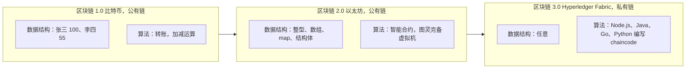

# 区块链的演化：从比特币、以太坊到 Hyperledger Fabric 的三级跳

面试里问「区块链发展到哪一步了」，或者问「Fabric 和比特币是不是一回事」，答不上来往往是因为把区块链当成了一个静止的概念。它分成 1.0、2.0、3.0 三个阶段，每一代换一种玩法。看懂演化的钥匙只有一把：数据结构加算法组成程序，三代区块链的变化，本质就是数据结构和算法在逐级升级。

## 先给结论

- 区块链分三个阶段：1.0 是比特币（公有链），2.0 是以太坊（公有链加智能合约），3.0 是 Hyperledger Fabric（私有链）。
- 三代的分野可以一条线看完：1.0 只有账户余额这种极简结构和加减转账算法；2.0 结构扩展到整型、数组、map、结构体，算法升级为图灵完备的智能合约；3.0 数据结构任意，合约可用 Node.js、Java、Go、Python 等多语言编写，称为 chaincode（链码）。
- 1.0 与 2.0 是公有链，任何人接入就能同步账本，没有隐私可言；3.0 是私有链，账本有权限控制，房管局、银行、公安这类机构的数据才接得进来。
- 性能差距巨大：比特币每秒约 7 笔，以太坊每秒约 15 笔，Fabric 每分钟可达百万笔量级，性能可保障是它能进实际项目的前提。
- 关键技术两块：密码学（哈希、数字签名）解决抗抵赖与隐私保护；分布式共识（PoW、PoS、DPoS、PoET）解决多方记账谁说了算。

## 一、三代演进总览



三个方框从左到右，数据结构和算法的表达能力逐级放大，链的开放程度反而逐级收紧。这两个趋势叠加起来，就是区块链从「一种电子现金的实验」走向「行业应用基础设施」的过程。逐代对照：

| 阶段 | 代表 | 链类型 | 数据结构 | 算法 | 性能量级 |
|---|---|---|---|---|---|
| 1.0 | 比特币 | 公有链 | 账户余额 | 转账加减 | 每秒约 7 笔 |
| 2.0 | 以太坊 | 公有链 | 整型、数组、map、结构体 | 智能合约（图灵完备） | 每秒约 15 笔 |
| 3.0 | Hyperledger Fabric | 私有链 | 任意 | 多语言 chaincode | 每分钟可达百万笔 |

## 二、1.0 比特币：只有转账一种玩法

公有链的意思是：任何一个参与挖矿的人，只要电脑连入账本，就能同步到所有人的账本；任何人都能加入，没有任何隐私可言。这个开放性换来了全网共识，也决定了它的账本只能放最公开的数据。

于是 1.0 的数据结构极简：一张余额表，记录谁有多少币，张三 100、李四 55。算法也极简：转账就是一次加减，张三减 10 变 90，李四加 10 变 65。世界状态从「100, 55」经一次函数执行变成「90, 65」。day20 无源码，按主流写法补全这段世界状态变化（示例，可直接运行）：

```python
# 示例：区块链 1.0 的世界状态，按主流写法补全
balances = {"张三": 100, "李四": 55}

def transfer(sender: str, receiver: str, amount: int) -> None:
    if balances[sender] < amount:
        raise ValueError("余额不足")
    balances[sender] -= amount    # 张三 100 - 10 = 90
    balances[receiver] += amount  # 李四 55 + 10 = 65

transfer("张三", "李四", 10)
print(balances)  # {'张三': 90, '李四': 65}
```

这套结构天生只能表达「谁转给谁多少」，做不了别的。要让链承载更复杂的业务，就得同时升级数据和逻辑的表达能力。

## 三、2.0 以太坊：智能合约让链能跑程序

有了 1.0 之后，自然有人想升级：既然这套数据结构能支撑比特币，那把结构和算法搞得更复杂，是不是就不只能转账，还能做更多事？这就是以太坊带来的区块链 2.0，它仍是公有链，关键新增是一个概念：智能合约。

两处升级对应得很整齐：

- **数据结构升级。** 不再只有余额，而是支持整型、数组、map、结构体这类常规程序结构，业务对象终于能在链上完整表达。
- **算法升级。** 算法变成了智能合约：在图灵完备的虚拟机中执行的函数。图灵完备用大白话讲，就是这个虚拟机能执行任意逻辑的程序，而不是只会做转账那种有限的加减判断。合约的执行结果体现为世界状态的二进制指令变化：`00110011` 经函数执行变成 `10110110`。

智能合约一旦能写任意逻辑，众筹、投票、登记这些业务逻辑理论上都能搬上链，区块链从账本变成了一个全球共享的运行环境。代价是性能进一步下降，每秒约 15 笔的吞吐撑不起行业级应用。

## 四、3.0 Hyperledger Fabric：有权限的私有链

区块链 3.0 的代表是 Hyperledger Fabric，它与前两代最大的区别只有一个词：私有链。前两代谁都能同步账本，Fabric 的账本有权限，不是任何人想加入就能拿到历史交易记录。这样一来，房管局、银行、公安局这类机构的数据，只有在权限许可下才能接入链中，权限控制由此成为可能。

结构与算法也随之上一个台阶：

- **数据结构任意。** 想表达什么业务对象就用什么结构，比 2.0 更灵活。
- **算法仍是智能合约，但换了名字和生态。** 在 Fabric 里智能合约叫 chaincode（链码），可以用 Node.js、Java、Go、Python 等多种语言编写，其中 Fabric 比较推荐用 Node.js 实现。世界状态的变化与 2.0 一致，同样是二进制指令级别的记录。

对 Java 工程师来说，这一代终于可以不必学新语言就能上手写链码。day20 无源码，按 Fabric 官方 contractapi 的主流写法补全一个链码骨架（示例，非完整工程）：

```java
// 示例：Fabric Java chaincode 骨架，按 contractapi 主流写法补全
@Contract(name = "AssetTransfer")
public class AssetTransfer implements ContractInterface {

    @Transaction(intent = Transaction.TYPE.SUBMIT)    // 写操作：改世界状态
    public void createAsset(Context ctx, String id, String owner, int value) {
        Asset asset = new Asset(id, owner, value);
        ctx.getStub().putStringState(id, new Gson().toJson(asset));
    }

    @Transaction(intent = Transaction.TYPE.EVALUATE)  // 读操作：查世界状态，不上链
    public Asset queryAsset(Context ctx, String id) {
        return new Gson().fromJson(ctx.getStub().getStringState(id), Asset.class);
    }
}
```

一套链码对应一个业务合约，读写世界状态的方法一目了然，写法和写一个普通 Service 类没有太大距离感，这也是 3.0 能被企业接纳的重要原因。

## 五、关键技术两块：密码学与共识

把三代串起来看，有两类技术在所有阶段都不可或缺。

**第一，密码学解决「抵赖」和「隐私」。** 数据发出去，一定找得到是谁发的，有人声称「不是我发的」时，数字签名可以拆穿；哈希技术用来保护隐私与完整性。抗抵赖与隐私保护，靠的就是密码学、hash、数字签名这套组合。

**第二，分布式共识解决「谁说了算」。** 成员之间必须达成共识，分布式记账才成立。讲义列出的共识机制有四类：

| 机制 | 全称 | 要点 |
|---|---|---|
| PoW | Proof of Work，工作量证明 | 比特币采用；挖矿者大量计算得出合法的 block hash，消耗大量算力，不环保 |
| PoS | Proof of Stake，权益证明 | 以太坊采用，按持有权益决定记账权 |
| DPoS | Delegated Proof of Stake，委托权益证明 | 代表投票选出记账节点 |
| PoET | Proof of Elapsed Time，流逝时间证明 | Intel 提出的共识协议，依托可信执行环境，能耗远低于 PoW |

性能是这些选择最终呈现的结果。比特币每 10 分钟产出一个区块，原始区块大小 1MB，理论上每秒只有 7 笔左右交易，实际还会更低；全球都拿它做日常交易，网络基本处于瘫痪状态。以太坊提升到每秒约 15 笔，仍然非常低。Fabric 达到每分钟百万笔的量级，与前两代相比是数量级的跃升，性能可以保障，这才是它能投入实际项目的根本原因。

## 常见误区

- **把区块链等同于比特币。** 比特币只是区块链的一种实现。它确实存在挖矿耗能的问题，但区块链并非都要挖矿，2.0 与 3.0 的大量操作是执行智能合约，共识机制也远不止 PoW 一种。
- **把区块链当数据库用。** 区块链可以记录数据，但它不是数据库。拿它做增删改查好比用大炮打蚊子，不仅不合适，还会带来性能与存储上的副作用。
- **把区块链当成万能颠覆技术。** 它实现的是分布式记账、分布式账本这一项能力，不是包治百病的方案，解决不了与多方信任无关的需求。
- **以为私有链背离了区块链的开放精神。** 开放是公有链的特性，不是区块链的定义；需要权限控制的行业场景，私有链才是正确形态。

## 面试可能被问到的问题

1. 面试官追问：「区块链 1.0、2.0、3.0 分别是什么？」
   答：1.0 以比特币为代表，是公有链，数据结构和算法都极简，只能做转账；2.0 以以太坊为代表，仍是公有链，引入图灵完备的智能合约，数据结构扩展到整型、数组、map、结构体；3.0 以 Hyperledger Fabric 为代表，是私有链，数据结构任意，智能合约叫 chaincode，可用 Node.js、Java、Go、Python 等编写，性能也达到实际项目可用的水平。
2. 面试官追问：「智能合约是什么，图灵完备指什么？」
   答：智能合约是部署在链上、由共识保证执行的程序，业务规则写进代码后由全网或联盟成员共同执行。图灵完备指执行环境能表达任意计算逻辑，以太坊虚拟机是图灵完备的，所以能跑复杂合约；比特币的脚本只能做有限的加减与条件判断，属于非图灵完备。
3. 面试官追问：「Fabric 和比特币最大的区别是什么？」
   答：链的开放性。比特币是公有链，任何人接入即可同步全部账本；Fabric 是私有链，账本有权限控制，只有被许可的机构才能接入和查询，因此适合房管局、银行、公安这类对数据权限有要求的场景，性能也从每秒几笔提升到每分钟百万笔量级。
4. 面试官追问：「PoW 和 PoS 有什么区别，为什么说 PoW 不环保？」
   答：PoW 靠算力竞争争夺记账权，矿工必须持续做大量哈希计算，绝大多数算力消耗没有产生有效计算，只用于证明工作量，所以耗电严重；PoS 按持有权益分配记账权，不需要算力军备竞赛，能耗大幅下降。DPoS 是权益证明的委托版，PoET 则由 Intel 提出并依托可信执行环境实现。
5. 面试官追问：「为什么不能拿区块链当数据库用？」
   答：数据库追求高并发读写、灵活查询和低成本存储，区块链为此付出的代价恰恰相反：每个节点存全量账本、写操作要打包出块并共识确认、历史数据不可修改。没有多方信任需求时用它记账，性能和成本都不可接受；只有互不信任的多方需要共同维护一份账本时，区块链才是对的工具。

## 配套资料

- 本教学日无源码包：`materials/code/03/day20-了解区块链以及Hyperledger fabric/` 下仅有解压清单 `_extracted.json`，解压文件数为 0；文中 1.0 世界状态演示与 Fabric Java chaincode 骨架均为按主流写法补全的示例。
- 三代演化的结构对照、共识机制全称与性能数据的表述抄录自本课画面线（讲义 1.6 区块链的演化一节）。
- 同章节延伸：比特币的 PoW 与账本机制见 `0327-认识区块链之什么是比特币_.md`；场景判断见 `0329-认识区块链之区块链应用场景.md`；常见疑问收束见 `0330-认识区块链之区块链的一些疑问.md`。
