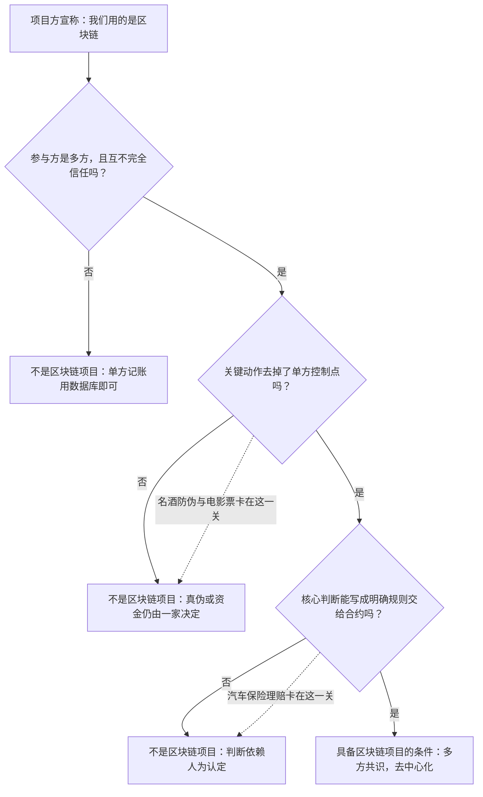

# 区块链应用场景：先看它凭什么适合，再看项目是真还是假

简历和评审会上，「我们用区块链做了 XX」的说法越来越多，其中不少是把普通系统套了个壳。场景清单背下来没有用，行业风向一变清单就过期；真正通用的是两件事：判断一个场景为什么适合区块链，以及判断一个自称区块链的项目是不是伪命题。这两件事是同一个判断逻辑的正反两面。

## 先给结论

- 六大类场景：金融服务、征信与权属管理、资源共享、贸易管理、物联网，加上云存储、医疗、通讯软件、电子游戏、投票等其他场景。
- 判断「凭什么适合」只有一条核心：场景里是否存在多方互不完全信任、又必须共同记账的结构。有，区块链才比中心化方案强。
- 资金类场景（众筹、共享单车押金）的关键动作是：动用资金需要多方签名达成共识，任何一方不能单方碰钱。
- 名酒防伪、电影票这类项目是伪命题：真伪由酒厂或影院一家说了算，中心化根本没去掉，链上只能记录「它说这是真的」，不能让「这是真的」成立。
- 汽车保险自动理赔也是伪命题：定损需要人为判断，智能合约是程序员写死的规则，写不出「碰一块漆赔多少」。
- 收束成一句话：能建立分布式账本、达成共识、去掉中心化，才是区块链项目；做不到就不是，不是什么项目都能往区块链上套。

## 一、六类场景，逐个看「凭什么」

### 金融服务

区块链应用最广的行业。银行方向有微众银行，腾讯牵头打造的互联网银行，整体基于区块链技术；证券交易、众筹也都适配。众筹的适配点最清楚：厂家发起产品众筹，出资人把钱放进来，厂家做不出产品就一分钱拿不到，动用资金必须征求平台和参与者的同意。每个出资人、每个平台都是链上的一个节点，资金安全由多方共识保证，而不是由平台的自觉保证。

### 征信与权属管理

征信涉及多个部门，部门之间建一条私有链做数据共享：某人的征信一旦出问题，立刻通知到其他环节，体系内任何一个节点都能直接查询。凭什么适合？因为征信数据天然属于「多方都在记、谁都改不了」的信任数据，一家中心化存储反而谁都不敢随便信。权属管理、音乐版权管理同理：权属由多方共同见证，而不是由一家机构单独认定。

### 资源共享

共享单车是最现实的注脚：ofo、摩拜那个年代，平台卷着押金跑路的事反复发生。把押金数据上链之后，平台想动用这笔钱，需要公司签名、平台签名、用户签名三方达成共识，缺一个都动不了，单方面跑路在机制上被堵死。day20 无源码，按主流写法补全这个多方签名校验的核心逻辑（示例，可直接运行）：

```python
# 示例：押金动用的多方签名共识，按主流写法补全
REQUIRED = {"公司", "平台", "用户代表"}

def release_deposit(signed_by: set) -> str:
    missing = REQUIRED - signed_by
    if missing:
        raise PermissionError(f"缺少签名，拒绝放行：{missing}")
    return "三方共识达成，押金放行"

release_deposit({"公司", "平台"})              # PermissionError：用户代表未签名
release_deposit({"公司", "平台", "用户代表"})   # 三方共识达成，押金放行
```

三个签名单独看都不稀奇，稀奇的是「缺一个就不放行」由链上的共识规则执行，任何一方包括平台自己都绕不过去。同属资源共享的还有社会能源共享、电商平台、大数据共享。

### 贸易管理

跨境贸易是出了名的繁琐耗时：商品进口，国家之间要结算，中间还夹着汇率兑换。参与方上链之后，交易一发生，数据直接在链上同步，各节点立刻拿到同一份事实，效率大幅提升。物流供应链、一带一路方向的贸易协作都是同样的逻辑。

### 物联网

这是区块链真正能发挥价值的行业，IBM 在牵头推进，代表项目是物联网疫苗 NeuroMesh：保护物联网设备的安全与用户隐私。背景是摄像头这类设备被黑客入侵后，用户隐私直接被公开直播。设备全部上链后，周边设备一旦发现某个节点行为异常，就对它发起投票，票数达到阈值就把这个节点下线或暂停，像免疫系统隔离病变细胞一样，疫苗之名由此而来。

### 其他场景

云存储、医疗、通讯软件、电子游戏、投票，都可以容纳区块链。场景会持续增加，判断逻辑不会变。

## 二、真伪判断：三个项目，三个坑

下面用一把尺子量三个项目。判断流程固定为三问：参与方是不是多方且互不完全信任？关键动作有没有去掉单方控制点？核心判断能不能写成明确规则交给合约执行？



**项目一：区块链名酒防伪。** 项目描述很漂亮：每瓶酒在链上有唯一记录，区块链验证酒的真伪，酒行业彻底革命。量一下就露馅：酒的真伪由谁决定？一定是酒厂。酒厂提供查询网站，所有验证都以酒厂为中心，去中心化在哪里？区块链要求各节点共同存储，这里只有酒厂一家说了算。链上记录的只是「酒厂声称这瓶是真的」这个声明，声明上链不等于声明为真。这是典型的伪命题。

**项目二：区块链电影票。** 背景是真有票房造假问题，方案是每张电影票唯一记录、验证进入区块链、票务行业彻底革命。和上一个如出一辙：票的验证完全由电影院决定，分布式信任体系没有建立起来，中心化概念还留在验证环节，不符合区块链的特性，同样是伪命题。

**项目三：区块链汽车保险。** 这个项目听起来最唬人：去中心化保险公司，没有太平洋、人保这样的中心保险公司，完全公平的投保体系，人人为我、我为人人，汽车出险后智能合约实时赔付。问题出在理赔环节：出险认定需要人为参与，车受损到什么程度、该赔多少钱，都要人来判断。智能合约是程序员写的一段程序，写不出赔付规则：总不能规定碰一块漆赔 200、两块赔 400、三块赔 600，实际受损情况千差万别。人为判断写不进合约，实时理赔就落空，这还是伪命题。

众筹项目为什么量出来是真的？对照三问走一遍：出资人、平台、厂家多方互不完全信任，过；放款不再由平台单方决定，达标即放款，过；「筹集额达到目标金额才能提款」是完全可以写成代码的明确规则，过。三条全过，众筹就是真场景。day20 无源码，按 Solidity 主流写法补全众筹合约里这条核心规则（示例，仅演示思路）：

```solidity
// 示例：众筹「达标才能放款」的核心规则，按 Solidity 主流写法补全，仅演示思路
contract Crowdfunding {
    uint public goal;                              // 目标金额
    uint public raised;                            // 已筹金额
    mapping(address => uint) public contributions; // 出资记录，链上账本
    bool public finalized;

    function contribute() external payable {       // 出资即写入链上账本
        require(!finalized, "众筹已结束");
        contributions[msg.sender] += msg.value;
        raised += msg.value;
    }

    function finalizeAndPay(address payable vendor) external {
        require(!finalized, "已结算");
        finalized = true;
        require(raised >= goal, "未达标：走退款流程，厂家拿不到钱");
        vendor.transfer(raised);                   // 达标才放款，规则由合约执行
    }
}
```

「未达标拿不到钱」不再是平台口头承诺，而是合约里的 `require`，平台想改也改不了，这正是众筹作为真区块链项目的那块基石。

## 三、把判断逻辑内化

三个反例加上众筹这个正例，判断标准已经完整：先看参与方，多方互不完全信任才有共识的必要；再看关键动作，单方说了算的环节不去掉，链就是摆设；再看规则，写得进代码的判断才能交给智能合约。市面上大量「区块链 +」项目死在第二问和第三问上，量一遍就知道深浅。

## 常见误区

- **沾上「多方」就上链。** 多方还得互不完全信任。公司内部几个部门协作，数据统一管理员就能管好，上链是负担。
- **以为上了链的东西就是真的。** 链保证「声明不可篡改」，不保证「声明为真」；名酒防伪的坑就在这里，假酒的「真」声明一样能上链。
- **以为智能合约能包办一切判断。** 合约只能执行明确规则，定损、鉴定、主观评价这类依赖人为参与的动作写不进去，汽车保险项目的失败点正在于此。
- **以为共识只是技术细节。** 共识恰恰是业务价值所在：资金要多方签名才放行，征信要多方同步才可信，绕开共识谈区块链应用等于没谈。

## 面试可能被问到的问题

1. 面试官追问：「区块链适合哪些场景，判断标准是什么？」
   答：金融服务、征信与权属管理、资源共享、贸易管理、物联网等。判断标准是场景里存在多方互不完全信任、又必须共同记账的结构，并且关键动作能去掉单方控制点、核心判断能写成明确规则。满足这三条，区块链才比中心化方案有优势。
2. 面试官追问：「名酒防伪为什么不是真正的区块链项目？」
   答：因为酒的真伪由酒厂单方认定，查询也以酒厂为中心，去中心化根本没实现。区块链只能保证「酒厂声称这瓶是真的」这条记录不被篡改，不能保证声称本身为真，分布式信任体系没有建立起来。
3. 面试官追问：「共享单车的押金问题，区块链怎么解决？」
   答：把押金数据上链，动用资金需要公司、平台、用户三方签名达成共识，缺任何一方都无法放款。平台不能单方面挪用押金，卷款跑路在机制上被堵死，资金安全从依赖平台自觉变成依赖共识规则。
4. 面试官追问：「物联网和区块链怎么结合？」
   答：把物联网设备全部上链，周边设备持续观测各节点行为，发现异常节点就发起投票，票数达到阈值将其下线或暂停。代表项目是 IBM 牵头的物联网疫苗 NeuroMesh，用来防摄像头这类设备被入侵后泄露用户隐私。
5. 面试官追问：「区块链汽车保险的自动理赔为什么不成立？」
   答：出险认定和赔付金额依赖人为定损，受损程度千差万别，写不成固定规则。智能合约是程序员预先编写的程序，只能执行明确判断，无法替代人为评估，所以「出险即实时赔付」落空，项目不成立。
6. 面试官追问：「众筹为什么是成立的区块链场景？」
   答：出资人、平台、厂家多方互不完全信任；放款不由平台单方决定，而是达到目标金额的共识规则；「达标才能提款」可以明确写进智能合约由链执行。三条件齐备，资金安全由共识保证。

## 配套资料

- 本教学日无源码包：`materials/code/03/day20-了解区块链以及Hyperledger fabric/` 下仅有解压清单 `_extracted.json`，解压文件数为 0；文中多方签名校验与众筹合约均为按主流写法补全的示例。
- 六类场景清单、三个真伪案例及其分析逻辑抄录自本课画面线（讲义 1.7 区块链应用场景一节）。
- 同章节延伸：共识机制与性能对比见 `0328-认识区块链之区块链的演化.md`；溯源调包等疑问收束见 `0330-认识区块链之区块链的一些疑问.md`。
