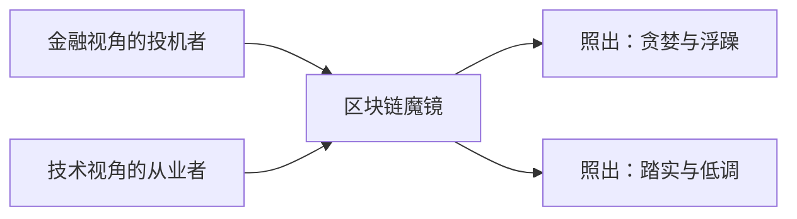

# 区块链技术现状：成熟度曲线上的幻灭期，与技术人员该有的姿态

概念和应用场景都过了一遍，接下来必须回答一个现实问题：这门技术现在到底走到哪一步了。不回答它，学习容易走极端：要么被「颠覆一切」的叙事带着头脑发热，要么被「骗局论」直接劝退。这节课用一张曲线、一份榜单和六条判断，把现状摊开来看。

## 先给结论

- 技术成熟度曲线把一项技术的生命周期分成五段：触发期、期望膨胀期、幻灭期、复苏期、成熟期；区块链当前位于幻灭期。
- 幻灭期不等于技术失败，它挤掉的是期望的水分；走过谷底，才会进入复苏期与成熟期。
- 画面给出的判断相当冷峻：可能 90% 的区块链项目并不成立，此前拆过的名酒防伪、保险自动理赔等多属此类。
- 国内代表玩家是微众银行这类金融机构，落地形态以联盟链为主：公链受监管与性能两头制约，私链又丢掉多方共识的意义。
- 方向确定、时间不定：基于区块链的新型生产关系必将重构商业生态，创新无捷径，唯有多尝试。

## 一、技术成熟度曲线：区块链正走在下坡的后半段

IBM 每年发布一张技术成熟度曲线图，横轴是时间，纵轴是期望值。一项新技术从出现到成熟，通常要走五个阶段。依据画面抄录整理如下：

```yaml
# 依据画面抄录整理：成熟度曲线五阶段与当前定位
curve:
  stages: [触发期, 期望膨胀期, 幻灭期, 复苏期, 成熟期]
  blockchain_now: 幻灭期        # 区块链当前所在位置
  still_hyped:                  # 还挂在期望膨胀期的技术
    - 物联网平台
    - 智能机器人
    - 5G
    - 人工智能
```

**第一，看懂纵轴。** 曲线量的是市场期望，不是技术能力。期望膨胀期里堆着被高估的技术，幻灭期是期望崩下来、泡沫被挤掉的一段下坡。

**第二，看懂区块链的位置。** 它已经从高位回落到幻灭期，画面里光标点到的位置贴近幻灭期与复苏期的交界。对照参照系更直观：深度学习、机器学习这类技术还停在期望膨胀期的高位，区块链等于提前透支过一轮期望，如今正在挤水分。

**第三，看懂方向。** 下坡不是终点。走过谷底之后，曲线向上通往复苏期与成熟期。把这张图放进脑子里，再看市场上的热闹与冷清，情绪就不容易被带着走。

## 二、国内玩家与九成伪命题

画面给出了一份国内区块链企业榜单（来源标注为链智库），节选几行感受一下行业结构：

```json
{
  "source": "链智库（画面表格抄录，节选）",
  "companies": [
    { "rank": 1, "name": "微众银行",   "desc": "互联网银行" },
    { "rank": 2, "name": "携程科技",   "desc": "金融移动销售管理平台提供商" },
    { "rank": 3, "name": "链上科技",   "desc": "数字资产交易平台提供商" },
    { "rank": 7, "name": "金融壹账通", "desc": "中小企业智能金融服务平台" }
  ]
}
```

榜单不用背，看结构：头排是金融机构，后面跟着资产交易、技术服务、区块链研究院，金融占了大头。排名第一的微众银行是腾讯牵头的互联网银行，讲应用场景时提过，它整体基于区块链技术。

为什么是这个结构？回到区块链的三种形态就明白了。公有链人人可进、数据全公开，性能与监管两头受限；私有链一家机构自用，多方共识的意义所剩无几；联盟链由多家机构许可准入、共同记账，既保住多方共识，又可控可管。国内能落地的场景绝大多数是机构间协作，对账、征信、溯源全是这一类，联盟链顺理成章成为主流形态。

再对照画面那条冷峻的判断：可能 90% 的区块链项目并不成立。判断标准在应用场景一课拆过三问：参与方是不是多方且互不完全信任？关键动作有没有去掉单方控制点？核心判断能不能写成明确规则交给合约执行？三问答不上来，就是套壳项目。

## 三、六条现状判断，逐条展开

1. **可能 90% 的区块链项目并不成立。** 缺少「多方互不信任又必须共同记账」的结构，把普通系统套上区块链的外壳，不成立的是场景，不是技术。
2. **区块链底层技术还很不成熟。** 性能吞吐、全量冗余带来的存储开销、隐私保护、跨链互通都还在发展，离关系型数据库那种成熟度还有距离。
3. **对价值互联网的认知还很肤浅。** 价值互联网指像信息互联网传递信息一样传递价值的网络形态，它该怎么组织、由谁治理，当下没有完整答案。
4. **市场的信仰游走在狂热和绝望之间。** 币价涨时人人谈颠覆，项目崩时人人喊骗局，情绪钟摆来回摆，正是幻灭期的典型特征。
5. **基于区块链的新型生产关系必将重构商业生态。** 生产关系说白了是多方之间的协作与分配方式；多方共识记账取代单方中心记账，是协作方式的升级。方向毋庸置疑，剩下的只是时间问题。
6. **创新无捷径，唯有多尝试。** 成熟的商业模式与杀手级应用，只能从一个一个真实项目里试出来。

## 四、区块链魔镜：两种人，两种镜像

画面里有一张「区块链魔镜」图：同一项技术，站在金融方向看和站在科技方向看，照出的东西完全不同。



图里的两条出边不表示随机，看的人决定照出什么：带着投机目的进来，看到的是暴涨的币价与一夜暴富的故事；带着技术目的进来，看到的才是分布式账本与共识机制。对技术人员的要求只有一句话：踏实学习技术、应用技术，而不是拿它投机。

两句话总结收尾：

- 白话版：技术发展的早期，别轻易提颠覆。动辄「颠覆某个行业」的话，幻灭期的市场已经替大家验证过了。
- 文艺版：未来已来，只是尚未流行。方向是真的，成熟需要时间，从业者要做的是趁泡沫退去时把技术学扎实。

## 常见误区

- **把幻灭期当成技术已死。** 幻灭期挤掉的是期望的水分和投机者，真正做事的技术在谷底继续积累，随后的复苏期与成熟期才是它的主场。
- **把「90% 项目不成立」读成「区块链没用」。** 不成立的是场景结构：没有多方互不信任的协作，就没有必要上链。场景判断错了，不代表技术本身错了。
- **以为国内主流玩法是炒币的公链。** 国内落地以联盟链为主，许可准入、数据可控可监管；投机性代币的热闹与产业落地是两回事。
- **在学习阶段就喊颠覆。** 技术发展早期，颠覆是结果不是口号；技术人员该做的是踏实学、低调用。

## 面试可能被问到的问题

1. 面试官追问：「技术成熟度曲线分哪几个阶段？区块链处于哪个阶段？」
   答：触发期、期望膨胀期、幻灭期、复苏期、成熟期五个阶段，纵轴是市场期望。区块链处于幻灭期，即期望回落、泡沫被挤掉的阶段；走过谷底后才进入复苏期和成熟期。
2. 面试官追问：「为什么说大部分区块链项目是伪命题？你怎么判断？」
   答：因为很多场景缺少区块链成立的必要结构。判断看三点：参与方是否多方且互不完全信任、关键动作是否去掉了单方控制点、核心判断能否写成明确规则交给合约执行。名酒防伪、保险自动理赔这类项目就是反面例子。
3. 面试官追问：「公链、联盟链、私链有什么区别？国内为什么以联盟链为主？」
   答：公链无许可、人人可参与、数据全公开；私链由单一机构控制，多方共识意义有限；联盟链由多家机构许可准入、共同记账。国内场景多为机构间协作且受监管约束，联盟链既有多方共识又可控，所以成为主流。
4. 面试官追问：「区块链底层技术目前有哪些不成熟的地方？」
   答：性能吞吐有限、全量冗余带来的存储开销大、隐私保护手段不足、跨链互操作缺乏标准、工程化运维门槛高。这些正是幻灭期里需要攻关的问题。
5. 面试官追问：「怎么理解基于区块链的新型生产关系将重构商业生态？」
   答：生产关系指多方之间的协作与分配方式。区块链把「单方中心记账」换成「多方共识记账」，信任由机制保证而不是由某个机构保证，这会改变机构间协作的成本结构。方向确定，但替换是渐进的，需要时间。

## 配套资料

- 本教学日无源码包：`materials/code/03/day20-了解区块链以及Hyperledger fabric/` 下仅有解压清单 `_extracted.json`，解压文件数为 0；文中 yaml 与 json 均为依据本课画面抄录整理的内容，非课程代码。
- 成熟度曲线、企业榜单、六条现状要点与「区块链魔镜」均抄录自本课画面线（讲义 1.9 现状一节，榜单来源标注为链智库）。
- 同章节延伸：场景真伪的三问判断见 `0329-认识区块链之区块链应用场景.md`；公链、联盟链、私链三形态与性能数据见 `0330-认识区块链之区块链的一些疑问.md`。
