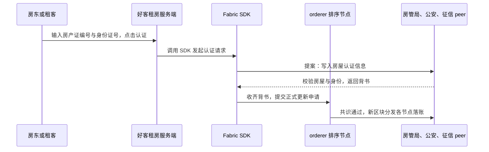

# 房源、合同、租金上链：好客租房的区块链应用设计

channel、chaincode、工作流程都铺完之后，回到项目本身还有最后一问：好客租房这个租房平台，区块链到底往哪儿放？租房是典型的传统行业，虚假房源泛滥、黑中介横行、租客和房东互相提防、交易效率低，这些老毛病一年比一年被吐槽，根子却始终是两个：信息不对称，数据可以被改。这一课不写区块链代码，做的是工程视角的设计：什么数据上链、谁来记账、怎么和现有服务集成。

## 先给结论

- 要解决的是信任问题：构建更可信赖的互联网租房系统，从根本上减少价值交换与转移中的欺诈和寻租，而不是多加一个业务功能。
- 记账靠三个政府部门节点：房管局校验房屋信息、公安局验证个人身份、征信中心验证个人信用，认证信息分布在不同节点上，每个节点都持有一份账本。
- 上链的是证据不是文件：合同图片只算摘要上链，原始图片放对象存储，取证时比对摘要就能判断合同有没有被篡改。
- 交易流水同样按 KV 设计：K 用订单号加分期，V 存交易双方、金额、是否逾期、交易类型。
- 认证请求由平台经 SDK 发起，数据通过共识后，新区块由 orderer 服务节点产生，各节点落账后全网一致。

## 一、场景分析：用户要的是互信

租房行业相对传统，大城市里几类问题长期存在：虚假房源、黑中介、租客与房东缺乏信任、交易效率低。用户的诉求很明确，构建一个更可信赖的互联网租房系统，从根本上去解决价值交换和转移中存在的欺诈与寻租现象，也就是解决人和人之间的信任问题。

落到产品语言，就是三个关键词：**信用互信**，租客和房东能查到对方可信的背景信息；**去中介**，平台替代掉中介的一部分工作；**智能合约**，合同与违约条款的执行有链上依据。这三点正好对应课程 PPT 上给出的三个图标：信用征信、房产中介、智能合约。

## 二、谁来记账：三个政府节点各管一摊

平台里有房东认证、个人认证等入口，而认证的数据源不在平台手里，在三个政府部门手里：

| 节点 | 手里有什么 | 在租房业务里用来干什么 |
|---|---|---|
| 房管局（房产局） | 房屋的产权与租赁状态 | 校验房屋信息：房子能不能租、是否房东直租、是否已抵押 |
| 公安部门 | 个人的备案情况 | 验证个人信息：是否有违法犯罪记录 |
| 征信中心 | 个人征信 | 验证个人信用：征信是否良好 |

现状是各部门各自单独管理数据，平台需要认证时才临时发起认证请求，慢、贵，而且单点结论容易被质疑。上链之后，个人认证信息、房产信息、征信信息分布在不同节点，每个节点都有账本，一处记录全网可见。合租场景的收益最直观：房东和现有租户能了解新租户的情况，新租户同样能了解已住成员和房东的信息，信息对等了，信任才有基础。

## 三、认证链路：从点击认证到新区块产生

业务流程从房东认证开始：输入房产证编号和身份证号，点击认证。平台并不自己判断真假，而是调用 SDK 向区块链发起认证请求，房管局节点就是 Fabric 里的 peer，订单的排序由 orderer 节点处理。整套链路和上一篇讲过的四步工作流程一一对应：



图里最关键的一环是「共识通过才产生新区块」：房管局管理员通过 SDK 把数据上传到区块链，经过共识之后，新的区块由 orderer 服务节点产生并分发给各节点，租客随后通过 SDK 发起查询，就能拿到房屋与房东的可信信息。课程 PPT 对这条链路给了两条说明，值得原样记住：

- 房屋认证信息发送到相关政府部门节点，通过查询区块链上的数据得到认证结果，返回内容包括两项：房产证与身份证是否匹配、房屋当前是否可以出租。为了能让测试通过，测试环境当前仅返回测试结果。
- 房管局的管理员通过 SDK 将数据上传到区块链，通过共识后，新的区块由 orderer 服务节点产生。

「仅返回测试结果」这句话意味着课程没有真实对接政府接口，认证流程做了测试桩，但链路设计与真实场景一致。

## 四、合同上链：存摘要，不存原图

合同上链的目的只有一个：防篡改。做法不是把合同原图塞进区块链，而是利用摘要算法的特点：原文改动哪怕一个字节，摘要值就完全不同，而且无法从摘要反推原文。

流程是固定的四步：租户和房东签名之后生成合同图片；对图片做摘要处理；用订单号和合同图片摘要组成键值对，存储到区块链里；合同原始图片存到独立服务器或第三方对象存储上，比如阿里云 OSS、华为云 OBS。需要取证时，把合同图片重新算一遍摘要，与链上记录比对：相同，合同没被动过；不同，数据已经被篡改。

按本课的存储方案补全一份键值对示意（示例，非课程代码）：

```json
{
  "key": "contract:HT202405180001",
  "value": {
    "orderNo": "HT202405180001",
    "contractDigest": "9f2c81ab6d3e4c7a9b1f0d8e2c5a7b39fe01a2b3c4d5e6f708a9b0c1d2e3f4a5",
    "imageStore": "oss://renting-contract/2024/05/HT202405180001.jpg",
    "signedBy": ["tenant:3201xx", "landlord:3201yy"],
    "signedAt": "2024-05-18 14:23:05"
  }
}
```

摘要计算本身很轻量，Java 里一行 `MessageDigest` 就能完成（示例）：

```java
// 对合同图片计算 SHA-256 摘要，摘要值连同订单号写入区块链（示例）
public String digest(Path contractImage) throws Exception {
    MessageDigest md = MessageDigest.getInstance("SHA-256");
    byte[] out = md.digest(Files.readAllBytes(contractImage));
    StringBuilder sb = new StringBuilder();
    for (byte b : out) {
        sb.append(String.format("%02x", b));
    }
    return sb.toString();
}
```

## 五、交易上链：把租金流水也钉进账本

支付完成之后，应用会把交易记录写入区块链账本，内容包括订单、分期、交易双方、交易金额、是否逾期、交易类型等。区块链里数据按 KV 保存：K 用订单号加分期编号，V 把双方与金额等信息整体存起来。

```json
{
  "key": "pay:HT202405180001:stage2",
  "value": {
    "orderNo": "HT202405180001",
    "stage": 2,
    "payer": "tenant:3201xx",
    "payee": "landlord:3201yy",
    "amount": "3600.00",
    "overdue": false,
    "tradeType": "RENT"
  }
}
```

合同与交易数据都上链之后，后续对合同做校验、查询交易历史，只要你是链上的一个节点，账本就在手里，数据拿得到。租客、房东、房管局这些参与方之间的互相信任问题，到这一步才算真正有了机制层面的答案。

## 常见误区

- **把合同原图整个写上链。** 链上存储昂贵且只适合小体量 KV，原图放对象存储，链上只存订单号加摘要，够取证用。
- **以为认证结论是平台自己说了算。** 平台替代的是中介的一部分工作，校验发生在房管局、公安、征信节点上，平台只是通过 SDK 发起请求、回收结果。
- **把上链当成一次数据库写入。** 数据要经共识，新区块由 orderer 产生，各节点落账后全网一致，不存在「改一张表就生效」。
- **把测试环境的认证结果当成假功能。** 那是测试桩，真实环境由房管局接口返回匹配结果与是否可出租两项内容。

## 面试可能被问到的问题

1. 面试官追问：「什么数据适合上链，什么数据不适合？」
   答：适合上链的是体量小、需要防篡改和多方互信的关键证据，如合同摘要、交易流水、认证结果。大文件和业务明细不适合，存储代价高且没有防篡改诉求，放对象存储或数据库，链上保留指纹即可。
2. 面试官追问：「合同被篡改了怎么发现？」
   答：上链时保存合同图片的哈希摘要，取证时对图片重算摘要并与链上比对。摘要算法对原文任何改动都敏感，比对不一致即可证明合同在落链后被修改过。
3. 面试官追问：「房管局节点在 Fabric 里对应什么角色？」
   答：peer。认证请求由平台经 SDK 发起提案，peer 校验并背书，orderer 负责排序，共识通过后产生新区块并分发给各 peer 落账，与 Fabric 标准的四步工作流程一致。
4. 面试官追问：「平台怎么和区块链集成？」
   答：通过 SDK。SDK 与实现语言无关，Java 服务端用 Java SDK，平台把认证、查询封装成普通接口给前端用，链的细节对业务代码透明。
5. 面试官追问：「交易记录的 K 为什么设计成订单号加分期？」
   答：一笔租金由订单和分期序号共同唯一定位，K 唯一才能防止重复写入，也便于按订单追查全部分期、按分期核对金额与逾期状态。
6. 面试官追问：「这套方案最终解决了什么问题？」
   答：租客、房东、房管局等参与方之间的互信问题。关键信息分布在各节点账本上且不可篡改，任何一方都难以单方面造假，虚假房源和黑中介的生存空间被压缩。

## 配套资料

- 本教学日无源码包：`materials/code/03/day20-了解区块链以及Hyperledger fabric/` 下仅有解压清单 `_extracted.json`，解压文件数为 0。
- 场景分析、项目分析、合同与租金管理三节的说明文字与两条官方说明抄录自本课画面线（讲义 4.1 至 4.3 节）。
- 文中合同存证、交易记录两段 JSON 与摘要计算 Java 代码均为按本课写法补全的示例，非课程代码。
- 同章节延伸：peer、orderer、channel 等术语见 `0332-Hyperledger fabric入门之简介.md`；提案、背书、排序、提交四步流程见 `0334-Hyperledger fabric入门之工作流程.md`。
