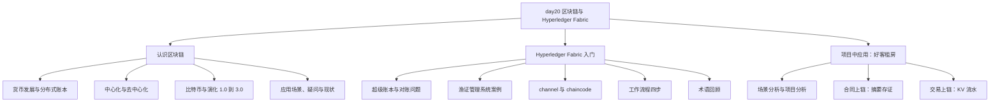

# day20 收束：一张地图复习区块链认知、Fabric 与租房项目上链

day20 是好客租房项目的最后一天，也是整门课里唯一不讲代码操作的一天：从货币发展讲到区块链，从超级账本讲到 Fabric 的工作流程，最后落回项目里的合同与租金上链。概念密度高、术语又全是新面孔，复习时最大的困难是散：十四个视频的要点摊在一周笔记里，考前想收拢没有抓手。

按「认知、框架、项目」三层把一整天压成一张地图，每层只留核心结论和最容易被追问的点。这也是阶段三的收官，复习完这一篇，好客租房项目全部结束。

## 先给结论

- 区块链的演化按三版记：1.0 是比特币，公有链；2.0 是以太坊，智能合约，仍是公有链；3.0 是 Hyperledger，私有链，面向企业。
- Hyperledger Fabric 是 IBM 牵头的超级账本项目里最出名的子项目，它不是数字货币技术，企业拿它解决互信与对账问题。
- 一笔交易四步走：提案、背书、排序、验证提交；账本的正式更新发生在最后一步，之前都是模拟执行。
- 项目落点：认证信息分布在政府节点，合同只上摘要、原图放对象存储，交易流水按 KV 上链。
- day20 是认知课，不涉及区块链的安装与 chaincode 开发实操，边界要清楚。

## 一、全章知识地图



左中右三条主线：左边回答「区块链是什么、从哪来」，中间回答「企业怎么用它」，右边回答「我们的项目怎么用」。复习时先定位自己卡在哪一层，再回到对应展开篇。

## 二、认识区块链：从货币到账本

**货币演化给出起点。** 从实物货币、金属货币、纸币到电子货币，价值载体一直在变，区块链进入视野正是从数字货币开始的：比特币是区块链的第一个大规模应用。

**两个案例撑起两个概念。** 分布式账本用「宝岛台湾记账」的例子讲清了多节点各自持有一份完整账本、彼此同步；中心化与去中心化用「斗地主记账」的例子对比了由一个中心记账和人人平等记账的差别。这两个案例是理解后面一切的地基：账本人人有，篡改就要同时改掉多数人的那份，代价极高，不可篡改由此而来。

**演化三版一张表。**

| 版本 | 代表 | 链的类型 | 关键词 |
|---|---|---|---|
| 区块链 1.0 | 比特币 | 公有链 | 数字货币 |
| 区块链 2.0 | 以太坊 | 公有链 | 智能合约 |
| 区块链 3.0 | Hyperledger | 私有链 | 企业级应用 |

应用场景、常见疑问与行业现状也都过了一遍：现状按行业热度曲线走过了萌芽期、期望期、泡沫期、复苏期、成熟期几个阶段，结论是泡沫退去后落地应用在增多，不必神化也不必唱衰。

## 三、Hyperledger Fabric：企业互信的工程答案

Fabric 由 IBM 牵头，是超级账本（Hyperledger）项目族里使用度最高、也最出名的一个，子项目众多但 Fabric 是门面。它与比特币的根本区别在于：不是数字货币技术，没有挖矿发币，定位是企业间的可信协作平台。

**它先解决了一个现实问题：对账。** 多个机构各自记账，同一笔业务两边数字对不上，核对成本极高；共享账本让所有参与方看同一份不可篡改的数据，对账问题从源头消失。

**案例是江苏省农牧厅的区块链渔证管理系统。** 目标是打击非法捕捞，渔业供应链的参与人包括渔民、政府渔政部门与消费者（餐馆）。每批渔获的关键数据上链，格式值得记一遍：

```json
{
  "location": {
    "latitude": "41.40238",
    "longitude": "22.17032"
  },
  "when": "201804161323",
  "weight": "58kg",
  "vessel": "奋进号38A"
}
```

位置、时间、重量、渔船，四个字段凑齐一份捕捞凭证，渔政监管部门据此核查捕捞行为是否合法。隐私与数据一致性则靠 channel 划分：不同业务用不同 channel 隔离数据，每个 channel 有自己的 ledger，授权内的参与方才可见。

**工作流程是全章最值得反复理解的部分。** 一笔交易四步：SDK 发起提案；channel 内的 peer 模拟执行并给出背书；SDK 收齐背书后向 orderer 提交更新申请，orderer 校验请求与签名并排序；校验通过后各 peer 真正执行更新，全网账本一致。核心结论一句话：账本不是提案时改的，是排序提交之后才改的。

**术语用一张表收口：** channel 是数据通道、chaincode 是智能合约、ledger 是账本、network 是节点组成的网络、world state 存当前值、MSP 管身份。细节见术语回顾篇的完整表格。

## 四、回到好客租房：设计先于实现

项目应用层只有三件事，全部是设计而非编码：

**第一，认证信息上链。** 房管局、公安、征信三个政府部门作为节点，房屋认证、个人认证、征信认证分布在不同节点，平台经 SDK 发起认证请求，共识后由 orderer 产生新区块。

**第二，合同摘要上链。** 合同图片做摘要，订单号加摘要组成 KV 写入区块链，原图放阿里云 OSS、华为云 OBS 一类对象存储；取证时重算摘要比对即可判断是否被篡改。

**第三，交易流水上链。** 支付完成后记录订单、分期、交易双方、金额、是否逾期、交易类型，K 用订单号加分期唯一定位。

三件事共同指向一个结果：租客、房东、房管局之间的互信问题有了机制层面的答案。课程受时长所限没有实际开发这部分，讲清楚「可以这样解决」就是目标。

## 五、这门课的边界

day20 的定位是认知课：什么是区块链、它能解决什么问题、项目里怎么设计。Fabric 的安装部署、chaincode 的编写与调用、网络搭建都没有展开。后续如果工作里真遇到区块链需求，路线是从 Fabric 官方文档与 `fabric-samples` 示例入手，先跑通 first-network，再对照工作流程四步理解每一步的产物，最后回到 chaincode 开发。概念不清时回到本章节各篇，每一篇只解决一个概念。

## 常见误区

- **把区块链等同于比特币。** 比特币只是区块链 1.0 的代表应用；Fabric 这类 3.0 框架不发行币，专注企业间互信。
- **以为联盟链人人可进。** Fabric 是授权型网络，参与方要进同一 channel 且具有相同 MSP 才能通信，数据对链外方不可见。
- **以为提案即落账。** 提案阶段只有模拟执行和背书，真正写入发生在 orderer 排序校验之后，各 peer 落账才算完成。
- **以为合同上链就是把文件存进去。** 链上存的是订单号加摘要，原图在对象存储，混淆这两者会把方案成本估错一个量级。

## 面试可能被问到的问题

1. 面试官追问：「公有链、私有链、联盟链的区别是什么？」
   答：公有链无准入门槛，任何人可参与记账，如比特币、以太坊；私有链由单一组织控制读写权限；联盟链介于两者之间，由多个授权机构共同维护，Fabric 就是典型，适合需要互信但又有隐私要求的机构间协作。
2. 面试官追问：「Fabric 为什么适合企业场景而不是比特币那套？」
   答：企业需要身份可控、数据隐私、高性能。Fabric 有 MSP 管理成员身份、channel 隔离数据，无挖矿机制共识开销小，而且支持图灵完备的智能合约，能承载复杂业务逻辑。
3. 面试官追问：「描述一笔 Fabric 交易的完整流程。」
   答：SDK 发起提案，channel 内各 peer 模拟执行产生读写集并签名背书；SDK 收齐背书后向 orderer 提交更新申请；orderer 校验请求与签名并排序，通过后通知各 peer 真正执行更新，全网账本一致。
4. 面试官追问：「区块链和分布式数据库有什么区别？」
   答：分布式数据库追求读写性能与一致性，由中心方控制，数据可改；区块链由多方共同维护，写入需共识，历史数据链式关联不可篡改，本质是多方互信基础设施而不是性能型存储。
5. 面试官追问：「你们的租房项目里区块链解决什么问题？」
   答：三方互信。房管局、公安、征信作为节点提供可信认证，合同摘要上链防篡改、支持取证，租金交易流水上链可追溯，虚假房源与合同纠纷在机制上被压缩。

## 配套资料

- 本教学日无源码包：`materials/code/03/day20-了解区块链以及Hyperledger fabric/` 下仅有解压清单 `_extracted.json`，解压文件数为 0。
- 渔获数据格式 JSON、隐私与数据一致性的 channel 划分、现状曲线阶段划分均抄录自本课画面线；合同与交易 KV 为按本课写法补全的示例。
- 分块复习入口：认识区块链见 `0323` 至 `0331` 各篇（区块链定义、货币发展、分布式账本、中心化与去中心化、比特币、演化、应用场景、疑问、现状）；Fabric 入门见 `0332` 至 `0334`（简介、chaincode、工作流程）；项目应用见 `0335-好客租房项目中应用区块链.md`。
- 阶段三至此全部结束，项目完整复习路径为 `0305` 至 `0336` 各篇。
