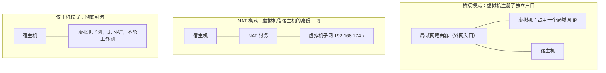

# 三台虚拟机的联网选型与资源规划：为什么是 NAT，内存怎么分

三台克隆出来的 CentOS 虚拟机要同时开机跑 Hadoop 集群，开机之前还有两个决定必须做：网络用哪种模式连、每台机器分多少内存和磁盘。选错了返工代价很高：网络模式选错，节点之间互相看不见；内存分太满，宿主机先卡死，三台虚拟机一起遭殃。

## 先给结论

- 虚拟机联网有三种模式：桥接、NAT、仅主机。本课选 NAT：虚拟机组自己的私有子网，上网借宿主机的 NAT 服务转发，不占用局域网的独立 IP。
- 内存分配公式：每台虚拟机内存 =（宿主机总内存 - 预留给宿主系统的 2～4GB）÷ 3；16GB 总内存每台分 4GB，8GB 总内存每台只剩 2GB。
- 磁盘每台 40GB 一般够用，不够可以后期扩容；三台合计预留 100GB 空闲空间。
- 集群规划以 node01、node02、node03 为基准：node01 是主节点，承担 NameNode、ResourceManager 与 Zookeeper；node02、node03 承担 DataNode、NodeManager 与 Zookeeper。
- 这一步做完，下一步才是进系统改 IP 和 MAC 地址，避免三台克隆机在网络里「撞身份」。

## 一、三种网络模式差在哪

VMware 的虚拟机设置里，「网络适配器」右侧给出三种联网方式：桥接、NAT、仅主机，默认停在 NAT。三种模式的差别用一张图看清楚：



**第一，桥接模式是「注册了户口」。** 虚拟机直接挂到局域网的路由器上，拿到一个与宿主机平级的独立 IP，在外界看来它就是多出来的一台真电脑，独自连外网毫无障碍。代价是每台虚拟机都要消耗一个局域网地址，路由器地址池不够用的环境里，一口气开三台就捉襟见肘。

**第二，NAT 模式是「黑户借宿主机的身份」。** 虚拟机组一个私有子网，收发外网数据都必须经过宿主机上的 NAT 服务做地址转换，外网看到的永远只有宿主机一台机器，虚拟机对外不可见。本课三台虚拟机就走这条路，网段 192.168.174.0，网关 192.168.174.1。

**第三，仅主机模式是「彻底与外界断联」。** 虚拟机之间组成一个封闭子网，比 NAT 更进一步的是连 NAT 服务都没有，只能内部互访，完全没有上外网的能力。装个软件都得靠离线包，学习环境用它会把自己逼进死胡同。

选 NAT 的理由由此而来：三台机器同时在线却不占局域网地址，节点互通靠私有子网，下载软件借宿主机转发，是学习集群的最优解。

## 二、内存与磁盘怎么分

虚拟机又占磁盘又吃内存。磁盘按每台 40GB 分配，日常学习足够，真不够时 VMware 支持后期扩容；开工前保证有 100GB 空闲空间给三台机器和系统预留。

内存才是更容易翻车的地方。三台虚拟机要同时运行，总占用是每台乘三，分配前先给宿主机留够底子。讲义公式：每台虚拟机内存 =（总内存 - 4GB）÷ 3，减掉的部分留给宿主的 Windows 系统，嫌减 4 太多也可以减 2。代入两个常见配置：

| 宿主机总内存 | 计算 | 每台虚拟机 |
|---|---|---|
| 16GB | (16 - 4) ÷ 3 | 4GB，设置里填 4096 |
| 8GB | (8 - 2) ÷ 3 | 2GB，设置里填 2048 |

VMware 内存设置默认 2GB，8GB 总内存的机器维持默认即可；16GB 的机器逐台改成 4096。后面装的软件越来越多，Hadoop 加 Zookeeper 全部启动后余量会很小，能分 4GB 就不要省。

## 三、集群规划：后面所有配置的基准

资源定了，接下来把三台机器的身份和角色也定下来。课程给出的集群规划表是后续每一篇配置的对表基准：

| IP | 主机名 | 环境配置 | 安装 |
|---|---|---|---|
| 192.168.174.100 | node01 | 关防火墙和 SELinux、host 映射、时钟同步 | JDK、NameNode、ResourceManager、Zookeeper |
| 192.168.174.120 | node02 | 同左 | JDK、DataNode、NodeManager、Zookeeper |
| 192.168.174.130 | node03 | 同左 | JDK、DataNode、NodeManager、Zookeeper |

管理角色集中在 node01：HDFS 的 NameNode 管元数据，YARN 的 ResourceManager 管资源调度，Zookeeper 也从这里起步；node02、node03 承担 DataNode 与 NodeManager，负责存数据和跑任务。环境配置一列的三件事（关防火墙和 SELinux、host 映射、时钟同步）在后面几篇逐项落实。

规划表贴在手边，下一件事就是进系统把 IP 和 MAC 地址改对，本课画面里已经给出了入口命令，具体改法由下一篇展开：

```bash
# 克隆机网络改造的第一步：MAC 地址与网卡名规则文件
vim /etc/udev/rules.d/70-persistent-net.rules
```

## 常见误区

- **把桥接模式当默认选项。** 桥接下每台虚拟机占一个局域网独立 IP，地址池不足或有网络准入限制时三台机器可能上不了网；学习集群用 NAT 自成子网更稳。
- **内存维持默认 2GB 不动。** 默认值只够虚拟机开机，Hadoop 与 Zookeeper 起来后明显吃紧；按公式分完内存再开始装软件。
- **把宿主机内存全分出去。** 宿主系统自己还要 2～4GB，分光之后宿主机卡死，所有虚拟机跟着卡死。
- **担心磁盘不够一开始就划很大。** 40GB 是合理起点，VMware 支持关机扩容，后期横向加就行，不必一次占满物理磁盘。

## 面试可能被问到的问题

1. 面试官追问：「桥接和 NAT 模式的本质区别是什么？」
   答：桥接把虚拟机直接接入物理局域网，拥有与宿主机平级的独立 IP，对外等于多出一台真机器；NAT 让虚拟机组私有子网，出外网必须经宿主机的 NAT 服务做地址转换，对外始终只有宿主机一个身份。前者消耗局域网 IP，后者不消耗。
2. 面试官追问：「搭 Hadoop 学习集群为什么选 NAT？」
   答：三台虚拟机要同时在线互相通信，NAT 的私有子网正好满足节点互通；同时不占用局域网地址，家庭或办公网络 IP 有限也不受影响；需要下载软件时借宿主机转发即可上网。
3. 面试官追问：「8GB 内存的电脑能跑三节点 Hadoop 集群吗？」
   答：能跑但很紧。按公式 8 减 2 再除以 3，每台约 2GB，Hadoop 与 Zookeeper 全部启动后余量很小。实践上可以精简每台机器上启动的进程数量，或者升级内存后再搭标准环境。
4. 面试官追问：「集群规划里管理角色为什么都放在 node01？」
   答：学习环境为了省资源，把 NameNode、ResourceManager 这类常驻内存的管理进程集中在一台机器，其余机器专心做数据节点和计算节点。生产环境会把管理角色分散部署并做高可用，避免单点故障。
5. 面试官追问：「虚拟机磁盘一开始分小了怎么办？」
   答：VMware 支持关机状态下扩展虚拟磁盘，进系统后再扩分区。初始 40GB 是合理起点，空间不足再扩，不必一次占满物理磁盘。

## 配套资料

- 本教学日无配套源码包（`materials/code/04/` 下无 day01 目录）；三种网络模式图示、内存公式与集群规划表抄录自本课画面线 PPT。
- 目录与命名印证：`materials/code/04/day02-HDFS/day02/讲义/Note02.md`，后续讲义中 Hadoop 3.1.1 安装于 `/export/servers`、集群按 node01 等主机名组织，与本课规划一致。
