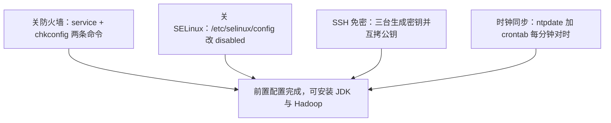
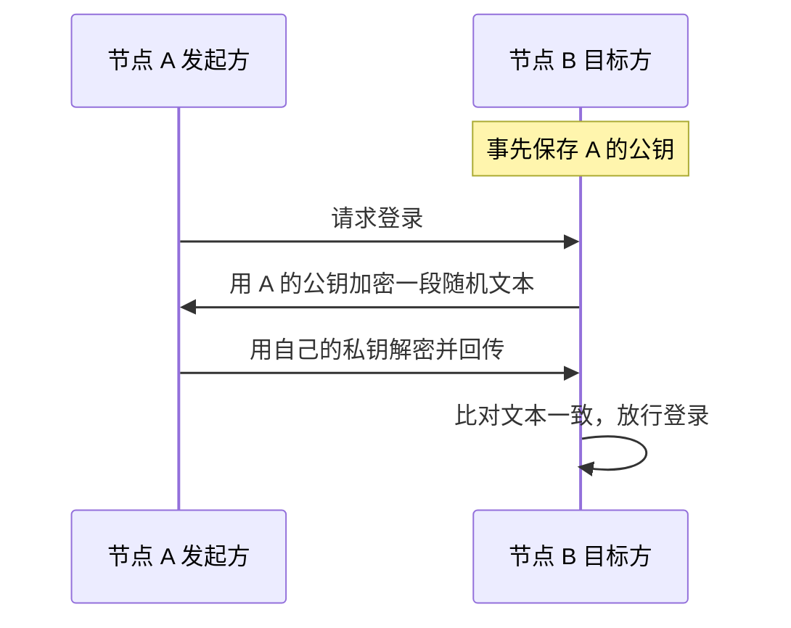

# 集群操作基本功：Linux 命令增强、shell 脚本与三台机器前置配置

Hadoop 集群的一切操作都发生在 Linux 命令行上，而且要在三台机器之间来回切换。这一课把地基打齐：常用命令增强（查找、权限、用户、服务）、shell 脚本语法（变量、运算、流程、函数），再用一个 xcall 脚本把同一条命令扇出到三台机器，随后完成集群上线前的四件前置配置：关防火墙、关 SELinux、SSH 免密、时钟同步。这些内容看着琐碎，缺任何一件，后面启动 Hadoop 时都会以更隐蔽的方式还回来。

## 先给结论

- 查文件内容用 grep，查文件本身用 find，追求速度用 locate（查预建数据库，新建文件要先 updatedb 刷新）。
- 权限三段 rwx 对应数值 421，`chmod` 改权限、`chown` 改属主；`service` 管服务的启停与状态，`chkconfig` 管开机自启。
- shell 要点：变量拼接必须写 `${str}`；赋值等号两边不能有空格，运算符两边必须有空格；`if` 的中括号两边留空格；函数返回值经 `$?` 读取且只有 0～255。
- 集群前置四件事：`service iptables stop` 加 `chkconfig iptables off` 关防火墙；`/etc/selinux/config` 改 `SELINUX=disabled`；三台 `ssh-keygen -t rsa` 后互拷公钥实现两两免密；`ntpdate` 加 crontab 每分钟对时 NTP 服务器。
- 三台的 `/etc/hosts` 内容必须一致，这是免密登录能按主机名执行的前提。

## 一、远程终端与查找命令增强

学习阶段用远程终端工具（SecureCRT）连虚拟机，比在虚拟机窗口里敲命令舒服得多：快速连接里填 IP 与 root 账号即可登录，外观里调大字号，终端仿真选 Linux 让文件列表带颜色，字符编码选 UTF-8 避免中文乱码。连上之后先补查找类命令。

**grep 搜文本内容。** 配合管道过滤进程最常用：

```bash
ps -ef | grep sshd        # 查找 ssh 服务进程
ps -ef | grep -v grep     # 排除 grep 命令自身
grep -n 'hello' a.txt     # 在文件中查关键词并显示行号
```

管道把前一个命令的输出交给后一个命令当输入；`grep sshd` 的结果里会混进 grep 自己这条命令，`-v` 参数就是把它排除掉。

**find 搜文件本身。** 按名字、权限、大小沿目录树扫描：

```bash
find . -name "*.log" -ls      # 当前目录找 .log 结尾的文件并列出详情
find /root/ -perm 777 -ls     # /root 下找权限为 777 的文件
find . -size +100M            # 当前目录找大于 100M 的文件
```

find 是逐目录的全文检索，目录一大就慢。

**locate 查数据库。** 系统把全部文件名与路径预存进数据库，查找只查库，速度远快于 find。最小化安装的系统要先装包：

```bash
yum -y install mlocate     # 提供 locate 与 updatedb
updatedb                   # 手动刷新数据库，新建文件刷新后才能查到
locate /etc/sh             # 秒出 /etc/shadow、/etc/shells 等结果
locate pwd                 # 查找与 pwd 相关的所有文件
```

数据库文件在 `/var/lib` 下的 locatedb（mlocate 系列），系统每天自动更新一次，所以查最新变动的文件先跑一遍 `updatedb`。

**用户管理。** `useradd hadoop` 创建普通用户，同时在 `/home` 下生成同名目录；`passwd hadoop` 给它设密码，设完即可用该用户登录。`su` 切换到 root 只换身份不换环境，家目录还留在原处；`su -` 是彻底切换，家目录与环境变量一起换过去；`exit` 退回原用户。普通用户切 root 要输密码，root 切普通用户免密，方向不同待遇不同。

## 二、权限与服务：马上要用的两板斧

`ll` 输出的第一列从左到右是文件类型加三组权限：d 开头是目录，`-` 开头是普通文件，还有软链接、套接字等类型；三组依次是所有者 u、所属组 g、其他用户 o 的读写执行位。r、w、x 的数值是 4、2、1，`rwxr-xr-x` 折算就是 755。改权限与属主：

```bash
chmod 777 a.txt               # 给所有人全部权限
chmod u-x a.txt               # 撤销所有者的执行权限
chmod g-rwx a.txt             # 清空所属组的全部权限
chmod g+x a.txt               # 给所属组加回执行权限
chown -R hadoop:hadoop a.txt  # 递归修改属主与属组为 hadoop
```

服务控制的两条命令马上要在集群配置里用上：`service iptables status` 查看防火墙状态，`stop` 临时关闭，`service sshd start|stop|restart` 同理；`chkconfig iptables on|off` 配置开机自启或永久不自启。临时关一次加开机禁用，才是真正关干净。

## 三、shell 脚本：从 hello 到函数

自动化部署、批量启停集群都靠 shell 脚本。一个最小脚本长这样：

```bash
#!/bin/bash          # 固定写法：指定 /bin/bash 作为解析器
echo "Hello World !"
```

两种执行方式：`sh hello.sh` 直接跑；或者 `chmod +x hello.sh` 加执行权限后 `./hello.sh` 执行，`./` 表示当前目录下的这个文件，换成绝对路径一样能跑。

**变量。** 赋值等号两边不能有空格；取值用 `$str`，一旦变量名后面要紧跟其他字符，必须加大括号划清边界：

```bash
#!/bin/bash
str="hello"
echo ${str}world    # 输出 helloworld；写成 $strworld 会被当成一个不存在的变量名
```

环境变量用 `env` 查看，自定义环境变量在 `/etc/profile` 里用 `export MYENV=/root/lib/demo` 声明，保存后 `source /etc/profile` 立即生效。脚本参数与状态符号记住四个：`$1` 是第一个参数，`$#` 是参数个数，`$*` 是参数列表字符串，`$?` 是上一条命令的退出状态或函数返回值。

**运算符。** 求两数之和有三种写法，空格规则是考点：

```bash
#!/bin/bash
a=1
b=2
echo `expr $a + $b`    # 反引号包 expr，加号两边必须留空格
echo $(($a+$b))        # 双小括号，空格随意
echo $((a+b))          # 括号内直接写变量名，同上
```

赋值等号两边不能有空格，运算符两边必须留空格，两条规则正好相反。用 expr 做乘法时乘号要转义成 `\*`，否则直接报 syntax error。

**流程控制。** if 的中括号两边必须留空格，判断用 `=` 且两边同样留空格，结束用反写的 fi；for 有列表式与 C 风格两种：

```bash
#!/bin/bash
read -p "please input your name:" NAME   # 从键盘读入并存到 NAME
if [ $NAME = root ]
then
    echo "hello $NAME, welcome !"
elif [ $NAME = hadoop ]
then
    echo "hello $NAME, welcome !"
else
    echo "Get out Please!"
fi

for i in 1 2 3            # 列表式：列表有几个元素就循环几次
do
    echo $i
done

for ((i=0; i<=5; i++))    # C 风格：与 Java 的 for 几乎一样
do
    echo "welcome $i times"
done
```

**函数。** 函数名直接定义、直接调用，连括号都不用，返回值用 `$?` 接住：

```bash
#!/bin/bash
funWithReturn(){
    echo "这个函数会对输入的两个数字进行相加运算..."
    read aNum
    echo "输入第二个数字："
    read anotherNum
    echo "两个数字分别为 $aNum 和 $anotherNum !"
    return $(($aNum+$anotherNum))
}
funWithReturn
echo "输入的两个数字之和为 $?"
```

`$?` 只有一个字节的空间，返回值限定 0～255：输入 10 和 20 得 30 正常，输入 100 和 200 求和 300，溢出回绕后显示 44。要传大数值就用 echo 输出、命令替换捕获，别依赖 return。

## 四、把命令扇到三台机器：xcall 脚本

课程演示里用远程终端的「交互窗口：将命令发送到所有标签」功能，一次输入三台同时执行。这套动作也可以用刚学的语法固化成脚本，免去每次手动发送（xcall 为按本课写法补全的示例，day01 无源码包）：

```bash
#!/bin/bash
# 用法：xcall <命令>   在 node01、node02、node03 上各执行一遍
for host in node01 node02 node03
do
    echo "========== $host =========="
    ssh $host "$*"
done
```

`$*` 把收到的整条命令原样转交，`ssh $host "命令"` 在远端执行。前提是三台之间已经免密，否则每台都会卡在密码输入；加执行权限后，`xcall java -version` 一条命令就能核对三台的 JDK 版本。装 Hadoop 阶段这类脚本每天都要用。

## 五、三台机器的集群前置配置

四件前置配置在操作上彼此独立，建议一次做完；免密配好后，上一节的 xcall 脚本立刻可用。整体结构与依赖如下：



**第一，三台关防火墙。** 学习环境图省事直接关；生产环境防火墙保持开启，改成对指定端口放行：

```bash
service iptables stop      # 临时关闭
chkconfig iptables off     # 禁止开机自启，两条命令三台都要执行
```

**第二，三台关 SELinux。** SELinux 是 Linux 的安全子系统，在文件权限之外再给访问文件的进程加一层约束，配置繁琐，学习阶段关闭。它有三种模式：enforcing 强制执行，permissive 只记警告日志不拦截，disabled 彻底关闭。编辑 `/etc/selinux/config`，注释掉默认的 `SELINUX=enforcing` 一行，改为：

```bash
SELINUX=disabled    # 重启后生效
```

**第三，三台 SSH 免密。** 集群主节点要频繁登录各节点启停进程，每次输密码就没法自动化。免密基于公钥私钥：目标节点保存发起方的公钥，握手时发起方用私钥作答，验证通过即放行，全程不传密码。三步操作：

```bash
# 第一步：三台机器各自生成密钥对，一路回车
ssh-keygen -t rsa

# 第二步：三台都把公钥交给 node01（含 node01 自己），node01 的 authorized_keys 收齐三把公钥
ssh-copy-id node01

# 第三步：在 node01 上把收齐的授权表分发到另两台
scp /root/.ssh/authorized_keys node02:/root/.ssh
scp /root/.ssh/authorized_keys node03:/root/.ssh
```

密钥对生成在 `/root/.ssh` 下：`id_rsa` 是私钥，`id_rsa.pub` 是公钥；`ssh-copy-id` 把公钥追加进对方的 `/root/.ssh/authorized_keys`。第三步把收齐三把公钥的授权表整体分发，最终三台两两互信。验证：任意节点 `ssh node02` 免密进入、`exit` 退出，逐对试通即可。



关键在「B 用 A 的公钥加密、A 用私钥解密」这一环：公钥可以公开分发，私钥永不离开本机，网络上看不到任何密码，这就是免密的信任根基。

**第四，三台时钟同步。** 分布式系统是有状态的，同一个操作 A 节点记的时间是 1、B 节点记的是 2，一致性判断就会出问题。两种方案：所有主机对网络时间对时（前提是都能联网），或所有主机以集群内某一台为准对时。课程采用前者，以阿里云 NTP 服务器为时间源：

```bash
yum install -y ntp         # 三台都要安装
ntpdate ntp4.aliyun.com    # 手动对时一次

crontab -e                 # 编辑定时任务，写入下面一行
*/1 * * * * /usr/sbin/ntpdate ntp4.aliyun.com

crontab -l                 # 查看定时任务是否已登记
```

crontab 一行五个时间字段，依次是分、时、日、月、周；`*/1` 放在分位表示每分钟执行一次，即每分钟向 NTP 服务器对时，三台机器时间始终保持一致。保存退出定时任务即已生效，用 `crontab -l` 复核。

## 常见误区

- **`su` 与 `su -` 混用。** 直接 `su` 切到 root 后，家目录和环境变量还是上一个用户的，装软件时 PATH 里少了该有的路径就报命令找不到；要彻底切换用 `su -`。
- **chmod 数字心算出错。** rwx 对应 421，`rw-r--r--` 是 644 不是 666；数字 7 才代表全部权限，别看见 777 就以为是读写执行之外的什么组合。
- **免密只做单向。** 只在 node01 上把公钥拷给另两台，结果是主到从免密、从到主仍要密码；scp 分发与互为备份都需要双向互通，按三步走完才是两两免密。
- **crontab 少写一个时间字段。** 字段一共五个，分、时、日、月、周，写四个任务不会按预期执行；改完用 `crontab -l` 确认登记成功。

## 面试可能被问到的问题

1. 面试官追问：「grep、find、locate 三者的适用场景与原理差异？」
   答：grep 在文本或命令输出里按模式匹配内容，常与管道组合过滤进程和日志；find 沿目录树逐节点按名字、权限、大小等条件检索文件，准确但慢；locate 把全系统文件名预建成数据库，查库所以快，代价是新建文件要 updatedb 刷新后才能查到。
2. 面试官追问：「SSH 免密登录的完整握手过程？」
   答：发起方生成 RSA 密钥对，公钥提前放入目标节点的 authorized_keys。登录时目标节点用该公钥加密一段随机文本发回，发起方用私钥解密并回传，比对一致即放行。私钥始终不出本机，整个网络传输里没有密码出现。
3. 面试官追问：「为什么学习环境直接关 SELinux，生产怎么做？」
   答：SELinux 在传统文件权限之上再对进程做强制访问控制，规则配置复杂，学习与多数内网部署场景选择 disabled 简化排查。生产高安全环境通常先 permissive 观察日志，再按需定制策略，而不是一刀切关闭。
4. 面试官追问：「分布式集群为什么必须时钟同步？」
   答：分布式系统是有状态的，时间戳参与版本判断、日志排序、租约与超时控制。节点间时间漂移会让不同节点对同一事件的先后给出不一致结论，进而破坏一致性协议与故障判断，所以集群上线前先统一时钟源。
5. 面试官追问：「chmod 755 和 644 分别用在什么场景？」
   答：755 是所有者可写、组和其他用户可读可执行，适合目录与需要执行的脚本；644 是所有者可读写、其他人只读，适合普通数据文件。原则是最小权限，避免图省事直接 777。
6. 面试官追问：「shell 函数里 100 加 200 为什么返回 44？」
   答：return 的值存放在一个字节里，范围 0～255，300 溢出后按 256 取模得到 44。需要大数值结果时通过 echo 输出再用命令替换捕获，不依赖 return。

## 配套资料

- 讲义（Hadoop 3.1.1 环境与 node01 命名印证）：`materials/code/04/day02-HDFS/day02/讲义/Note02.md`。
- shell 与 profile 配置写法实例：`materials/code/04/day02-HDFS/day02/资料/test.sh`。
- day01 无源码包；xcall 脚本、if 示例中的用户名（原屏示例中的机构用户名已替换为中性名）均为按本课写法补全的可运行示例。
