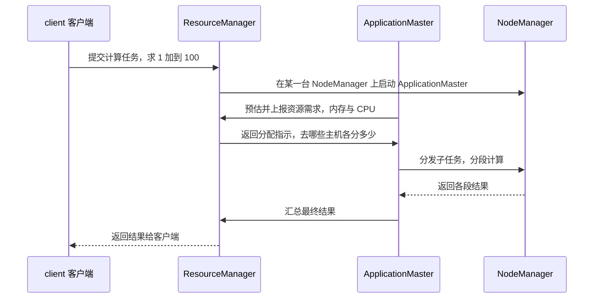

# 从 Nutch 到 Hadoop 3：一次看清 Hadoop 架构演进的全貌

环境与 ZooKeeper 都就绪了，Hadoop 本体安装之前，值得先把架构地图看懂：Hadoop 怎么来的、1.x 为什么被淘汰、2.x 引入 YARN 解决了什么、3.x 改了哪些地方。地图立住了，后面 day02 讲 NameNode、DataNode 时，每个组件都有位置可放。

## 先给结论

- Hadoop 起源于 Nutch 搜索引擎项目，受 Google 的 GFS 与 MapReduce 两篇论文启发而生，2008 年成为 Apache 顶级项目。
- 狭义的 Hadoop 只有两个核心：HDFS 负责分布式存储，MapReduce 负责分布式计算；广义的 Hadoop 指整个生态圈。
- 1.x 架构是两对主从：HDFS 侧 NameNode、SecondaryNameNode、DataNode，计算侧 JobTracker、TaskTracker；NameNode 单点与 JobTracker 身兼二职是它的两大死穴。
- 2.x 引入 YARN：ResourceManager 统一调度资源，ApplicationMaster 管理单个任务，计算框架与资源调度解耦；NameNode 高可用需要 JournalNode 与 ZooKeeper、ZKFC 配合。
- 3.x 与 2.x 架构一致，NameNode 高可用允许配置多个 standby 节点，本课程使用 hadoop-3.1.1。

## 一、出身：一个搜索引擎、两篇论文

Hadoop 的前身是开源搜索引擎项目 Nutch。抓取数十亿规模的网页后，它撞上两个瓶颈：网页怎么存储，抓下来之后怎么分析计算，单机方案在数据量面前毫无还手之力。

2003 年与 2004 年，Google 相继发表 GFS 与 MapReduce 两篇论文：GFS 描述谷歌内部的分布式文件系统，把海量数据拆开存储，解决海量网页的存储问题；MapReduce 描述分布式计算框架，解决海量网页的计算问题。Nutch 依照这两篇论文开发出 HDFS 与 MapReduce，随后 Hadoop 从 Nutch 独立出来，2008 年成为 Apache 顶级项目。

发行版本有三个来源：Apache 官方版完全开源免费，可下载源码甚至提交修改，课程用的就是它；Hortonworks 由雅虎主导，免费开源，界面成熟；Cloudera 产品稳定但服务收费，两家公司后来合并。版本上 1.x 已淘汰，2.x 仍有企业在用，3.x 是当前主线，课程基于 3.1.1。

**狭义与广义要分开说。** 狭义的 Hadoop 是一个软件，只有两个核心：HDFS 是分布式文件系统，解决存储；MapReduce 是分布式计算系统，解决计算。广义的 Hadoop 是一个生态圈，围绕这两件事长出了 ZooKeeper、HBase、Hive、Spark、Flink、Kafka、Storm、Flume、Sqoop、Hue、Oozie、Impala 等一圈框架，各自补一块能力，后面会陆续遇到。

## 二、1.x：两对主从，两个单点

早期架构里，存储与计算各自带了一套主从结构：

**HDFS 的核心思想是把大文件拆成小文件分存到不同节点。** NameNode 是主节点，管理文件系统的元数据：文件叫 a.txt、有多大、权限是什么、被切成哪些块、每块存在哪台机器上。文件内容本身不经过 NameNode，真实数据全部落在 DataNode 上，由 NameNode 统一管理；客户端拿到元数据才知道去哪读文件，所以 NameNode 一旦挂掉，整个集群的数据就找不着了，这是分布式文件系统最大的软肋。SecondaryNameNode 负责辅助管理，帮 NameNode 分担元数据合并的负担，它不是备份节点，这一点在 day02 展开。

**计算侧是 JobTracker 与 TaskTracker 一对主从。** JobTracker 负责计算任务的分配与调度，TaskTracker 分别执行分配到的任务。问题在于 JobTracker 既管资源分配又管任务监控，负载过重，而且同样是单点。1.x 已基本不用，记个印象即可，但两个病根值得记住，2.x 的改造正是冲着它们去的。

## 三、2.x：YARN 把资源调度从计算里拆出来

2.x 对计算做了大手术：资源管理独立成一个新集群，主节点叫 ResourceManager，从节点叫 NodeManager，这套集群统称 YARN。用一个任务走一遍流程，客户端提交一个任务，要求算 1 加 2 一直加到 100 的和：

图里的分工要点是：ResourceManager 只负责接收请求、给整个任务派一个 ApplicationMaster 管家；ApplicationMaster 预估任务要多少内存与 CPU，拿着分配指示去找各个 NodeManager 分活干，三台机器分别算 1 加到 30、31 加到 60、61 加到 100，算完由它汇总返回客户端。资源调度归 YARN，具体计算归框架，MapReduce 从此只是跑在 YARN 上的一种框架，Spark、Flink 都能同样接入。

**单点问题在 2.x 里有两种解法，按可用性等级排列：**

| 形态 | HDFS | YARN | 额外组件 |
|---|---|---|---|
| 单点 | 单 NameNode | 单 ResourceManager | 无 |
| 仅计算高可用 | 单 NameNode | ResourceManager 主备 | ZooKeeper、ZKFC |
| 仅存储高可用 | NameNode 一主一备 | 单 ResourceManager | JournalNode、ZooKeeper、ZKFC |
| 双高可用 | NameNode 一主一备 | ResourceManager 主备 | JournalNode、ZooKeeper、ZKFC |

仅做计算高可用时，ZooKeeper 与 ZKFC 配合监控 ResourceManager，主节点一倒，备份立刻顶上。做 NameNode 高可用时多两个角色：两个 NameNode 一个 active 对外服务，一个 standby 做备份；JournalNode 负责两者间的元数据同步，保证 standby 与 active 时刻一致，否则切换后必然丢数据；ZooKeeper 与 ZKFC 继续承担监控与自动切换。前几篇的 watch 机制与临时节点，在这里从原理变成了工程实践。

## 四、3.x：稳中演进

3.x 的架构与 2.x 一致，没有推翻重来，变化集中在 NameNode 高可用的规模上：2.x 只能一个 active 配一个 standby，3.x 允许同时存在多个 standby，主节点出问题时备份更多。配合 Federation 联邦架构，多个 NameNode 各管一段命名空间，共同扩容整个文件系统，HDFS 能支撑的集群规模进一步放开。

3.x 还引入纠删码，用更低的冗余成本替代三副本，适合冷数据归档。课程环境选 hadoop-3.1.1，安装与配置在下一篇展开。至此 day01 的概念地图收束完毕：Hadoop 从哪来、新旧架构差在哪、ZooKeeper 在其中的位置，全部就位。

## 常见误区

- **把 SecondaryNameNode 当成 NameNode 的热备。** 它只做元数据合并辅助，NameNode 宕机时不能接替对外服务；真正的热备是处于 standby 状态的 NameNode。
- **把元数据当文件内容。** NameNode 只存文件大小、权限、块位置这类描述信息，真实数据都在 DataNode 的磁盘上，读写数据流不经过它，否则 NameNode 会成为集群瓶颈。
- **用 1.x 的术语回答 2.x 的问题。** JobTracker 与 TaskTracker 已被 ResourceManager、NodeManager 与 ApplicationMaster 取代，面试还按旧架构作答会直接暴露知识停留在旧版本。
- **忽略 DataNode 的上报机制。** DataNode 周期性向 NameNode 发心跳与块状态报告，前者证明存活，后者说明本机存了哪些块；NameNode 靠这两样掌握全局副本情况。

## 面试可能被问到的问题

1. 面试官追问：「Hadoop 的狭义和广义分别指什么？」
   答：狭义的 Hadoop 是一个软件框架，只包含 HDFS 与 MapReduce，一个管存储一个管计算；广义指整个生态圈，包括 ZooKeeper、HBase、Hive、Spark、Flink、Kafka 等围绕存储与计算发展出来的框架。
2. 面试官追问：「Hadoop 1.x 有哪两个致命单点？」
   答：一个是 HDFS 的 NameNode，元数据只在它手里，挂掉则数据找不着；另一个是 JobTracker，既管资源调度又管任务监控，负载过重且不可替换。2.x 用 YARN 解决计算侧，用 NameNode 高可用解决存储侧。
3. 面试官追问：「说说 YARN 上提交一个任务的完整流程。」
   答：客户端向 ResourceManager 提交任务；RM 在某个 NodeManager 上启动该任务的 ApplicationMaster；AM 预估所需内存与 CPU 并上报，RM 返回分配指示；AM 到各 NodeManager 分发子任务并收集结果，汇总后经 RM 返回客户端。
4. 面试官追问：「NameNode 高可用为什么需要 JournalNode？」
   答：active 与 standby 两个 NameNode 的元数据必须时刻一致，切换后才不会丢数据。JournalNode 集群负责元数据在两者之间的同步，active 的每笔修改都写入 JournalNode，standby 从中读取保持对齐。
5. 面试官追问：「ZooKeeper 和 ZKFC 在 Hadoop 高可用里做什么？」
   答：ZKFC 是部署在 NameNode 所在节点的监控进程，利用 ZooKeeper 的 watch 机制与临时节点探测 active 节点是否存活；active 宕机后临时节点消失，watch 触发通知，ZKFC 执行主备切换，让 standby 升级为 active，全程自动完成。
6. 面试官追问：「Hadoop 3.x 相对 2.x 有什么变化？」
   答：架构上两者一致，3.x 的主要改动是 NameNode 高可用支持配置多个 standby，不再局限于一主一备；同时引入纠删码等存储新特性，降低副本带来的存储成本。

## 配套资料

- 讲义：`materials/code/04/day02-HDFS/day02/讲义/Note02.md`，其中 1.3 节 HDFS 的架构给出 NameNode 与 DataNode 的职责对照表，1.5 节 SecondaryNameNode 与 fsimage、edits 的合并机制，与这一课的 2.x HDFS 部分直接对应。
- day01 无源码包；YARN 提交流程与高可用形态整理为按本课画面线（PPT 架构图与讲解）补全的整理，命令与组件名均以 Apache Hadoop 官方文档为准。
