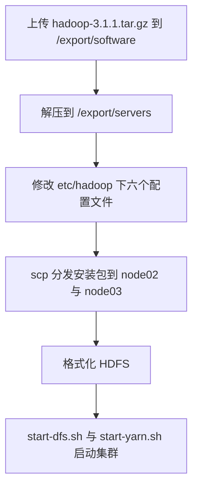
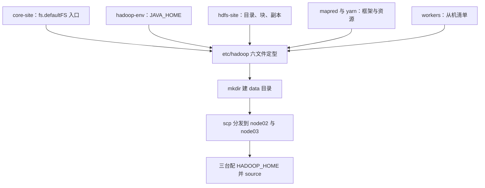
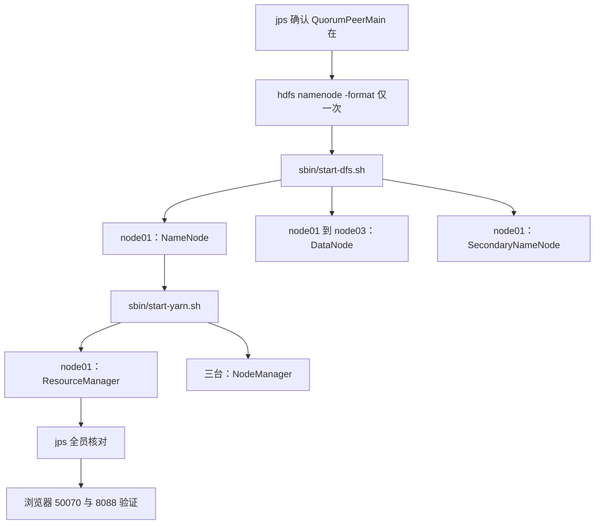

# Hadoop 的安装三部曲：准备工作、六个配置文件与集群启动

## 先给结论

- Hadoop 安装分五步：上传并解压、修改配置文件、分发安装包、格式化 HDFS、启动集群；目录约定与 JDK 一致，压缩包进 `/export/software`，解压到 `/export/servers`。
- 解压完先认门牌：`bin` 放客户端命令，`sbin` 放集群启停脚本，`etc/hadoop` 放全部配置文件，`share` 放依赖与文档。
- 待改配置共六个：`core-site.xml` 定 `fs.defaultFS` 集群大门牌，`hadoop-env.sh` 显式补 `JAVA_HOME`，`hdfs-site.xml` 管目录、128M 块、3 副本与 50070 端口，`mapred-site.xml` 指定 yarn，`yarn-site.xml` 关虚拟内存检查，`workers` 写三台主机名。
- 长 XML 建议用 Notepad++ 的 NppFTP 插件远程编辑，`Ctrl+S` 即回传保存，比在虚拟机里用 vi 手敲稳妥。
- 改完先建 data 目录再 scp 分发安装包，三台各自配环境变量。
- 格式化只能执行一次：`hdfs namenode -format` 创建存放元数据（fsimage 与 edits）的目录，重复格式化会生成新 clusterID，DataNode 对不上号起不来。
- Hadoop 3 用 root 启动必须在 `hadoop-env.sh` 声明五个 `*_USER` 变量；`start-dfs.sh` 与 `start-yarn.sh` 两连启动，jps 逐个对号：node01 五个进程，node02、node03 各两个。
- Web 验证两条路：`node01:50070` 看 HDFS、`node01:8088` 看 YARN；Windows 侧配好 hosts 映射才能用主机名打开。

## 第1部分：Hadoop 装机第一步：上传解压、认清目录、备齐六个待改配置

rz 上传完 300 多 MB 的 tar 包，解压完盯着 bin、sbin、etc、share 一堆目录不知从哪下手，是装 Hadoop 时最常见的卡点。Hadoop 的安装不是解压了事，它是一套顺序固定的五步工程，配置文件散在 etc/hadoop 下面共六个，改的时候还有趁手的远程编辑工具可选。这一课把第一步走完，同时把后面四步的路线图立起来。

### 一、五步路线与第一步的命令

整个安装的顺序是固定的，前一步的产物是后一步的输入：



图里从修改配置开始的三步都以 node01 为源头：配置在 node01 上改，改完整包分发出去，其余节点拿到的是同一份内容。安装包可从 Apache 官网下载，课程使用 3.1.1 版本。上传与解压就三条命令（day01 无源码包，命令出自本课画面线的讲义截图）：

```bash
cd /export/software
rz                                        # 选择本地 hadoop-3.1.1.tar.gz 上传
tar zxvf hadoop-3.1.1.tar.gz -C ../servers
```

`-C` 指定解压目的地，`../servers` 相对当前目录就是 `/export/servers`，写成绝对路径等价。JDK 安装时踩过的坑在这里同样适用：漏了 `-C`，包会散在当前目录；目录约定一乱，后面所有引用路径都要跟着返工。

版本搭配与上一篇装 JDK 的结论一致：JDK 8 加 Hadoop 3.1.1 是课程验证过的稳定组合，Hadoop 大版本一换，配置项与启动行为都可能出现差异，学习环境跟课程版本走最省事。压缩包也可以先在 Windows 侧下载好，再用 `rz` 拖进虚拟机，比在 Linux 里直接下载直观，网速只取决于虚拟网络。

### 二、解压完先认门牌

进入解压目录看一眼，Hadoop 的家当一目了然：

```bash
cd /export/servers/hadoop-3.1.1
ls
# bin  etc  include  lib  LICENSE.txt  NOTICE.txt  README.txt  sbin  share
```

**bin 与 sbin 都是命令，分工不同。** `bin` 下的 `hadoop`、`hdfs`、`yarn` 是日常客户端命令；`sbin` 下的 `start-dfs.sh`、`start-yarn.sh` 是集群级启停脚本，只在主节点执行。

**etc/hadoop 是后面几课的主战场。** 全部配置文件都在这里，需要动手改的一共六个：

| 文件 | 管什么 |
|---|---|
| `core-site.xml` | 全局核心配置，文件系统入口 |
| `hadoop-env.sh` | Hadoop 运行环境变量，JAVA_HOME 在这里补 |
| `hdfs-site.xml` | HDFS 存储参数：元数据目录、块、副本 |
| `mapred-site.xml` | MapReduce 框架参数 |
| `yarn-site.xml` | YARN 资源调度参数 |
| `workers` | 从机清单，Hadoop 3 用它取代了 2.x 的 slaves |

`share` 目录放依赖 jar 与官方文档，排查某个配置项的含义时翻它比到处搜索快；`include`、`lib` 是 C 语言本地库相关，纯 Java 开发基本不碰。

### 三、改配置的趁手工具：NppFTP

六个文件里 XML 占了四个，动辄上百行、缩进层层嵌套，在虚拟机终端里用 vi 直接改，光标跳转、复制粘贴都不顺手，手一滑就可能把标签改残。课程的做法是在 Windows 上用 Notepad++ 配 NppFTP 插件远程编辑：

1. Notepad++ 菜单「插件 → Plugin Manager → Show Plugin Manager」，列表里找到 NppFTP 安装；
2. 点出 NppFTP 窗口的齿轮进 Profile settings，Add 一个新配置，主机填 node01 的 IP `192.168.174.100`，用户名 root，密码为虚拟机的 root 密码；
3. 连接后左侧列出远端目录树，依次展开 `/export/servers/hadoop-3.1.1/etc/hadoop`，双击文件即可打开编辑；
4. 每改完一个文件务必 `Ctrl+S`，内容自动回传到 Linux；未保存的文件标签显示红色，一眼能看出漏了哪个。

这套流程的本质是走 SFTP，把远端文件当本地文件改。没有这个插件用 vi 照样能配，只是效率与出错率差别明显，建议配上。

## 第2部分：六个配置文件逐个过：把单机安装包改写成集群配置

解压出来的 Hadoop 还只是 node01 上的一个单机安装包，参数全是默认值。六个文件改完、目录建好、整包分发、环境变量配齐，三台机器才被拧成一个集群。参数不必逐条背，每个文件抓住核心几条，其余按需再查。

### 一、core-site.xml：集群的大门牌

```xml
<configuration>
  <property>
    <name>fs.defaultFS</name>
    <value>hdfs://node01:8020</value>
  </property>
  <property>
    <name>hadoop.tmp.dir</name>
    <value>/export/servers/hadoop-3.1.1/data/temp</value>
  </property>
  <property>
    <name>io.file.buffer.size</name>
    <value>8192</value>
  </property>
  <property>
    <name>fs.trash.interval</name>
    <value>10080</value>
  </property>
</configuration>
```

`fs.defaultFS` 里的 `hdfs://` 声明使用分布式文件系统，`node01:8020` 说明主节点在 node01、RPC 端口 8020，三台的这份配置必须一致。`hadoop.tmp.dir` 指定临时文件目录，指向的 data 目录还不存在，待会儿统一创建。`io.file.buffer.size` 是读写缓冲区大小，按内存余量调。`fs.trash.interval` 开启 HDFS 垃圾桶机制，单位分钟，10080 即七天，误删的文件能从垃圾桶捞回。首条取自画面线，后三条为按讲解补全的示例值。

### 二、hadoop-env.sh 与 hdfs-site.xml：存储侧的底座

hadoop-env.sh 翻到 JAVA_HOME 一行，把注释打开并写上真实路径：

```bash
export JAVA_HOME=/export/servers/jdk1.8.0_141
```

**JAVA_HOME 为什么要在 profile 之外再写一遍。** Hadoop 的启停脚本要 SSH 到各节点远程执行，那是非交互 shell，不加载 `/etc/profile`，读不到外部变量，只能在脚本里显式给。路径写错集群直接起不来，以 `ls /export/servers` 看到的真实目录名为准。

hdfs-site.xml 的参数最多，挑核心的看：

```xml
<configuration>
  <property>
    <name>dfs.namenode.name.dir</name>
    <value>file:///export/servers/hadoop-3.1.1/data/namenode/namenodedatas</value>
  </property>
  <property>
    <name>dfs.datanode.data.dir</name>
    <value>file:///export/servers/hadoop-3.1.1/data/datanode/datanodedatas</value>
  </property>
  <property>
    <name>dfs.blocksize</name>
    <value>134217728</value>
  </property>
  <property>
    <name>dfs.namenode.http-address</name>
    <value>node01:50070</value>
  </property>
  <property>
    <name>dfs.replication</name>
    <value>3</value>
  </property>
  <property>
    <name>dfs.permissions.enabled</name>
    <value>false</value>
  </property>
  <property>
    <name>dfs.namenode.checkpoint.dir</name>
    <value>file:///export/servers/hadoop-3.1.1/data/dfs/snn/name</value>
  </property>
  <property>
    <name>dfs.namenode.checkpoint.edits.dir</name>
    <value>file:///export/servers/hadoop-3.1.1/data/dfs/nn/snn/edits</value>
  </property>
  <property>
    <name>dfs.namenode.secondary.http-address</name>
    <value>node01:50090</value>
  </property>
</configuration>
```

几组关键值：`dfs.namenode.name.dir` 是 NameNode 元数据的存放路径，元数据是 HDFS 最核心的数据；`dfs.datanode.data.dir` 是 DataNode 真实数据的家；`dfs.blocksize` 把分块大小定为 134217728 字节即 128M，大文件进 HDFS 都按这个粒度切；`dfs.replication` 设副本数为 3，每个块存三份，一台宕机数据不丢；`dfs.namenode.http-address` 的 50070 是浏览器访问 HDFS 的端口，与 8020 的 RPC 端口是两回事；`dfs.permissions.enabled` 先置 false 关掉权限校验，学习阶段省去权限干扰；末尾两条是 SecondaryNameNode 做检查点合并用的镜像与 edits 目录。

### 三、mapred-site.xml 与 yarn-site.xml：计算与资源

MapReduce 的配置里最关键的一条是指定执行框架：

```xml
<configuration>
  <property>
    <name>mapreduce.framework.name</name>
    <value>yarn</value>
  </property>
  <property>
    <name>mapreduce.map.memory.mb</name>
    <value>1024</value>
  </property>
  <property>
    <name>mapreduce.reduce.memory.mb</name>
    <value>1024</value>
  </property>
  <property>
    <name>mapreduce.jobhistory.address</name>
    <value>node01:10020</value>
  </property>
</configuration>
```

`framework.name` 写 yarn，意思是 MapReduce 框架跑在 YARN 集群上，YARN 的两个角色 ResourceManager 与 NodeManager 正是主与从。不配这条，任务默认跑本地模式，集群等于白搭。内存各给 1024M，另有 map 与 reduce 进程的 `-Xmx512M` 堆上限、排序缓冲 256M 等条目，按需微调。

yarn-site.xml 同样只抓重点：

```xml
<configuration>
  <property>
    <name>yarn.nodemanager.aux-services</name>
    <value>mapreduce_shuffle</value>
  </property>
  <property>
    <name>yarn.nodemanager.resource.memory-mb</name>
    <value>1024</value>
  </property>
  <property>
    <name>yarn.nodemanager.vmem-check-enabled</name>
    <value>false</value>
  </property>
  <property>
    <name>yarn.nodemanager.local-dirs</name>
    <value>file:///export/servers/hadoop-3.1.1/data/nodemanager/nodemanagerDatas</value>
  </property>
  <property>
    <name>yarn.nodemanager.log-dirs</name>
    <value>file:///export/servers/hadoop-3.1.1/data/nodemanager/nodemanagerLogs</value>
  </property>
  <property>
    <name>yarn.log-aggregation.retain-seconds</name>
    <value>18144000</value>
  </property>
</configuration>
```

**shuffle 服务是任务跑通的前提。** `aux-services` 必须是 `mapreduce_shuffle`，MapReduce 的洗牌阶段靠 NodeManager 上这个辅助服务转发数据，漏配任务直接失败。`vmem-check-enabled` 置 false 是因为 YARN 默认对虚拟内存卡得严，小内存机器上容器动辄报超出限额，关掉省心。日志聚合保留 18144000 秒，任务跑完日志集中收集，排查历史任务才有的看。

### 四、workers、建目录、分发与环境变量

`workers` 文件里写清三台机器，每行一个：

```bash
node01
node02
node03
```

配置里引用的 data 目录此刻都不存在，统一建出来（nodemanager 的数据、日志与 temp 目录同理）：

```bash
mkdir -p /export/servers/hadoop-3.1.1/data/dfs/nn/snn/edits
mkdir -p /export/servers/hadoop-3.1.1/data/namenode/namenodedatas
mkdir -p /export/servers/hadoop-3.1.1/data/datanode/datanodedatas
```

站在 `/export/servers` 里把整个 Hadoop 目录分发到另外两台，免密登录此前已配好：

```bash
cd /export/servers
scp -r hadoop-3.1.1/ node02:$PWD
scp -r hadoop-3.1.1/ node03:$PWD
```

三台各把两行环境变量追加进 `/etc/profile` 并生效：

```bash
export HADOOP_HOME=/export/servers/hadoop-3.1.1/
export PATH=$HADOOP_HOME/bin:$HADOOP_HOME/sbin:$PATH
source /etc/profile
```

整条链路串起来：



图里六路输入汇成一份配置；建目录是因为配置引用的路径必须真实存在；分发与环境变量让三台机器拿到同一套定义，`hdfs`、`yarn` 命令才能在任意节点直接敲。

## 第3部分：启动集群：格式化只能一次，进程逐个对号

配置分发完毕，离看到 50070 页面还差三步：格式化、启动、验证。多数人的集群翻车都翻在格式化上，把它当成可以随手重复的初始化命令；也有人被 Hadoop 3 新增的进程用户约束拦在 start-dfs.sh 的第一屏报错里。这一课把三步一次走通。

### 一、格式化 NameNode：一次性的初始化

站在 Hadoop 主目录执行（命令出自画面线讲义）：

```bash
cd /export/servers/hadoop-3.1.1
hdfs namenode -format
# 中途询问 Is it OK...? 输入 Y 回车
```

为什么要格式化？HDFS 需要一个初始化过程来创建存放元数据的目录，fsimage 与 edits 这两类文件的家就在这里；格式化同时会写入 VERSION 文件，记录 clusterID、namespaceID 这类集群身份信息。

**坑就坑在 clusterID 上。** 每次格式化都会生成新的 clusterID。如果格式化完已经启动过集群，DataNode 注册时把旧 clusterID 写进了自己的 data 目录；这时再把 NameNode 格式化一遍，NameNode 手里是新 ID，DataNode 手里是旧 ID，两边对不上，DataNode 的注册请求被拒绝，jps 里 NameNode 活着、DataNode 却消失，集群等于半瘫。数据并没有丢，只是身份对不齐。

确实需要重新格式化时，正确姿势是停集群、清空数据目录、再格式化，让所有节点从同一份新身份开始：

```bash
sbin/stop-dfs.sh
sbin/stop-yarn.sh
rm -rf /export/servers/hadoop-3.1.1/data/*    # 三台都要清
hdfs namenode -format
```

### 二、启动前的两块补丁

**第一块，root 用户声明。** Hadoop 3 对进程运行用户做了校验，用 root 启动就必须在脚本里显式声明各进程归属。在 `etc/hadoop/hadoop-env.sh` 末尾追加五行，再把该文件分发到另外两台：

```bash
export HDFS_NAMENODE_USER="root"
export HDFS_DATANODE_USER="root"
export HDFS_SECONDARYNAMENODE_USER="root"
export YARN_RESOURCEMANAGER_USER="root"
export YARN_NODEMANAGER_USER="root"
```

```bash
cd /export/servers/hadoop-3.1.1/etc/hadoop
scp hadoop-env.sh node02:$PWD
scp hadoop-env.sh node03:$PWD
```

缺了这五行，start-dfs.sh 第一屏就是 `ERROR: but there is no HDFS_NAMENODE_USER defined`，报错里的名字与变量名一致，好认。

**第二块，ZooKeeper 先行。** 启动 Hadoop 前确认 ZooKeeper 已经在跑，jps 里应能看到 QuorumPeerMain 进程；没起先把 ZK 拉起来再启动集群。

### 三、start-dfs 与 start-yarn：进程逐个对号

HDFS 与 YARN 分两个脚本启动：

```bash
sbin/start-dfs.sh
# Starting namenodes on [node01]，随后逐台拉起 DataNode 与 SecondaryNameNode
jps
# NameNode / DataNode / SecondaryNameNode / QuorumPeerMain
sbin/start-yarn.sh
# Starting resourcemanager，随后在从机上拉起 NodeManager
jps
# ResourceManager 与 NodeManager 也就位了
```

node01 既是 NameNode 所在地，又兼任 DataNode 与 NodeManager，属于主从同机；node02、node03 上 jps 应看到 DataNode 与 NodeManager，装了 ZooKeeper 的机器三台都有 QuorumPeerMain。启动脚本正是按 `workers` 清单 SSH 到各节点拉进程的，前一篇配的从机清单在这里兑现。

完整链条看一遍：



图中任何一环缺失，后面的验证都是空谈：DataNode 没起，50070 页面上存活节点数就是 0；YARN 没起，8088 直接打不开。

### 四、Web UI 验证与第一个文件

浏览器打开 `node01:50070`，Overview 页顶部出现 `node01:8020` 与 active 字样即 HDFS 就绪，页面上还有 NameNode 的存储容量信息。左上角 Utilities 里的 `Browse the file system` 能浏览整个分布式文件系统，刚装好是空的，传一个文件试试：

```bash
vi abc.txt                      # 随便写几行内容
hdfs dfs -put abc.txt /
hdfs dfs -ls /
```

刷新页面就能看到根目录下的 abc.txt，页面上还挂着删除按钮，命令行与页面看到的是同一套文件系统。再开一个页签访问 `node01:8088`，YARN 的集群页面列出集群指标与节点列表，能看到三个 NodeManager。

用主机名访问有个前提：Windows 侧要配 hosts 映射。Win10 对 hosts 文件有权限限制，普通方式打开改不了，要以管理员身份运行记事本，再在记事本里打开 `C:\Windows\System32\drivers\etc\hosts` 追加三行：

```bash
192.168.174.100 node01
192.168.174.120 node02
192.168.174.130 node03
```

不配映射就只能写 IP 访问，`192.168.174.100:50070` 与 `node01:50070` 指向同一台机器。

## 常见误区

- **解压位置随手放。** 解到家目录或 `/usr/local`，后续 `HADOOP_HOME`、配置里的 data 目录、scp 分发路径全都跟着变；认准 `/export/servers/hadoop-3.1.1`。

- **`tar` 参数写错。** `-C` 大写指定目的地，写成小写 `c` 就成了打包；漏写 `-C` 解压物散落在 `/export/software`。

- **bin 与 sbin 混着找。** 启停集群在 `sbin`，敲 `hdfs dfs` 这类命令在 `bin`，找错目录会误以为命令丢了。

- **六个文件只记得改五个。** `workers` 最不起眼，却决定 DataNode 与 NodeManager 在哪些机器上拉起，漏改或仍写 localhost，从节点起不来。

- **`fs.defaultFS` 的端口写成 50070。** 8020 是客户端 RPC 端口，50070 是浏览器页面端口，写反了 shell 客户端连不上集群。

- **改完只保存 node01。** 配置没有 scp 到 node02、node03，两台从机拿默认参数起进程，副本数、目录全都对不上。

- **`workers` 里残留 localhost。** 启动时本机重复拉起进程，jps 出现两份 DataNode。

- **元数据目录漏建或写成相对路径。** `file:///` 后必须跟绝对路径，目录不存在，格式化阶段就会报错。

- **把反复格式化当补救手段。** DataNode 起不来时先想 clusterID 不一致，正确做法是停集群、清空三台 data 目录、再格式化一次，而不是对着起不来的集群继续 format。

- **只改 node01 的 hadoop-env.sh。** 用户变量没分发，node02、node03 上 DataNode 启动时报同样的 `*_USER` 未定义错误。

- **50070 打不开就乱改配置。** 先查三件事：Windows hosts 是否配了、防火墙是否关闭、jps 里 NameNode 是否存在，多数情况轮不到改配置。

- **`hdfs` 提示 command not found 就重装。** 要么命令敲错了字母，要么 PATH 没含 `bin` 与 `sbin` 且忘了 source，先 `echo $HADOOP_HOME` 排查。

## 面试可能被问到的问题

1. 面试官追问：「Hadoop 集群部署的完整流程是什么？」
   答：五步：上传并解压安装包、修改配置文件、分发安装包到所有节点、格式化 HDFS、启动集群。顺序不能乱，格式化必须在启动之前、且只在 NameNode 所在节点做一次。

2. 面试官追问：「bin 和 sbin 目录的区别？」
   答：bin 是客户端命令集，hadoop、hdfs、yarn 的日常操作都在这里；sbin 是服务端管理脚本，负责整个集群进程的启停，例如 start-dfs.sh、start-yarn.sh，只在管理节点执行。

3. 面试官追问：「etc/hadoop 下哪些文件是必改的？」
   答：核心六个：core-site.xml 定义文件系统入口，hdfs-site.xml 定义存储参数，mapred-site.xml 指定计算框架跑在 YARN 上，yarn-site.xml 配资源调度，hadoop-env.sh 补 JAVA_HOME 等环境变量，workers 列出从机。

4. 面试官追问：「为什么推荐远程编辑工具改配置？」
   答：长 XML 在终端 vi 里编辑缩进错乱、粘贴易变形，出错率高。NppFTP 走 SFTP 把远端文件映射成可本地编辑的形式，保存即回传，效率与准确性都更好；它改变的是人改配置的方式，不影响集群运行机制。

5. 面试官追问：「workers 文件起什么作用？」
   答：它是集群的从机清单。start-dfs.sh 按它逐台 SSH 拉起 DataNode，start-yarn.sh 按它拉起 NodeManager。写错主机名或残留 localhost，会造成进程重复拉起或从节点缺失。

6. 面试官追问：「fs.defaultFS 配的端口是 8020 还是 50070，为什么？」
   答：8020。fs.defaultFS 是客户端与 DataNode 访问 NameNode 走的 RPC 地址；50070 是 NameNode 的 HTTP 页面端口，供浏览器查看 HDFS 状态，两者用途不同，不可混写。

7. 面试官追问：「hadoop-env.sh 里为什么还要再写一次 JAVA_HOME？」
   答：启停脚本通过 SSH 远程执行，属于非交互 shell，不加载 /etc/profile。脚本拿不到外部环境变量，只能在 hadoop-env.sh 里显式 export，否则 NameNode 进程起不来。

8. 面试官追问：「mapreduce.framework.name 不配会怎样？」
   答：默认值 local，MapReduce 任务在本机 JVM 里跑本地模式，根本不提交到 YARN。配成 yarn 才会把任务交给 ResourceManager 调度，分布式跑起来。

9. 面试官追问：「yarn.nodemanager.vmem-check-enabled 为什么关闭？」
   答：YARN 默认按物理内存的倍数限制容器虚拟内存，内存小的机器很容易触发 container 超限被杀。小规格集群里关掉该检查避免任务频繁失败，生产上更应调整内存配比而非一律关闭。

10. 面试官追问：「workers 文件与 2.x 的 slaves 是什么关系？」
   答：作用相同，都是集群从机清单，Hadoop 3 把文件更名为 workers。启停脚本按它 SSH 到每台机器拉起或停止 DataNode 与 NodeManager。

11. 面试官追问：「dfs.replication 改成 2 会影响已有文件吗？」
   答：不会。该参数只对之后写入的新文件生效，已有文件按各自记录的副本数存放，需要调整用 hdfs dfs -setrep 命令逐个或递归修改。

12. 面试官追问：「格式化 NameNode 到底做了什么？」
   答：初始化 NameNode 的元数据存储：创建 fsimage 与 edits 文件所在目录，写入记录 clusterID、namespaceID 的 VERSION 文件。它只处理元数据目录，不动 DataNode 上的数据。

13. 面试官追问：「为什么不能随便重复格式化？」
   答：每次格式化都生成新的 clusterID，而启动过的 DataNode 在本地目录里记录着旧 ID，重新格式化后两边身份对不上，DataNode 注册被拒，jps 里 NameNode 在而 DataNode 消失。确要重格必须先停集群并清空各节点数据目录。

14. 面试官追问：「Hadoop 3 用 root 启动报 HDFS_NAMENODE_USER 未定义怎么处理？」
   答：在 hadoop-env.sh 里显式 export 五个用户变量：HDFS_NAMENODE_USER、HDFS_DATANODE_USER、HDFS_SECONDARYNAMENODE_USER、YARN_RESOURCEMANAGER_USER、YARN_NODEMANAGER_USER，并分发到所有节点。这是 3.x 新增的进程用户校验。

15. 面试官追问：「jps 里应该看到哪些进程，分别在哪些节点？」
   答：单 NameNode 部署下，主节点有 NameNode、DataNode、SecondaryNameNode、ResourceManager、NodeManager；纯从节点有 DataNode 与 NodeManager；装了 ZooKeeper 的机器另有 QuorumPeerMain。少一个进程就按对应组件的日志排查。

16. 面试官追问：「50070 和 8088 两个页面分别看什么？」
   答：50070 是 HDFS 的 NameNode 页面，看集群容量与存活节点，Utilities 里的 Browse the file system 能像资源管理器一样浏览 HDFS 目录；8088 是 YARN 的 ResourceManager 页面，看集群资源、任务与 NodeManager 列表。两个页面都能打开，说明 Hadoop 集群搭建成功。

17. 面试官追问：「启动 HDFS 后存活 DataNode 数量为 0，怎么排查？」
   答：先到从机上看 jps 与 DataNode 日志；常见原因是 clusterID 不一致（重复格式化所致）、防火墙拦截 8020 之类的 RPC 端口、节点间时间不同步。按日志里的注册失败原因对症处理。

## 配套资料

- 讲义：`materials/code/04/day02-HDFS/day02/讲义/Note02.md`，其中 1.5 节的元数据目录、1.8 节的 HDFS 命令都以 `/export/servers/hadoop-3.1.1` 为基准展开，与本课目录约定一致。

- 资料：`materials/code/04/day02-HDFS/day02/资料/test.sh`，内含向 `/etc/profile` 追加 `HADOOP_OPTS` 环境变量的写法，可对照后面配置环境变量的部分。

- day01 无源码包；文中命令与目录清单出自本课画面线（讲义截图与终端输出），为按本课写法补全的可运行示例。

- 讲义：`materials/code/04/day02-HDFS/day02/讲义/Note02.md`，1.4 节给出块大小在 hdfs-site.xml 中的配置写法，1.5 节给出元数据保存目录的配置示例，与本课 hdfs-site.xml 部分对应。

- 资料：`materials/code/04/day02-HDFS/day02/资料/test.sh`，含向 `/etc/profile` 追加 Hadoop 相关环境变量的实例写法。

- day01 无源码包；文中 core-site.xml 的后三条与 mapred-site.xml 的补充条目为按本课讲解补全的示例，hdfs-site.xml 与 yarn-site.xml 取值出自画面线（讲义配置截图）。

- 讲义：`materials/code/04/day02-HDFS/day02/讲义/Note02.md`，1.5 节说明元数据保存在 `dfs.namenode.name.dir` 与 edits 目录中，正是格式化创建的目录；1.9.8 节含 `sbin/stop-dfs.sh`、`sbin/start-dfs.sh` 的标准用法。

- 资料：`materials/code/04/day02-HDFS/day02/资料/test.sh`，与本课的 native 库环境变量相关，可作为环境排查参考。

- day01 无源码包；文中启动输出摘要、hosts 配置与重格步骤出自本课画面线（终端与浏览器截图），为按本课写法补全的可运行示例。
