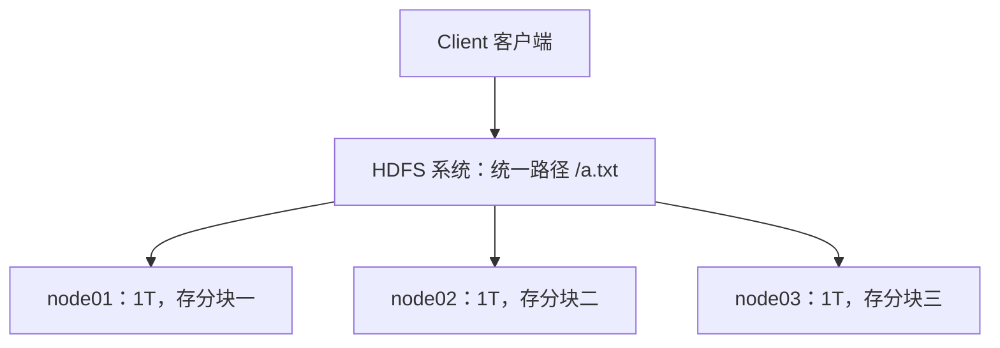

# 1T 硬盘存不下 2T 文件：HDFS 的分布式存储思想与三大角色

一块 1T 的硬盘塞不下一个 2T 的 a.txt，加硬盘也总有更大的文件在后面等着。换一个思路，把文件切成几份摊到多台机器上，再让使用者看到的仍然是完整的一个文件，这正是 HDFS 要解决的问题。day02 从这一课进入 HDFS 本体。

## 先给结论

- HDFS 全称 Hadoop Distributed File System，是 Apache Hadoop 的子项目，专门解决大数据的存储问题。
- 核心思想是切块分存：大文件切成分块摊到多台机器，对外只给一个统一路径，客户端看到的是完整文件。
- 三大角色分工明确：NameNode 管元数据，DataNode 存真实数据，SecondaryNameNode 定期合并 fsimage 与 edits，它不是热备。
- 块默认 128M（Hadoop 1 时代是 64M），由 `dfs.blocksize` 配置；副本默认 3 份，由 `dfs.replication` 配置。
- 设计基调是一次写入、多次读取，牺牲随机改写能力换取高吞吐。

## 一、从 2T 文件说起：为什么需要分布式文件系统

单机的困境很直白：node01 的硬盘 1T，a.txt 有 2T，物理上就存不下。思路一转，把 a.txt 切成三份，找三块 1T 的硬盘来分摊，node01、node02、node03 各存一段，容量问题立刻化解。

新问题跟着来：文件被切到三台机器上，读取时总不能让客户端挨台机器去找。HDFS 就是为此而生的整合层，它把三台机器的磁盘虚拟成一个整体，共 3T 可用，对外提供一套与 Linux 风格一致的目录结构。客户端想访问 a.txt，只看到根目录下有一个完整的 `/a.txt`，完全不用关心哪一块在哪台机器上，切分、定位、拼装全部由 HDFS 在幕后完成。



图里 Client 到 HDFS 只有「一条路径」这一个动作，三台机器对客户端完全透明，这就是分布式存储思想：机器变多对使用者不可见，容量与吞吐却实打实增加了。

讲义给 HDFS 补了三条设计目标：通过跨多台廉价计算机集群分布数据和处理来节约成本；通过自动维护多个数据副本在故障发生时保证可靠性；为超大规模数据提供所需的扩展能力。用廉价机器加软件层容错替代昂贵的单机高可靠硬件，是大数据存储的基本盘。

## 二、三大角色：谁管名，谁管数

HDFS 内部是典型的一主多从，NameNode 是中心服务器，DataNode 是存储节点，外加一个辅助角色 SecondaryNameNode。职责对照如下（出自讲义 1.3 节）：

| | NameNode | DataNode |
|---|---|---|
| 存什么 | 元数据 | 文件内容 |
| 在哪存 | 内存中 | 磁盘 |
| 维护关系 | 文件、block、DataNode 三者关系 | block id 到本机文件的对应 |

**NameNode 管的是「名」。** 文件叫什么、多大、权限如何、切成哪些块、每块在哪台 DataNode 上，这些描述信息全部在 NameNode 的内存里。客户端读写前先问它要位置，文件内容本身不经过 NameNode，数据流直接在客户端与 DataNode 之间走，否则 NameNode 会成为全集群的瓶颈。

**DataNode 管的是「数」。** 真实数据块落在各 DataNode 的磁盘上，它们周期性向 NameNode 发心跳与块状态报告：心跳证明自己活着，块报告说明本机存了哪些块，NameNode 靠这两样掌握全局副本情况。

**SecondaryNameNode 是辅助工位，不是备份节点。** 元数据的操作日志记在 edits 里，完整镜像叫 fsimage，edits 越滚越大，重启加载与查询都慢。SecondaryNameNode 定期把 fsimage 与 edits 拉过去，合并成新的 fsimage 送回 NameNode，把 edits 控制在合理范围内。NameNode 宕机时它不能顶上对外服务，机制细节在讲元数据的课程里展开。

## 三、块与副本：大小怎么定，副本怎么放

所有文件以 block 块的形式存放于 HDFS，块大小在 Hadoop 1 里默认 64M，Hadoop 2 起默认 128M，可在 hdfs-site.xml 里指定：

```xml
<property>
  <name>dfs.blocksize</name>
  <value>134217728</value>
</property>
<property>
  <name>dfs.replication</name>
  <value>3</value>
</property>
```

134217728 字节即 128M。一个 130M 的文件会被切成两个块，一个装 128M、一个装 2M，实际占磁盘 130M，而不是把第二块补零凑到 128M 变成 256M，块按需占用空间。

用块而不是整个文件做存储单元有三点好处：一个文件可以大于集群中任意一块单盘；块抽象简化了存储子系统的设计；块是天然的备份单元，复制一个块就能提供容错与可用性。对访问频繁的文件，块还可以显式缓存在 DataNode 的堆外内存里，调度器把计算任务安排到缓存所在节点即可提速，join 操作里的小维表就是典型的缓存候选。

副本解决可靠性：每个块默认存三份，一台机器宕机，数据仍在另外两台上。放置讲究「分散」：本地一份、同机架其他节点一份、不同机架再一份，机架级故障也不会三份全灭。上一课 hdfs-site.xml 里的 `dfs.replication=3` 对应的正是这里的含义。

读多写少是整个系统的前提。HDFS 采用一次写入、多次读取的模型，文件写入后不支持随机修改，并发控制因此大幅简化，换来的是对大数据集的高吞吐访问，这与它承载日志、数仓明细这类海量追加型数据的定位一致。

## 常见误区

- **把 SecondaryNameNode 当 NameNode 的热备。** 它只做元数据合并辅助，不接收客户端请求，NameNode 宕机它救不了场；真正的热备是高可用架构里的 standby NameNode。
- **以为块会占满 128M。** 130M 文件占 130M 磁盘，块是切分上限不是预分配；小文件多的问题出在元数据开销，不在磁盘浪费。
- **往 HDFS 里堆海量小文件。** 每个文件、每个块都占 NameNode 一份内存元数据，千万个小文件能把 NameNode 内存压垮；应合并后再入 HDFS，命令行可用 `hdfs dfs -getmerge`。
- **拿 HDFS 当低延迟数据库用。** 它面向高吞吐顺序读，不支持随机改写与毫秒级响应，交互式低延迟查询要靠 HBase 这类组件补位。

## 面试可能被问到的问题

1. 面试官追问：「HDFS 解决了什么问题？」
   答：单机存不下、也扛不住超大文件的读写。HDFS 把大文件切块分散到多台廉价机器上存储，通过副本保证容错，对外提供统一路径与访问接口，使用者像操作本地文件系统一样操作一个虚拟的整体。
2. 面试官追问：「NameNode 和 DataNode 各自存什么？」
   答：NameNode 存元数据且在内存中：文件名、大小、权限、块列表、块与 DataNode 的映射；DataNode 在磁盘上存真实数据块并维护块到本地文件的对应。文件数据流不经过 NameNode，避免它成为瓶颈。
3. 面试官追问：「SecondaryNameNode 是 NameNode 的备份吗？」
   答：不是。它定期合并 fsimage 与 edits，把操作日志控制在合理规模，减轻 NameNode 的恢复负担；它不承载客户端请求，NameNode 宕机时无法接替。
4. 面试官追问：「块大小为什么定 128M，调大调小有什么影响？」
   答：块太大，单个任务的输入少、并行度上不去，失败重试的代价也大；块太小，块数量暴增，NameNode 元数据内存吃紧、寻址占比升高。128M 是磁盘传输时间远大于寻址时间前提下折中的经验值，Hadoop 1 的 64M 沿袭自早期硬件水平。
5. 面试官追问：「三副本是怎么放置的？」
   答：默认策略是本地一份、同机架其他节点一份、不同机架一份。同机架带宽高、传输快，异机架防机架级断电故障，兼顾写入速度与可靠性。
6. 面试官追问：「一次写入多次读取带来什么好处？」
   答：文件一旦写入不再随机修改，并发控制大幅简化，一致性处理变简单，系统可以把精力放在吞吐与容错上，这正是日志采集、数仓存储这类场景需要的特性。

## 配套资料

- 讲义：`materials/code/04/day02-HDFS/day02/讲义/Note02.md`，1.1 节 HDFS 定义与一次写入多次读取，1.3 节架构与 NameNode、DataNode 职责对照表，1.4 节块大小与引入块的好处，1.5 节 SecondaryNameNode 与 fsimage、edits 合并机制，均与本课内容逐段对应。
- 资料 `materials/code/04/day02-HDFS/day02/资料/test.sh` 侧重本地库编译环境，与本课概念无直接关联，讲 HDFS 命令与 API 时再对照使用。
