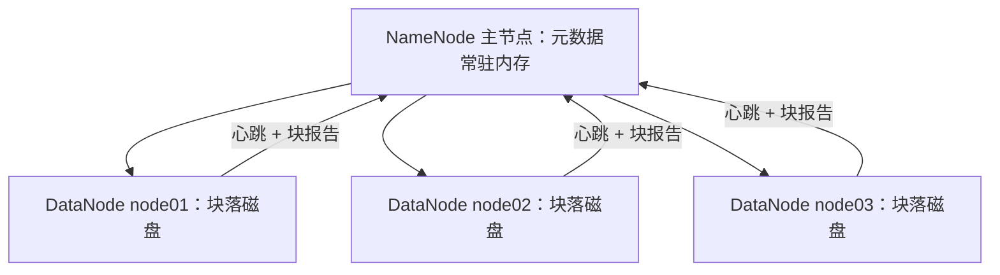
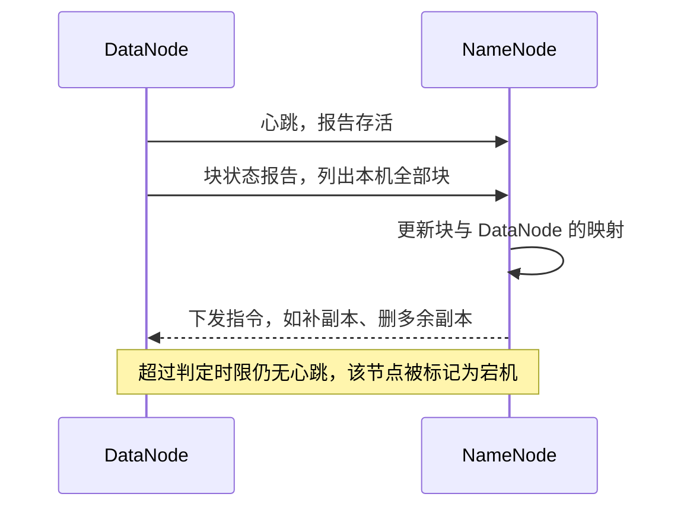

# NameNode 管名，DataNode 管数：HDFS 主从架构里两个核心进程的分工

文件切块摊到 node01、node02、node03 之后，客户端要读 a.txt 时总得有人告诉它「第一块在哪台机器上」。能回答这个问题的就是 NameNode，能交付数据的就是 DataNode。这两个进程谁干什么、互相之间靠什么联系，是 HDFS 集群里最先要分清楚的一组关系。

## 先给结论

- NameNode 是主节点，管理元数据：文件名、大小、权限、块列表、每块存在哪些 DataNode 上，这些信息常驻内存。
- DataNode 是从节点，负责存储真实数据块，数据落在本地磁盘，同时向 NameNode 提供存储能力。
- DataNode 周期性向 NameNode 发心跳和块状态报告；心跳证明存活，块报告列出本机全部块，超过时限没有心跳就被判定宕机。
- 文件内容的数据流不经过 NameNode，客户端从它那里拿到 DataNode 地址后直接传输，否则 NameNode 会成为全集群瓶颈。
- 这套架构源自 Google 的 GFS 论文，Doug Cutting 据此实现了 HDFS。

## 一、三个设计目标与一段历史

HDFS 的设计目标有三条。**第一，用廉价机器换容量。** 存 PB 级数据不需要一台超级服务器，买多台普通计算机组成集群即可解决存储问题。**第二，用副本换可靠。** 文件切成三块分放三台机器后，任何一台宕机都会让某个块消失，HDFS 把每个块复制多份存到不同节点，坏一台不影响数据完整性。**第三，用加机器换扩展。** 三台机器的 3T 空间用满，再加一台 1T 的 node04 进集群，扩容动作对上层的应用几乎透明，代价很小。

历史脉络也简单。Doug Cutting 做 Lucene 时需要爬虫支撑，撞上如何存大规模数据、如何动态容错这类难题；Google 公开发表的三篇论文里有一篇 GFS，描述了其内部可伸缩、可容错的分布式文件系统；Cutting 参照 GFS 做出了开源实现，就是 HDFS。理解这一点有助于接受它的许多设计取向：工业级容错靠软件层叠加，而不依赖单机硬件的绝对可靠。

## 二、一主多从：两个进程各管一摊

HDFS 集群由许多主机组成，架构是典型的一主多从。每台主机上跑着一个专门管理本机磁盘的进程，叫 DataNode，它们是真正放数据的工位。管理这些 DataNode 的是另一个更上层的进程 NameNode，即主节点。

讲义里给出的职责对照十分清晰：

| | NameNode | DataNode |
|---|---|---|
| 存什么 | 元数据 | 文件内容 |
| 在哪存 | 内存 | 磁盘 |
| 维护关系 | 文件、block、DataNode 三者的关系 | block id 到本机文件的对应 |

**NameNode 管的是「名」。** 集群里存了一个 a.txt，它的名字、大小、权限、切成了哪些块、每块落在哪些 DataNode 上，全部记录在 NameNode 里。这份元数据一旦丢失，文件本身还在磁盘上，但再也拼不回一个完整的 a.txt，所以元数据是整个集群最金贵的东西。NameNode 还承担第二项职责：监控所有 DataNode 的存活状态，机械故障、断电都会让 DataNode 掉线，NameNode 要实时维护这份故障视图。

**DataNode 管的是「数」。** 它提供磁盘，文件内容以块的形式落在本机，并维护块 id 与本地文件的对应关系。读写请求到来时，与文件内容相关的数据流直接在客户端和 DataNode 之间流动。

集群的实际部署用 `jps` 一看便知（取自本课搭建的三节点集群）：

```bash
[root@node01 ~]# jps
2673 SecondaryNameNode
2345 NameNode
3242 NodeManager
3675 JobHistoryServer
3101 ResourceManager
2494 DataNode
2030 QuorumPeerMain

[root@node02 ~]# jps
2032 QuorumPeerMain
2332 NodeManager
2471 DataNode
```

node01 上 NameNode 与 DataNode 进程同机共存，node02、node03 只有 DataNode，是从节点。注意这不是高可用，只是没有为 NameNode 单独划分机器，进程共置与主备切换是两回事。



图里向下是管理关系，向上是汇报关系，一主多从的信息流向就这两条。副本放在哪些 DataNode 上也由 NameNode 根据全局情况拍板，读文件时它还会尽量把离客户端最近的副本地址排在前面。

## 三、心跳与块报告：NameNode 怎么知道谁活着、谁存了什么

NameNode 不在 DataNode 身边盯着，靠的是周期性汇报，这里有一条固定的工作流程。



**第一，心跳证明活着。** 每个 DataNode 隔一小段时间向 NameNode 发一次心跳，收到心跳即认为节点工作正常；一旦超过判定时限仍无心跳，NameNode 就把它当宕机处理。**第二，块报告说明存了什么。** 心跳只带状态不带明细，块状态报告则包含该 DataNode 上所有数据块的列表，NameNode 汇总所有节点的块报告，才能知道每个块的三个副本分别在谁那里。**第三，汇报之后有指令。** NameNode 发现某个块只剩两个副本，就挑一台健康节点把块补复制一份，把副本数拉回预期值，这就是上一课说的快速恢复能力。

心跳节奏和宕机判定阈值都可以配置，本课集群未改动，默认写法如下（示例为按本课写法补全）：

```xml
<!-- DataNode 心跳间隔，单位秒，Hadoop 默认 3 秒 -->
<property>
  <name>dfs.heartbeat.interval</name>
  <value>3</value>
</property>
<!-- NameNode 复查心跳超时的间隔，单位毫秒，Hadoop 默认 300000 -->
<property>
  <name>dfs.namenode.heartbeat.recheck-interval</name>
  <value>300000</value>
</property>
```

还有一个容易被忽略的点：NameNode 的元数据在内存里，内存断电即失。所以 NameNode 必须把元数据落盘做持久化，靠的是 fsimage 与 edits 两个文件，宕机恢复和 SecondaryNameNode 的合并机制都围绕它们展开，下一课专门讲。

## 常见误区

- **以为 NameNode 里也存文件数据。** 它只存描述信息，文件内容不经过 NameNode；如果数据流也走它，全集群的读写都会在这个单点排队。
- **以为 DataNode 宕机数据就丢了。** 每个块有多副本分放不同节点，NameNode 通过心跳发现节点失联，会指挥健康节点补齐副本数。
- **看到 node01 上既有 NameNode 又有 DataNode，就以为搭了高可用。** 这只是进程共置在一台机器，NameNode 宕机时没有任何备节点能接替，高可用需要单独的 standby 角色与仲裁机制。
- **以为 NameNode 元数据掉电就永久丢失、无能为力。** 元数据通过 fsimage 与 edits 持久化在磁盘上，重启时加载镜像再重放日志即可恢复，内存只是运行态。

## 面试可能被问到的问题

1. 面试官追问：「NameNode 和 DataNode 的职责边界是什么？」
   答：NameNode 是主节点，在内存中管理元数据，包括文件名、大小、权限、块列表以及块与 DataNode 的映射，同时监控各 DataNode 状态、决定副本放置；DataNode 是从节点，在磁盘上存真实数据块，维护块 id 到本地文件的对应，周期性向 NameNode 发心跳和块报告。
2. 面试官追问：「NameNode 怎么知道某个 DataNode 挂了？」
   答：靠心跳机制。DataNode 定期发心跳证明存活，Hadoop 默认 3 秒一次；超过由 `dfs.namenode.heartbeat.recheck-interval` 参与计算的判定时限仍收不到心跳，NameNode 就把该节点标记为宕机，随后对其上的块做副本补齐。
3. 面试官追问：「为什么文件数据流不经过 NameNode？」
   答：NameNode 是集群单点，只应承担元数据问答这类轻量工作。客户端先问它要 DataNode 地址，再与 DataNode 直接传输数据，把最重的数据流分摊到各个存储节点上，避免 NameNode 成为吞吐瓶颈。
4. 面试官追问：「心跳和块状态报告是一回事吗？」
   答：不是。心跳是高频的存活信号，只证明节点活着；块状态报告是本机全部数据块的清单，让 NameNode 掌握每个副本的实际分布。心跳丢了说明节点可能宕机，块报告缺失说明某些副本对不上账，两者分别支撑可用性判断和数据完整性判断。
5. 面试官追问：「NameNode 的元数据都在内存，机器重启怎么办？」
   答：元数据有磁盘持久化机制。完整镜像记在 fsimage，增量操作日志记在 edits，重启时先加载 fsimage 到内存，再把其中之后的 edits 操作重放一遍，即可恢复到宕机前的最新状态；日志膨胀问题由 SecondaryNameNode 定期合并解决。

## 配套资料

- 讲义：`materials/code/04/day02-HDFS/day02/讲义/Note02.md`，1.2 节 HDFS 历史与 GFS 渊源，1.3 节架构说明与 NameNode、DataNode 职责对照表，其中「周期性接收心跳信号和块状态报告」的表述与本课心跳流程逐条对应。
- 本课无配套源码包，文中心跳相关 XML 为按本课写法补全的默认配置示例，`jps` 输出取自本课集群实操记录。
