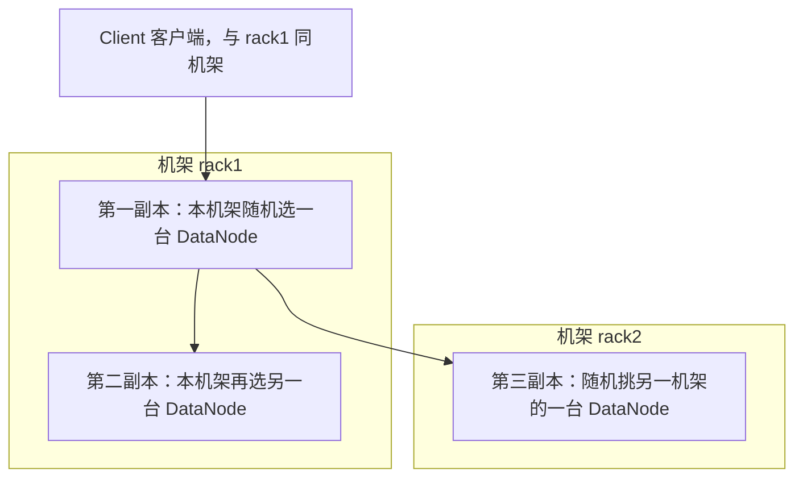

# 300M 文件切三块、每块存三份：HDFS 的分块逻辑与机架感知副本策略

一个 300M 的 a.txt 要放进 HDFS，它会被切成几块？切下来的 44M 尾巴算不算一个块？三个副本又该往哪些机器上放才不白存？把这两个问题想透，HDFS 的存储骨架就清楚了。

## 先给结论

- 所有文件以 block 块为单位存进 HDFS，Hadoop 2 起块大小默认 128M，300M 文件切成 128M、128M、44M 三个块。
- 块是逻辑单位，只描述「切了几份」，不预分配空间，44M 的尾块实际只占 44M 磁盘。
- 每个块默认存 3 个副本，用空间换安全；NameNode 记录每个副本的位置，副本数不足时自动指挥补齐。
- 副本放置靠机架感知算法：本机架一份、同机架另一节点一份、另一机架一份，兼顾写速度与容灾。
- 副本数由 hdfs-site.xml 的 `dfs.replication` 控制，本课集群取值 3。

## 一、分块：128M 是上限，不是预分配

HDFS 对每个文件执行分片机制，按固定大小切片。以 300M 的 a.txt 为例：第一块装满 128M，第二块再装 128M，剩余 44M 单独成第三块，共三个 block。哪怕最后只剩 2M，它也是一个完整的 block，只是这一块实际占用的磁盘就只有 2M。也就是说 300M 文件在集群里占 300M 空间，而不是三块各占 128M 凑成 384M，块的大小描述的是切分上限，不是占位大小。

块大小可以在 hdfs-site.xml 里调整，单位是字节（示例为按本课写法补全，取 Hadoop 默认值）：

```xml
<property>
  <name>dfs.blocksize</name>
  <value>134217728</value>
</property>
```

134217728 字节即 128M。讲义把块称作逻辑单位，意思是「这个文件有几个块」只说明它被切成了几段，文件真实多大要看实际字节数，块数与磁盘占用是两本账。

## 二、副本机制：拿空间换安全

切完块还要考虑一个现实问题：某台机器宕机，它磁盘上的块就没了，文件立刻残缺。HDFS 的答案是副本机制，存每一个块的时候，同时把这个块复制出多份，分别放到不同节点上。默认每个块三副本：比如第一块落在 node01，就再往 node02、node03 各放一份；第二块、第三块同理。任何一台机器挂掉，每个块至少还有两份幸存，文件的完整性不受影响。

代价也很直白，三副本占三倍空间。这是 HDFS 用空间换安全的明码标价，对廉价机器组成的大集群来说，这笔账比采购高可靠存储硬件划算得多。

NameNode 在这套机制里当总账房。**第一，它记账。** a.txt 切成三个块之后，每个块的三个副本分别落在哪个 DataNode，NameNode 的元数据里记得清清楚楚，比如 block1 记为 node01、node02、node03 各一份。**第二，它补账。** node01 宕机后，block1 的实际分布和账面记录对不上了，NameNode 发现副本数掉到 2，会从 node02 或 node03 上再拷一份到别的健康节点，把副本数拉回 3。整个过程不需要人工介入，这就是 HDFS 的快速恢复能力。

## 三、机架感知：三个副本放哪最有讲究

三个副本总不能闭着眼睛乱放。真实机房里，服务器由一个个机架（rack）组成，每个机架里插满主机，同机架内部走交换机带宽高，跨机架的链路一旦出问题就是整架失联。副本放置算法因此要同时算两笔账：写入要快，故障要扛得住。这套算法叫机架感知，各 Hadoop 版本细节略有差异，本课以 Hadoop 3 的策略为例。



上传客户端与 rack1 同机架时，第一副本在本机架里随机挑一台 DataNode；第二副本仍在本机架，换一台主机；第三副本跨出去，随机挑另一个机架的一台 DataNode。这个组合的妙处在于：前两份在同机架内完成，机架内部带宽大、流水线传输快，不占跨机架的昂贵链路；第三份跨机架，哪怕 rack1 整架断电，数据在 rack2 依然有一份活口，机架级故障压不垮它。讲义 1.6 节的表述与之对应：本地一份，同机架内其它某一节点上一份，不同机架的某一节点上一份。

## 四、配置与验证

副本数是 hdfs-site.xml 里的显式配置，本课三节点集群的实际配置如下（取自集群配置文件）：

```xml
<property>
  <name>dfs.replication</name>
  <value>3</value>
</property>
```

想改某个已上传文件的副本数，不用重新上传，`setrep` 直接调整（示例命令，演示用）：

```bash
# 把 /a.txt 的副本数调整为 2，-w 表示等待实际副本数到位
hdfs dfs -setrep -w 2 /a.txt

# 查看一个文件实际切了几个块、每块副本落在哪些节点
hdfs fsck /a.txt -files -blocks -locations
```

`fsck` 的输出里能看到 300M 文件被切成三个块以及每块的 DataNode 位置，与前面讲的账本完全对得上。

## 常见误区

- **以为 44M 的尾块会占满 128M。** 块只规定切分上限，不预分配空间，三块合计仍占 300M；小文件多的真正代价在 NameNode 元数据内存，不在磁盘浪费。
- **以为副本越多越安全就越该调大。** 副本数翻倍，存储成本与写入流量同步翻倍，写吞吐会被流水线复制拖累；非关键数据调 2，海量冷数据调 1，是常见的省钱手段。
- **以为改了 hdfs-site.xml 里的 `dfs.replication`，旧文件的副本数会自动变。** 该配置只约束新写入的文件；存量文件要用 `hdfs dfs -setrep` 逐个或递归调整。
- **以为三副本随机散放即可。** 放置策略是算过的：全放同机架扛不住机架断电，全放异机架又浪费本机架带宽，机架感知就是在两者之间取平衡。

## 面试可能被问到的问题

1. 面试官追问：「300M 的文件在 HDFS 里切几个块，怎么算？」
   答：默认块大小 128M，切三块：128M、128M、44M。最后不满 128M 的部分也独立成块，但实际只占 44M 磁盘，块是逻辑切分单位，不做空间预分配。
2. 面试官追问：「三副本的放置策略是什么，为什么这样放？」
   答：默认本地一份、同机架其它某一节点一份、不同机架某一节点一份。前两份留在本机架利用高带宽加快流水线写入，第三份跨机架抵御整架断电级的故障，写入速度与容灾能力同时兼顾。
3. 面试官追问：「存一块 DataNode 宕机了，HDFS 怎么把数据救回来？」
   答：NameNode 元数据里记着每个块三个副本的位置，DataNode 心跳消失后节点被标记宕机，NameNode 对比账面副本数与实际存活副本数，发现不足就从健康副本所在节点再复制一份到其他节点，自动把副本数补回 3，无需人工干预。
4. 面试官追问：「副本机制的成本是什么，什么场景会调低副本数？」
   答：成本是等倍的存储空间和写入时的复制流量。日志类可重建的中间数据、测试数据常把副本调到 2 甚至 1 来省空间，重要数据保持 3，极端重要再往上加。
5. 面试官追问：「机架感知是靠什么知道谁是本机架的？」
   答：管理员在配置里提供机架脚本，把节点 IP 或主机名映射到网络拓扑的机架层级，NameNode 据此计算任意两个节点的拓扑距离，再按距离远近执行放置与读排序策略。

## 配套资料

- 讲义：`materials/code/04/day02-HDFS/day02/讲义/Note02.md`，1.4 节文件副本与 Block 块存储及块大小配置，1.6 节文件写入过程中「本地一份、同机架一份、不同机架一份」的副本放置策略与机架感知描述，1.8 节 hdfs 命令行清单。
- 本课无配套源码包，`setrep`、`fsck` 两条演示命令与 `dfs.blocksize` 片段为按本课写法补全的示例；`dfs.replication=3` 片段取自本课集群的 hdfs-site.xml 实际配置。
