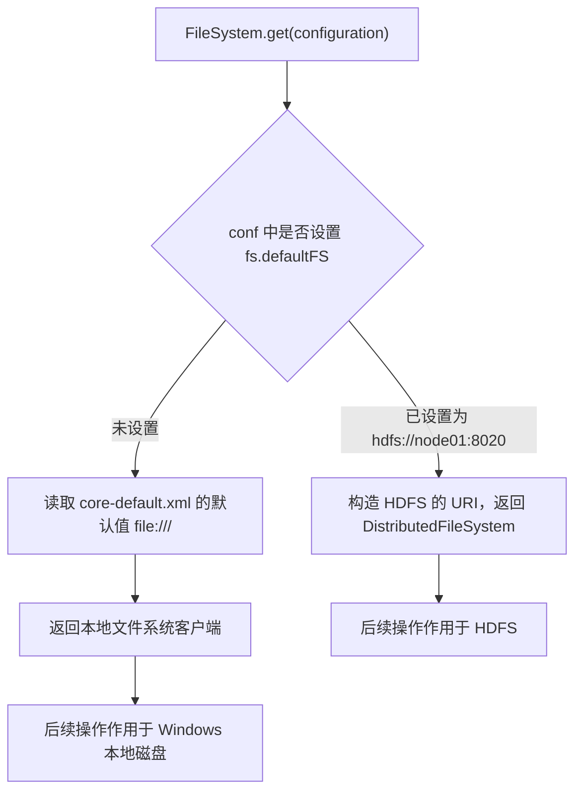
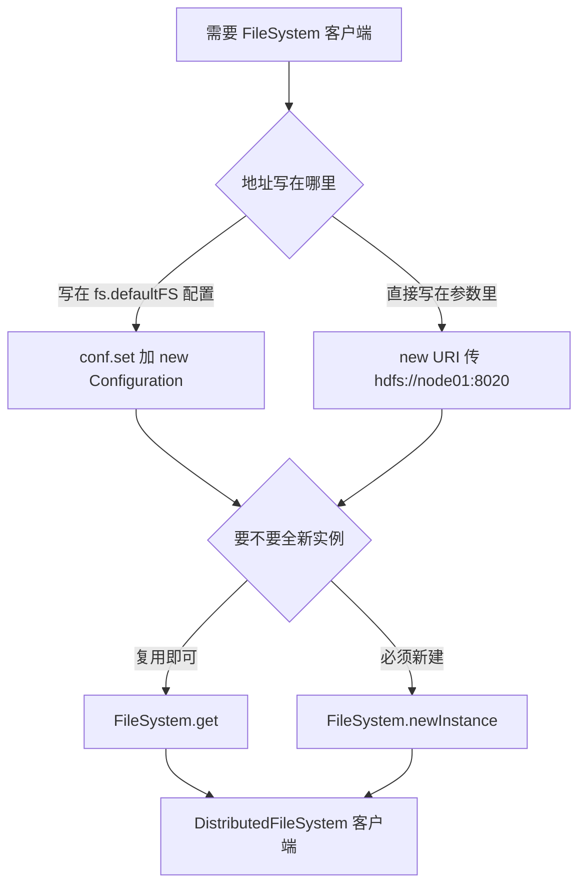
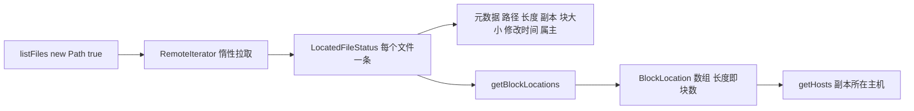
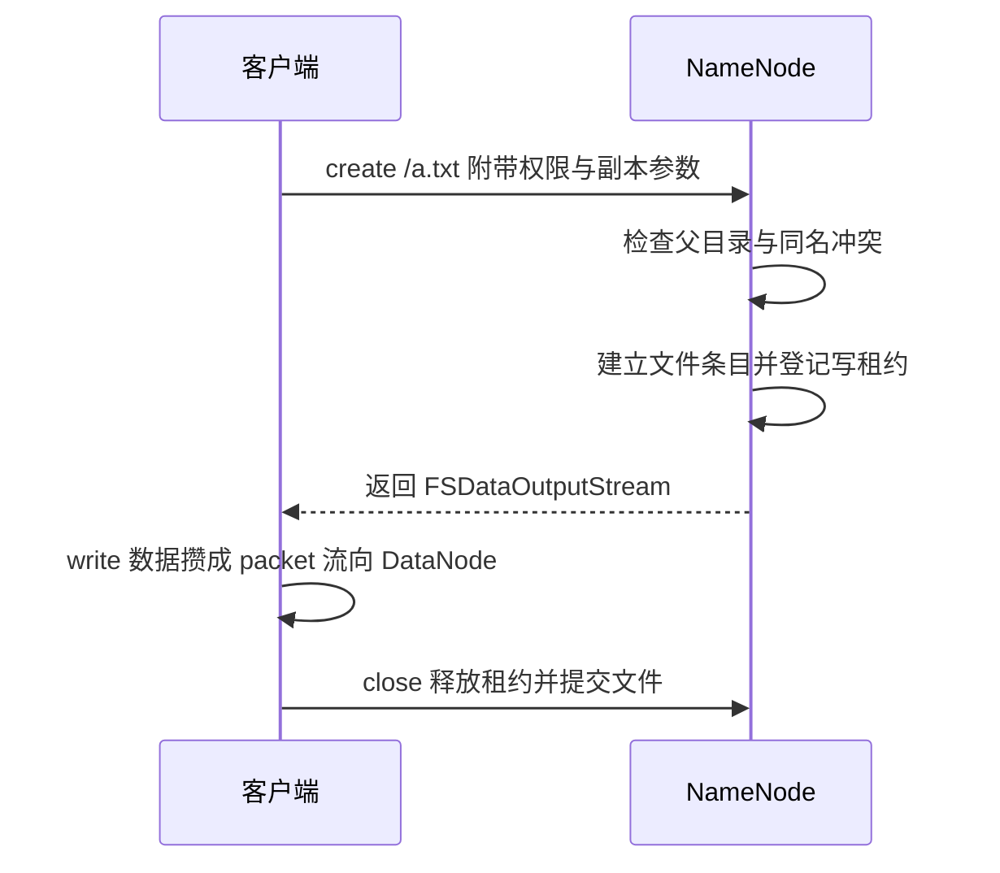
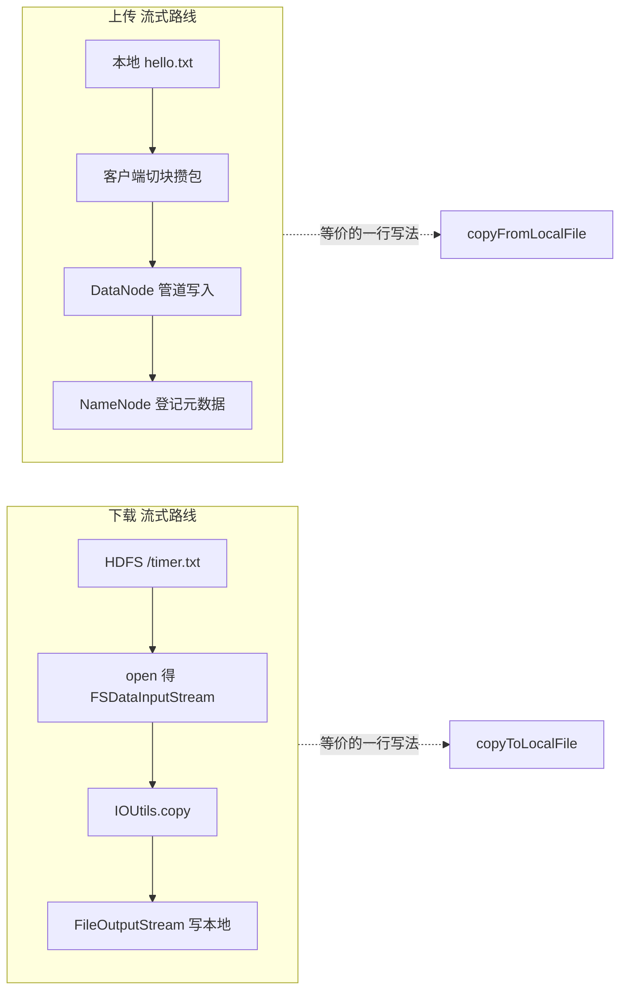
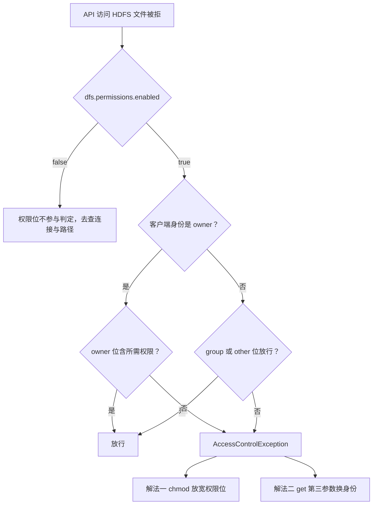
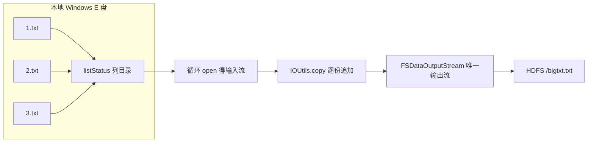

# HDFS 的 API 操作合辑：Windows 环境、FileSystem 四种获取、文件操作与小文件合并

## 先给结论

- 七篇内容覆盖 Java 操作 HDFS 的完整入门：Windows 环境配置、FileSystem 的四种获取方式、文件列表遍历、目录与文件创建、上传下载、访问权限、小文件合并。
- Windows 端四步：Hadoop 发行包放无中文无空格路径、配 HADOOP_HOME、bin 加进 Path、hadoop.dll 拷进 System32 后重启，hosts 补上映射才能直接写 hdfs://node01:8020。
- Configuration 封装配置，FileSystem 是文件系统操作入口；不设 fs.defaultFS 时默认取 file:///，get 到本地文件系统，文件会悄悄写到本地磁盘。
- 四种获取方式殊途同归，拿到的都是 DistributedFileSystem：URI 直连语法最简；`get` 有实例缓存，`newInstance` 每次新建，需要多个互不干扰的连接时必须用后者。
- listFiles 递归遍历返回 LocatedFileStatus，路径、副本数、块大小、属主一应俱全，块与副本位置由 getBlockLocations 与 getHosts 给出；mkdirs 一次建多级目录等价 mkdir -p。
- create 返回 FSDataOutputStream，调用瞬间 NameNode 已建文件条目，往流里写出才是真正写数据；写完必须 close 释放租约，对同名文件覆盖要走 overwrite 重载。
- 上传下载两条路线：IOUtils 流式拷贝可控可加工，copyFromLocalFile 与 copyToLocalFile 一行搬文件，重载带 delSrc 与 overwrite 两个开关。
- 权限校验由 dfs.permissions.enabled 决定，默认关着形同虚设；AccessControlException 一行读四段，被拒后 chmod 放宽文件权限或换客户端身份。
- 小文件是 NameNode 内存与计算调度的双重负担：下载侧 getmerge 一条命令拼大文件，上传侧流式追加写进唯一输出流，SequenceFile 与 HAR 归档是更系统的治理方案。

## 第1部分：在 Windows 上跑通 HDFS Java API：环境配置四步与第一种获取 FileSystem 的方式

想用 Java 代码操作集群上的 HDFS，动手写代码之前要先过一道坎：开发机是 Windows，Hadoop 的 Java API 底层依赖本地库，环境不配好，代码一跑就报 UnsatisfiedLinkError，连 FileSystem 对象都拿不到。这课解决两件事：把 Windows 侧的 Hadoop 运行环境搭起来，以及写出第一段拿到 FileSystem 的代码。

### 一、Windows 环境四步

Apache 官方发行包不带 Windows 本地二进制，实际开发用的是社区提供的 winutils 发布包整理出的 windows 版 Hadoop 3.1.1 目录，bin 里带 winutils.exe、hadoop.dll、hdfs.exe 等文件。环境搭建按四步执行。

**第一步，放置发行包。** 把整个 Hadoop 目录拷到一个没有中文、没有空格的路径下，比如 E 盘根目录。路径里出现中文或空格，本地库加载时容易出问题。

**第二步，配置 HADOOP_HOME。** 系统变量里新建 HADOOP_HOME，值指向 Hadoop 目录本身。

**第三步，把 bin 加入 Path。** Path 里追加 %HADOOP_HOME%\bin，使命令行能直接调 bin 下的工具。

**第四步，部署 hadoop.dll 并重启。** 把 bin 目录下的 hadoop.dll 拷贝到 C:\Windows\System32，然后重启 Windows。四步缺一不可，少了任何一步 API 都跑不起来。

系统变量与 hosts 的最终形态如下：

```bash
# 系统变量新增
# 变量名 HADOOP_HOME，值 E:\hadoop-3.1.1
# Path 中追加一项
%HADOOP_HOME%\bin
```

```bash
# C:\Windows\System32\drivers\etc\hosts 末尾追加三节点映射
192.168.174.100 node01
192.168.174.120 node02
192.168.174.130 node03
```

hosts 映射是给后文代码铺路的：hdfs://node01:8020 里的 node01 要靠它解析成 NameNode 所在机器的 IP，写 IP 与写主机名都行，写主机名的前提就是这份映射存在。

### 二、Maven 工程与依赖

建一个普通 Maven 工程，包名用 com.study.hdfs，工程名 day02-hdfs-api。依赖按讲义 1.9.1 的清单引入，编译级别 1.8：

```xml
<dependencies>
    <!-- Hadoop 客户端总依赖，传递引入 common 与 hdfs 相关包 -->
    <dependency>
        <groupId>org.apache.hadoop</groupId>
        <artifactId>hadoop-client</artifactId>
        <version>3.1.1</version>
    </dependency>
    <!-- 单元测试 -->
    <dependency>
        <groupId>org.junit.jupiter</groupId>
        <artifactId>junit-jupiter-api</artifactId>
        <version>RELEASE</version>
    </dependency>
</dependencies>
```

讲义里还给 hadoop-common、hadoop-hdfs、hadoop-hdfs-client 配了 provided 作用域并带了 shade 打包插件，本地开发以 hadoop-client 这条编译依赖为核心即可。

### 三、第一种获取 FileSystem 的方式

Java 里操作 HDFS 的主角是两个类。Configuration 封装客户端与服务器的配置信息，注意要导 org.apache.hadoop.conf.Configuration 这个包；FileSystem 是文件系统抽象类，代表一套文件的管理方式，子类决定具体操作的是哪种文件系统，要用 org.apache.hadoop.fs 包下的那个。

第一种方式就是先 new Configuration，再往里 set 文件系统地址，最后 FileSystem.get：

```java
@Test
public void getFileSystem1() throws IOException {
    Configuration configuration = new Configuration();
    // 指定要操作的文件系统：HDFS，NameNode 在 node01 的 8020 端口
    configuration.set("fs.defaultFS", "hdfs://node01:8020");
    // 拿到 FileSystem 就相当于拿到了主节点元数据的操作入口
    FileSystem fileSystem = FileSystem.get(configuration);
    System.out.println("fileSystem:" + fileSystem.toString());
}
```

运行输出类似这样：

```text
fileSystem:DFSClient[clientName=DFSClient_NONMAPREDUCE_1851825033_1, ugi=root (auth:SIMPLE)]
Process finished with exit code 0
```

打出了 DFSClient 就说明客户端已经与 node01 建立连接，ugi 是当前操作用户。首次运行通常先看到几行 log4j 警告，原因是 Hadoop 内部要日志服务而工程没配。把配套资料里的 log4j.properties 放进 src/main/resources 即可消除：

```properties
log4j.rootLogger=WARN, Console
log4j.appender.Console=org.apache.log4j.ConsoleAppender
log4j.appender.Console.layout=org.apache.log4j.PatternLayout
log4j.appender.Console.layout.ConversionPattern=(%r ms) [%t] %-5p: %c#%M %x: %m%n
```

这条获取路径的判断逻辑如下：



### 四、为什么必须设置 fs.defaultFS

点进 FileSystem.get 的源码，它层层调用后从 conf 里取 fs.defaultFS 作为文件系统名。这个参数在 core-default.xml 里的默认值是 file:///，file 开头代表本地文件系统。也就是说不写 configuration.set 那一行，程序不会报错，只是 get 到一个操作本地磁盘的客户端，后续的 mkdir、put 全部发生在开发机本地，跟集群毫无关系。这类错误不抛异常、难察觉，只有等到文件「莫名」出现在本地目录时才暴露。8020 端口是 fs.defaultFS 指定的 RPC 通信端口，与页面用的 50070 分属两条通道：一条跑元数据协议，一条跑 Web UI。

## 第2部分：拿到 HDFS 的 FileSystem 还有三种写法：URI 直连、配置驱动与 newInstance

上一篇用 `conf.set("fs.defaultFS", ...)` 加 `FileSystem.get(conf)` 拿到了第一个 FileSystem 对象。翻别人的工程代码会发现，同样一件事至少有四种写法：有的把地址塞进 URI，有的调 `get`，有的调 `newInstance`，编译和运行全都能通过。困惑随之而来：这几种写法到底差在哪，工程里该固定用哪一种。这一课把剩下三种方式补齐，并把 `get` 与 `newInstance` 的本质差别讲透。

### 一、方式二：把地址直接写进 URI

URI（统一资源标识符）可以理解成给集群上的文件系统起一个带协议的门牌号：`hdfs` 是协议，`node01:8020` 是 NameNode 所在主机与 RPC 端口。第一种方式把地址藏在配置里，第二种方式把它亮在参数上：

```java
@Test
public void getFileSystem2() throws Exception {
    // get 的另一个重载：第一个参数显式给 URI，第二个参数给配置
    FileSystem fileSystem = FileSystem.get(new URI("hdfs://node01:8020"), new Configuration());
    System.out.println("fileSystem:" + fileSystem);
}
```

方法会抛出 `URISyntaxException`（URI 写法非法时触发），演示代码直接 `throws Exception` 抛出即可。运行后打印的同样是 `DFSClient[clientName=DFSClient_NONMAPREDUCE_xxx_1, ugi=root (auth:SIMPLE)]` 这类信息，说明连接已经建立。课程里的评价是：第一种方式思路清晰，配置里指定文件系统；第二种方式语法简化，地址一目了然。

这个重载还有一个隐含规则：显式传入的 URI 优先级高于配置。`get(uri, conf)` 会以 URI 里的 scheme 和 authority 决定连哪个文件系统，URI 里没写的部分才回退到 `fs.defaultFS` 的配置值。

### 二、方式三与方式四：newInstance 一族

第三种方式看起来和第一种几乎一样，唯一变化是 `get` 换成了 `newInstance`：

```java
@Test
public void getFileSystem3() throws Exception {
    Configuration configuration = new Configuration();
    configuration.set("fs.defaultFS", "hdfs://node01:8020");
    // newInstance 按配置创建一个全新的 FileSystem 实例
    FileSystem fileSystem = FileSystem.newInstance(configuration);
    System.out.println(fileSystem.toString());
}

@Test
public void getFileSystem4() throws Exception {
    // newInstance 的重载：URI 与配置一起给
    FileSystem fileSystem = FileSystem.newInstance(new URI("hdfs://node01:8020"), new Configuration());
    System.out.println(fileSystem.toString());
}
```

参数形态上，方式三是「配置驱动」，方式四是「URI 加配置」，与 `get` 的两个重载一一对应。四种方式的代码骨架完全一致，差别只在地址写在哪里、取实例走哪条路径：



从图上看，横向是「地址放哪」的自由度，纵向是「取实例路径」的选择，两个维度正交，组合出四种写法。

### 三、get 有缓存，newInstance 没有

既然 `get` 与 `newInstance` 参数相同、返回相同，Hadoop 为什么要留两套入口。答案在 `org.apache.hadoop.fs.FileSystem` 的源码里：`get` 一路调用后会把实例放进一个 `Cache`（`FileSystem.CACHE`），缓存的键由 URI 和当前用户共同决定。同一个 JVM 里第二次 `get` 相同的 URI 加用户，直接命中缓存返回同一个对象，不再新建连接；`newInstance` 则绕开缓存，每次都执行 `createFileSystem` 现场构造一个全新对象。

这个差别带来三个实际影响。

**第一，改配置后想立即生效，用 newInstance。** 先 `get` 再改 `conf.set` 再 `get`，第二次大概率命中缓存，拿到的是带着旧参数的同一个对象；`newInstance` 没有这个问题。

**第二，连接数量管理策略不同。** `get` 复用实例，天然省资源，适合大多数脚本与任务；`newInstance` 每调一次就多一个客户端连接，用完必须 `close`，否则连接堆积。

**第三，多用户隔离必须用 newInstance。** 缓存键包含用户名，但显式传不同用户时若想彻底隔离连接与心跳，`newInstance` 语义更干净，不会与缓存里的对象互相影响。

日常写单元测试、跑一次性的数据任务，`get` 就够了；写框架级的工具类、需要精确控制连接生命周期时，`newInstance` 更合适。

## 第3部分：遍历 HDFS 的文件清单：listFiles 递归迭代与 LocatedFileStatus 元数据

Web 页面上点开 Browse Directory 能看到整个文件系统树，可一落到代码里就有新问题：想统计某个目录下有多少输入文件、每个文件被切了几块、副本分布在哪些机器，该调哪个方法。真正写过一遍的人还会卡在两处：`listFiles` 的返回值不是熟悉的 `List` 而是一个 `RemoteIterator`，第二个参数的布尔值也不知道是干嘛的。这一课把递归遍历、元数据读取和块位置信息一次讲清。

### 一、listFiles 与递归开关

拿到 FileSystem 之后，遍历的骨架只要三步：调 `listFiles` 得到迭代器，循环判断 `hasNext`，`next` 取出每条记录。

```java
@Test
public void getListFiles() throws Exception {
    // 1: 获取 FileSystem 对象
    FileSystem fileSystem = FileSystem.get(new URI("hdfs://node01:8020"), new Configuration());
    // 2: 获取指定目录下的所有文件信息，第二个参数 true 表示递归子目录
    RemoteIterator<LocatedFileStatus> iterator = fileSystem.listFiles(new Path("/"), true);
    // 3: 遍历迭代器
    while (iterator.hasNext()) {
        // 获取每一个文件的详细信息
        LocatedFileStatus fileStatus = iterator.next();
        System.out.println(fileStatus.getPath().toString());
    }
    fileSystem.close();
}
```

运行输出形如：

```text
hdfs://node01:8020/export/servers/hadoop-3.1.1/datas/jobsitory/DoneDats/2019/04/24/000000/job_1555938431963_0001-1556074220928-root-QuasiMonteCarlo-155607456128-2-1-SUCCEEDED-default-1556074333781.jhist
```

路径以 `hdfs://node01:8020` 开头，后面是文件在 HDFS 上的绝对路径。把递归参数从 `true` 改成 `false`，输出立刻只剩根目录一层的文件，子目录深处的内容全部消失，这个开关就是控制遍历深度的地方。

`RemoteIterator` 之所以不是普通的 `List`，是因为遍历对象在远端：迭代器每向前走一步才向 NameNode 取一条记录，目录里有十万个文件也不会一次性把十万个对象堆进内存，这正是它被设计成惰性拉取的原因。

### 二、LocatedFileStatus 里能读到什么

`next()` 拿到的每个 `LocatedFileStatus` 是一条文件元数据，名字里带 Status 的这族对象提供了常规的描述信息：

```java
while (iterator.hasNext()) {
    LocatedFileStatus fileStatus = iterator.next();
    // 完整路径 hdfs://node01:8020/export/...
    System.out.println(fileStatus.getPath().toString());
    // 文件名
    System.out.println(fileStatus.getPath().getName());
    // 文件长度、副本数、块大小、修改时间、属主
    System.out.println(fileStatus.getLen());
    System.out.println(fileStatus.getReplication());
    System.out.println(fileStatus.getBlockSize());
    System.out.println(fileStatus.getModificationTime());
    System.out.println(fileStatus.getOwner() + ":" + fileStatus.getGroup());
}
```

这些字段与 Web 页面目录列表里的 Permission、Owner、Size、Last Modified、Replication、Block Size 列一一对应，页面上能看到的，代码里都能拿到。两个字段的读法顺带说明：`getModificationTime` 返回毫秒时间戳，直接打印是一长串数字，转成日期对象格式化后才能用于报表；`getOwner` 与 `getGroup` 的默认值来自提交程序的操作系统用户，和 shell 里 `hdfs dfs -ls` 看到的属主是同一套体系。

### 三、块与副本的位置：getBlockLocations

`LocatedFileStatus` 比 `FileStatus` 多出来的核心能力是位置信息。一个文件按 128 MB 切成块，每块默认三副本，`getBlockLocations` 把这些块与副本的落点一次给出：

```java
// blockLocations 数组长度就是该文件的块数，测试文件小于 128 MB 时一般是 1
BlockLocation[] blockLocations = fileStatus.getBlockLocations();
System.out.println(blockLocations.length);
for (BlockLocation blockLocation : blockLocations) {
    // 每个块的三副本分别存放在哪些主机
    String[] hosts = blockLocation.getHosts();
    for (String host : hosts) {
        System.out.println(host);
    }
}
```

真实输出里，块数打印 `1`，主机名依次打印 `node01.hadoop.com`、`node02.hadoop.com`、`node03.hadoop.com`，正好对应三副本分布。文件超过 128 MB 时数组长度会大于 1，每个元素对应一个块，主机清单逐块给出。整条数据链路如下：



从图上看，元数据与块位置是同一对象向外辐射的两条支路，做数据巡检读左边，做本地性分析读右边。`BlockLocation` 里除了 `getHosts()`，还有 `getNames()` 与 `getTopologyPaths()` 等方法，前者取 IP 级地址，后者带机架拓扑路径，做机架感知相关分析时会用到。

### 四、listFiles 与 listStatus 的分工

`FileSystem` 还有一个 `listStatus(new Path("/"))`，返回 `FileStatus[]`，不递归，一次把当前目录的所有条目（含子目录）装进数组返回。小文件合并这类场景常用它列本地目录再逐个读入。两者的取舍很直接：要递归、要块位置用 `listFiles`；只列一层、连目录本身也要处理用 `listStatus`。

## 第4部分：在 HDFS 上建目录与建文件：mkdirs 的多级语义与 create 返回的那条流

命令行里 `hdfs dfs -mkdir -p /app/test/hello` 一条命令能建三层目录，换成 Java API 后困惑就来了：`mkdirs` 明明返回 boolean，示例代码却直接把返回值扔掉；`create` 更奇怪，一行代码跑完既没写任何数据，Web 页面上却真的多出一个文件。这两个方法各自的行为边界在哪里，本课用两组演示加一条时序把语义讲透。

### 一、mkdirs：多级目录一步到位

建目录的操作分两步：先拿 FileSystem，再调 `mkdirs` 传一个 `Path`：

```java
@Test
public void mkdirsTest() throws Exception {
    // 1: 获取 FileSystem 对象
    FileSystem fileSystem = FileSystem.get(new URI("hdfs://node01:8020"), new Configuration());
    // 2: 创建多级文件夹，父目录不存在会自动逐级创建
    fileSystem.mkdirs(new Path("/app/test/hello"));
}
```

方法签名里的 boolean 返回值表示目录是否就绪，正常场景直接忽略，必要时可以用它判断权限不足之类的失败。运行后刷新 Web 页面的根目录，能看到 `app` 目录逐级点进去是 `test` 再是 `hello`，列表里的属主是执行程序的用户，属组是默认的 `supergroup`。

与它一字之差的 `mkdir(new Path("/app/test/hello"))` 行为完全不同：父目录 `/app`、`/app/test` 必须已经存在，缺任何一级就抛异常。一个是「只建最后一级」，一个是「缺哪级补哪级」，记不住区别时统一用 `mkdirs` 就不会踩坑。

`Path` 的写法决定了路径解析方式：直接写 `/app/test/hello` 按默认文件系统解析，需要明确指向某个集群时也可以用带 scheme 的完整 URI。创建结果想再验证一遍，用上一篇的 `listStatus` 打印目录内容，或直接刷新 Web 页面，两条路看到的应当完全一致。

目录在 HDFS 里只是一条元数据，不占块存储，空目录无论建多少层都不消耗 DataNode 的磁盘空间，真正占空间要等到往里写文件。另外 mkdirs 遇到权限不足这类失败时返回 false 而不抛异常，控制台通常只有一条 WARN 日志，批量建目录的脚本里值得顺手检查一下返回值，别等下游写数据时才发现目录根本没建成。

### 二、create：返回的是一条流，不是一个标记

创建文件同样一个方法搞定，`create` 传目标路径即可：

```java
@Test
public void createFileTest() throws Exception {
    FileSystem fileSystem = FileSystem.get(new URI("hdfs://node01:8020"), new Configuration());
    // 调用即创建：返回可用于写数据的输出流
    FSDataOutputStream out = fileSystem.create(new Path("/a.txt"));
    // 往流里写内容，close 后数据完整提交
    out.writeUTF("hello hdfs");
    out.close();
    fileSystem.close();
}
```

这行代码有两个容易被误解的地方。

**第一，创建发生在 create 被调用的那一刻，不是 close。** 课程演示里只执行了 `fileSystem.create(new Path("/a.txt"))`，一次数据都没写，刷新页面根目录就出现了 `a.txt`，Size 列显示 0 B，副本数 3、块大小 128 MB 这些默认值已经挂好。也就是说，create 调用时 NameNode 端的元数据条目已经建立，返回的流只负责往这个已存在的文件里灌数据。

**第二，返回的 FSDataOutputStream 是写数据的通道。** 需要内容就在流上 `write`，写完 `close`；不需要内容的空文件，拿到流之后直接 close 也可以。

### 三、一次 create 在集群里发生了什么

把 create 到 close 的完整链路画出来，语义就清楚了：



从时序看，文件条目在第三次交互后就已存在，这就是页面立刻可见 0 字节文件的原因；最后一步 close 才把状态收口，租约归还给 NameNode。`mkdirs` 的链路与之类似，客户端逐级检查路径，每一级都向 NameNode 发起创建并接受权限校验，任何一级失败整个过程返回 false。

## 第5部分：HDFS 上传与下载：IOUtils 流式拷贝和 copyFromLocalFile、copyToLocalFile 两条路线

把开发机 E 盘的一个文件传上集群，或者把集群文件拉回本地，命令行就是 `hdfs dfs -put` 与 `-get` 各敲一行，到了 Java API 里却出现了两种完全不同的写法：一种要手动拿两个流再交给工具类复制，另一种一行代码完事。什么时候该用哪种、重载里那些布尔参数是什么意思，这一课把下载、上传连同 rename、delete 一起讲清。

### 一、下载方式一：两个流加一个 copy

把 HDFS 根目录的 `/timer.txt` 拉到本地 E 盘，完整代码如下：

```java
@Test
public void getFileToLocal() throws Exception {
    // 1: 获取 FileSystem 对象
    FileSystem fileSystem = FileSystem.get(new URI("hdfs://node01:8020"), new Configuration());
    // 2: open 得到 HDFS 文件的输入流，数据从集群读进来
    FSDataInputStream inputStream = fileSystem.open(new Path("/timer.txt"));
    // 3: 本地文件的输出流，数据写到 E 盘
    FileOutputStream outputStream = new FileOutputStream(new File("E:/timer.txt"));
    // 4: 工具类把输入流复制到输出流，再逐个关闭
    IOUtils.copy(inputStream, outputStream);
    IOUtils.closeQuietly(inputStream);
    IOUtils.closeQuietly(outputStream);
    fileSystem.close();
}
```

运行后打开 E 盘的 `timer.txt`，内容与集群上的文件一致，说明数据完整落地。这里有个课堂上真实发生过的插曲：IDE 联想 `IOUtils` 时会同时给出 `org.apache.commons.io` 与 Hadoop 自带两套候选，两边都有 `copy`，课程演示最终选的是 `org.apache.commons.io` 这一版，配套的 `closeQuietly` 关流不抛异常，写起来最省事。如果不想引入 commons-io 依赖，Hadoop 自带的 `org.apache.hadoop.io.IOUtils.copyBytes(in, out, conf, true)` 同样能完成流式拷贝，最后一个参数表示复制完自动关闭两个流。

下载完成后建议做一次完整性核对：HDFS Web 页面上显示的 Size 是文件的逻辑字节数，与本地文件属性里的大小一致才算拷贝完整；文本文件还可以直接打开比对首尾内容。另外本地同名文件会被 FileOutputStream 无提示覆盖，反复调试时若怀疑内容不对，先确认是不是旧文件一直没被替换。

### 二、下载方式二与上传：copyToLocalFile 与 copyFromLocalFile

纯粹的搬文件没必要手写四个流，FileSystem 提供了一步到位的方法。下载一行，方法名直译就是「拷贝到本地文件」：

```java
@Test
public void downloadFileTest() throws Exception {
    FileSystem fileSystem = FileSystem.get(new URI("hdfs://node01:8020"), new Configuration());
    // 第一个 Path 是数据从哪来（HDFS），第二个 Path 是数据到哪去（本地）
    fileSystem.copyToLocalFile(new Path("/timer.txt"), new Path("F:/timer.txt"));
    fileSystem.close();
}
```

上传就是把方向对调，方法名变成「从本地拷贝」：

```java
@Test
public void uploadFileTest() throws Exception {
    FileSystem fileSystem = FileSystem.get(new URI("hdfs://node01:8020"), new Configuration());
    // 源是本地 E 盘的 hello.txt，目标是 HDFS 根目录
    fileSystem.copyFromLocalFile(new Path("E:/hello.txt"), new Path("/hello.txt"));
    fileSystem.close();
}
```

两个方法都有一组携带布尔参数的重载，含义固定：

```java
// delSrc: 上传后是否删除本地源文件；overwrite: HDFS 上同名文件是否覆盖
fileSystem.copyFromLocalFile(true, true, new Path("E:/hello.txt"), new Path("/hello.txt"));
// 下载版重载：delSrc 控制下载后是否删除 HDFS 上的源文件
fileSystem.copyToLocalFile(false, new Path("/timer.txt"), new Path("F:/timer.txt"));
```

源路径需要显式区分文件系统时，可以写成 `file:///c:/install.log` 这种带 scheme 的形式，不带 scheme 的路径默认按代码里连接的文件系统解释。

两条路线的数据走向如下：



从图上看，便捷方法只是把流式过程的中间步骤封装掉了，底层走的仍是同一套读写链路。

### 三、rename 与 delete

改名和删除同样是 FileSystem 的一行调用，属讲义未单独演示但日常必备的基础方法，示例按本课环境补全：

```java
// 改名即移动：目标路径不同目录时效果相当于剪切
fileSystem.rename(new Path("/hello.txt"), new Path("/app/hello.txt"));
// 第二个参数表示是否递归删除目录，删目录传 true
fileSystem.delete(new Path("/app/test/hello"), false);
fileSystem.close();
```

`rename` 只修改 NameNode 里的路径元数据，块数据原地不动，所以目录整体改名无论多大都瞬间完成；`delete` 对目录必须传 `recursive = true`，否则目录非空时删除失败。

删除还牵涉回收站机制：集群开启 trash 配置后，被 delete 的文件会先挪进用户目录下带时间戳的 `.Trash` 目录，到达检查点间隔才真正清理，误删的文件可以从里面捞回来；未开启回收站时删除立即生效，删错只能靠备份或快照挽回，生产环境执行删除前要格外谨慎。

## 第6部分：HDFS API 访问权限问题：AccessControlException 是怎么来的，怎么解

同一段下载代码，昨天还能把 `/timer.txt` 拉回本地，今天一运行就抛 `AccessControlException`，报错里写着 `Permission denied: user=ift, access=READ`；反过来，把 Web UI 里某个文件的权限位改成 000，下载却照样成功。两种现象指向同一个总开关：`dfs.permissions.enabled`。这一课把权限检查从关闭到打开的全过程走一遍，并给出被拒之后的两种解法。

### 一、权限列为什么会形同虚设

HDFS 的权限模型与 Linux 同构：`r w x` 三种权限位，owner、group、other 三段判定，谁创建文件谁就是 owner。权限模型那一课已经把判定顺序拆过一遍，这里补上它在 API 场景里的实际表现。

浏览器打开 `node01:50070` 浏览根目录，`timer.txt` 的权限是 `rw-r--r--`，owner 是 root，含义理应是「只有 root 能写，其他用户只能读」。做个狠一点的实验，把权限清零：

```bash
# 三位八进制权限全部去掉，文件变成零权限
hdfs dfs -chmod 000 /timer.txt
```

刷新 Web UI，权限位变成 `---------`，文件还在。此时跑上一课写好的下载代码：

```java
@Test
public void downloadFileTest() throws Exception {
    FileSystem fileSystem = FileSystem.get(new URI("hdfs://node01:8020"), new Configuration());
    // 文件权限已被 chmod 000 清零，下载依然成功，说明校验根本没有执行
    fileSystem.copyToLocalFile(new Path("/timer.txt"), new Path("E:/timer2.txt"));
    fileSystem.close();
}
```

运行通过，E 盘多出内容完整的 `timer2.txt`。零权限的文件能被任意用户读走，结论只有一个：判定逻辑压根没跑。原因在集群安装阶段就埋下了，`etc/hadoop/hdfs-site.xml` 里写的是：

```xml
<property>
    <name>dfs.permissions.enabled</name>
    <value>false</value>
</property>
```

开关为 false 时，NameNode 对所有操作跳过权限检查，Web UI 上的权限列只剩展示价值。

### 二、打开权限检查：停集群、改配置、分发、重启

要让改过的权限真正起作用，把 value 改成 true：

```xml
<property>
    <name>dfs.permissions.enabled</name>
    <value>true</value>
</property>
```

配置文件改在运行中的进程里是不生效的，HDFS 的每个进程启动时读取一次配置，改完必须重启。完整操作序列：

```bash
# 停止 HDFS，YARN 一并停掉，保证相关进程全部退出
sbin/stop-dfs.sh
sbin/stop-yarn.sh
# 个别残留进程（如 JobHistory）用 kill 清理
kill -9 进程号

# 在 node01 的 etc/hadoop 下修改 hdfs-site.xml 后分发到另外两台
scp hdfs-site.xml node02:$PWD
scp hdfs-site.xml node03:$PWD

# 重启集群
sbin/start-dfs.sh
sbin/start-yarn.sh
```

`jps` 确认 NameNode、DataNode、SecondaryNameNode 与 ResourceManager、NodeManager 都起来了，开启动作才算完成。三台节点的配置必须同步分发，只改 node01 一台，重启后集群里就同时存在开了校验和没开校验的进程，问题会以更隐蔽的方式出现。

这张图把权限被拒之后的排查路径串起来：



### 三、被拒之后：改权限或者换身份

开关打开后重跑下载，控制台给出完整报错：

```text
org.apache.hadoop.security.AccessControlException:
Permission denied: user=ift, access=READ,
inode="/timer.txt":root:supergroup:rw-------
```

逐段翻译：访问者是 Windows 开发机当前登录用户 `ift`；想做的事是读；文件 `/timer.txt` 的 owner 是 root，group 是 supergroup，权限位 `rw-------`。`ift` 不是 root，也不在 supergroup 里，按 other 段判定，而 other 七位全是横杠，读写执行一律拒绝。

**解法一，放宽权限位。** 给 other 段加上读写：

```bash
hdfs dfs -chmod 666 /timer.txt
```

`ift` 走 other 段拿到 `rw-`，下载恢复。代价是文件对整个集群开放了写权限，颗粒度最粗。

**解法二，伪造用户。** 文件只许 root 动，那就让客户端以 root 的身份连上去。`FileSystem.get` 有一个三参数重载，第三个参数就是访问身份：

```java
@Test
public void downloadAsRoot() throws Exception {
    // 第三个参数指定连接身份：以 root 的名义访问，即伪造用户
    FileSystem fileSystem = FileSystem.get(
            new URI("hdfs://node01:8020"), new Configuration(), "root");
    fileSystem.copyToLocalFile(new Path("/timer.txt"), new Path("E:/timer2.txt"));
    fileSystem.close();
}
```

在 `ift` 登录的 Windows 上以 root 身份成功下载了权限 600 的文件。不想动代码的话，也可以在启动环境里设置环境变量 `HADOOP_USER_NAME=root`，`UserGroupInformation` 初始化登录用户时会读它，效果与第三个参数等价。讲义 1.9.8 节用的是另一种组合：`/config` 目录下的 `core-site.xml` 权限 600，代码里传的用户是 `hadoop`，这个用户不是 owner，下载同样会被拒，可以拿来反向验证判定逻辑。

开关的取舍也顺理成章：学习环境关掉校验，命令随便敲、代码随便跑，不会中途被权限打断；生产环境必须打开，再用 chmod、chown 把目录权限收窄到具体应用账号，多用户共用一个集群时，这道闸拦住的是误删误写。伪造用户能成立，恰恰印证了「防止好人做错事」的定位，HDFS 默认相信客户端声明的身份，真正的强认证要上 Kerberos 才有。

## 第7部分：HDFS 小文件合并：getmerge 一行命令与一段流式拷贝代码

集群用久了，根目录和业务目录里堆满几 KB 的 txt、xml 小文件。HDFS 最擅长存储大文件，小文件一多，NameNode 首当其冲。这一课给出两条合并路线：下载侧一条 `getmerge` 命令，上传侧一段流式拷贝代码。

### 一、小文件多的两个代价

**第一笔账记在 NameNode 头上。** HDFS 的目录树、文件与块的映射关系全部放在 NameNode 内存里，元数据按文件条目维护：一个大文件和一个 1 KB 的小文件，占用的元数据结构是同一档。一亿个小文件就是一亿份条目，内存先扛不住，重启时加载 fsimage 与 edits 的时间也会长得难以接受。讲义的判断很直接：Hadoop 擅长存储大文件，因为大文件的元数据信息比较少，工作中有必要时一定要把小文件合并成大文件一起处理。

**第二笔账记在计算侧。** MapReduce 处理数据时，通常一个小文件就对应一个 map task，而任务是进程级的，启动、调度、汇报各有一套固定成本。一万个 100 KB 的文件跑一次统计，真正读数据的时间可能不到总耗时的一成，其余都耗在任务的起起落落上。生产上更体系化的方案还有把小文件装进 SequenceFile 容器、打成 HAR 归档，思路同源：把「一份元数据 + 一次任务」的成本摊到一大份数据上。

### 二、下载侧合并：getmerge

shell 模式下现成有一条命令，把 HDFS 上的一批文件合并成一个大文件并下载到本地：

```bash
cd /export/servers
# 把 /config 下所有 xml 合并成一个 hello.xml，落在本地当前目录
hdfs dfs -getmerge /config/*.xml ./hello.xml

# 课堂演示：根目录下所有 txt 合并成 big.txt
hdfs dfs -getmerge /*.txt ./big.txt
```

`cat big.txt` 能看到所有小文件的内容首尾相接。注意 `getmerge` 的语义是「合并后下载」，源文件在 HDFS 上原封不动，要清理得自己另删。

### 三、上传侧合并：流式拷贝进一个大文件

反向操作没有现成命令，用 Java 程序完成：本地 `E:\input` 下的一批小文件，合并成 HDFS 根目录的 `/bigtxt.txt`。

```java
package com.study.hdfs;

import org.apache.commons.io.IOUtils;
import org.apache.hadoop.conf.Configuration;
import org.apache.hadoop.fs.FSDataInputStream;
import org.apache.hadoop.fs.FSDataOutputStream;
import org.apache.hadoop.fs.FileStatus;
import org.apache.hadoop.fs.FileSystem;
import org.apache.hadoop.fs.LocalFileSystem;
import org.apache.hadoop.fs.Path;
import org.junit.jupiter.api.Test;
import java.net.URI;

public class HdfsApiStudy {

    @Test
    public void mergeFileTest() throws Exception {
        // 1: 获取 HDFS 文件系统，第三个参数以 root 身份连接，避开权限拦截
        FileSystem fileSystem = FileSystem.get(
                new URI("hdfs://node01:8020"), new Configuration(), "root");
        // 2: 在 HDFS 上创建唯一的大文件，拿到它唯一的输出流
        FSDataOutputStream outputStream = fileSystem.create(new Path("/bigtxt.txt"));
        // 3: 获取本地文件系统，指向 Windows 这台机器
        LocalFileSystem localFileSystem = FileSystem.getLocal(new Configuration());
        // 4: 列出本地目录下所有小文件的详情
        FileStatus[] fileStatuses = localFileSystem.listStatus(new Path("E:\\input"));
        // 5: 逐个小文件拿输入流，内容拷进同一个输出流
        for (FileStatus fileStatus : fileStatuses) {
            FSDataInputStream inputStream = localFileSystem.open(fileStatus.getPath());
            IOUtils.copy(inputStream, outputStream);
            IOUtils.closeQuietly(inputStream);
        }
        IOUtils.closeQuietly(outputStream);
        localFileSystem.close();
        fileSystem.close();
    }
}
```

整段程序的骨架是「一个输出流 + N 个输入流」：`create` 只执行一次，`/bigtxt.txt` 从头到尾只有一个写出端；循环里每轮 `open` 一个小文件，`IOUtils.copy` 把字节从本地流搬进 HDFS 流，读完立刻 `closeQuietly`。上一课的下载是 `open` 得输入流再 copy 到本地输出流，这一课方向对调，读的是本地、写的是 HDFS，`IOUtils` 这座桥没变。

数据走向如图：



运行后打开 Web UI，根目录多出 `bigtxt.txt`，下载回来检查内容，所有小文件的字节依次拼接，一个不落。元数据从 N 份收敛成 1 份，NameNode 的压力随之减轻。

## 常见误区

- **只配了 HADOOP_HOME，漏了 Path 或 hadoop.dll。** 运行时抛 UnsatisfiedLinkError 之类的本地库错误，四步要一次配齐并重启。
- **代码写 node01 但 hosts 没加映射。** 客户端解析不了主机名，连接直接失败；要么补映射，要么改写 IP 192.168.174.100。
- **忘设 fs.defaultFS 就开始 get。** 不报错但拿到的是本地文件系统客户端，文件全落在开发机，排查半天以为集群有问题。
- **包导错。** FileSystem 必须导 org.apache.hadoop.fs 包下的类，IDE 提示里的同名类混着用会连编译都过不了。
- **以为四种方式性能不同。** 拿到的都是同一个 DistributedFileSystem 客户端，读写行为完全一致；差异只在取实例的路径与缓存语义上。
- **URI 只写 hdfs://node01 不写端口。** 端口为空时客户端会按协议默认端口去连，版本间默认值有差异（8020 或 9000 系），连不上 NameNode 时先检查 URI 是否写全。
- **get 之后改 conf 期望立刻生效。** `get` 命中缓存返回旧对象，新设置不会体现在已获取的实例上；确需新配置生效，改用 `newInstance` 或在 `get` 前完成设置。
- **导错 URI 的包。** 必须是 `java.net.URI`，IDE 联想时选成别的同名类会直接编译失败。
- **递归参数写 false 还指望拿到子目录的文件。** `false` 只遍历当前一层，要全树扫描必须显式传 `true`。
- **把 listFiles 当成返回 List 的方法。** 它返回 `RemoteIterator`，不能用下标访问，也没有 size，只能顺序消费；一次 `next()` 只能取一条，在循环里调两次会悄悄跳过一半文件。
- **以为它也会列出目录条目。** `listFiles` 只返回文件，目录不会出现在结果里；需要连目录一起处理时换 `listStatus`。
- **遍历完忘记 close。** FileSystem 背后是到 NameNode 的连接，遍历结束后调用 `close()` 释放，长驻进程尤其要注意。
- **以为 close 之前文件根本不存在。** create 调用即建条目，先 create 再长时间不写不 close，集群里会多出一个 0 字节且带着租约的文件，其他客户端尝试写它会被阻塞。
- **同名文件直接 create。** 默认重载不允许覆盖，抛 `FileAlreadyExistsException`；确需覆盖用 `create(path, overwrite, ...)` 重载，把 overwrite 置 true。
- **把 mkdir 当 mkdirs 用。** 单级方法遇到父目录缺失直接抛异常，多级路径一律用 `mkdirs`。
- **create 后忘了 close 流。** 租约不释放，文件停留在未完成状态，任务日志里还会出现租约恢复相关的告警，排查成本很高。
- **IOUtils 导错包。** commons-io 与 Hadoop 自带两套 `IOUtils` 方法签名不同，混着导轻则 `closeQuietly` 找不到，重则复制行为不符合预期，导包时看清 `org.apache` 后面的完整路径。
- **delSrc 随手传 true。** 上传成功即删本地源文件、下载成功即删 HDFS 源文件，调试阶段传 true 很容易把唯一的数据副本删掉，确认业务确实需要搬移语义再开。
- **上传目标已存在直接报错。** 不带 `overwrite` 的重载遇到 HDFS 同名文件抛 `FileAlreadyExistsException`，需要覆盖语义就用 `copyFromLocalFile(delSrc, overwrite, src, dst)` 重载。
- **本地与 HDFS 路径混着写不标注。** 两个 `Path` 一进一出，写反了方向或者把本地路径当 HDFS 路径，数据会传到意料之外的位置，拿不准时给本地路径加 `file:///` 前缀。
- **改了配置不重启。** 权限开关在进程启动时读取，`hdfs-site.xml` 改完不重启 NameNode 与 DataNode，行为不会有任何变化。
- **只改一台节点。** 配置只改 node01，忘了 `scp` 到 node02、node03，重启后各节点认知不一致，故障时隐时现。
- **以为 chmod 000 就谁都进不来。** 校验开关关闭时权限位不参与任何判定，000 只影响展示。
- **600 之后再报错就束手无策。** 报错里的 `user=` 才是判定主体，它是开发机当前登录用户，不是文件 owner；看懂四段报错，要么改权限位，要么换身份。
- **输出流放进循环里创建。** 每轮 `create` 都会新建并覆盖同名文件，跑完只剩最后一个小文件的内容；输出流必须在循环外创建一次，循环里只负责往里写。
- **忘了带伪造用户。** 权限检查开着时，两参数的 `FileSystem.get` 用开发机当前用户连 HDFS，往根目录写文件大概率被拒，三参数写法显式指定有写权限的身份。
- **只关输入流不关输出流。** HDFS 的输出流写完必须关闭，缓存的数据才会刷下去并完成文件租约提交，少了 `closeQuietly(outputStream)`，文件可能缺尾甚至读取异常。
- **把 getmerge 当成集群内合并。** 它合并的结果落在本地磁盘，HDFS 上那批小文件原样保留；想顺手清理要单独执行删除。

## 面试可能被问到的问题

1. 面试官追问：「Windows 上开发 HDFS 程序，为什么还要装一套 Hadoop 环境？」
   答：Hadoop 客户端读写时要调用本地库完成文件操作，Windows 下依赖 winutils.exe 与 hadoop.dll 这类本地二进制。环境变量指向发行包、bin 进 Path、hadoop.dll 进 System32，这四步不齐，API 运行时会抛本地库加载错误。

2. 面试官追问：「不设置 fs.defaultFS，FileSystem.get 会返回什么？」
   答：Configuration 会取 core-default.xml 里的默认值 file:///，返回的是本地文件系统的客户端对象，不是 DistributedFileSystem。程序照常运行，但所有文件操作都发生在本地磁盘，这是典型的静默错误。

3. 面试官追问：「fs.defaultFS 里的 8020 和 Web 页面的 50070 有什么区别？」
   答：8020 是 NameNode 对外提供 RPC 服务的端口，客户端的元数据请求、文件的读写协调都走它；50070 是 NameNode 的 HTTP 端口，提供 Web UI 页面。一个是程序通信通道，一个是人工查看通道。

4. 面试官追问：「hdfs://node01:8020 里的 node01 为什么能直接用？」
   答：前提是开发机的 hosts 文件里配置了 node01 到 NameNode 主机 IP 的映射，客户端把 URI 里的主机名解析成 IP 后建立连接；没有映射就要直接写 IP 地址。

5. 面试官追问：「Configuration 和 FileSystem 各自承担什么角色？」
   答：Configuration 封装客户端与服务端的配置键值，决定连接哪个文件系统、用什么参数；FileSystem 是文件系统的抽象入口，通过静态方法 get 按配置返回具体实现，拿到它之后才能做建目录、上传下载、遍历等操作。

6. 面试官追问：「FileSystem.get 和 FileSystem.newInstance 有什么区别？」
   答：`get` 内部有实例缓存，键由 URI 与用户组成，相同条件下重复调用返回同一个实例；`newInstance` 绕过缓存，每次创建全新实例。需要连接隔离或修改配置后立即生效时用 `newInstance`，一般场景用 `get` 即可。

7. 面试官追问：「get 传入的 URI 和配置里的 fs.defaultFS 同时存在时听谁的？」
   答：显式传入的 URI 优先。客户端按 URI 的 scheme 与 authority 决定目标文件系统，URI 中缺失的部分才回退到 `fs.defaultFS` 的配置值，所以两者都写时要保证指向同一个集群，避免排查困难。

8. 面试官追问：「四种获取方式选哪种比较好？」
   答：功能上等价，选团队统一的即可。偏脚本化的单任务用 `conf.set("fs.defaultFS", ...)` 加 `get`，思路清晰；工具类或框架代码里常用 `get(new URI(...), conf)`，地址显式可读；需要多实例隔离时换 `newInstance`。

9. 面试官追问：「FileSystem 对象用完为什么要 close？」
   答：它背后持有着与 NameNode 的 RPC 连接以及读写用的资源，不关闭会泄漏连接。`get` 拿到的缓存实例被 close 后会从缓存移除并断开连接，后续再 `get` 会重新创建，因此缓存复用与 close 的时机要配合好。

10. 面试官追问：「同一个 JVM 里 get 两次相同的 URI，拿到的是同一个对象吗？」
   答：是。两次 `get` 命中同一缓存键（URI 加用户），返回同一个 FileSystem 实例；换成 `newInstance` 则每次都是新对象，两者的判等结果不同。

11. 面试官追问：「listFiles 和 listStatus 有什么区别？」
   答：`listFiles` 支持递归参数，只返回文件，元素类型 `LocatedFileStatus` 额外带块位置信息，以远程迭代器惰性返回；`listStatus` 不递归，一次性返回 `FileStatus[]`，目录条目也包含在内。递归扫描选前者，列单层目录选后者。

12. 面试官追问：「为什么返回 RemoteIterator 而不是 List？」
   答：文件清单存在 NameNode 端，目录很大时一次拉全量既慢又可能撑爆客户端内存。`RemoteIterator` 逐条拉取，遍历到哪取到哪，用流式的代价换内存安全，处理百万级文件目录也不会 OOM。

13. 面试官追问：「怎么拿到一个文件每个 block 的存储主机？」
   答：对 `LocatedFileStatus` 调 `getBlockLocations()` 得到 `BlockLocation` 数组，数组长度即块数，每个元素再调 `getHosts()` 得到该块各副本所在主机名。这个信息是数据本地性调度的基础，计算框架会尽量把任务调度到副本所在节点。

14. 面试官追问：「LocatedFileStatus 能读到哪些元数据？」
   答：路径、文件名、文件长度、副本数、块大小、修改时间、访问时间、属主与属组、权限等。与 Web UI 目录列表展示的字段一一对应，本质上都是 NameNode 里保存的文件元数据。

15. 面试官追问：「遍历根目录时输出的路径为什么以 hdfs://node01:8020 开头？」
   答：`Path` 保留的是带 scheme 与 authority 的完整 URI，scheme 与端口来自连接时使用的文件系统地址，因此输出里自带集群标识；只想要目录部分可以再用 `getName` 或 `toUri().getPath()` 细分。

16. 面试官追问：「mkdirs 和 mkdir 有什么区别？」
   答：`mkdirs` 等价于 Unix 的 `mkdir -p`，多级路径里缺失的父目录会自动逐级创建，目录已存在也不报错；`mkdir` 只建最后一级，父目录不存在时抛异常。日常代码统一用 `mkdirs`。

17. 面试官追问：「create 只调用不写数据，HDFS 上会有什么？」
   答：会有一个 0 字节的文件。create 调用时 NameNode 已经建立元数据条目并登记写租约，返回的输出流才负责写数据。这也解释了为什么空文件也会占一条元数据。

18. 面试官追问：「create 为什么返回 FSDataOutputStream 而不是 boolean？」
   答：因为创建文件和写文件在 HDFS 里是一条连续的链路，方法设计成返回输出流，让客户端继续往里写。流内部完成与 DataNode 建立数据管道、分包发送、确认应答这些细节，close 时统一提交。

19. 面试官追问：「同名文件重复 create 会怎样？」
   答：默认抛 `FileAlreadyExistsException`。要覆盖语义需要使用带 overwrite 参数的重载并传 true，这一点与很多本地文件系统「直接覆盖」的直觉不同。

20. 面试官追问：「create 的父目录不存在会失败吗？」
   答：不会，create 默认具备自动创建父目录的能力，与 mkdirs 一样补齐缺失层级；只有权限不足或同名冲突这类校验失败才会抛异常。

21. 面试官追问：「copyFromLocalFile 的 delSrc 和 overwrite 分别控制什么？」
   答：`delSrc` 为 true 时上传成功后删除本地源文件，实现搬移语义；`overwrite` 为 true 时覆盖 HDFS 上同名文件，为 false 时目标已存在会抛 `FileAlreadyExistsException`。两者都通过方法重载传入，默认值都是 false。

22. 面试官追问：「手写 IOUtils 流式拷贝和 copyToLocalFile 有什么区别？」
   答：底层链路一致，后者只是对前者的封装。流式写法可以在 copy 前后插入自己的逻辑，比如解压、过滤、边读边计算，小文件合并上传也依赖它；纯粹搬文件用封装方法即可，代码更短更不容易出错。

23. 面试官追问：「shell 里的 put 和 get 命令与这套 API 是什么关系？」
   答：同一套实现。命令行工具内部调用的就是 FileSystem 的 `copyFromLocalFile`、`copyToLocalFile` 等方法，命令只是 API 的壳，所以两者支持的参数语义（覆盖、删除源文件）也对应得上。

24. 面试官追问：「rename 一个目录为什么瞬间完成？」
   答：HDFS 的改名是纯元数据操作，NameNode 只修改路径条目的父子关系，块数据与 DataNode 完全不动，因此与目录大小无关，复杂度为常数级。

25. 面试官追问：「上传一个大文件时，块切分发生在哪一端？」
   答：发生在客户端。`FSDataOutputStream` 在本地把数据流切成固定大小的块依次写向 DataNode 管道，128 MB 一块的边界由客户端计算，NameNode 只负责为每个块分配副本位置。

26. 面试官追问：「dfs.permissions.enabled 关掉意味着什么？」
   答：NameNode 跳过所有权限检查，文件上的权限位只剩展示作用，任何用户可以对任何路径做任何操作。适合个人学习与受控实验环境，生产环境必须开启。

27. 面试官追问：「AccessControlException 里的 user=ift, inode=root:supergroup:rw------- 怎么解读？」
   答：user 是客户端当前身份，inode 三段依次是 owner、group 和权限位。判定时先看访问者是否匹配 owner，再看 group，最后落到 other；访问者 ift 不在 owner 与 group 内，other 段无读写权限，因此拒绝。

28. 面试官追问：「代码不改，怎么换一个身份访问 HDFS？」
   答：`FileSystem.get` 提供三参数重载，第三个参数直接指定访问用户，即伪造用户；也可以给进程设置 `HADOOP_USER_NAME` 环境变量，`UserGroupInformation` 取登录用户时会优先使用它。

29. 面试官追问：「HDFS 权限和 Linux 权限有什么异同？」
   答：模型同构，都是 rwx 加 owner、group、other 三段判定。差别在身份来源：Linux 由操作系统认证，HDFS 默认相信客户端自报的用户名；超级用户也不是固定账号，而是启动 NameNode 进程的那个用户。

30. 面试官追问：「为什么生产环境要开着权限检查？」
   答：集群是多用户共享的，开着校验才能把目录授权到具体应用账号，防止误删误写；它配合 chown、chmod 做粗粒度隔离，要强认证再叠加 Kerberos。关闭校验等于所有人共享管理员权限，一次误操作就可能波及全集群。

31. 面试官追问：「为什么大量小文件对 HDFS 不友好？」
   答：NameNode 元数据常驻内存，每个小文件一份独立条目，文件数上到千万级时内存吃紧、重启加载变慢；计算侧每个小文件往往独占一个 map task，任务启动与调度的固定开销远超读取数据本身。

32. 面试官追问：「getmerge 是在集群内部把文件拼起来吗？」
   答：不是。它把 HDFS 上一批文件合并成一个大文件写到本地文件系统，源文件不动。集群内部的合并要用程序或专门的归档方案。

33. 面试官追问：「合并程序的输出流为什么只 create 一次？」
   答：`create` 在 HDFS 上新建文件并返回输出流，循环里反复 create 会不断新建同名文件、互相覆盖，最终只留最后一次的内容；单一大文件正是靠一个输出流接收所有输入流实现的。

34. 面试官追问：「生产上还有哪些小文件治理方案？」
   答：常见三类：入库前在应用侧聚合，凑成大文件再上传；用 SequenceFile 这类容器格式把小文件按 key 装进大文件；用 HAR 归档把一批小文件打包成归档卷，元数据开销大幅下降，代价是读取要经过一层解析。

35. 面试官追问：「合并时某个小文件正在被并发写入，会怎样？」
   答：`open` 读到的是当时已提交的可见数据，正在写尚未关闭的文件内容不完整，还可能触发租约相关的异常；合并任务应针对已稳定的文件跑，业务侧写入结束后再触发。

## 配套资料

- 讲义：`materials/code/04/day02-HDFS/day02/讲义/Note02.md`，1.9 节开头的 Windows 系统配置 hadoop 运行环境四步，1.9.1 节 Maven 依赖清单，1.9.2 节 Configuration 与 FileSystem 概述（get 方法依据 fs.defaultFS 判断文件系统类型、默认值 file:///），1.9.3 节获取 FileSystem 的第一种方式，均与课程讲解对应。
- 资料：`materials/code/04/day02-HDFS/day02/资料/log4j.properties`，即消除 log4j 警告所用的日志配置文件。
- 本课 Java 工程为课上现场搭建，未随资料包收录源码，Java 代码以讲义 1.9.3 第一种方式为准；winutils 相关表述基于社区提供的 winutils 发布包，未引用第三方链接。
- 讲义：`materials/code/04/day02-HDFS/day02/讲义/Note02.md`，1.9.3 节获取 FileSystem 的几种方式，第二、三、四种方式的完整代码与本课演示一致。
- 资料：`materials/code/04/day02-HDFS/day02/资料/log4j.properties`，运行时消除 log4j 警告的日志配置。
- 本课 Java 工程为课上现场编写，未随资料包收录源码，代码以讲义 1.9.3 与课程演示为准，包名统一改写为 `com.study.hdfs`。
- 讲义：`materials/code/04/day02-HDFS/day02/讲义/Note02.md`，1.9.4 节遍历 HDFS 中所有文件（listFiles 加递归参数加 RemoteIterator 的完整示例），1.9.9 节小文件合并中 `local.listStatus` 的真实用法可对照非递归方式。
- 资料：`materials/code/04/day02-HDFS/day02/资料/log4j.properties`，运行示例前放入 `src/main/resources` 消除日志警告。
- 本课 Java 工程为课上现场编写，未随资料包收录源码，代码以讲义 1.9.4 与课程演示为准，包名统一改写为 `com.study.hdfs`。
- 讲义：`materials/code/04/day02-HDFS/day02/讲义/Note02.md`，1.9.5 节 HDFS 上创建文件夹（`mkdirs` 的完整示例），1.9.9 节小文件合并中 `fileSystem.create(new Path("/bigfile.txt"))` 返回 `FSDataOutputStream` 的真实用法可与本课 create 语义对照。
- 本课 Java 工程为课上现场编写，未随资料包收录源码，代码以讲义 1.9.5 与课程演示为准，包名统一改写为 `com.study.hdfs`。
- 讲义：`materials/code/04/day02-HDFS/day02/讲义/Note02.md`，1.9.6 节下载文件（open 加 `IOUtils.copy` 的流式写法），1.9.7 节 HDFS 文件上传（`copyFromLocalFile` 与 `file:///` 显式源路径），1.9.8 节访问权限控制中的 `copyToLocalFile` 用法，1.9.9 节小文件合并中流式复制的进阶用法。
- 本课 Java 工程为课上现场编写，未随资料包收录源码，代码以讲义 1.9.6、1.9.7 与课程演示为准，包名统一改写为 `com.study.hdfs`；rename 与 delete 为 FileSystem 基础方法，示例按课程环境补全。
- 讲义：`materials/code/04/day02-HDFS/day02/讲义/Note02.md`，1.9.8 节访问权限控制（停集群、改 `hdfs-site.xml`、scp 分发、重启与三参数 `get` 的完整实测），1.4.3 节 HDFS 文件权限验证（权限模型与「防止好人做错事」的定位）。
- 资料：`materials/code/04/day02-HDFS/day02/资料/log4j.properties`，放入 `src/main/resources` 消除日志告警。
- 本课 Java 工程为课上现场编写，未随资料包收录源码，代码以讲义 1.9.8 与课程演示为准，包名统一改写为 `com.study.hdfs`。
- 讲义：`materials/code/04/day02-HDFS/day02/讲义/Note02.md`，1.9.9 节小文件合并（`getmerge` 命令与 `mergeFile` 完整代码，正文 Java 代码即出自该节，包名统一改写为 `com.study.hdfs`）。
- 本课 Java 工程为课上现场编写，未随资料包收录源码，以讲义 1.9.9 与课程演示为准。
