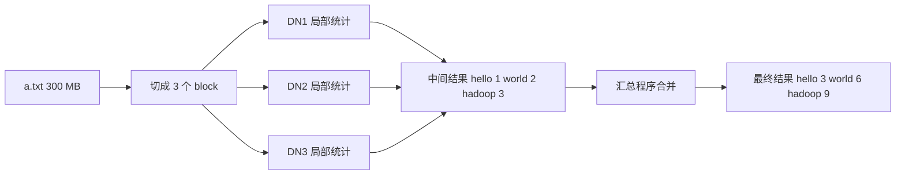

# MapReduce 介绍：Hadoop 生态里负责计算的另一半

HDFS 学完，PB 级数据存得下了，但存下来只是第一步。一个 300 MB 的 `a.txt` 摊在面前，要统计每个单词出现的次数，单机把文件整个读进内存再写 Java 逻辑，文件再大一点内存就溢出，效率也上不去。Hadoop 两大核心，HDFS 管分布式存储，MapReduce 管分布式计算，数据存好之后，就轮到它出场。

## 先给结论

- MapReduce 是运行在 YARN 集群上的分布式计算框架，定位是海量数据的离线批处理，与 HDFS 并列构成 Hadoop 的两大核心。
- 核心思想分而治之：Map 阶段负责分，把大问题拆成多个互不依赖的小问题并行处理；Reduce 阶段负责合，把各分片的中间结果汇总成最终结果。
- 计算跟着数据走：文件切成块存到哪几台 DataNode，统计程序就复制到哪几台机器上就地计算，避免把海量数据搬到一台机器。
- 每个分片上跑的统计程序叫 map task，负责汇总的程序叫 reduce task，本质都是运行在节点上的进程。
- 生活化类比：集团统计年度盈利，各省分公司先各自汇总再上报总部，远快于把全量流水寄到总部一起算。

## 一、为什么存储之外还要一个计算框架

需求很朴素：`a.txt` 共 300 MB，统计其中每个单词出现的次数，期望拿到 `hello 5`、`world 3`、`hadoop 2`、`java 1` 这样的最终结果。

传统做法是单机读文件、写统计逻辑，文件超过内存就溢出，一台机器的算力也有上限。用分布式计算的思想重新看这个问题：`a.txt` 上传 HDFS 时已经按 128 MB 一块切成三个 block，分别存在 DN1、DN2、DN3 三台 DataNode 上。数据本来就散着放，统计逻辑为什么不散着跑？

于是把同一个统计程序复制三份，分别在三台 DataNode 上对本地 block 就地统计，各自得出一份局部结果；再找一台节点跑一个汇总程序，把三份局部结果合并成最终结果。文件再大，无非是多切几块、多复制几份程序，任务量被摊薄到整个集群。

## 二、分而治之：一次单词计数的完整走法

输入与期望输出对照：

```text
a.txt 内容（节选）          期望输出
hello,world                hello  5
hello,hadoop               world  3
hdfs,hadoop                hadoop 2
hello,java                 java   1
```

完整流程如图：



图里前半段是 Map 阶段：把大文件拆块、把程序分发下去并行统计，产出各块局部的中间结果。后半段是 Reduce 阶段：把中间结果汇总合并成最终答案。这就是分而治之，Map 负责分，Reduce 负责合。中间结果里的数字是课堂板书的演示值，实际统计时每个单词的次数取决于文件内容。

给两个阶段的专业命名：每个 DataNode 上跑的统计程序叫 map task，一个 map task 就是一个进程；做汇总的程序叫 reduce task。map task 每读完一行就拆词记数，后续课程会用真实工程里的 Mapper 落地这件事：

```java
// 摘自课程后续词频统计工程，包名已改写：map task 的业务核心就是拆词记 1
public class WordCountMapper extends Mapper<LongWritable, Text, Text, LongWritable> {
    @Override
    protected void map(LongWritable key, Text value, Context context)
            throws IOException, InterruptedException {
        String line = value.toString();
        String[] split = line.split(",");
        for (String word : split) {
            context.write(new Text(word), new LongWritable(1));
        }
    }
}
```

## 三、它跑在哪：与 YARN 的关系

MapReduce 自己不管理机器，计算任务跑在 YARN 集群上。YARN 有两大部件：ResourceManager 负责全局控制，计算任务来了由它接收并指派；NodeManager 负责具体执行，在自己管理的节点上把任务跑起来。map task、reduce task 都是 NodeManager 启动并看护的进程，资源申请、任务分配这些协调动作全部经由 YARN 完成，具体链路在框架结构那一课展开。

## 常见误区

- **把 MapReduce 理解成单机工具类。** 它是分布式计算框架，程序会被复制到多台节点并行运行，产出中间结果再汇总，与单机内存里的统计代码是两套运行模型。
- **以为统计程序在 NameNode 上跑。** 计算跟着数据走，程序复制到数据所在的 DataNode 就地执行；NameNode 只管元数据，不承载业务计算。
- **混淆 HDFS 与 YARN 的分工。** HDFS 负责把数据分块存住，YARN 负责给计算任务分配机器与资源，MapReduce 是跑在这两者之上的计算模型。
- **拿它做低延迟查询。** MapReduce 的强项是离线批处理，任务以分钟计，秒级响应的交互式查询要另选引擎。

## 面试可能被问到的问题

1. 面试官追问：「MapReduce 的核心思想是什么？」
   答：分而治之。把大计算任务拆成互不依赖的小任务并行处理（Map），再把各小任务的结果汇总（Reduce）。类比集团统计盈利：各省分公司先各自汇总，总部只合并各省结果。
2. 面试官追问：「Map 阶段和 Reduce 阶段各自做什么？」
   答：Map 阶段对每个数据分片执行相同的重复处理，输出键值对形式的中间结果；Reduce 阶段把相同 key 的中间结果归并汇总，产出最终结果。
3. 面试官追问：「为什么要把程序复制到数据所在节点，而不是把数据搬过来？」
   答：移动计算比移动数据划算。数据动辄 TB 级，跨网络搬迁既慢又占带宽；程序代码只有几十 KB，复制到节点后就地读取本地块，网络开销降到最低。
4. 面试官追问：「map task 和 reduce task 是什么？」
   答：都是运行在集群节点上的进程。map task 由 NodeManager 启动，处理分配给它的数据分片；reduce task 拉取 map 的输出做汇总。每个作业会有一批 map task 和若干 reduce task。
5. 面试官追问：「MapReduce 适合什么场景，不适合什么场景？」
   答：适合海量数据的一次性离线批处理，比如日志统计、指标汇总，对完成时间不敏感；不适合低延迟的交互式查询和强依赖迭代中间结果的机器学习计算，后者由 Spark 等引擎承接。

## 配套资料

- 本课为 MapReduce 开篇概念课，day03 资料包未收录讲义与源码，示例数据与流程图按课堂板书整理；文中 Mapper 代码摘自课程后续真实工程 `materials/code/04/day04-MapReduce高级/day04/代码/day04_mapreduce_combiner/src/main/java/`，包名统一改写为 `com.study.mapreduce`。
