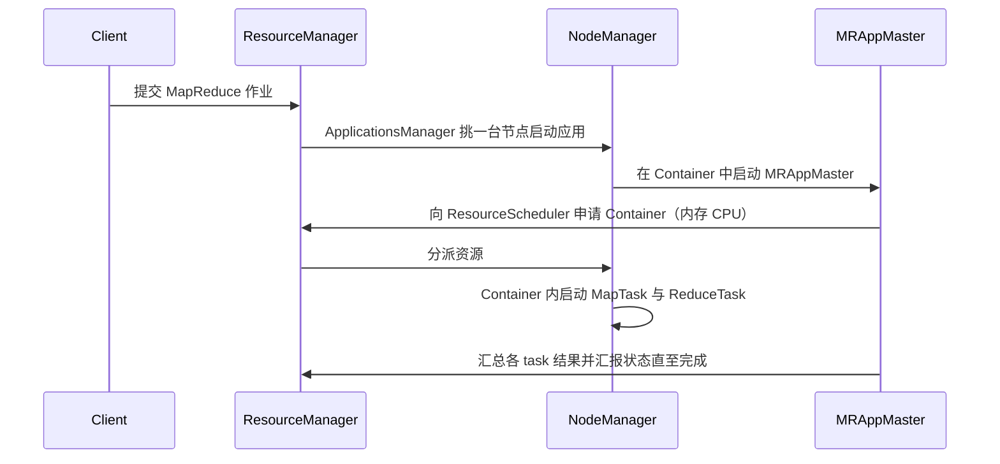

# MapReduce 的构思和框架结构：做什么与怎么做分离，三类进程跑一个作业

写一个分布式统计程序，要处理数据切片、任务分配、节点间通信、失败重试、资源申请，每一样单拎出来都够写一个季度。MapReduce 存在的意义就是把这些收进框架：用户写好业务逻辑代码，框架自带的一套默认组件与之整合成完整程序，投放到 Hadoop 集群上跑。这一课拆它的两条设计构思、一套键值对编程模型，以及作业在 YARN 上的完整运行链路。

## 先给结论

- MapReduce 的核心功能：把用户编写的业务逻辑代码与框架自带的默认组件整合在一起，运行在 Hadoop 集群上。
- 构思一，分而治之：大任务拆小任务并行，前提是小任务之间没有依赖关系。
- 构思二，统一架构隐藏细节：切片、传输、容错、资源申请都由框架兜底，用户只写「做什么」，框架决定「怎么做」。
- 编程模型是一套键值对转换：Map 把 K1 V1 变成 K2 V2，Reduce 把 K2 V2 变成 K3 V3，整个计算就是两次键值对变换。
- 一个完整的 MapReduce 程序分布式运行时有三类实例进程：MRAppMaster、MapTask、ReduceTask，调度由 YARN 完成。

## 一、两条构思：分而治之，统一架构

**第一，分而治之，且要拆得开。** 把大计算任务划分成小计算任务并行执行，划分有一个硬前提：小任务之间不能产生依赖关系。单词计数拆成三块各统计各的，互不牵扯，可以并行；如果第二步必须等第一步的完整结果才能开始，这种结构就拆不成并行小任务。

**第二，统一架构，隐藏细节。** 实现分布式计算，如果切片怎么切、中间结果怎么跨节点传输、某个 task 挂了怎么重试都要用户自己写，没人用得起。MapReduce 给了一个统一的计算框架把这些细节收走，用户只需要干好自己该干的事。一句话概括：通过抽象模型和计算框架，把「需要做什么」与「具体怎么做」分开。编程任务量从「写一个分布式系统」降到「重写两个方法」。

抽象模型 Map 与 Reduce 取自函数式语言：Map 对一组数据做某种重复式处理，Reduce 对 Map 产生的中间结果做汇总。框架同时提供了一组接口，实现接口、重写方法，就能接入分布式运行。

## 二、KV 转换：map 与 reduce 的真实长相

MapReduce 处理的数据类型是键值对，可以理解成一个个 Map 集合条目。两个阶段各自做一次转换：Map 阶段把 K1 V1 变成 K2 V2，Reduce 阶段把 K2 V2 变成 K3 V3。把 K1 V1 到 K3 V3 的转换写完，计算任务就完成了。

以单词计数为例，课程配套工程里的 Mapper 与 Reducer（包名已改写为 `com.study.mapreduce`）：

```java
package com.study.mapreduce;

import org.apache.hadoop.io.LongWritable;
import org.apache.hadoop.io.Text;
import org.apache.hadoop.mapreduce.Mapper;

import java.io.IOException;

// 泛型依次是 K1 V1 K2 V2
public class WordCountMapper extends Mapper<LongWritable, Text, Text, LongWritable> {
    @Override
    protected void map(LongWritable key, Text value, Context context)
            throws IOException, InterruptedException {
        // 一行文本按逗号拆词，每个单词输出一次 <单词, 1>
        String line = value.toString();
        String[] split = line.split(",");
        for (String word : split) {
            context.write(new Text(word), new LongWritable(1));
        }
    }
}
```

```java
package com.study.mapreduce;

import org.apache.hadoop.io.LongWritable;
import org.apache.hadoop.io.Text;
import org.apache.hadoop.mapreduce.Reducer;

import java.io.IOException;

// 泛型依次是 K2 V2 K3 V3，values 是同一单词收到的所有 1
public class WordCountReducer extends Reducer<Text, LongWritable, Text, LongWritable> {
    @Override
    protected void reduce(Text key, Iterable<LongWritable> values, Context context)
            throws IOException, InterruptedException {
        long count = 0;
        for (LongWritable value : values) {
            count += value.get();
        }
        context.write(key, new LongWritable(count));
    }
}
```

一行的完整旅程：

```text
map 输入     K1: 0          V1: hello,world
map 输出     K2: hello      V2: 1
reduce 输入  K2: hello      V2: <1,1,1>
reduce 输出  K3: hello      V3: 3
```

`K1` 是行偏移量，由框架的输入组件产生，`V1` 是一行文本；map 拆词输出 `K2 V2`；框架把相同单词的 1 收集成一个序列交给 reduce；reduce 累加输出 `K3 V3`。计算必有输入输出，作业的输入输出路径在 Job 对象上指定：

```java
// 输入与输出是框架约定的必填项
TextInputFormat.addInputPath(job, new Path("hdfs://node01:8020/wordcount"));
TextOutputFormat.setOutputPath(job, new Path("hdfs://node01:8020/wordcount_out"));
```

## 三、框架结构：三类实例进程与 YARN 流水线

MapReduce 基于 YARN 集群运行，一个完整的程序在分布式运行时有三类实例进程：MRAppMaster、MapTask、ReduceTask。MRAppMaster 是每个作业的管理者，不承载业务逻辑，负责申请资源、分派任务、汇报进度；MapTask 与 ReduceTask 才是干活的。

作业提交后的完整链路：



ResourceManager 是 YARN 的主节点，内部有两个关键组件：ApplicationsManager 负责应用管理，作业提交后它挑一台 NodeManager 把 MRAppMaster 启动起来；ResourceScheduler 负责资源调度，MRAppMaster 向它申请内存与 CPU，申请到的资源以 Container 为单位。资源落到各 NodeManager 手里，由它们启动 Container 运行 MapTask、ReduceTask，任务结果汇到 MRAppMaster，再由它向 ApplicationsManager 汇报，直至作业完成。NodeManager 是 YARN 的从节点，也是资源的实际宿主。

## 常见误区

- **以为用户要写分布式调度代码。** 切片、跨节点传输、容错重试、资源申请全由框架与 YARN 兜底，用户只实现 Mapper、Reducer 并重写 map、reduce 方法。
- **任何任务都想拆。** 分而治之的前提是小任务间无依赖、可并行，有严格先后依赖的计算拆不成 MapReduce 的形状。
- **把 MRAppMaster 当业务入口。** 它是框架为每个作业启动的管理进程，负责资源申请与状态汇报；业务逻辑在 MapTask 与 ReduceTask 里。
- **混淆 ResourceManager 与 MRAppMaster。** 前者是整个集群的资源管理者，常驻集群；后者是单个作业的应用管理者，作业结束即退出。

## 面试可能被问到的问题

1. 面试官追问：「怎么理解把需要做什么与具体怎么做分开？」
   答：需要做什么指用户的业务逻辑，比如拆词、计数，写在 Mapper 与 Reducer 里；具体怎么做指切片、数据传输、容错、资源调度这些分布式细节，由 MapReduce 框架和 YARN 实现。用户面对的是一个统一的抽象模型，编程量大幅下降。
2. 面试官追问：「一个 MapReduce 作业运行时有哪三类实例进程？」
   答：MRAppMaster、MapTask、ReduceTask。MRAppMaster 负责整个作业的资源申请、任务分派与进度汇报；MapTask 处理各数据分片；ReduceTask 汇总中间结果。
3. 面试官追问：「K1 V1 K2 V2 K3 V3 分别是什么？」
   答：以单词计数为例，K1 V1 是输入的行偏移量和一行文本，K2 V2 是 map 输出的单词和 1，K3 V3 是 reduce 输出的单词和总次数。整个计算就是两次键值对变换。
4. 面试官追问：「分而治之对任务拆分有什么前提？」
   答：小任务之间不能有依赖关系，必须能并行执行。各分片独立处理、各自出结果，才谈得上分布；有先后依赖的逻辑需要改造数据流或者换引擎。
5. 面试官追问：「MRAppMaster 申请的资源以什么为单位？」
   答：Container，封装了一定量的内存与 CPU。MRAppMaster 向 ResourceManager 的 ResourceScheduler 申请 Container，申请到的资源由对应 NodeManager 启动容器来运行 MapTask 或 ReduceTask。

## 配套资料

- 代码：`materials/code/04/day04-MapReduce高级/day04/代码/day04_mapreduce_combiner/src/main/java/`，课程后续 MapReduce 高级篇的真实词频统计工程，正文 Mapper、Reducer 与 Job 输入输出代码摘自该工程，包名统一改写为 `com.study.mapreduce`。
- 本课为概念与框架结构课，day03 资料包未收录讲义与源码，运行链路图按课堂板书与框架结构图重绘。
