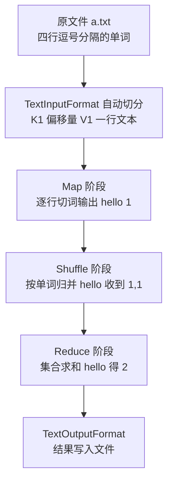
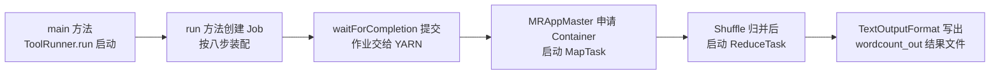

# MapReduce案例-wordcount四讲：八步拆解、Map 与 Reduce 代码、JobMain 装配与集群运行排错

## 先给结论

wordcount 是大数据的 Hello World：在一个文本文件里统计每个单词出现的总次数。它小到一行业务逻辑，又全到覆盖 MapReduce 八步骨架的每一环，第一次真正动手写 MapReduce 作业，从它开始最合适。全系列四讲从步骤拆解写到集群运行排错，跑通一个完整作业。
第一讲把八步套在 wordcount 身上走一遍：K1 V1 由 TextInputFormat 自动产生，Map 逐行切词输出 (单词, 1)，三行核心逻辑配上 LongWritable 与 Text 两个 Hadoop 类型。第二讲写 Reduce：泛型前两个必须接住 Mapper 的输出，reduce 按 key 被调用，遍历、累加、写出三步，values 是 Iterable 而不是 List 的原因也要咬准。
第三讲是主程序 JobMain：main 与 run 的固定分工，八步按次序装配成 Job，输出路径必须预先不存在。第四讲把作业提交上集群：packaging 定 jar、scope 写 provided、setJarByClass 一行都不能少，先后撞上 ClassNotFoundException 与输出目录已存在两个经典报错，各对应一个机制，排掉之后结果文件 part-r-00000 与 _SUCCESS 标志就位。
四讲依次是：
- 步骤分析：八步套进 wordcount、数据准备与 WordCountMapper 逐行拆解。
- Reduce 阶段代码：泛型对接、Iterable 遍历累加与写出。
- JobMain 代码：固定模板、八步装配与打包提交。
- 集群运行：打包准备、两个经典报错排错与结果验证。

## 第1部分：WordCount 步骤拆解与 Map 阶段实现：第一段真正要写的业务代码

八步骨架背下来了，落到具体需求还是不知道第一行代码写什么。wordcount 是大数据的 Hello World：在一个文本文件里统计每个单词出现的总次数。把八步套在它身上走一遍，每一步的数据长什么样、哪几步要自己写，看完就有手感；这一课同时把数据准备、Maven 工程和 Map 阶段代码一次做完。

### 一、把 wordcount 套进八步

拿四行英文数据当原文件（课堂画法，偏移量按字节计、暂忽略换行符）：

```text
hello,world
hello,hadoop
world,hdfs
hadoop,java
```

八步中的第一步由 `TextInputFormat` 完成：读取原文件，每一行变成一个键值对，K1 是这一行相对文件起点的字节偏移量，V1 是这一行的文本。`hello,world` 是 11 个字节，所以第二行的偏移量是 11，依此类推得到 23、33。这一步完全自动，K1 V1 长这样：

```text
K1     V1
0      hello,world
11     hello,hadoop
23     world,hdfs
33     hadoop,java
```

第二步是 Map 阶段要自己写的逻辑：把 K1 V1 转成 K2 V2。转成什么样由业务决定，统计次数最自然的做法是把一行按逗号切开，每个单词后面配一个固定值 1，表示出现了一次。四行数据切完得到 8 个键值对，hello 和 world、hadoop 各出现两次，hdfs 和 java 各一次。

Shuffle 阶段接管 K2 V2，做分区、排序、规约、分组四件事，作用是把相同单词的 1 收进同一个集合。分组之后键值对变成了新的 K2 V2：hello 对应 `1,1`，hadoop 对应 `1,1`，hdfs 对应 `1`。这一过程默认自动完成。

Reduce 阶段把新 K2 V2 转成 K3 V3：K3 还是单词，V3 是把集合里的每个 1 相加的结果，hello 得 2，hdfs 得 1。最后由 `TextOutputFormat` 把 K3 V3 写进结果文件。整条数据流：



关键路径：第 1、3、4、5、6、8 步框架包办，业务代码集中在 Map 的切词打 1 与 Reduce 的求和。

### 二、数据准备与 Maven 工程

写代码前把环境和原料备齐。数据侧两件事：建一个文本文件写入单词，再上传到 HDFS。进到数据目录建 `wordcount.txt`，实际使用的内容为：

```text
hello,world,hadoop
world,hdfs
hadoop,java
```

上传用 HDFS 命令，目录建在根下，文件放进去：

```bash
hdfs dfs -mkdir /wordcount
hdfs dfs -put wordcount.txt /wordcount
```

传完在 HDFS 的 Web 页面能看到 `/wordcount/wordcount.txt` 即算就绪。几行数据不影响流程，四行三行走的是同一条八步路。

工程侧新建一个 Maven 模块，名字如 `day03_mapreduce_wordcount`，坐标改为中性包名 `com.study.mapreduce`。依赖沿用课程真实工程的做法，引入 `hadoop-client`：

```xml
<dependency>
    <groupId>org.apache.hadoop</groupId>
    <artifactId>hadoop-client</artifactId>
    <version>3.1.1</version>
</dependency>
```

课程课堂上演示的是把上一模块的 pom 复制过来再补依赖；真实工程里 `hadoop-client` 等依赖均为 3.1.1，编译目标 1.8。依赖就位后，在 `com.study.mapreduce` 包下建三个类：WordCountMapper、WordCountReducer、JobMain，Map 阶段先写第一个。

### 三、WordCountMapper 逐行拆解

Mapper 的四个泛型前两个是 K1 V1 的类型，后两个是 K2 V2 的类型。真实工程代码与课堂讲解一致：

```java
package com.study.mapreduce;

import org.apache.hadoop.io.LongWritable;
import org.apache.hadoop.io.Text;
import org.apache.hadoop.mapreduce.Mapper;

import java.io.IOException;

// 泛型依次是 K1 V1 K2 V2 的类型
public class WordCountMapper extends Mapper<LongWritable, Text, Text, LongWritable> {
    // map 方法每被调用一次处理一行
    @Override
    protected void map(LongWritable key, Text value, Context context)
            throws IOException, InterruptedException {
        Text text = new Text();
        // 1. 对每一行的数据进行字符串拆分
        String line = value.toString();
        String[] split = line.split(",");
        // 2. 遍历数组，获取每一个单词
        for (String word : split) {
            text.set(word);
            // 3. 把 K2 V2 写入上下文，传给 Shuffle
            context.write(text, new LongWritable(1));
        }
    }
}
```

**map 方法的三个参数各司其职。** `key` 就是 K1，本行文本的字节偏移量，词频统计用不到它但不能删；`value` 是 V1，一行文本，拆词全靠它；`context` 是 MapReduce 的上下文对象，代表整个作业的执行流程，是 Map 与后续阶段之间的桥梁，输出全靠 `context.write` 往下传。

**切词逻辑跟着数据走。** `value` 的类型是 Text，先 `toString()` 转成字符串 `line`，再 `split(",")` 按逗号切出单词数组。数据文件里单词以逗号分隔，所以分隔符写逗号；换成空格分隔的数据就写 `split(" ")` 或者用 `StringTokenizer`，分隔符由数据决定，不是固定的。

**write 的参数类型必须与泛型对齐。** `context.write` 的签名要求第一个参数是 Text、第二个是 LongWritable，`word` 是 String、`1` 是 int，直接传编译不过，所以要 `new Text(word)` 和 `new LongWritable(1)`。每循环一次输出一个键值对，一行 `hello,world` 就输出两个：`(hello, 1)` 和 `(world, 1)`。

**循环内 new 对象可以再省一点。** 每轮 `new Text()` 会产生大量短命对象，提取到循环外用 `set()` 换内容复用是惯用写法，`LongWritable` 同理。真实工程对固定值 1 保留了直接构造，效果相同。

## 第2部分：WordCount 的 Reduce 阶段：Iterable 遍历累加，把一堆 1 变成总次数

Map 端把每个单词都变成了 (单词, 1)，同一单词的 1 经过 Shuffle 归并收进同一个集合。谁来把 hello 的 `1,1` 变成 2？这就是 Reduce 阶段的活。写 WordCountReducer 时最费解的一处是 reduce 方法的第二个参数：它是一个 `Iterable`，既没有 size 也下标取不了值，为什么框架给的是这种形态。

### 一、Reducer 的泛型：接住 Mapper 的输出

自定义 Reducer 同样继承框架类、重写方法。四个泛型的含义与 Mapper 呼应：前两个对应 K2 V2，后两个对应 K3 V3。课程真实工程的声明（包名改写为 `com.study.mapreduce`）：

```java
package com.study.mapreduce;

import org.apache.hadoop.io.LongWritable;
import org.apache.hadoop.io.Text;
import org.apache.hadoop.mapreduce.Reducer;

import java.io.IOException;

// 泛型依次是 K2 V2 K3 V3 的类型
// KEYIN   K2 每个单词        Text
// VALUEIN V2 集合元素类型    LongWritable
// KEYOUT  K3 每个单词        Text
// VALUEOUT V3 单词出现次数   LongWritable
public class WordCountReducer extends Reducer<Text, LongWritable, Text, LongWritable> {
}
```

K2 是单词所以是 Text；V2 声明的不是集合类型本身，而是集合中元素的类型，也就是 LongWritable。这里填 `IntWritable` 还是 `LongWritable` 都可以，一个是 int 的封装、一个是 long 的封装，前提是与 Mapper 的 V2 类型保持一致，Mapper 输出 LongWritable，这里就得写 LongWritable。

### 二、reduce 方法：遍历、累加、写出

分组后的新 K2 V2 长这样，每组进一次 reduce 方法：

```text
K2       V2            K3       V3
hello    1,1     ->    hello    2
world    1,1     ->    world    2
hadoop   1,1     ->    hadoop   2
hdfs     1       ->    hdfs     1
java     1       ->    java     1
```

转换逻辑三步：遍历 values 集合、把集合中的值相加、把 K3 V3 写入上下文。真实工程实现：

```java
@Override
protected void reduce(Text key, Iterable<LongWritable> values, Context context)
        throws IOException, InterruptedException {
    long count = 0;
    // 1. 遍历 values 集合
    for (LongWritable value : values) {
        // 2. 将集合中的值相加
        count += value.get();
    }
    // 3. 将 K3 和 V3 写入上下文中
    context.write(key, new LongWritable(count));
}
```

**参数与泛型一一对应。** `key` 是 K2 单词；`values` 是该单词收到的所有 1 构成的序列，类型 `Iterable<LongWritable>`；`context` 还是那个上下文对象，把各阶段连起来。注意泛型里 V2 写的是元素类型，方法参数里拿到的是装这些元素的 `Iterable`，两者不矛盾。

**LongWritable 要 get() 成 long 才能运算。** `value` 是 LongWritable 对象，直接相加不行，调 `value.get()` 取出内部的 long 值再累加到 `count`。算完的 `count` 是 long，写出去时反向包一层 `new LongWritable(count)`，类型又回到框架要求的形态。

**reduce 输出后就是终点前最后一站。** `context.write` 写出的 K3 V3 交给第八步设置的 `TextOutputFormat`，由它自动写进结果文件，每一行是 `单词<TAB>次数`，用户不用再操心写文件的细节。

数据流一张图：


关键路径：每个 K2 触发一次 reduce 调用，组内的值在方法里走完一遍迭代，输出键值对直接进入输出组件。

### 三、为什么 values 是 Iterable 而不是 List

**第一，分组结果不保证在内存里凑成一个完整集合。** 分组把相同 K2 的 V2 拉到一个序列，热门单词的值序列可能有几百万个元素，全部物化成 List 再算，内存扛不住。框架给的是迭代器语义：数据在哪不重要，按需逐个吐出来，走完一遍刚好算完，空间复杂度与组内元素个数解耦。

**第二，框架在迭代中复用对象。** for 循环每次拿到的 `LongWritable` 很可能是同一个被反复填充的实例，迭代到下一个元素时上一个对象的值就被覆盖了。所以 `value.get()` 要在循环体内立刻取值，不能把对象存进集合等循环结束后再算，那时所有元素都是最后一轮的值。

**第三，求和恰好只需要单遍。** 累加是无状态的，来一个加一个，不需要回头取第 i 个元素，也不需要提前知道组内有多少个，`Iterable` 的能力完全够用。如果要算平均数，同样是一遍循环里同时累加 sum 和计数，不因为拿不到 size 而受限。

## 第3部分：WordCount 主程序 JobMain：八步装配、打包提交与日志观察

Mapper 和 Reducer 写完，手里还只是两段业务逻辑，类自己不会跑。谁创建任务对象、谁告诉框架每一步用哪个类、数据从哪里读结果写到哪里、jar 包怎么丢到集群上执行，这些问题都归主程序 JobMain 管。把主程序写完，wordcount 才真正成为一个能提交的 MapReduce 作业。

### 一、固定模板：main 与 run 的分工

主程序的写法在 Hadoop 里几乎是一字不改的模板。`main` 方法是 JVM 入口，负责new 配置对象并启动任务；`run` 方法是任务装配现场，八步都写在这里。真实工程的骨架（包名改写为 `com.study.mapreduce`）：

```java
package com.study.mapreduce;

import org.apache.hadoop.conf.Configuration;
import org.apache.hadoop.conf.Configured;
import org.apache.hadoop.util.Tool;
import org.apache.hadoop.util.ToolRunner;

public class JobMain extends Configured implements Tool {
    @Override
    public int run(String[] args) throws Exception {
        // 装配八步，见下文
        return 0;
    }

    public static void main(String[] args) throws Exception {
        Configuration configuration = new Configuration();
        // 启动一个任务，configuration 传给 ToolRunner，args 是命令行参数
        int run = ToolRunner.run(configuration, new JobMain(), args);
        System.exit(run);
    }
}
```

`ToolRunner.run` 做了三件事：解析命令行参数、把 configuration 通过 `setConf` 存进 Tool 实现类（也就是 JobMain 的父类 `Configured`）、回调 `run` 方法。因此 `run` 里拿配置不能自己再 new 一个，那样就与 main 传的配置脱节了，要用 `super.getConf()` 取回同一个对象。`run` 的返回值最终交给 `System.exit`，0 表示任务执行成功，非 0 表示失败，方便脚本判断结果。

### 二、run 方法：把八步装配成 Job

八步与编程规范一一对应，框架提供了逐项设置的 API。课程真实工程的完整装配：

```java
@Override
public int run(String[] args) throws Exception {
    // 创建任务对象，第二个参数是任务名，会出现在集群调度页面上
    Job job = Job.getInstance(super.getConf(), "mapreduce_wordcount");

    // 打包放到集群运行时，需要做一个配置：指定主类所在 jar
    job.setJarByClass(JobMain.class);

    // 第一步：设置读取文件的类，它把文件按行切成 K1 V1，并指定输入路径
    job.setInputFormatClass(TextInputFormat.class);
    TextInputFormat.addInputPath(job, new Path("hdfs://node01:8020/wordcount"));

    // 第二步：设置 Mapper 类与 Map 阶段输出类型 K2 V2
    job.setMapperClass(WordCountMapper.class);
    job.setMapOutputKeyClass(Text.class);
    job.setMapOutputValueClass(LongWritable.class);

    // 第三到六步：分区、排序、规约、分组，采用框架默认实现

    // 第七步：设置 Reducer 类与 Reduce 阶段输出类型 K3 V3
    job.setReducerClass(WordCountReducer.class);
    job.setOutputKeyClass(Text.class);
    job.setOutputValueClass(LongWritable.class);

    // 第八步：设置输出类与输出路径
    job.setOutputFormatClass(TextOutputFormat.class);
    TextOutputFormat.setOutputPath(job, new Path("hdfs://node01:8020/wordcount_out"));

    // 提交任务并等待完成，返回值转成退出码
    boolean b = job.waitForCompletion(true);
    return b ? 0 : 1;
}
```

几个细节值得停下来看。输入路径 `hdfs://node01:8020/wordcount` 是 HDFS 上的目录，数据放在哪就写到哪，写目录名而不是文件名，框架会把目录下的文件都作为输入。输出路径 `wordcount_out` 必须是当前不存在的目录，作业成功后由框架自动创建；提前建好或残留上次的目录，任务启动即报错，删掉再跑。Map 输出类型与最终输出类型分开设置，`setMapOutputKeyClass` 管 K2，`setOutputKeyClass` 管 K3。`waitForCompletion(true)` 提交作业并阻塞等待结果，参数传 false 则提交后不打印进度、方法立即返回。

提交到集群后的执行链路：



关键路径：客户端只负责装配和提交，真正跑起来是 YARN 分资源、MRAppMaster 管流程、MapTask 与 ReduceTask 干活。

### 三、打包提交与日志观察

本地写完先打包，Maven 会把编译产物放进 `target` 目录：

```bash
mvn clean package -DskipTests
```

把 jar 提交到集群用 `hadoop jar` 命令，后面跟 jar 路径和主类全限定名：

```bash
hadoop jar target/day03_mapreduce_wordcount-1.0-SNAPSHOT.jar com.study.mapreduce.JobMain
```

提交成功后客户端日志的观察点依次是：作业 id 形如 `job_17xx...`，接着进入 Running job 状态，map 和 reduce 各自打到 `100%`，最后 Completed successfully 并输出一屏 Counters，其中 `Map input records` 应等于输入文件的行数、`Reduce output records` 应等于单词个数，两组数字对得上，说明跑的是预期数据。作业执行期间在 YARN 的 8088 页面能看到任务名 `mapreduce_wordcount` 的运行状态，历史服务 19888 页面可以查每个 task 的日志。

跑完看结果，输出目录里 `part-r-00000` 就是 Reduce 的产出，`r` 代表 reducer：

```bash
hdfs dfs -cat /wordcount_out/part-r-00000
```

内容一行一个单词加次数，键之间按字典序排列，这是 Shuffle 阶段默认排序的效果，单词与次数之间是制表符：

```text
hadoop   2
hello    1
hdfs     1
java     1
world    2
```

与手工数出来的结果一致，八步骨架从数据文件到结果文件完整闭合。

## 第4部分：把 WordCount 跑上集群：打包、提交、排错与结果验证

Mapper、Reducer、JobMain 在 IDE 里本地跑通，只是开发阶段的自测。生产环境的 MapReduce 作业都提交到 Hadoop 集群上执行，数据在各节点之间流动。第一次把 wordcount 提交上去的人，几乎都会先后撞上两个报错：`ClassNotFoundException` 和输出目录已存在。这两个错各对应一个机制，弄明白之后，打包提交就是一套固定动作。

### 一、打包前的两处准备

第一处在 `pom.xml`。Maven 默认按 jar 打包，但工程模板里通常会显式声明，把打包方式和依赖范围一起定清楚（包名已改写为 `com.study`）：

```xml
<groupId>com.study</groupId>
<artifactId>day03_mapreduce_wordcount</artifactId>
<version>1.0-SNAPSHOT</version>
<packaging>jar</packaging>

<dependencies>
    <dependency>
        <groupId>org.apache.hadoop</groupId>
        <artifactId>hadoop-common</artifactId>
        <version>3.1.1</version>
        <scope>provided</scope>
    </dependency>
</dependencies>
```

`provided` 这个 scope 值得说一下：它的含义是编译期可见、运行期由目标环境提供。集群的每个节点上都装着完整的 Hadoop，`hadoop jar` 命令启动时自动把 Hadoop 的类路径挂上，所以自己的包里不需要也不应该再塞一份 Hadoop 的类。

第二处在 IDEA 右侧的 Maven 面板。点一下「Skip Tests」按钮（闪电图标），让打包时跳过测试代码的执行，然后双击 `package`。构建完成后工程目录下多出 `target` 目录，里面的 `day03_mapreduce_wordcount-1.0-SNAPSHOT.jar` 就是产物，把它上传到集群节点的 `/export/software` 目录。

### 二、提交命令与主类全限定名

在节点上执行 `hadoop jar`，第一个参数是 jar 包名，第二个参数是主类的全限定名，也就是包名加类名：

```bash
hadoop jar day03_mapreduce_wordcount-1.0-SNAPSHOT.jar com.study.mapreduce.JobMain
```

主类名可以在 JobMain 类上右键选「Copy Reference」直接复制，避免手敲出错。这条命令可以在任意一个节点上执行，执行命令的机器充当客户端，负责装配作业并提交给 YARN，之后它只负责打印进度。

### 三、第一个错：ClassNotFoundException

首次提交大概率看到这样的日志：

```bash
Error: java.lang.RuntimeException: java.lang.ClassNotFoundException: Class com.study.mapreduce.WordCountMapper
```

这个错很反直觉：JobMain 里明明用 `setMapperClass(WordCountMapper.class)` 指定过 Mapper，类也确实在工程里。原因在运行方式变了。本地 IDE 运行时，整个工程就是一个 JVM，所有类都在类路径上；集群运行时，作业被拆成多个 MapTask 分散到 node01、node02、node03 上执行，每个节点的 JVM 都要加载 `WordCountMapper` 的字节码，而这个类只存在于提交客户端本地的 jar 里，节点上并没有。

修复只要一行。run 方法里加上：

```java
// 打包放到集群运行时，需要做一个配置：指定主类所在 jar
job.setJarByClass(JobMain.class);
```

框架根据传入的 class 对象定位它所在的 jar，提交作业时把 jar 随任务分发到各节点，MapTask 和 ReduceTask 才加载得到自定义的 Mapper、Reducer。改完重新 `mvn clean package`，把旧 jar 删掉、新 jar 重新上传，再次提交。

### 四、第二个错：输出目录已存在

修完类加载的问题再提交，这次卡在另一个报错上：输出目录已存在。原因是之前某次运行已经在 HDFS 上建过 `/wordcount_out`，而框架要求输出路径必须不存在，成功后由它自动创建，这是一层防止覆盖历史结果的保护。删除旧目录再提交：

```bash
hdfs dfs -rm -r /wordcount_out
```

### 五、进度、计数器与结果文件

删完目录第三次提交，日志的推进节奏是固定的：作业 id 形如 `job_17xx...`，进入 Running job 状态，map 从 0% 走到 100%，reduce 接着走到 100%，最后输出 Completed successfully 和一整屏 Counters。计数器是对账工具，两个关键项要对得上：`Map input records` 应等于输入文件的行数，`Reduce output records` 应等于统计出的单词个数。作业运行期间，YARN 的 8088 页面上能看到任务名 `mapreduce_wordcount` 的状态，历史服务 19888 页面可以回查每个 task 的日志。

整个提交运行链路：


关键路径：客户端只装配和提交，真正干活的是 YARN 拉起的 MapTask 与 ReduceTask，产物落在 HDFS 的输出目录里。

结果目录里有两个东西，`_SUCCESS` 是一个空文件，只作成功标志；`part-r-00000` 才是结果，`r` 代表 reducer：

```bash
hdfs dfs -cat /wordcount_out/part-r-00000
```

```text
flume    1
hadoop   2
hello    2
```

内容为节选，一行一个单词加出现次数，中间是制表符，键按字典序排列。到此 wordcount 案例从代码到集群结果完整闭环，后面的分区、排序等案例都在这个骨架上改。

## 常见误区

- **把 K1 当行号。** 第二行的 K1 是 11，不是 1，它是相对文件起点的字节偏移量；实际计算含换行符，课堂画法暂忽略。
- **分隔符写死空格。** 数据是逗号分隔时 `split(" ")` 切出来的是整行，拆词结果直接错，分隔符要看数据本身。
- **在 map 里做汇总。** Map 阶段只负责把一行拆成 (单词, 1)，累加是 Reduce 的事，职责混了后面全乱。
- **write 直接传 String 和 int。** 泛型声明是 Text 和 LongWritable，参数必须 new 成对应类型，否则编译不过。
- **map 方法漏抛异常。** `IOException` 和 `InterruptedException` 是父类方法签名的一部分，删掉就重写不兼容。
- **对 values 调 size() 或 get(i)。** `Iterable` 接口只有 iterator 和 for-each，没有长度也没有下标，编译直接报错，求和用单遍循环解决。
- **把迭代出的对象存起来事后算。** 对象被框架复用，循环结束后集合里全是最后一次的值，必须循环内立刻 `get()`。
- **Reducer 泛型与 Mapper 输出对不上。** Mapper 输出 K2 是 Text、V2 是 LongWritable，Reducer 的前两个泛型写成别的类型，作业运行时类型不匹配直接失败。
- **累加后忘记 context.write。** 方法算完不写出，结果文件里就没有这个单词，每处理一组都该有对应的 write。
- **在 reduce 里依赖组间顺序。** 每次调用只看得到自己这组的 key 和 values，跨单词的逻辑不该放在 reduce 里。
- **提前建好输出目录。** 框架要求输出路径必须不存在，已存在时作业抛异常直接失败，重跑前删除旧目录或换新目录名。
- **输入路径写到具体文件。** `addInputPath` 传目录名即可，框架把目录下所有文件当输入；写成不存在的文件名则报文件找不到。
- **run 里 new 新的 Configuration。** 应通过 `super.getConf()` 使用 main 传入的同一个配置对象，另建一份会让作业读不到预期的配置。
- **忘了 job.setJarByClass(JobMain.class)。** 本地 IDE 里跑没事，提交集群后各节点找不到主类所在 jar，任务直接失败，这一行就是为分布式运行准备的。
- **改完代码不重新打包。** 集群上跑的还是旧 jar，症状是改了逻辑结果不变，重新 `mvn package` 再提交即可。
- **忘了 job.setJarByClass(JobMain.class)。** 本地 IDE 里跑不出问题，一提交集群就报 `ClassNotFoundException`。这一行就是为分布式运行准备的，它决定自定义类所在的 jar 会不会被分发到各节点。
- **以为 package 会把依赖一起打进 jar。** 默认的 `maven-jar-plugin` 只打包本模块的类，第三方依赖不会自动进入 jar；Hadoop 依赖应声明为 `provided`，由集群环境提供，需要打进依赖时才用 shade 插件。
- **输出目录提前建好或上次残留。** 框架只在作业成功时自动创建输出目录，已存在则提交即失败，重跑前用 `hdfs dfs -rm -r` 删掉或换新目录名。
- **只看 map 100% 就当跑完了。** map 阶段完成不等于作业成功，要等到 reduce 100%、日志输出 Completed successfully，并检查输出目录里出现 `_SUCCESS` 文件才算闭环。

## 面试可能被问到的问题

1. 面试官追问：「wordcount 的完整流程是什么？」
   答：输入文件由 TextInputFormat 按行切成 K1 V1，K1 是行偏移量、V1 是一行文本；Mapper 把每行按分隔符切词，输出 (单词, 1)；Shuffle 把相同单词的 1 归并成一个集合；Reducer 遍历集合求和输出 (单词, 总次数)；最终由 TextOutputFormat 写入结果文件。

2. 面试官追问：「K1 为什么是 LongWritable 而不是 Long？」
   答：Hadoop 的 KV 要跨节点序列化传输，框架自建了 Writable 序列化体系，Java 原生类型没有实现该接口。LongWritable 封装 long、Text 封装字节数组对应 String，体积小、序列化高效。

3. 面试官追问：「map 方法的三个参数分别是什么？」
   答：key 是 K1 行偏移量，value 是 V1 一行文本，context 是 MapReduce 上下文对象，负责把 map 的输出传递给下一级，是连接 Map 与 Shuffle、Reduce 的桥梁。

4. 面试官追问：「context.write 前为什么要 new Text 和 new LongWritable？」
   答：write 的参数类型由 Mapper 泛型的 KEYOUT、VALUEOUT 决定，word 是 String、1 是 int，与声明不符；必须包装成 Text 和 LongWritable 才能写出去，这也是框架在编译期帮你挡类型错误的机制。

5. 面试官追问：「K1 V1 需要自己写代码生成吗？」
   答：不需要。TextInputFormat 读取文件时自动按行生成 K1 V1，K1 默认是行首字节偏移量，用户代码只在 map 方法里消费它们。

6. 面试官追问：「reduce 方法会被调用多少次？」
   答：每个不同的 K2 调用一次。词频统计里就是一个单词一次，方法的 key 是该单词，values 是 Shuffle 分组后属于它的全部 1。

7. 面试官追问：「values 为什么是 Iterable 而不是 List？」
   答：组内的值序列可能极大，框架用迭代器按需提供数据，避免整体物化占内存；同时迭代中会复用对象，要求在循环内立刻取值。求和这类聚合单遍遍历即可，Iterable 语义足够。

8. 面试官追问：「Reducer 的四个泛型怎么确定？」
   答：前两个必须与 Mapper 的 KEYOUT、VALUEOUT 一致，接住 K2 V2；后两个由最终业务结果决定，词频统计里 K3 还是单词 Text，V3 是次数 LongWritable。

9. 面试官追问：「reduce 的输出最终写到哪里？」
   答：context.write 把 K3 V3 交给 Job 里设置的 OutputFormat，默认 TextOutputFormat 写到输出目录的 part 文件，每行一个键值对，键值间以制表符分隔。

10. 面试官追问：「想在 Reduce 里输出平均数而不是总数，怎么改？」
   答：遍历 values 时同时累加总和与个数，两个变量都在循环里更新，循环结束后输出总和除以个数。注意值可能是整数除法，按业务决定是否转浮点。

11. 面试官追问：「JobMain 为什么继承 Configured 还要实现 Tool？」
   答：Tool 接口让主类能被 ToolRunner 统一驱动，ToolRunner 会解析通用命令行参数，并通过 setConf 把 Configuration 注入 Configured 父类保存；run 方法里 super.getConf() 取回的正是同一份配置，这是 Hadoop 官方推荐的主程序模板。

12. 面试官追问：「super.getConf() 里的配置是从哪来的？」
   答：main 方法里 new 的 Configuration 传给 ToolRunner.run，ToolRunner 调用 tool.setConf 把它设置到 Configured 中，run 里再通过 super.getConf() 取回，保证整个作业使用同一个配置对象。

13. 面试官追问：「输出路径已存在会怎样？」
   答：作业提交时直接抛出目录已存在的异常并失败，框架只在作业成功时自动创建输出目录。重跑前要删除旧输出目录或改用新路径，这是防止覆盖历史结果的保护机制。

14. 面试官追问：「setMapOutputKeyClass 和 setOutputKeyClass 分别设什么？」
   答：前者设置 Map 阶段输出 K2 的类型，Shuffle 按 K2 排序分组；后者设置 Reduce 阶段最终输出 K3 的类型。词频统计里都是 Text，但两个声明含义不同，缺一个都可能导致运行时类型不匹配。

15. 面试官追问：「job.setJarByClass 的作用是什么？」
   答：框架根据传入的类定位它所在的 jar 包，并把 jar 分发到各工作节点，MapTask 和 ReduceTask 才能加载到自定义的 Mapper、Reducer。本地运行体现不出差别，集群运行缺了它就报 ClassNotFound。

16. 面试官追问：「waitForCompletion(true) 的参数是什么含义？」
   答：true 表示提交作业后阻塞等待，并在客户端实时打印进度百分比，方法返回作业成功与否的布尔值；false 表示只提交不等待进度，客户端立即返回，适合由外部系统轮询作业状态的场景。

17. 面试官追问：「hadoop jar 命令提交之后发生了什么？」
   答：客户端装配好 Job 后把作业描述和 jar 上传到 HDFS 的 staging 目录，向 YARN 提交应用；ResourceManager 分配第一个 Container 启动 MRAppMaster，AppMaster 再为每个 MapTask、ReduceTask 申请 Container 并在节点上拉起进程，任务从 HDFS 读输入、写输出。

18. 面试官追问：「为什么本地能跑，提交集群就报 ClassNotFoundException？」
   答：本地运行时所有类都在同一个 JVM 的类路径上；集群运行时 MapTask 在各节点的独立 JVM 里执行，节点上没有自定义类所在的 jar。job.setJarByClass 就是让框架定位 jar 并随作业分发，缺了这一行节点加载不到 Mapper、Reducer。

19. 面试官追问：「Hadoop 依赖为什么配 provided 而不是默认的 compile？」
   答：集群每个节点都部署了完整的 Hadoop 运行环境，hadoop jar 启动时自带类路径，作业包里再带一份既浪费体积，还可能与集群版本不一致引发冲突。provided 表示编译时可见、打包不带入、运行时由集群提供。

20. 面试官追问：「输出目录里的 _SUCCESS 文件是干什么用的？」
   答：它是作业成功完成后由框架写出的空标志文件，本身没有数据。下游程序和调度脚本可以用它的存在与否判断上一轮作业是否成功，比解析日志可靠。

21. 面试官追问：「如何确认一次 MapReduce 作业的结果是正确的？」
   答：三个对账点：作业退出码为 0 且日志出现 Completed successfully；输出目录存在 _SUCCESS 文件；Counters 里 Map input records 等于输入行数、Reduce output records 符合预期。三者齐了再抽样检查 part 文件内容。

## 配套资料

- 代码：`materials/code/04/day04-MapReduce高级/day04/代码/day04_mapreduce_combiner/src/main/java/`，课程真实词频统计工程，正文 WordCountMapper 与该工程的实现一致，包名统一改写为 `com.study.mapreduce`；pom 依赖版本摘自同工程 `pom.xml`。
- day03 资料包未收录本课源码与讲义，wordcount.txt 与 HDFS 上传命令按课堂演示实录补全。
- 代码：`materials/code/04/day04-MapReduce高级/day04/代码/day04_mapreduce_combiner/src/main/java/`，课程真实词频统计工程，正文 WordCountReducer 与该工程实现一致，包名统一改写为 `com.study.mapreduce`。
- day03 资料包未收录本课源码与讲义，分组数据示例按课堂板书与工程运行结果补全。
- 代码：`materials/code/04/day04-MapReduce高级/day04/代码/day04_mapreduce_combiner/src/main/java/`，课程真实词频统计工程，正文 JobMain 摘自该工程（工程中另挂了一个规约类，本课按默认 Shuffle 装配，故正文省去该行），包名统一改写为 `com.study.mapreduce`。
- day03 资料包未收录本课源码与讲义，Maven 打包、`hadoop jar` 提交与日志观察按课程 Hadoop 3.1.1 集群环境的通用做法补全。
- 代码：`materials/code/04/day04-MapReduce高级/day04/代码/day04_mapreduce_combiner/src/main/java/`，课程真实工程，正文 JobMain 与 wordcount 类摘自该工程，包名统一改写为 `com.study.mapreduce`。
- day03 资料包未收录本课的打包脚本与提交日志原文，pom 配置、`hadoop jar` 命令与排错过程按课程 Hadoop 3.1.1 集群环境的实际操作整理。
