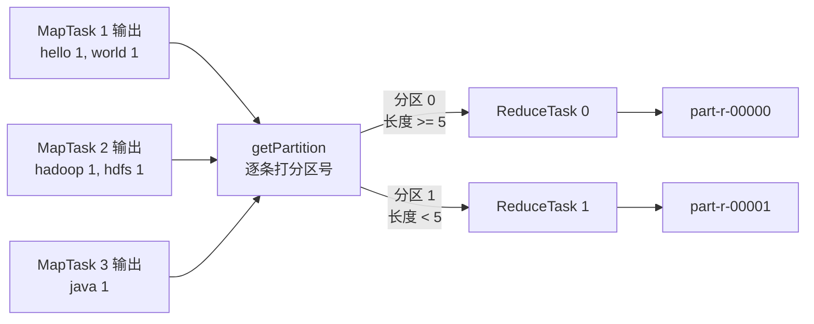

# MapReduce 分区：把数据按规则拆给不同的 Reduce

wordcount 跑完只有一个结果文件 `part-r-00000`，因为整个作业只有 1 个 ReduceTask。现在换一个需求：统计单词时，把长度大于等于 5 的单词结果放一个文件，长度小于 5 的放另一个文件。数据出口要从 1 个变成 2 个，靠的就是 Shuffle 八步里的第三步，分区。

## 先给结论

- 分区就是给每条 Map 输出的键值对打一个分区号，同一分区的数据发给同一个 ReduceTask，一个 ReduceTask 产出一个结果文件 `part-r-0000x`。
- 默认分区规则是 `HashPartitioner`，公式为 `(key.hashCode() & 0x7fffffff) % numReduceTasks`，不设置时永远是 1 个分区、1 个 Reduce。
- 自定义分区三步：写一个类继承 `Partitioner` 并重写 `getPartition`；`job.setPartitionerClass` 指定分区类；`job.setNumReduceTasks` 设置 Reduce 个数。
- `getPartition` 返回的编号就是 ReduceTask 的编号，编号必须落在 0 到 Reduce 个数减 1 之间，越界作业直接报错。
- wordcount 案例拆两个分区后，输出目录会出现 `part-r-00000` 与 `part-r-00001` 两个文件，各自装一个分区的统计结果。

## 一、分区是什么：给每条数据打分区号

MapReduce 八步里，Map 阶段两步、Reduce 阶段两步，中间 Shuffle 四步：分区、排序、规约、分组。分区排在第一步，作用是在 Map 输出与 Reduce 之间建立一条对应关系：分区号相同的键值对去同一个 ReduceTask，分区号不同就去不同的 ReduceTask，不同 ReduceTask 各自写出自己的结果文件。

wordcount 之所以只有 1 个 `part-r-00000`，是因为框架默认只有 1 个分区，全部数据交给 1 个 ReduceTask。回看画过的执行图：300 MB 的 `a.txt` 切成 3 个 block，3 个 MapTask 并行输出 `<单词, 1>`，之后全部汇入同一个 ReduceTask 汇总。一旦要求按单词长度拆成两份结果，就必须有 2 个 ReduceTask，而决定哪条数据去哪个 ReduceTask 的机制，就是分区。

## 二、默认规则 HashPartitioner：哈希取正再对 Reduce 个数取模

框架自带的分区实现是 `HashPartitioner`，源码只有一行核心逻辑：

```java
package org.apache.hadoop.mapreduce.lib.partition;

public class HashPartitioner<K, V> extends Partitioner<K, V> {
    @Override
    public int getPartition(K key, V value, int numReduceTasks) {
        return (key.hashCode() & 0x7fffffff) % numReduceTasks;
    }
}
```

三个参数分别是 K2、V2 和 Reduce 个数。它拿 K2 的哈希值，先与 `0x7fffffff`（int 的最大值）做与运算，再对 Reduce 个数取模。与运算这一步是为了把可能的负哈希值变成非负数：哈希值本身可能为负，负数取模的结果也为负，拿负数当分区编号没有意义；与上 `0x7fffffff` 后最高位清零，结果落在非负区间。取模的结果范围是 0 到 numReduceTasks 减 1，这个整数就是 ReduceTask 的编号。

这条默认规则对 wordcount 的新需求不适用：单词不同，哈希值就不同，取模后会被随机撒到多个分区里，而需求要求长度大于等于 5 的全去 0 号分区、小于 5 的全去 1 号分区，分区依据是业务字段而不是哈希散列。这时候就要自己定规则。

## 三、自定义 Partitioner 三步走

第一步，写一个类继承 `Partitioner`，泛型填 K2 和 V2 的类型，重写 `getPartition`：

```java
package com.study.mapreduce;

import org.apache.hadoop.io.LongWritable;
import org.apache.hadoop.io.Text;
import org.apache.hadoop.mapreduce.Partitioner;

public class PartitionerOwn extends Partitioner<Text, LongWritable> {

    @Override
    public int getPartition(Text text, LongWritable longWritable, int numReduceTasks) {
        // 单词长度 >= 5，进第一个分区，交给编号 0 的 ReduceTask
        if (text.toString().length() >= 5) {
            return 0;
        } else {
            // 单词长度 < 5，进第二个分区，交给编号 1 的 ReduceTask
            return 1;
        }
    }
}
```

方法返回 int，返回值就是分区号。Reduce 个数是 2，编号只能是 0 或 1；如果是 3 个 Reduce，就可以返回 0、1、2。分区逻辑本身非常朴素，本质就是回答一个问题：这条数据什么时候返回几号。

第二步和第三步在 JobMain 的 run 方法里完成，用两个 set 把规则告诉任务：

```java
// 第三步分区不再用默认方式，指定自定义分区类
job.setPartitionerClass(PartitionerOwn.class);

// 第七步设置 Reducer 类之后，设置 Reduce 的个数，与分区数保持一致
job.setNumReduceTasks(2);
```

`setPartitionerClass` 告诉框架按哪个类分区，`setNumReduceTasks(2)` 决定拉起 2 个 ReduceTask。分区号 0 的数据交给 0 号 ReduceTask，分区号 1 的交给 1 号，一一对应。

数据流向：



关键路径：每个 MapTask 的输出都经过 `getPartition` 打号，0 号分区汇入 ReduceTask 0 写出 `part-r-00000`，1 号分区汇入 ReduceTask 1 写出 `part-r-00001`。

## 四、工程实例：按手机号前三位分四区

课程真实工程里有一个更接近生产场景的分区：流量统计按手机号归属拆分，把 `135`、`136`、`137` 开头的手机号各进一个分区，其余进第四个分区，共 4 个分区对应 4 个 ReduceTask（包名已改写为 `com.study.mapreduce`）：

```java
public class FlowPartition extends Partitioner<Text, FlowBean> {
    @Override
    public int getPartition(Text text, FlowBean flowBean, int numReduceTasks) {
        // 判断手机号以哪个数字开头，返回不同的分区编号
        if (text.toString().startsWith("135")) {
            return 0;
        } else if (text.toString().startsWith("136")) {
            return 1;
        } else if (text.toString().startsWith("137")) {
            return 2;
        } else {
            return 3;
        }
    }
}
```

JobMain 里对应 `job.setPartitionerClass(FlowPartition.class)` 加 `job.setNumReduceTasks(4)`。这个例子与单词长度分区的模式完全一致，只是分区依据从单词长度换成了手机号前缀，分区个数从 2 变成 4。

## 五、跑起来验证输出文件

分区版 wordcount 重新打包提交集群，日志照旧走到 map 100%、reduce 100%。打开 HDFS 的输出目录，会看到两个结果文件：`part-r-00000` 是 0 号分区的产出，里面全是长度大于等于 5 的单词统计；`part-r-00001` 是 1 号分区的产出，全是长度小于 5 的单词统计。分别 `hdfs dfs -cat` 查看内容，与手工按长度归类数出来的结果一致，分区链路闭合。

## 常见误区

- **分区号返回越界值。** `getPartition` 返回的编号必须落在 0 到 numReduceTasks 减 1 之间，返回了大于等于 Reduce 个数的编号，MapTask 在写出数据时直接抛 `Illegal partition` 异常，作业失败。
- **设了分区类却忘了改 Reduce 个数。** `setNumReduceTasks` 不设置时默认为 1，此时只存在 0 号 ReduceTask，1 号分区没有归宿，运行时报非法分区；反过来 Reduce 个数多于实际用到的分区号，多出来的 Reduce 各写一个空的 `part-r-0000x`，不报错但产生空文件。
- **以为分区能带来全局有序。** 分区只决定数据去向，排序在每个分区内独立进行，两个 part 文件之间没有顺序关系；要全局有序得靠全排序方案，不能靠多分区。
- **分区规则不确定。** 同一个 key 每次 `getPartition` 必须返回同一个分区号，规则里掺入随机因素会破坏分组，同一 key 的数据被拆到不同 Reduce，统计结果错乱。
- **默认分区被误解为均匀分流。** HashPartitioner 按哈希散列，通常比较均匀；自定义分区按业务划分，划分不当会造成某个分区的数据量远大于其他分区，对应 ReduceTask 拖慢整个作业。

## 面试可能被问到的问题

1. 面试官追问：「MapReduce 的默认分区规则是什么？」
   答：HashPartitioner，实现为一行 `(key.hashCode() & 0x7fffffff) % numReduceTasks`，对 Map 输出的 key 取哈希、与 int 最大值按位与保证非负、再对 Reduce 个数取模，得到 0 到 numReduceTasks 减 1 的分区号。
2. 面试官追问：「为什么要与 0x7fffffff 按位与？」
   答：key 的 hashCode 可能为负数，负数对正数取模结果仍为负，无法当分区编号。0x7fffffff 是 int 的最大值，二进制下除最高位外全为 1，按位与把符号位清零，把哈希值映射到非负区间。
3. 面试官追问：「自定义分区需要哪几步？」
   答：三步。写一个类继承 Partitioner 并重写 getPartition 返回分区号；JobMain 里 job.setPartitionerClass 指定该类；job.setNumReduceTasks 设置与分区规划匹配的 Reduce 个数。
4. 面试官追问：「分区数和 Reduce 个数不一致会怎样？」
   答：分区号就是 ReduceTask 的编号。Reduce 个数少于用到的分区号时报 Illegal partition 作业失败；Reduce 个数多于分区号时，多余的 ReduceTask 各产出一个空的结果文件。两者应保持一致。
5. 面试官追问：「分区发生在哪个阶段，和排序什么关系？」
   答：分区发生在 Map 端，是 Shuffle 四步（分区、排序、规约、分组）的第一步，MapTask 在把数据溢写到磁盘前先打分区号；排序发生在分区之后，且是在各分区内部分别有序，分区之间互不影响。
6. 面试官追问：「多分区会带来什么风险？」
   答：主要是数据倾斜。自定义分区按业务划分，如果某个分区键的数据量占绝对多数，对应 ReduceTask 的处理时间远超其他节点，整个作业被它拖住。设计分区规则时要评估各分区的数据量分布。

## 配套资料

- 代码：`materials/code/04/day04-MapReduce高级/day04/代码/day04_mapreduce_combiner/src/main/java/`，课程真实工程，第四节 FlowPartition 与对应的 JobMain 装配摘自该工程的 `mapreduce_flowcount_partition` 子包，包名统一改写为 `com.study.mapreduce`。
- 正文按单词长度分两区的 `PartitionerOwn` 示例为按本课画面写法补全，day03 资料包未收录该示例源码。
