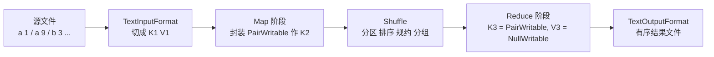
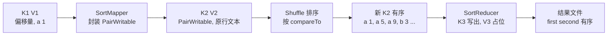
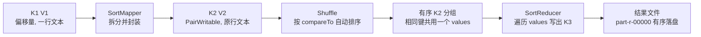

# MapReduce 排序实战：自定义 WritableComparable 让 K2 自己开口说话

## 先给结论

- 排序的入口是 K2 类型自带的 `compareTo`：Shuffle 四步的第二步就是排序，wordcount 的 K2 是 `Text` 按字典序，结果文件天然有序不是巧合。
- 排序主要发生在 Map 端：溢写前分区排序、溢写文件之间归并，Reduce 端拉取后再归并；数据进 reduce 方法时早已排好，业务代码一行排序都不用写。
- 想对 value 或多字段排序，把它们组合进 key：自定义 Bean 实现 `WritableComparable<自身类型>`，同时提供 write、readFields 序列化与 compareTo 比较规则，把它当 K2。
- 铁律两条：write 与 readFields 字段顺序完全一致，错一个顺序字节流整体错位且不抛异常；compareTo 返回值只看符号，多字段先比 first 再比 second，保险写法用 `Integer.compare`。
- 换排序规则有两条路：改 Bean 的 `compareTo`，或者 `job.setSortComparatorClass` 指定独立比较器不动 Bean；默认升序，降序就把比较方向对调。
- Mapper 只管把一行文本封装成 `PairWritable` 当 K2，Reducer 遍历 `values` 有几个写几个，JobMain 走 `Configured` 加 `Tool` 加 `ToolRunner` 模板，排序是默认行为。
- 集群验证：打包上传后 `hadoop jar 包名 主类全限定名` 提交，`part-r-00000` 里同组内按 second 升序；排错三板斧是分隔符、输出目录已存在、主类全限定名写错。

## 第1部分：MapReduce排序-概述

打开 wordcount 的 `part-r-00000`，单词按字典序排得整整齐齐。代码里没有任何一行写过排序，这个顺序是哪来的？想进一步实现「先按字母排、字母相同再按数字排」这类自定义排序，光知道默认行为不够，得弄清楚排序发生在哪一步、按什么规则排、以及怎么把自己的类型塞进这套机制。

### 一、序列化铺垫：Writable 与 WritableComparable
排序绕不开序列化，因为 Map 的输出要跨进程、跨节点传给 Reduce，传输前必须把对象变成字节流。Java 里的序列化是把结构化对象转成字节流的过程，反序列化是它的逆过程，实现 `Serializable` 接口即可。但 Hadoop 没有沿用这一套：Java 序列化是重量级框架，字节流里附带了大量额外信息，比如校验数据、继承体系描述，传输和存储的开销大。

Hadoop 自研了轻量序列化机制，接口是 `Writable`，只有两个方法要实现：`write` 负责把对象字段写进字节流，是序列化；`readFields` 负责从字节流把字段读回来，是反序列化。想序列化哪个属性就写哪个属性，不带冗余信息，网络开销显著降低。

在 `Writable` 之上还有一个子接口 `WritableComparable`，它同时继承了 `Writable` 和 Java 的 `Comparable`：

```java
public interface WritableComparable<T> extends Writable, Comparable<T> {
}
```

实现这个接口的类，既能在节点间序列化传输，又能互相比较大小，而比较大小的规则就是排序规则。序列化和排序两件事，落到代码上就是实现这一个接口。

### 二、默认排序为什么按 key 字典序
Shuffle 四步中的第二步就是排序，排序对象是 K2。框架并不关心业务含义，它只调用 K2 类型的 `compareTo` 方法决定先后。wordcount 的 K2 是 `Text`，`Text` 自己实现了 `WritableComparable<Text>`，比较规则是按 UTF-8 字节逐个比较，效果等同于字符串字典序，所以单词统计结果出来就是 `a` 在前、`b` 在后。换成 `LongWritable`、`IntWritable` 这类数值类型当 K2，比较规则就是数值升序。

换句话说，结果文件里的顺序不是输出格式安排的，是 K2 类型自带的比较逻辑在 Shuffle 阶段生效的结果。这也解释了为什么默认只能按 key 排：K2 有 `compareTo`，V2 没有，框架默认的排序机制根本不看 V2。

### 三、排序发生在哪：Map 端排序与归并链路
排序不是 Reduce 干的，主要工作量在 Map 端，链路如下：


关键路径：map 的输出先进内存缓冲区，缓冲区写满时按分区号把数据排序后整批溢写到磁盘，形成分区内有序的小文件；一个 MapTask 可能溢写多次，任务结束前把这些小文件归并排序成一个有序文件。Reduce 端把各 MapTask 的有序文件拉过来再做一次归并，此时相同 key 的数据已经相邻，第四步分组就是把相邻同 key 的 value 聚成一个集合传给 reduce 方法。归并排序贯穿始终，这也是为什么能对磁盘上放不下的大数据量做外部排序。

### 四、全排序思路：想排谁就把谁做成 K2
课程案例的数据是一列字母加一列数字：

```text
a 1
a 9
b 3
a 5
b 8
b 10
```

要求第一列按字典序排，第一列相同时第二列按升序排，期望输出 `a 1, a 5, a 9, b 3, b 8, b 10`。对着八步流程走一遍，难点立刻暴露：排序只认 K2，而要排的字段有两个，单独拿字母当 K2 排不出第二列，单独拿数字当 K2 又丢掉第一列。

解决思路是组合 key。把 Map 输出的 key 和 value 里需要参与排序的字段合并成一个新的 key，数据形态从 `<key, value>` 变成 `<(key, value), value>`，对新 key 排序时先比第一字段、相同再比第二字段。落到这个案例：

| 环节 | K | V |
|---|---|---|
| K1 V1 | 行偏移量 | 一行文本，如 `a 1` |
| K2 V2 | `PairWritable`（first = 字母，second = 数字） | 原行文本 |
| K3 V3 | 排好序的 `PairWritable` | `NullWritable` 占位 |

K2 是自定义类型 `PairWritable`，内部两个字段 `first` 和 `second`，实现 `WritableComparable` 后带上比较规则：先按 `first` 字典序，相同再按 `second` 数值升序。经过 Shuffle 排序，进入 Reduce 的新 K2 已经是 `a 1, a 5, a 9, b 3, b 8, b 10` 的顺序。V2 里的原行文本在这个案例中没有用，Reduce 阶段把它丢弃，V3 用 `NullWritable` 占位，它是一个表示「没有值」的占位类型。最后由 `TextOutputFormat` 输出，文件里落下的就是排好序的 `first second` 各行。

整体流程：



关键路径：排序能力来自 K2 类型自己，Map 负责把待排序字段装进 K2，Shuffle 按规则排好，Reduce 只负责转交输出。重点依然在写 Map 和 Reduce，只是给 K2 类型补上排序规则。
## 第2部分：MapReduce排序-实现比较器和序列化代码

上一篇定下了排序案例的方案：把字母和数字组合成 `PairWritable` 当 K2，让 Shuffle 按「先 first 字典序、first 相同再 second 升序」的规则排。方案落地只剩写代码，核心是这个类本身。它要实现 `WritableComparable` 接口，重写三个方法：`compareTo` 定排序规则，`write` 做序列化，`readFields` 做反序列化。

### 一、PairWritable 的骨架
类里两个字段，`first` 装字母列，`second` 装数字列，再配上存取方法和输出格式（包名改写为 `com.study.mapreduce`，getter 与 setter 从略）：

```java
package com.study.mapreduce;

import org.apache.hadoop.io.WritableComparable;

import java.io.DataInput;
import java.io.DataOutput;
import java.io.IOException;

public class PairWritable implements WritableComparable<PairWritable> {
    private String first;
    private int second;

    public String getFirst() { return first; }
    public void setFirst(String first) { this.first = first; }
    public int getSecond() { return second; }
    public void setSecond(int second) { this.second = second; }

    // 输出格式：字母 制表符 数字
    @Override
    public String toString() {
        return first + "\t" + second;
    }
}
```

泛型参数 `PairWritable` 不能省。不填泛型时 `compareTo` 的参数退化为 Object，方法里要自己强转，还失去了编译期类型检查；填上自己，参数直接是 `PairWritable`，比较逻辑写起来干净。

### 二、compareTo：先比 first，相同再比 second
排序规则在 `compareTo` 里实现。这个方法会被框架成千上万次调用，每次比较两个对象，决定谁排前面：

```java
// 实现排序规则
@Override
public int compareTo(PairWritable other) {
    // 先比较 first，String 自带的 compareTo 按字典序逐字符比较
    int result = this.first.compareTo(other.first);
    if (result == 0) {
        // first 相同，再比较 second，数字直接相减
        return this.second - other.second;
    }
    return result;
}
```

逐行拆开看。`this.first.compareTo(other.first)` 调的是 String 自带的比较方法，它按字典序工作：两个字符串从第一个字符比起，取字符的 ASCII 码相减。比如 `abc` 对 `bbb`，第一个字符 `a` 的 ASCII 码小于 `b`，立即得出 `abc` 小；第一个字符相同就比第二个，依此类推。返回值同样是三态：字符串相等返回 0，我的字符串大返回正数，小返回负数。

result 不为 0，说明 first 已经分出大小，直接返回 result。result 等于 0，说明两个 first 完全相同，进入第二层比较：数字直接相减，`this.second - other.second`，减出差是正数表示我大，负数表示我小，0 表示相等。整个方法只需要返回大于 0、小于 0 或等于 0 的值，框架的比较器只认符号，不关心具体数值。这样定出来的顺序默认是升序，想降序就把被减数和减数对调。

### 三、write 与 readFields：顺序一致是铁律
序列化方法把对象字段依次写进字节流，反序列化方法按同样顺序读回来：

```java
// 序列化：将对象数据写成字节流
@Override
public void write(DataOutput dataOutput) throws IOException {
    dataOutput.writeUTF(first);
    dataOutput.writeInt(second);
}

// 反序列化：从字节流恢复对象字段
@Override
public void readFields(DataInput dataInput) throws IOException {
    this.first = dataInput.readUTF();
    this.second = dataInput.readInt();
}
```

两条规矩。第一，每个成员变量都要写一次，`write` 里写的顺序和 `readFields` 里读的顺序必须完全一致。这里 `first` 是 String，对应 `writeUTF` 与 `readUTF`；`second` 是 int，对应 `writeInt` 与 `readInt`；其他类型也各有对应方法，如 `writeLong`、`writeFloat`、`writeBoolean`。第二，顺序错位不报错但数据全毁：如果写的时候先 first 后 second，读的时候先读 int，反序列化会把 second 的字节当成 first 解析，字段张冠李戴，结果文件里出现莫名其妙的值，这类问题排查起来非常耗时。反序列化的工作方式是框架先构造出空对象，再调 `readFields` 把字节流里的值一个个填进去，所以方法里都是赋值语句，不需要 new。

### 四、排序作业的 Map、Reduce 与主程序
Mapper 把每行文本拆开封装，K2 用 `PairWritable`，V2 放原行文本（按上一篇的流程设计，应用类为按本课写法补全）：

```java
public class SortMapper extends Mapper<LongWritable, Text, PairWritable, Text> {
    @Override
    protected void map(LongWritable key, Text value, Context context) throws IOException, InterruptedException {
        String[] split = value.toString().split("\t");
        // first 取字母列，second 取数字列，组合成 K2
        PairWritable pair = new PairWritable();
        pair.setFirst(split[0]);
        pair.setSecond(Integer.parseInt(split[1]));
        context.write(pair, value);
    }
}
```

Reducer 里排序已经完成，直接把 K3 写出，V3 用 `NullWritable.get()` 占位：

```java
public class SortReducer extends Reducer<PairWritable, Text, PairWritable, NullWritable> {
    @Override
    protected void reduce(PairWritable key, Iterable<Text> values, Context context) throws IOException, InterruptedException {
        // 相同 key 不存在时每个 key 单独一组，直接写出排好序的 K3
        context.write(key, NullWritable.get());
    }
}
```

JobMain 的关键装配，类型声明要与 Mapper、Reducer 的泛型一一对应：

```java
job.setJarByClass(JobMain.class);
job.setMapperClass(SortMapper.class);
job.setMapOutputKeyClass(PairWritable.class);
job.setMapOutputValueClass(Text.class);
// 第三到六步默认，排序按 PairWritable 的 compareTo 执行
job.setReducerClass(SortReducer.class);
job.setOutputKeyClass(PairWritable.class);
job.setOutputValueClass(NullWritable.class);
job.setOutputFormatClass(TextOutputFormat.class);
TextInputFormat.addInputPath(job, new Path("hdfs://node01:8020/sort"));
TextOutputFormat.setOutputPath(job, new Path("hdfs://node01:8020/sort_out"));
```

提交集群后，输入 `a 1`、`a 9`、`b 3`、`a 5`、`b 8`、`b 10` 六行，输出文件里就是：

```text
a	1
a	5
a	9
b	3
b	8
b	10
```

数据变换全程：



关键路径：排序动作一行都没写，全靠 K2 类型自带的 compareTo 在 Shuffle 里生效，Map 负责装数据、Reduce 负责交结果。

### 五、真实工程对照：FlowBean 按流量降序
课程真实工程里的排序实战用的是同一个模式，只是 Bean 里装的是四个流量字段，排序依据是上行流量，且要求降序（包名改写为 `com.study.mapreduce`）：

```java
public class FlowBean implements WritableComparable<FlowBean> {
    private Integer upFlow;
    private Integer downFlow;
    private Integer upCountFlow;
    private Integer downCountFlow;

    @Override
    public void write(DataOutput dataOutput) throws IOException {
        dataOutput.writeInt(upFlow);
        dataOutput.writeInt(downFlow);
        dataOutput.writeInt(upCountFlow);
        dataOutput.writeInt(downCountFlow);
    }

    @Override
    public void readFields(DataInput dataInput) throws IOException {
        this.upFlow = dataInput.readInt();
        this.downFlow = dataInput.readInt();
        this.upCountFlow = dataInput.readInt();
        this.downCountFlow = dataInput.readInt();
    }

    @Override
    public int compareTo(FlowBean other) {
        return this.getUpFlow().compareTo(other.getUpFlow()) * -1;  // 按上行流量降序
    }
}
```

Mapper 把 `FlowBean` 当 K2、手机号当 V2 输出，Shuffle 排完后，Reducer 把键值对颠倒顺序写出，文件里每行就是「手机号 流量四项」且按上行流量从大到小排列。升序变降序的实现，正是在 compareTo 结果上乘以 -1，与 PairWritable 里「对调被减数与减数」是同一个思路。
## 第3部分：MapReduce排序-其他代码编写

上一篇把排序最硬的骨头啃完了：`PairWritable` 实现 `WritableComparable`，`compareTo` 定规则，`write`/`readFields` 管序列化。剩下的问题看起来简单，坑却不少：Mapper 的四个泛型怎么填，Reducer 要不要在方法里再排一次序，JobMain 里要不要给排序加配置。很多人卡在最后一点上，翻遍 API 找 `setSort` 之类的方法。把代码落完会发现，三个类里都找不到一行排序逻辑，这正是设计使然：Bean 提供 `compareTo`，框架在 Shuffle 里自动调用，业务代码只负责转换和写出。

### 一、SortMapper：拆分、封装、写出
先定泛型。K1 是行偏移量 `LongWritable`，V1 是一行文本 `Text`，这两个固定；关键是 K2 和 V2：对照执行流程图，K2 是封装好的 `PairWritable`，V2 是原始的一行数据 `Text`（包名统一改写为 `com.study.mapreduce`）：

```java
public class SortMapper extends Mapper<LongWritable, Text, PairWritable, Text> {
    @Override
    protected void map(LongWritable key, Text value, Context context) throws IOException, InterruptedException {
        // 对每一行数据进行拆分，封装成 PairWritable 对象作为 K2
        String[] split = value.toString().split("\t");
        PairWritable pairWritable = new PairWritable();
        pairWritable.setFirst(split[0]);
        pairWritable.setSecond(Integer.parseInt(split[1]));
        // 将 K2 和 V2 写入上下文，V2 仍然是原始行文本
        context.write(pairWritable, value);
    }
}
```

三个动作。拆分：数据文件里字母和数字用制表符隔开，`split("\t")` 得到长度为 2 的数组。封装：`split[0]` 是字母列，塞进 `first`；`split[1]` 是数字列，但它现在是字符串，必须调 `Integer.parseInt` 转成 int 再塞进 `second`，否则编译直接报错。写出：`context.write(pairWritable, value)`，K2 是新封装的 Bean，V2 原样透传一行文本，留着它是因为最终输出还想看到完整原始数据。

**第一，map 方法每条记录调用一次。** 框架读一行就调一次 `map`，六行数据就调六次，方法内每次都 new 一个新的 `PairWritable`，互不干扰。

### 二、SortReducer：透传 K2，靠遍历处理重复键
Reducer 的泛型跟着数据流走：进来的 K2 是 `PairWritable`、V2 是 `Text`；出去的 K3 还是 `PairWritable`，V3 用 `NullWritable` 占位，它就是个表示「没有值」的空类型：

```java
public class SortReducer extends Reducer<PairWritable, Text, PairWritable, NullWritable> {
    @Override
    protected void reduce(PairWritable key, Iterable<Text> values, Context context) throws IOException, InterruptedException {
        // 相同 K2 会落到同一个 values 集合，遍历几次就写出几次，保证重复键全部输出
        for (Text value : values) {
            context.write(key, NullWritable.get());
        }
    }
}
```

排序在这个类里同样找不到。Shuffle 在排序和分组完成后才调用 `reduce`，方法收到的 `key` 已经处于正确顺序，方法内要做的事情只剩把 K2 V2 转成 K3 V3。`NullWritable` 不能直接 new，要调 `NullWritable.get()` 拿它的单例空对象。

for 循环不是可有可无的装饰。假设数据里出现了两条 `a 1`，Shuffle 会把相同键归进同一个集合，reduce 收到的就是 `key = a 1`，`values` 里两个元素。如果方法里只写一次 `context.write(key, ...)`，输出就只剩一条，另一条凭空消失。循环遍历 `values`，集合里有几个元素就写几次 K3，不管多少条重复的 `a 1` 都能完整落盘。集合里 V2 的内容此处并不重要，重要的只是它的个数。

### 三、JobMain：八个步骤的模板装配
主程序沿用课程的固定模板：类继承 `Configured` 实现 `Tool`，重写 `run` 方法装八个步骤，`main` 方法里通过 `ToolRunner` 启动。`ToolRunner.run` 的返回值就是作业状态，`System.exit` 用它做进程退出码，0 表示正常，非 0 表示异常：

```java
public class JobMain extends Configured implements Tool {
    @Override
    public int run(String[] strings) throws Exception {
        Job job = Job.getInstance(super.getConf(), "mapreduce_sort");
        // 打包放在集群运行时，需要做一个配置
        job.setJarByClass(JobMain.class);
        // 第一步：设置读取文件的类，K1 和 V1
        job.setInputFormatClass(TextInputFormat.class);
        TextInputFormat.addInputPath(job, new Path("hdfs://node01:8020/input/sort"));
        // 第二步：设置 Mapper 类，以及 K2、V2 的类型
        job.setMapperClass(SortMapper.class);
        job.setMapOutputKeyClass(PairWritable.class);
        job.setMapOutputValueClass(Text.class);
        // 第三、四、五、六步采用默认方式（分区、排序、规约、分组）
        // 排序按 PairWritable 的 compareTo 自动进行，不用做任何设置
        // 第七步：设置 Reducer 类，以及 K3、V3 的类型
        job.setReducerClass(SortReducer.class);
        job.setOutputKeyClass(PairWritable.class);
        job.setOutputValueClass(NullWritable.class);
        // 第八步：设置输出类与输出路径
        job.setOutputFormatClass(TextOutputFormat.class);
        TextOutputFormat.setOutputPath(job, new Path("hdfs://node01:8020/out/sort_out"));
        boolean b = job.waitForCompletion(true);
        return b ? 0 : 1;
    }

    public static void main(String[] args) throws Exception {
        Configuration configuration = new Configuration();
        int run = ToolRunner.run(configuration, new JobMain(), args);
        System.exit(run);
    }
}
```

类型声明与泛型一一对应：`setMapOutputKeyClass(PairWritable.class)` 对着 Mapper 泛型里的 K2，`setOutputKeyClass(PairWritable.class)` 对着 Reducer 泛型里的 K3，`setOutputValueClass(NullWritable.class)` 对着 V3。排序在第三到六步的默认行为里，一行设置都不用加。

**从旧作业复制模板，清理遗留配置是最容易漏的活。** 上一个案例设过分区器 `PartitionerOwn`、reduce 个数 2，粘贴过来后这些行还在，而本案例根本没有分区，reduce 个数也不用设，默认就是 1。遗留的分区器会把数据硬分到不存在的分区里，遗留的 `setNumReduceTasks(2)` 会产出两份输出文件，行为全乱。逐行检查一遍，用不到的设置删干净。

### 四、setSortComparator 与 Bean 内 compareTo 的取舍
排序不设就会自动进行，依据是 K2 类型的 `compareTo`。真正要动手改顺序时，有两种做法。**第一种，改 Bean。** 直接在 `PairWritable` 或 `FlowBean` 的 `compareTo` 里调整规则，改完这个类型在任何作业里都带着同样的顺序，一劳永逸，代价是动了数据模型类。**第二种，设独立比较器。** JobMain 里调 `job.setSortComparatorClass(比较器.class)`，传入一个继承 `WritableComparator` 的类，不动 Bean 就能换排序规则，适合临时把升序换降序、或者 K2 是内置类型而默认字典序不合需求的场景，代价是每个作业要单独设置一次。

本课案例的 K2 是自定义 Bean，`compareTo` 已经写在 Bean 里，所以什么也不用设。真实工程的流量排序同理，规则长在 `FlowBean` 内部。

### 五、真实工程对照：流量排序的 KV 换位
课程真实工程的排序作业用的是同一套结构，差别在于最终输出想先看手机号再看流量，于是 Reducer 里做了一次键值对换位（包名改写为 `com.study.mapreduce`）：

```java
public class FlowCountSortMapper extends Mapper<LongWritable, Text, FlowBean, Text> {
    @Override
    protected void map(LongWritable key, Text value, Context context) throws IOException, InterruptedException {
        FlowBean flowBean = new FlowBean();
        String[] split = value.toString().split("\t");
        // 手机号作为 V2
        String phoneNum = split[0];
        // 四个流量字段封装进 flowBean，作为 K2
        flowBean.setUpFlow(Integer.parseInt(split[1]));
        flowBean.setDownFlow(Integer.parseInt(split[2]));
        flowBean.setUpCountFlow(Integer.parseInt(split[3]));
        flowBean.setDownCountFlow(Integer.parseInt(split[4]));
        // 将 K2 和 V2 写入上下文中
        context.write(flowBean, new Text(phoneNum));
    }
}
```

```java
public class FlowCountSortReducer extends Reducer<FlowBean, Text, Text, FlowBean> {
    @Override
    protected void reduce(FlowBean key, Iterable<Text> values, Context context) throws IOException, InterruptedException {
        for (Text value : values) {
            // 键值对换位：K3 输出手机号，V3 输出排好序的 FlowBean
            context.write(value, key);
        }
    }
}
```

Mapper 把流量四项装进 `FlowBean` 当 K2、手机号当 V2，Shuffle 按 `FlowBean` 的 `compareTo`（上行流量降序）排完，Reducer 循环里写成 `context.write(value, key)`，进出两个泛型表跟着互换，输出文件里每行就是「手机号 流量四项」。对应的 JobMain 里 `setOutputKeyClass(Text.class)`、`setOutputValueClass(FlowBean.class)`，输入取 `out/flowcount_out`，输出写到 `out/flowcountsort_out`。

数据变换全程如下。



关键路径：排序动作在 Mapper、Reducer、JobMain 三个类里都搜不到，它发生在 Shuffle 里，由 K2 自带的 `compareTo` 驱动；三个类分别只做封装、透传和装配。
## 第4部分：MapReduce排序-集群运行

代码在 IDEA 里跑通了，怎么搬到三台节点的集群上跑？这一步的流程固定，但翻车点密集：数据文件的分隔符和程序里的 `\t` 对不上，作业跑完输出目录被上一次运行占着，主类全限定名手打错一个字母。排序作业提交集群的完整链路是所有 MapReduce 作业共用的，走通一次，后面每类作业都是同样的动作。

### 一、准备输入数据与目录
先造数据。本地写一个 `sort.txt`，内容直接取课程样例七行，注意字母和数字之间是制表符，不是空格：

```text
a	1
a	5
a	7
a	9
b	3
b	8
b	10
```

**上传之前先核对分隔符。** 程序里 Mapper 按 `split("\t")` 拆分，如果文件里实际是空格或多个空格，`split[1]` 就取不到数字，轻则 `Integer.parseInt` 抛 `NumberFormatException`，重则数组越界。从别处复制数据到编辑器时肉眼难辨空格和制表符，务必在编辑器里切到显示空白字符的模式确认一遍。

再建 HDFS 目录并上传。程序里输入路径写的是 `/input/sort`，两级目录要递归创建，`-p` 参数不可少：

```bash
# 递归创建多级输入目录
hdfs dfs -mkdir -p /input/sort
# 上传数据文件到输入目录
hdfs dfs -put sort.txt /input/sort
```

路径必须与 JobMain 里 `TextInputFormat.addInputPath` 写的完全一致，目录建在别处作业会直接报输入路径不存在。

### 二、打包与上传
打包前先 clean，把旧构建产物清掉再打，避免旧 class 混进新包：

```bash
# 清理旧产物并重新打包，产物在 target 目录
mvn clean package
```

打出的 jar 在工程 `target` 目录下，形如 `day03_mapreduce_sort-1.0-SNAPSHOT.jar`。把它上传到 Linux 节点，课程里用终端传输工具 `rz`，执行后弹出文件选择框选 jar 即可：

```bash
# 从本地选择文件上传到当前目录，-E 表示遇到同名文件跳过
rz -E
```

同名的旧包先删掉再传，否则集群上跑的可能还是旧代码，现象会变成「改了逻辑结果不变」，这类问题最冤枉。

### 三、hadoop jar 提交作业
提交命令由三段组成：`hadoop jar`、jar 包路径、主类全限定名。主类名建议从 IDE 里直接复制引用粘贴过来，手写容易错：

```bash
# hadoop jar <jar 包路径> <主类全限定名>
hadoop jar day03_mapreduce_sort-1.0-SNAPSHOT.jar com.study.mapreduce.JobMain
```

回车后控制台先滚动作业提交与资源申请的日志，随后进入 Map 阶段，进度到 100% 后切到 Reduce 阶段，最后打印 `completed successfully` 与一串计数器。整条链路是 YARN 接下作业、分配容器、启动 MapTask 与 ReduceTask，排序发生在 Shuffle 阶段，业务代码全程只提供 `compareTo`。

提交到运行的全过程如下。


关键路径：jar 是唯一上船的行李，主类全限定名是 YARN 找入口的唯一线索，两样对上作业才能起航。

### 四、验证排序结果
作业成功不代表结果正确，输出必须人工验证。打开 Hadoop Web UI 的 Browse Directory 页面，逐级进入 `/out/sort_out`，Reduce 输出文件固定叫 `part-r-00000`，前缀 `r` 表示来自 Reducer，后缀是编号，reduce 个数大于 1 时会看到 `part-r-00001` 等一系列文件。下载下来用 Excel 打开：

```text
a	1
a	5
a	7
a	9
b	3
b	8
b	10
```

对照 `PairWritable` 的 `compareTo` 规则逐条核：先按字母字典序，a 组整体排在 b 组之前；字母相同时按数字升序，a 组内 1、5、7、9 递增。两组规则都成立，排序功能才算验收通过。数据里若有重复键，比如两条 `a 1`，Reducer 遍历 `values` 的写法会把它们都输出，这一条可以自行加数据验证。

### 五、排错点盘点
**第一，分隔符不一致。** 数据里的空格遇上程序的 `\t`，解析阶段就崩。现象是 `NumberFormatException` 或 `ArrayIndexOutOfBoundsException`，正解是把数据文件的分隔符改成制表符重新上传。

**第二，输出目录已存在。** MapReduce 不会覆盖已有输出，`/out/sort_out` 残留着上次的结果，作业直接失败，日志里出现 `FileAlreadyExistsException`。重跑前先删输出目录：

```bash
# 删除旧输出目录，再重新提交作业
hdfs dfs -rm -r /out/sort_out
```

**第三，主类全限定名写错。** 命令行报「找不到或无法加载主类」，多半是手打类名漏了包名或拼错字母。从 IDE 对着类右键复制引用，粘贴到命令里。

**第四，jar 包版本陈旧。** 改完代码只打包忘了重新上传，集群上跑的还是旧逻辑。行为与代码对不上时，先比对 jar 的上传时间与打包时间。

**第五，`setJarByClass` 缺失。** JobMain 里少了这一行，集群上会报 Mapper 或 Reducer 类找不到，因为作业无法定位到所属 jar。
## 常见误区

- **以为排序是 Reduce 阶段做的。** 排序主要发生在 Map 端溢写和归并，Reduce 端只做拉取后的归并；等数据到 reduce 方法里时早已有序。
- **以为结果文件的顺序是输出格式给的。** `TextOutputFormat` 原样写出行，顺序来自 K2 类型的 `compareTo` 在 Shuffle 阶段的效果，换 K2 类型顺序规则就变。
- **以为默认排序能作用于 value。** 默认排序只看 K2，V2 不参与比较；要对 value 排序必须把它组合进 key，排完在 Reduce 阶段再拆开。
- **把多分区当成全排序。** 分区之后每个 part 文件各自有序，文件之间没有顺序关系；要全文件有序，要么只用 1 个 Reduce，要么设计按区间分区的方案。
- **混淆排序和分组。** 排序把 key 按规则排相邻，分组才把相邻同 key 的 value 聚成集合；分组依赖排序成立，顺序颠倒逻辑上讲不通。
- **write 与 readFields 顺序不一致。** 序列化先写 first 再写 second，反序列化也必须先读 first 再读 second，顺序一旦错开，字节流整体错位，字段值张冠李戴且不抛异常，是最难查的一类错。
- **compareTo 里用减法比较很大的数值。** `this.second - other.second` 在两个数符号相反、绝对值都很大时可能溢出，减出差翻转符号导致排序错乱；保险写法是 `Integer.compare(this.second, other.second)`。
- **K2 类型没有用 setMapOutputKeyClass 声明。** Mapper 泛型里的 K2 是 `PairWritable`，JobMain 里必须对应声明；类型声明与泛型对不上，运行时才报类型不匹配，排查成本高。
- **toString 里追加换行符。** `TextOutputFormat` 每写一条记录自带换行，toString 再拼一个 `\n`，结果文件里会插进成片的空行。
- **以为 Reduce 里还要自己排序。** 进入 reduce 方法的数据已经按 K2 排好序，方法内再排序属于重复劳动；排序是 Shuffle 的职责，Bean 只负责提供 compareTo。
- **只写一次 context.write，重复键丢失。** 两条 `a 1` 会归进同一个 `values` 集合，不遍历集合就只输出一条；必须 for 循环，有几个元素写几次。
- **照抄旧作业的 K3 类型声明。** 旧作业 `setOutputKeyClass(Text.class)` 粘过来没改，本案例 K3 是 `PairWritable`，类型与 Reducer 泛型对不上，运行时才报类型不匹配，排查成本高。
- **遗留分区器与 reduce 个数没删。** 模板里残留 `setPartitionerClass`、`setNumReduceTasks(2)`，无分区的案例会产出两份文件或直接报错，复制模板后要逐行清理。
- **以为数据看着像「a 数字」就能跑。** 肉眼看不出空格与制表符的差异，程序只认 `split("\t")`；上传前必须用显示空白字符的编辑器核对。
- **重跑不删输出目录。** 框架为防止误覆盖已有结果，输出目录存在时直接拒绝作业；每次提交前删 `/out/sort_out` 是标准动作。
- **把主类名写成简单类名。** `JobMain` 与 `com.study.mapreduce.JobMain` 不是一回事，hadoop jar 需要全限定名才能在 jar 里定位入口类。
- **用 Excel 改完数据直接上传。** Excel 另存会把制表符替换或带出引号与编码变化，构造测试数据用纯文本编辑器最稳。

## 面试可能被问到的问题

1. 面试官追问：「MapReduce 的默认排序规则是什么？」
   答：按 K2 升序，具体规则由 K2 类型的 compareTo 决定。Text 按字节字典序，IntWritable、LongWritable 按数值升序。框架在 Shuffle 的排序步骤里调用这个 compareTo，业务代码不用写任何排序语句。

2. 面试官追问：「Hadoop 为什么不用 Java 的 Serializable？」
   答：Java 序列化是重量级框架，字节流里附带校验信息、继承体系等大量冗余，传输和存储开销大。Hadoop 自研 Writable 接口，write 和 readFields 两个方法只传输业务字段本身，序列化结果紧凑，配合排序需求又有 WritableComparable 子接口。

3. 面试官追问：「Writable 和 WritableComparable 什么关系？」
   答：WritableComparable 继承了 Writable 和 Comparable 两个接口，实现它既要提供 write、readFields 完成序列化，也要提供 compareTo 定义比较规则。需要把自定义类型当 K2 用时，实现 WritableComparable 即可同时满足传输和排序。

4. 面试官追问：「排序具体发生在哪些环节？」
   答：Map 端缓冲区溢写时按分区排序，一个 MapTask 的多个溢写文件在任务结束前归并排序成一个有序文件；Reduce 端从多个 MapTask 拉取有序分区后再次归并。整个过程是归并排序思想，支持远超内存的数据量。

5. 面试官追问：「想按 value 排序怎么做？」
   答：把需要排序的 value 与原 key 组合成复合 key，自定义 Bean 实现 WritableComparable 承载它们并定义比较规则，作为新的 K2 输出；Shuffle 排完序后，Reduce 阶段再按需拆开输出。典型案例是把 first、second 两个字段装进 PairWritable。

6. 面试官追问：「分组为什么依赖排序？」
   答：分组把相同 key 的 value 聚成一个 Iterable 传给 reduce 方法，它的实现前提是相同 key 的数据在输入流里相邻，而这正是排序完成的。没有排序，相同 key 散落在各处，分组无法一次遍历完成。

7. 面试官追问：「自定义类型要作为 K2 参与排序，需要做什么？」
   答：实现 WritableComparable 接口并把泛型填成自己，重写 write、readFields 提供序列化能力，重写 compareTo 定义比较规则。框架在 Shuffle 阶段调用 compareTo 决定 K2 的顺序，业务代码不需要写排序逻辑。

8. 面试官追问：「compareTo 的返回值有什么约定？」
   答：只看符号。正数表示当前对象大于参数对象，负数表示小于，0 表示相等。多字段排序就是逐字段比较，前面的字段返回 0 才继续比下一个，例如先比 first 再比 second。

9. 面试官追问：「write 和 readFields 实现时最要注意什么？」
   答：字段顺序完全一致。序列化按什么顺序写，反序列化必须按同样顺序读，且每个字段都要写读配对；类型要与 DataOutput、DataInput 的方法对应，String 用 writeUTF 和 readUTF，int 用 writeInt 和 readInt。顺序错位不会报异常，但字段值全部错乱。

10. 面试官追问：「readFields 里为什么不 new 对象？」
   答：反序列化时框架已经构造好空对象，readFields 的职责只是从字节流把值填进各字段。MapReduce 框架会复用对象反复填充以减少创建开销，方法里 new 新对象反而破坏了这套机制。

11. 面试官追问：「默认升序，怎么改成降序？」
   答：调转 compareTo 的比较方向即可，可以把被减数与减数对调，也可以在原结果上乘以 -1。课程流量排序工程里就是 `getUpFlow().compareTo(other.getUpFlow()) * -1` 实现按上行流量降序。

12. 面试官追问：「NullWritable 在排序作业里起什么作用？」
   答：它是表示「没有值」的占位类型。排序案例里想要的数据全在 K3 上，V3 没有内容但不能缺席，用 NullWritable.get() 占住位置，TextOutputFormat 输出时会忽略它，文件里只落下排好序的 key。

13. 面试官追问：「自定义排序作业里，排序逻辑写在哪个类？」
   答：哪个类都不写。排序由 Shuffle 按 K2 类型的 compareTo 自动完成，Mapper 负责把数据封装成可排序的 K2，Reducer 拿到的已经是排好序的数据，JobMain 也不需要为排序增加设置。

14. 面试官追问：「reduce 方法的 values 参数是什么，怎么用？」
   答：相同 K2 的所有 V2 组成的集合。reduce 每组调用一次，遍历集合可以逐条处理值；输出时如果键也要多次写出，就在循环里写 K3，保证重复键不丢。

15. 面试官追问：「不改 Bean 有没有办法换排序规则？」
   答：有，job.setSortComparatorClass 指定一个继承 WritableComparator 的比较器。Bean 内 compareTo 适合规则固定、多个作业共用的场景；独立比较器适合临时调整顺序或 K2 是内置类型的场景，两者并存时以设置的比较器为准。

16. 面试官追问：「JobMain 继承 Configured 实现 Tool 再配 ToolRunner，图什么？」
   答：ToolRunner 会解析命令行参数并把配置合并进 Configuration，再用反射创建 Tool 实例调用 run。这套模板让作业支持 -D 参数动态改配置，main 里的 System.exit 拿 run 的返回值做进程退出码，0 正常非 0 异常，便于脚本判断作业成败。

17. 面试官追问：「排序案例里 reduce 的个数为什么不用设置？」
   答：没有自定义分区器，默认分区器按哈希把所有 K2 分到同一个分区，reduce 个数默认 1，全局排序必须保证输出只有一个文件，多 reduce 会把顺序打碎在多个 part 文件里，所以保持默认恰好正确。

18. 面试官追问：「hadoop jar 命令的参数结构是什么？」
   答：hadoop jar 后跟两个核心参数，jar 包在节点上的路径和主类的全限定名。框架从全限定名在 jar 里定位入口类，执行其 main 方法完成作业提交，主类必须实现作业装配逻辑。

19. 面试官追问：「本地 Windows 跑 MapReduce 和提交集群有什么差别？」
   答：本地运行依赖 winutils 等环境模拟，输入输出路径可以是本地盘；集群运行要求先打包，路径全部指向 HDFS，且 JobMain 必须调用 setJarByClass 让框架知道作业属于哪个 jar，否则容器里加载不到自定义类。

20. 面试官追问：「输出目录已存在会怎样？」
   答：作业提交后立即失败，抛 FileAlreadyExistsException。框架不允许覆盖既有输出，防止误删结果；重跑前要手动删除输出目录，或让程序每次使用带时间戳的输出路径。

21. 面试官追问：「part-r-00000 这个文件名怎么解读？」
   答：part 是输出文件统一前缀，中间的 r 表示由 Reducer 产出，00000 是 reduce 任务编号。reduce 个数为 1 时只有一个文件，多个 reduce 时编号依次递增；只有 map 的作业输出前缀是 m。

22. 面试官追问：「作业提交之后从哪里观察运行状态？」
   答：两个入口，一是提交命令的控制台日志，实时滚动 Map 与 Reduce 进度百分比和最终计数器；二是 YARN 的 Web UI，能看到作业列表、运行日志和资源占用，HDFS 的 Web UI 则用来检查输入输出目录与 part 文件内容。

## 配套资料

- 代码：`materials/code/04/day04-MapReduce高级/day04/代码/day04_mapreduce_combiner/src/main/java/`，课程真实工程，其中 `mapreduce_sort` 子包是排序实战（自定义 Bean 当 K2），第四节方案与之一致，实现细节见下一篇。
- 正文 PairWritable 案例的数据与流程按本课画面与讲义整理，PairWritable 类源码将在下一篇给出；day03 资料包未单独收录该示例工程。
- 代码：`materials/code/04/day04-MapReduce高级/day04/代码/day04_mapreduce_combiner/src/main/java/`，课程真实工程，第五节 FlowBean（实现 WritableComparable 的流量排序 Bean）与其 Mapper、Reducer、JobMain 摘自该工程的 `mapreduce_sort` 子包，包名统一改写为 `com.study.mapreduce`。
- 正文 PairWritable 与 SortMapper、SortReducer 为按本课画面与流程设计补全的应用代码，day03 资料包未收录该示例工程；JobMain 装配骨架与 `materials/code/04/day04-MapReduce高级/day04/代码/day04_mapreduce_combiner/src/main/java/` 下真实主程序一致。
- 代码：`materials/code/04/day04-MapReduce高级/day04/代码/day04_mapreduce_combiner/src/main/java/`，课程真实工程，第五节 FlowCountSortMapper、FlowCountSortReducer 摘自该工程的 `mapreduce_sort` 子包（同包内 FlowBean 实现 WritableComparable、JobMain 装配了输入 `out/flowcount_out` 与输出 `out/flowcountsort_out`），包名统一改写为 `com.study.mapreduce`。
- 正文 SortMapper、SortReducer、JobMain 为按本课画面线与口播流程还原的 PairWritable 排序案例代码，day03 资料包未收录该示例工程，类与方法名与画面一致；ToolRunner 模板骨架与上述真实工程 JobMain 一致。
- 代码：`materials/code/04/day04-MapReduce高级/day04/代码/day04_mapreduce_combiner/src/main/java/`，课程真实工程，本课运行的排序作业类 FlowBean、FlowCountSortMapper、FlowCountSortReducer、JobMain 位于该工程的 `mapreduce_sort` 子包，包名统一改写为 `com.study.mapreduce`。
- 文中 hadoop jar 提交命令、HDFS 目录操作与验证步骤按本课操作画面整理，jar 包名与主类全限定名按包名改写规则调整；样例数据为课程讲义中的排序测试集。
