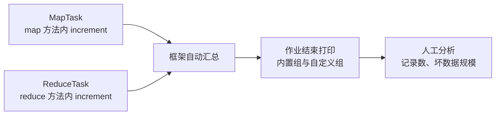
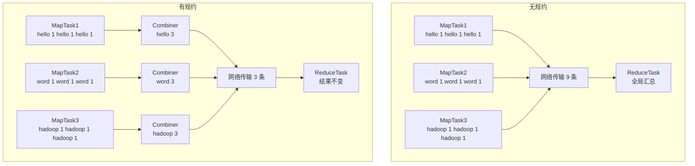
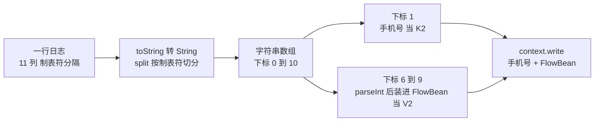
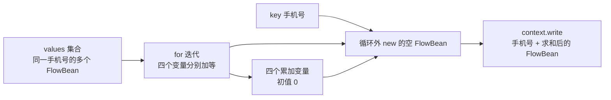
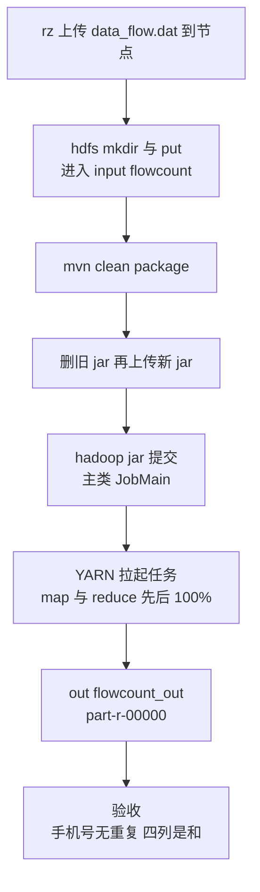
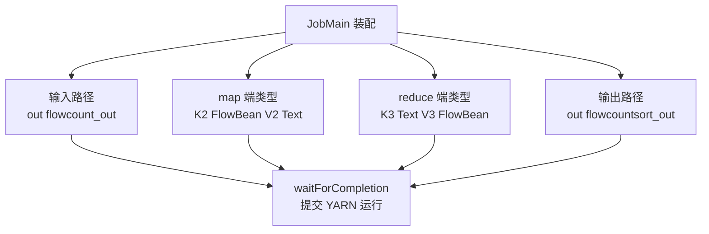
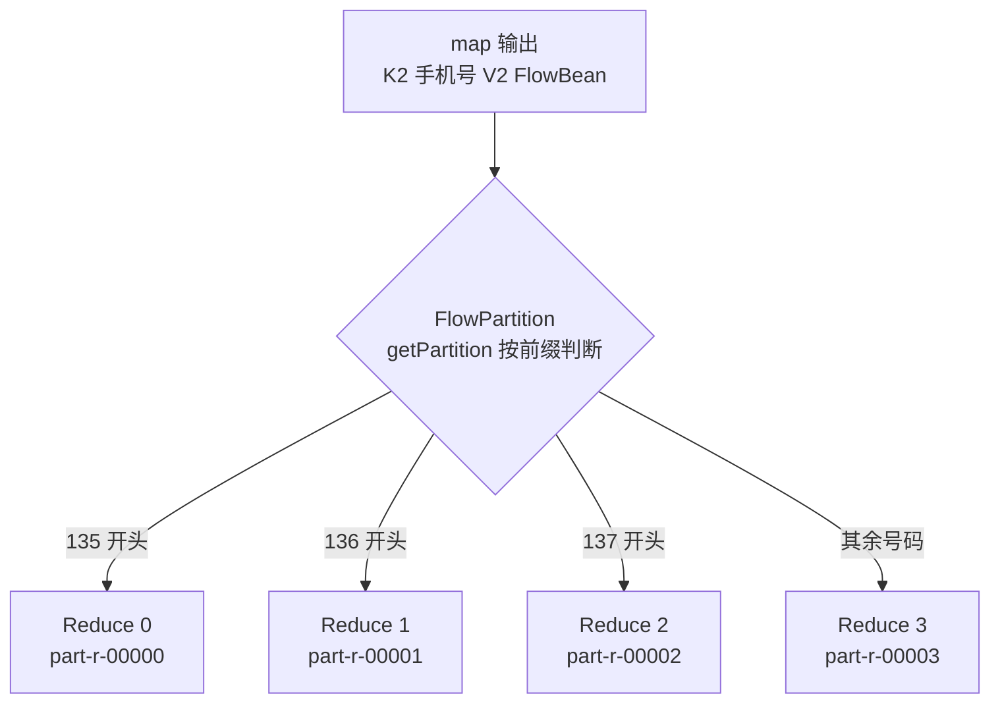

# MapReduce 进阶实战合辑：计数器、Combiner 与流量统计的求和、排序、分区全流程

## 先给结论

- 本系列是 MapReduce 的进阶实战合辑，共十篇：先讲计数器与 Combiner 两个通用机制，再以流量统计为主案例，把求和、排序、分区三种典型加工逐一落地到可运行的集群作业。
- 计数器是作业的轻量统计面板：内置五类计数器看框架健康度，自定义有字符串组名加变量名与枚举两种写法，累加必须写在 map 或 reduce 方法体内，排脏数据时当轻量日志用。
- Combiner 是 Map 端的局部规约：继承 Reducer 即可，一行 setCombinerClass 完成装配；硬约束是不能改变最终结果，求和可用、求平均不可用，且框架不保证调用次数。
- 流量求和案例把需求翻译成六类数据形态：K1/V1 由输入格式定死，K2 用手机号，V2 用自定义 FlowBean 装四个流量列，拆分封装发生在 map，求和发生在 reduce。
- 自定义 Bean 的两件事必须做对：实现 Writable 并保证 write 与 readFields 的字段顺序完全一致；reduce 端结果必须装进新 new 的 Bean，框架会复用迭代对象反复填充。
- 集群运行形成闭环：rz 传数据进 HDFS、Maven 打包、hadoop jar 提交、按三点验收结果；输出目录残留与旧 jar 未替换是重跑时最常见的两处翻车点。
- 排序案例的核心是 KV 换位：对谁排序谁就当 K2，FlowBean 升级为 WritableComparable，compareTo 结果乘 -1 翻转为降序，排序由 Shuffle 完成，业务代码里看不到排序语句。
- 排序作业的输入是求和作业的输出，切割索引随之改变；setMapOutputKeyClass 与 setOutputKeyClass 分别声明两端类型，声明必须与写出代码逐位对齐。
- 分区案例按手机号前缀分流：继承 Partitioner 重写 getPartition，JobMain 三处新增一个都不能少，分区号必须落在 0 到 Reduce 个数减 1 之间，else 兜底保证全覆盖。
- 全系列的方法论可以平移：先把需求翻译成六类数据形态，再按四个类的分工填代码，最后用计数器与结果文件做双向验收。

## 第1部分：MapReduce 计数器：把计算过程的统计信息当轻量日志用

作业跑完只剩一个结果文件，中间过程是个黑盒：Map 到底读了几条记录，坏数据混进来多少，Reduce 收到的键值对数量对不对。翻日志要跨多个节点的多个容器，费时费力。计数器就是框架自带的统计面板，作业结束自动汇总打印一行行「名字 = 数字」，把「当成日志的输出来使用，观察整个运算过程再做分析和判断」这句话落到实处。它分两种，框架内置的和业务自定义的。

### 一、内置计数器：作业自带的统计面板

之前运行 MapReduce 任务时，日志下半部分那些「名字跟一个数字」的条目全是内置计数器，分为几类。文件系统计数器（File System Counters）统计读入和写出的字节数；作业计数器（Job Counters）统计启动的 map 任务数、数据本地化的 map 任务数这类调度信息；MapReduce 框架计数器统计业务最关心的数据量，比如 Map 接到的输入记录数是 7、输出记录数也是 7，Shuffle 阶段传输的字节数，Reduce 的输入输出记录数；输入格式计数器（File Input Format Counters）统计读到的字节数如 29；输出格式计数器统计写出字节。这套数字合起来能还原一次计算的完整轮廓：数据多大、条数多少、哪个阶段动了它。

计数器从任务到汇总的链路如下。



关键路径：业务代码只管 increment，收集与汇总全由框架完成，结果统一出现在作业结束的日志里。

### 二、方式一：字符串组名与变量名

自定义计数器最直接的写法是给组名和变量名两个字符串。在昨天排序案例的 `SortMapper` 里加两行（包名统一改写为 `com.study.mapreduce`）：

```java
public class SortMapper extends Mapper<LongWritable, Text, PairWritable, Text> {
    @Override
    protected void map(LongWritable key, Text value, Context context) throws IOException, InterruptedException {
        // 自定义计数器：统计 map 阶段处理的数据记录条数
        Counter counter = context.getCounter("MR_COUNT", "MapReduceCounter");
        counter.increment(1);
        // 对每一行数据进行拆分，封装成 PairWritable 对象作为 K2
        String[] split = value.toString().split("\t");
        PairWritable pairWritable = new PairWritable();
        pairWritable.setFirst(split[0]);
        pairWritable.setSecond(Integer.parseInt(split[1]));
        // 将 K2 和 V2 写入上下文中
        context.write(pairWritable, value);
    }
}
```

两个参数怎么理解。对照内置计数器的展示结构，「文件系统计数器」那一层相当于组名，组里的「读的字节数」这一项相当于变量名。这里组名取 `MR_COUNT`，变量名取 `MapReduceCounter`，含义是在 map 分类下统计处理记录数。`getCounter` 返回 `Counter` 对象，IDE 的补全列表里能看到 `getDisplayName`、`getValue`、`setValue` 等方法，累加用的是 `increment`，参数 `1` 实际是 long 类型，写作 `1L` 更严谨，每次 map 方法执行加 1，七行数据最终就是 7。

### 三、方式二：枚举管理一组计数器

要同时统计多个值时，字符串组名的写法容易拼错、也难集中管理，框架允许用枚举把一组计数器定义在一起。在 `SortReducer` 里定义枚举并使用：

```java
public class SortReducer extends Reducer<PairWritable, Text, PairWritable, NullWritable> {
    // 自定义计数器：用枚举统一管理一组统计变量
    public static enum MyCounter {
        REDUCE_INPUT_KEY_RECORDS, REDUCE_INPUT_VALUE_RECORDS
    }

    @Override
    protected void reduce(PairWritable key, Iterable<Text> values, Context context) throws IOException, InterruptedException {
        // 循环外每组调用一次，统计 reduce 阶段 K2 的个数
        context.getCounter(MyCounter.REDUCE_INPUT_KEY_RECORDS).increment(1);
        for (Text value : values) {
            // 循环内每条调用一次，统计 reduce 阶段 V2 的个数
            context.getCounter(MyCounter.REDUCE_INPUT_VALUE_RECORDS).increment(1);
            context.write(key, NullWritable.get());
        }
    }
}
```

枚举里两项，一个统计键的个数，一个统计值的个数。位置有讲究：`reduce` 方法每组调用一次，`REDUCE_INPUT_KEY_RECORDS` 的累加放在 for 循环外，进入方法就加 1；`REDUCE_INPUT_VALUE_RECORDS` 要数的是集合里每个元素，累加放在循环内。`getCounter` 接收枚举项，链式跟上 `increment(1)`，一行完成取与加。

### 四、上集群看输出

打包上传的流程与排序作业一致：`mvn clean package` 打包，上传 jar，删掉旧输出目录，然后 `hadoop jar` 提交。作业结束后往下翻日志，内置计数器在前面，自定义的排在后面：

```text
MR_COUNT
    MapReduceCounter=7
MyCounter
    REDUCE_INPUT_KEY_RECORDS=7
    REDUCE_INPUT_VALUE_RECORDS=7
```

三行数字对上了数据：输入七行，map 处理七条，所以 `MapReduceCounter` 是 7；本例没有重复键，每个键单独一组，reduce 收到 7 个键、7 个值，枚举里两个变量同为 7。计数器生效的标志就是这些数字与业务预期吻合，一旦不符，说明数据或逻辑有问题，这正是它的价值所在。

### 五、坏数据排查：计数器当轻量日志

计数器最实用的场景之一是排查脏数据。流量数据里混进一条非数字字段，`Integer.parseInt` 直接抛异常，整条作业失败重来并不划算，也未必想让它失败。把解析包进 try，异常时计数并跳过（`MR_COUNT` 系列之外的补充示例，按主流写法补全）：

```java
try {
    pairWritable.setSecond(Integer.parseInt(split[1]));
} catch (NumberFormatException e) {
    // 记一条坏数据，作业继续跑
    context.getCounter("DATA_CLEAN", "BAD_NUMBER_RECORDS").increment(1);
    return;
}
```

作业照常结束，日志里 `DATA_CLEAN BAD_NUMBER_RECORDS=13` 就意味着十三条脏记录被跳过。与日志相比，计数器的优势是框架汇总好了，不用去多个节点翻多个容器的输出；规模一目了然，据此再决定要不要导出明细做清洗。

## 第2部分：Combiner 规约：Map 端先合并一次，Reduce 收到的数据从 8 条变 3 条

Shuffle 的四个内部步骤里，分区、排序、分组都讲过了，剩下规约（Combiner）这个最容易被当成可选配件的组件。它解决的问题是纯网络的：MapTask 与 ReduceTask 通常跑在不同主机上，map 的输出要跨机器传给 reduce，数据里大量重复条目原样过网，带宽白白消耗。用 wordcount 做一次对比实验，代码一行业务逻辑都不改，只加一个类和一行装配，计数器里的 Reduce input records 就从 8 降到 3，而最终输出三条结果纹丝不动。

### 一、为什么要在 Map 端先合并一次

拿 300MB 的 wordcount 场景走一遍。文件切分成三个 block，分布在三个 DataNode 上，每个 block 启动一个 MapTask，各自统计自己那份。故意把重复词放多：第一个 MapTask 产出 `hello 1`、`hello 1`、`hello 1`，第二个产出 `word 1` 三条，第三个产出 `hadoop 1` 三条。按老思路直接启动一个 ReduceTask 全局汇总，九条数据要从三个节点过网络汇到一处。可 reduce 算出来的最终结果无非是 `hello 3`、`word 3`、`hadoop 3`，九条原始数据里全是同一单词的 1，传输的绝大部分是无效冗余。

既然每个单词的汇总迟早要做，就在每个 MapTask 之后先做一次。第一个 MapTask 把三条 `hello 1` 合成 `hello 3`，第二个合成 `word 3`，第三个合成 `hadoop 3`，网络上传的只剩三条，ReduceTask 再对三次局部结果做最终汇总。这就是规约：对每个 MapTask 的输出做局部汇总，把 Reduce 阶段要干的活提前到 map 这边干一次，降低网络传输量。这段提前执行的逻辑跑在每个 map 所在的节点上，reduce 依然是全局汇总，两者作用位置不同。

对比两种做法的数据流。



关键路径：规约不是替代 reduce，而是在 map 与 reduce 之间插入一次局部收敛，收益全部体现在网络传输的条数和字节数上。

### 二、写法：继承 Reducer 的 MyCombiner

讲义里实现步骤就两条：自定义一个 combiner 继承 Reducer、重写 reduce 方法；在 job 中设置 `job.setCombinerClass(CustomCombiner.class)`。课程真实工程里的规约类如下（包名改写为 `com.study.mapreduce`）：

```java
// 规约
public class MyCombiner extends Reducer<Text, LongWritable, Text, LongWritable> {
    @Override
    protected void reduce(Text key, Iterable<LongWritable> values, Context context) throws IOException, InterruptedException {
        long count = 0;
        // 1: 遍历 values 集合
        for (LongWritable value : values) {
            // 2: 将集合中的值相加
            count += value.get();
        }
        // 3: 将 k3 和 v3 写入上下文中
        context.write(key, new LongWritable(count));
    }
}
```

泛型填的是 K2、V2、K3、V3 四个类型，这里 `Text, LongWritable, Text, LongWritable` 意味着输入什么类型、输出还是什么类型，规约不改变数据形态，只收敛条数。方法体与 `WordCountReducer` 一字不差，这正是「reduce 要做什么事情，规约里就做什么事情」的直接体现。它由框架在每个 MapTask 输出后调用，同一个节点上这个类的 reduce 会被多组数据反复触发，把该节点的局部数据先收敛完，才把结果交给网络。

### 三、装配与实测对比

JobMain 里规约类的设置位置在第三到六步之间，分区排序规约分组这四步都算 Shuffle 内部环节：

```java
// 第三、四、五、六步采用默认方式（分区、排序、规约、分组）
// 设置我们的规约类
job.setCombinerClass(MyCombiner.class);
```

实验设计成前后对照。输入数据四行 `hello,word`、`hello,hadoop`、`word,hello`、`hadoop,word`，共八个单词。先不带规约跑一次基准：Reduce input records 为 8，Reduce output records 为 3。加上 `setCombinerClass` 重新打包提交，同样数据再跑：Reduce input records 降到 3，Reduce output records 仍是 3。map 侧的传输字节数（Map output materialized bytes）也从 136 降到 55。传输条数与字节双双收敛，而输出文件里 `hello 2`、`word 2`、`hadoop 3` 之类的结果与不加规约完全一致。

中间还踩到一个与环境相关的坑：提交时报错，日志指向容器启动异常，原因是节点时钟不同步，用 `ntpdate` 对齐时间后作业恢复正常。集群作业对节点时间敏感，遇到莫名其妙的容器错误，先查时间同步。

顺带一个工程上的简化判断：本例 `MyCombiner` 与 `WordCountReducer` 的方法体完全相同，这种情况下可以直接写 `job.setCombinerClass(WordCountReducer.class)`，不必另建类（按主流写法补充的说明）；只有当规约逻辑与全局汇总逻辑需要不同时，才单独写一个类。

### 四、约束：不能改变最终结果

规约只是一次可有可无的辅助合并，框架对它的调用不受业务控制。同一个作业，map 输出条数少时规约可能一次都不触发，输出多时可能触发多轮，不同 MapTask 触发的轮次也不同。所以规约逻辑必须满足一个性质：无论被调用多少次、甚至一次不调，最终结果都一样。

**求和满足这个性质。** 先把局部的 1 加起来再把局部和加到一起，与直接把所有 1 加起来，结果相等，加法结合律保证正确。**求平均不满足。** 第一个 MapTask 有数据 2、4、6，局部平均是 4；第二个 MapTask 有数据 8，局部平均是 8；reduce 拿两个平均数再平均得 6，而全局真实平均是 5。规约阶段做过一次除法，信息就永久丢失了。想用规约优化平均问题，只能让 combiner 输出「总和与条数」这样的中间量，把除法留给 reduce 做最后一次，这已经是改设计而不是简单复用 reduce 了。判断标准一句话：规约操作要能以任意次数、任意组合反复套用而不改变结果。

## 第3部分：流量统计求和案例拆解：11 列上网日志怎么按手机号汇成四列结果

wordcount 统计单词次数，输入输出都是现成的 Text，不需要自己造类型。真实业务没这么客气：拿到一份手机上网日志，一行 11 列，只关心其中 5 列，还要把散落在不同行的同一个手机号聚到一起，把流量四项各自相加。流量统计求和是 wordcount 之后第一个要求自定义数据载体的案例，难度不在代码量，而在动手之前把 K2、V2 放什么想清楚，键的设计一错，后面每一步都在返工。

### 一、先看懂日志：11 列里只关心 5 列

资料目录的 input 文件夹里有一个 `data_flow.dat`，每行就是一条手机上网记录，列与列之间用制表符分开。课件里配了一张日志格式表，逐列解释含义，对照着拆解一遍：

| 列下标 | 字段 | 含义 | 本案例怎么用 |
|---|---|---|---|
| 0 | 时间戳 | 记录时间，毫秒值 | 丢弃 |
| 1 | 手机号 | 用户标识 | 留作 K2 |
| 2 | MAC 地址 | 设备标识 | 丢弃 |
| 3 | IP 地址 | 访问来源 | 丢弃 |
| 4 | 访问网址 | 访问的域名 | 丢弃 |
| 5 | 网址类型 | 网址的种类 | 丢弃 |
| 6 | upPackNum | 上行数据包数，单位：个 | 留作求和 |
| 7 | downPackNum | 下行数据包数，单位：个 | 留作求和 |
| 8 | upFlow | 上行总流量 | 留作求和 |
| 9 | downFlow | 下行总流量 | 留作求和 |
| 10 | 状态码 | 请求状态，如 200 | 丢弃 |

列下标从 0 起数，`split("\t")` 切出来的数组就按这张表对位。需求一句话：统计同一个手机号的上行数据包数、下行数据包数、上行总流量、下行总流量四项之和。其余 6 列与统计目标无关，处理时视同不存在。

### 二、需求推演：同一个手机号，四列各自相加

拿两条同一手机号的记录在纸面上走一遍（示例数字取自课件画图，只保留相关列，分隔符为制表符）：

```text
手机号          上行包数   下行包数   上行流量   下行流量
135xxxx9658     15         9          918        4938
135xxxx9658     18         15         1116       954
---------- 同一手机号汇总后期望的输出 ----------
135xxxx9658     33         24         2034       5892
```

上行包数 15 加 18 得 33，下行包数 9 加 15 得 24，上行流量 918 加 1116 得 2034，下行流量 4938 加 954 得 5892。相加的前提是「两条记录先被聚到同一个手机号名下」，这句话翻译成 MapReduce 的语言就是：以手机号为键，相同键的数据进同一个集合，对集合里的四列分别求和。键选谁、值装什么，整个方案就这两处要动脑子。

### 三、把需求翻译成六类数据形态

MapReduce 的每个阶段都在做类型变换，动手写代码之前把六类形态推干净：

**第一，K1 与 V1。** 输入由 `TextInputFormat` 读出，K1 是行偏移量（LongWritable），V1 是一整行的文本（Text），这是默认行为，不用配置。

**第二，K2 与 V2。** map 的任务是把一行文本拆开重装：手机号切出来当 K2，四个流量列装进 FlowBean 当 V2。map 只拆装、不算账。

**第三，Shuffle 的新 K2 与新 V2。** 分区、排序、规约、分组四步采用默认方式，分组把相同手机号的 V2 收拢，送进 reduce 的数据变成「手机号 + 一串 FlowBean 组成的集合」。

**第四，K3 与 V3。** reduce 迭代集合，把每个 FlowBean 的四个字段分别累加，K3 沿用手机号，V3 是累加后的新 FlowBean，写出落盘。

```java
// 六类形态对应的类型设计，与课程真实工程中 Mapper、Reducer 的泛型一致
// K1: LongWritable   V1: Text        每行的偏移量与整行文本
// K2: Text           V2: FlowBean    手机号 + 四个流量字段
// K3: Text           V3: FlowBean    手机号 + 逐字段求和后的 FlowBean
public class FlowCountMapper extends Mapper<LongWritable, Text, Text, FlowBean> { }

public class FlowCountReducer extends Reducer<Text, FlowBean, Text, FlowBean> { }
```

完整的数据流：


关键路径：手机号作为键贯穿 K2 与 K3，FlowBean 作为值在 V2 与 V3 之间转换，唯一的区别是 V3 的四个字段已经是和。

### 四、为什么只实现 Writable

自定义类型要在 MapReduce 里传输，必须实现序列化接口，这一步没有商量余地。接口有两个候选：`Writable` 只提供 `write` 与 `readFields` 两个方法，管序列化与反序列化；`WritableComparable` 在前者的基础上追加 `compareTo`，管排序。本案例的 K2 是 Text，Text 自带比较器，Shuffle 的排序按手机号执行即可；FlowBean 只作为 V2 存在，排序与否轮不到它说话。所以 FlowBean 实现 Writable 就够了。

对照排序案例就能看清这条边界：那个案例把装着流量字段的 Bean 直接当 K2 用，Shuffle 要按 Bean 内部的数值排，Bean 才必须实现 WritableComparable 并重写 compareTo。需求决定接口，不是 Bean 越高级越好。

## 第4部分：FlowBean 与 FlowCountMapper：把一行日志拆成手机号和四个流量字段

方案定了：K2 是手机号，V2 是装四个流量值的 FlowBean。落成代码要建四个类，FlowBean、FlowCountMapper、FlowCountReducer、JobMain，本节写前两个。FlowBean 是多数人写的第一份自定义序列化 Bean，它从一个普通 JavaBean 出发，加上两个方法就获得在 Hadoop 集群上传输的资格；Mapper 则是纯粹的拆装车间，一行进、一键一值出。

### 一、四个类的分工

建好包之后按流程把四个类一次排开。FlowBean 是 V2 与 V3 的载体，map 输出的每条记录都背着一个它；FlowCountMapper 负责把一行 11 列的日志拆成 K2 和 V2；FlowCountReducer 负责对集合求和；JobMain 把三者拧成一个作业。写代码从 FlowBean 开始，它是另外两个类的依赖，Mapper 和 Reducer 的泛型里都要引用它。

### 二、FlowBean：普通 JavaBean 加上序列化能力

类的骨架就是常规 JavaBean 写法，四个成员变量加存取方法（包名已改写，getter 与 setter 从略）：

```java
package com.study.mapreduce.flowcount;

import org.apache.hadoop.io.Writable;

import java.io.DataInput;
import java.io.DataOutput;
import java.io.IOException;

public class FlowBean implements Writable {
    private Integer upFlow;        // 上行数据包数
    private Integer downFlow;      // 下行数据包数
    private Integer upCountFlow;   // 上行总流量
    private Integer downCountFlow; // 下行总流量

    // 四个字段的 getter 与 setter 从略

    // 结果文件里一行四个值的样子，制表符分隔
    @Override
    public String toString() {
        return
                upFlow +
                "\t" + downFlow +
                "\t" + upCountFlow +
                "\t" + downCountFlow;
    }

    @Override
    public void write(DataOutput dataOutput) throws IOException {
        dataOutput.writeInt(upFlow);
        dataOutput.writeInt(downFlow);
        dataOutput.writeInt(upCountFlow);
        dataOutput.writeInt(downCountFlow);
    }

    @Override
    public void readFields(DataInput dataInput) throws IOException {
        this.upFlow = dataInput.readInt();
        this.downFlow = dataInput.readInt();
        this.upCountFlow = dataInput.readInt();
        this.downCountFlow = dataInput.readInt();
    }
}
```

字段类型用 Integer 而不是基本类型 int，是常规 JavaBean 的属性习惯，getter 与 setter 拿它当对象属性处理；进序列化方法时自动拆箱成 int，交给 `writeInt` 落盘，两种写法在这里都成立。

一个字段语义要对齐的细节：课程工程里 `upFlow` 装的是上行数据包数，`upCountFlow` 装的才是上行总流量，字段名与中文含义存在错位。阅读与维护时以日志列的语义为准，注释补上含义，避免按字段名望文生义。

`toString` 值得单独说一句：`TextOutputFormat` 把值写进结果文件时调用的就是它，四个值之间用制表符分隔，下游才能按列切分。这里顺手把默认格式改成了统一分隔的样子，改的不是逻辑，是落盘的排版。

### 三、write 与 readFields：同一份字段清单走两遍

序列化方法把每个成员变量依次写进字节流，反序列化方法按同样的顺序读回来，四个字段都是整数，与 `writeInt`、`readInt` 一一对应。

两条铁律。第一，每个成员变量都要写一次、读一次，漏一个字段，反序列化端就读串。第二，顺序必须完全一致：写的时候先 upFlow 后 downFlow，读的时候也必须先 upFlow 后 downFlow；顺序错开不会抛异常，字节流会整体错位，四列的值张冠李戴，这类问题只能靠盯输出内容才能发现。反序列化的工作方式是框架先构造好空对象，再调 `readFields` 把字节流里的值逐个填进字段，所以方法体里全是 `this.xxx =` 的赋值语句，不需要 new。

### 四、FlowCountMapper：三步拆出一行日志的 K2 与 V2

```java
package com.study.mapreduce.flowcount;

import org.apache.hadoop.io.LongWritable;
import org.apache.hadoop.io.Text;
import org.apache.hadoop.mapreduce.Mapper;

import java.io.IOException;

public class FlowCountMapper extends Mapper<LongWritable, Text, Text, FlowBean> {
    @Override
    protected void map(LongWritable key, Text value, Context context) throws IOException, InterruptedException {
       //1:拆分手机号
        String[] split = value.toString().split("\t");
        String phoneNum = split[1];
        //2:获取四个流量字段
        FlowBean flowBean = new FlowBean();
        flowBean.setUpFlow(Integer.parseInt(split[6]));
        flowBean.setDownFlow(Integer.parseInt(split[7]));
        flowBean.setUpCountFlow(Integer.parseInt(split[8]));
        flowBean.setDownCountFlow(Integer.parseInt(split[9]));

        //3:将k2和v2写入上下文中
        context.write(new Text(phoneNum), flowBean);
    }
}
```

泛型四位一次填对：K1 与 V1 是输入格式的固定搭配 `LongWritable, Text`；K2 是手机号，Text；V2 是自定义的 FlowBean。

map 方法体按三步读。第一步拆分，`value` 是 Text 类型，先 `toString` 转成 String 再按制表符切开，得到一个字符串数组，数组下标与日志列一一对应：下标 0 是时间戳，1 是手机号，6 到 9 是四个流量列。手机号在下标 1，切出来直接当 K2 的原料。第二步封装，new 一个 FlowBean，把数组下标 6 到 9 的四个字符串用 `Integer.parseInt` 转成整数装进去，`split` 切出来的全是 String，而 FlowBean 的字段是 Integer，转换不能省。第三步写出，K2 要的是 Text 类型，所以手机号包一层 `new Text(phoneNum)`，连同 flowBean 一起交给 context。

每处理一行就执行一次 map，每行 new 一个新的 FlowBean，互不干扰。拆分之外的任何算术都不该出现在这里。

数据在这一步的变形：



关键路径：一行 11 列的原始文本，在 map 里收窄成 5 个值的结构化键值对，减掉的 6 列永远不再过网。

## 第5部分：FlowCountReducer 与 JobMain：把集合累加成一行汇总，再装配成作业

Reduce 收到的数据已经不是一行行日志，而是「手机号 + 一串 FlowBean 组成的集合」，这是 Shuffle 分组交出来的形态。reduce 的活儿只有一个：把集合里每个 Bean 的四个字段分别加起来，装进一个新 Bean 写出。写完 Reducer 还要过 JobMain 这一关，八个装配点逐个对号入座，类型填错一个，运行时才炸。

### 一、FlowCountReducer：四个变量、一次迭代

```java
package com.study.mapreduce.flowcount;

import org.apache.hadoop.io.Text;
import org.apache.hadoop.mapreduce.Reducer;

import java.io.IOException;

public class FlowCountReducer extends Reducer<Text, FlowBean, Text, FlowBean> {
    @Override
    protected void reduce(Text key, Iterable<FlowBean> values, Context context) throws IOException, InterruptedException {
       //封装新的FlowBean
        FlowBean flowBean = new FlowBean();
        Integer upFlow = 0;
        Integer  downFlow = 0;
        Integer upCountFlow = 0;
        Integer downCountFlow = 0;
        for (FlowBean value : values) {
            upFlow  += value.getUpFlow();
            downFlow += value.getDownFlow();
            upCountFlow += value.getUpCountFlow();
            downCountFlow += value.getDownCountFlow();
        }
        flowBean.setUpFlow(upFlow);
        flowBean.setDownFlow(downFlow);
        flowBean.setUpCountFlow(upCountFlow);
        flowBean.setDownCountFlow(downCountFlow);
        //将K3和V3写入上下文中
        context.write(key, flowBean);
    }
}
```

方法进来的 `key` 就是手机号，K3 不需要任何加工，原样写出。真正要造的是 V3：循环外的四个 Integer 变量分别对应 FlowBean 的四个字段，初值必须是 0，这是求和的起点，漏了初值编译都过不了。循环里每来一个 FlowBean，四个变量各自 `+=` 它的对应字段；循环结束时变量里装的就是这个手机号的四项总和。把这四个和 set 进循环外 new 出来的那个 FlowBean，它就是 V3，与 key 一起 `context.write` 写出。一个手机号对应一次 reduce 调用、一条输出记录。

### 二、为什么重新 new 一个 FlowBean

这是自定义 Bean 作 V2 之后最容易踩的暗坑。reduce 的参数 `values` 看着像集合，实际是框架在 Shuffle 落盘数据上的迭代视图，迭代出的 FlowBean 对象被框架反复复用：同一个对象读下一条记录时会被 `readFields` 重新填充。这意味着两件事。第一，把迭代出来的引用存下来、或者直接拿它当 V3 写出，拿到的只是最后一次填充的值，前面几条全丢。第二，迭代结束后再碰这些引用，内容已不可信。累加结果必须装进自己 new 的新对象，值才真正固定下来。

另一个方向同样要躲开：把 `context.write` 挪进循环里，写出来的就是一个手机号多条记录原样转发，汇总语义被破坏。汇总类 Reducer 的写法是循环里只累加，循环外写出一次。

reduce 阶段的数据变形：



关键路径：四个变量把集合收敛成一行，新 Bean 是结果的唯一落点，迭代对象本身自始至终只读不存。

### 三、JobMain：八个装配点对号入座

```java
package com.study.mapreduce.flowcount;

import org.apache.hadoop.conf.Configuration;
import org.apache.hadoop.conf.Configured;
import org.apache.hadoop.fs.Path;
import org.apache.hadoop.io.Text;
import org.apache.hadoop.mapreduce.Job;
import org.apache.hadoop.mapreduce.lib.input.TextInputFormat;
import org.apache.hadoop.mapreduce.lib.output.TextOutputFormat;
import org.apache.hadoop.util.Tool;
import org.apache.hadoop.util.ToolRunner;

public class JobMain extends Configured implements Tool {
    @Override
    public int run(String[] strings) throws Exception {
        //创建一个任务对象
        Job job = Job.getInstance(super.getConf(), "mapreduce_flowcount");

        //打包放在集群运行时，需要做一个配置
        job.setJarByClass(JobMain.class);
        //第一步:设置读取文件的类: K1 和V1
        job.setInputFormatClass(TextInputFormat.class);
        TextInputFormat.addInputPath(job, new Path("hdfs://node01:8020/input/flowcount"));

        //第二步：设置Mapper类
        job.setMapperClass(FlowCountMapper.class);
        //设置Map阶段的输出类型: k2 和V2的类型
        job.setMapOutputKeyClass(Text.class);
        job.setMapOutputValueClass(FlowBean.class);

        //第三,四，五，六步采用默认方式(分区，排序，规约，分组)

        //第七步 ：设置文的Reducer类
        job.setReducerClass(FlowCountReducer.class);
        //设置Reduce阶段的输出类型
        job.setOutputKeyClass(Text.class);
        job.setOutputValueClass(FlowBean.class);

        //第八步:设置输出类
        job.setOutputFormatClass(TextOutputFormat.class);
        //设置输出的路径
        TextOutputFormat.setOutputPath(job, new Path("hdfs://node01:8020/out/flowcount_out"));

        boolean b = job.waitForCompletion(true);
        return b?0:1;

    }
    public static void main(String[] args) throws Exception {
        Configuration configuration = new Configuration();

        //启动一个任务
        int run = ToolRunner.run(configuration, new JobMain(), args);
        System.exit(run);
    }
}
```

骨架从 wordcount 案例整体平移，改动全在类型与路径上。作业名改成 `mapreduce_flowcount`；`setMapperClass` 换成 FlowCountMapper，Map 输出类型对应换成 `Text` 与 `FlowBean`；`setReducerClass` 换成 FlowCountReducer，Reduce 输出类型同样是 `Text` 与 `FlowBean`；输入路径指向 `/input/flowcount`，输出路径指向 `/out/flowcount_out`，后者运行前必须不存在，成功后由框架自动创建。`setJarByClass` 一行保留，它是集群提交时 jar 分发的依据。

规约装配这一处与 wordcount 不同：wordcount 里有 `job.setCombinerClass(MyCombiner.class)`，本案例直接删掉。原因不在求和不能用规约，而在现有 MyCombiner 的泛型是 Text 配 LongWritable，对不上 FlowBean；要用得针对 FlowBean 另写一个规约类。课程为了聚焦求和主流程没有配置它，删掉装配行之后第三到六步全部走默认，正确性不受任何影响。

### 四、两个易翻车的细节

**第一，Tool 导错包。** JobMain 要继承 Configured、实现 Tool，IDEA 里敲 Tool 回车时第一条候选未必正确，导错之后满屏红线还不容易看出原因。正确的只有一个位置：`org.apache.hadoop.util.Tool` 与 `org.apache.hadoop.util.ToolRunner`，两个类必须同源。

**第二，Map 输出类型与 Reduce 输出类型是两套声明。** `setMapOutputKeyClass` 与 `setMapOutputValueClass` 描述 Shuffle 之前的 K2、V2；`setOutputKeyClass` 与 `setOutputValueClass` 描述最终的 K3、V3。两个 Bean 类型一致时容易顺手写重，一旦哪天 V2 与 V3 分家，漏改的声明要到运行时才报类型不匹配。

## 第6部分：流量求和上集群：data_flow.dat 进 HDFS 到 part-r-00000 验收

Mapper、Reducer、JobMain 四件套齐了，剩下最后一公里：把数据文件送进 HDFS，把代码打成 jar 提交上去，最后打开结果文件验收。这套动作与 wordcount 的集群运行是同一套流程，但验收多了一个专属检查点：输出必须按手机号汇总，手机号不允许重复。自定义 Bean 作业的运行期报错也集中在这里，序列化相关的异常第一次跑几乎躲不开，得知道去哪里认。

### 一、数据进 HDFS

`data_flow.dat` 在资料目录的 input 文件夹里，先把它传到 Linux 节点，再送进 HDFS。终端里执行 `rz -E` 等待接收，弹窗里选中文件即可；数据文件到位后建 HDFS 目录并上传：

```bash
# 上传数据文件到节点当前目录（rz -E 后在弹窗选择 data_flow.dat）
rz -E

# 目标目录尚不存在，先创建再上传
hdfs dfs -mkdir -p /input/flowcount
hdfs dfs -put data_flow.dat /input/flowcount
```

路径必须与 JobMain 里 `TextInputFormat.addInputPath` 写的 `/input/flowcount` 完全一致。传错了位置，作业照样跑完，但 Map input records 计数是 0，输出目录里只有一个空文件，这类「成功却没数据」的情况多半是路径没对上。

### 二、打包与提交

IDEA 右侧 Maven 面板点一下「Skip Tests」，先 clean 再 package，构建完成后 target 目录下出现 `day04_mapreduce_combiner-1.0-SNAPSHOT.jar`。把它拷到桌面，上传到节点，替换旧包：

```bash
# 旧 jar 先删掉，避免 rz 改名留下一堆副本
rm day04_mapreduce_combiner-1.0-SNAPSHOT.jar
rz -E

# 提交作业：jar 包名 + 主类全限定名
hadoop jar day04_mapreduce_combiner-1.0-SNAPSHOT.jar com.study.mapreduce.flowcount.JobMain
```

主类全限定名就是包名加类名，在 IDEA 里对 JobMain 右键 Copy Reference 可以整段复制，手敲容易错。日志开始滚动后，map 从 0% 走到 100%，reduce 接着走到 100%，最后输出 Completed successfully 和一整屏计数器，Spilled Records、Shuffled Maps、CPU time spent 等指标都在里面，数据量对不上账时回头看这里。

`setJarByClass` 这一行在本案例里继续发挥着作用：四个自定义类的字节码都在这个 jar 里，靠它随作业分发到各节点，任务进程才加载得到。

### 三、验收：手机号不重复、四列是和

作业跑完去 HDFS 的 Web 页面看结果，路径是 `/out/flowcount_out`，点开 `part-r-00000`，用 Head the file 按钮查看文件开头内容。每行左边是手机号，右边是四个流量列的和，顺序为上行包数、下行包数、上行流量、下行流量，中间制表符分隔：

```text
手机号          上行包数和   下行包数和   上行流量和   下行流量和
135xxxx9658     33           24           2034         5892
138xxxx0101     459          344          62352        51921
```

第一行的四个数正是步骤分析里那两条同手机号记录的和，33、24、2034、5892 与纸面推演完全一致。验收三条：手机号应该没有重复，出现重复说明分组或求和逻辑有问题；每行的数值应明显大于任何单条原始记录，太小说明累加没生效；行数应等于输入数据去重后的手机号个数。三条都对上，按手机号汇总这个目标才算闭环。

从上传到验收的完整链路：



关键路径：数据与代码两条线各自进集群，在 hadoop jar 这一步汇合，产物只有 part-r-00000 一个文件值得人工打开。

### 四、本地跑与集群跑的差异

同一份代码两种跑法，差别全在路径与环境。本地跑是在 IDEA 里直接运行 JobMain，数据在本机磁盘，输入输出路径写本地目录，Windows 下还要本地库支撑，适合开发期快速自测；集群跑则要求路径写成 `hdfs://node01:8020` 开头的 HDFS 地址，作业交给 YARN 调度，数据在各节点之间流动。本案例的 JobMain 路径写死为 HDFS 地址，即集群模式；想本地调试，把两个 Path 换成本地目录即可，装配代码一行都不用动。

### 五、序列化报错现场与修复

自定义 Bean 作业第一次提交，报错大概率落在序列化上，三类现场各有指纹。

**现场一，Bean 忘了实现 Writable。** map 输出一落盘，任务直接失败，异常栈里是 `ClassCastException`，提示 FlowBean 无法转换成 `org.apache.hadoop.io.Writable`。修复就是把 `implements Writable` 补上，并重写 write 与 readFields。

**现场二，无参构造缺失。** 报 `InstantiationException` 之类，出现在 reduce 端反序列化时。机制在于框架构造空对象走的是反射，要求类有无参构造器；课程工程里的 FlowBean 没写任何构造器，编译器自动补了默认的无参构造，所以这次运行安然无恙。风险埋在后面：哪天为了方便写一个带全参的构造器，默认构造随之消失，作业当场翻车。修复是显式补回 `public FlowBean() { }`。

**现场三，write 与 readFields 顺序错位。** 这一类最阴险，作业正常跑完，不抛任何异常，但结果文件里四列数值张冠李戴。排查手段只剩对输出：发现列对不上，回头逐行核对两个方法的字段顺序。

排查的通用顺序是先看异常栈第一行指向哪个类、缺哪个方法，再对照 Bean 的接口实现、构造器与两个序列化方法，三处排查完，这类报错基本清零。

## 第7部分：让 FlowBean 可排序：WritableComparable 接口与 compareTo 降序写法

求和案例交付了按手机号汇总的 part 文件，新的需求立刻接上来：把这份结果按某一列流量从大到小排，做一张流量排行。难点不在「想排」，而在 MapReduce 的排序只发生在 Shuffle 阶段，且框架只拿 key 去比大小，value 装什么都排不上。想按四列流量排序，就得让封装这四列的 Bean 挪到 key 的位置，而能进 key 位置的类必须自带比较能力，WritableComparable 正是为这种场景准备的接口。

### 一、需求与思路：对谁排序，谁就当 K2

需求只有一句话：在求和结果的基础上，按某列流量降序排列。输出格式不变，仍是「手机号 + 四列流量」，变的只是行的先后顺序。

MapReduce 框架里排序发生的时机是固定的：map 输出溢写落盘前，以及 Shuffle 阶段拉取合并时，框架都会按 key 逐条调用 compareTo，把同一分区内的数据排成有序序列。value 自始至终不参与比较，这是理解整个案例的支点。想让四列流量进入排序流水线，唯一的入口就是封装成 K2；手机号暂时退到 V2 的位置跟着走，等排完序再在 Reducer 里把两者换回来，那是后面两个视频要写的代码。

两个作业的接力关系如下，这张图在讲两段流水线如何靠一个中间文件衔接：


关键路径在中间那个文件：求和作业的 part-r-00000 正是排序作业的输入，MapReduce 作业之间没有内存级的传递，全靠 HDFS 上的文件交接。

### 二、WritableComparable：一个接口补齐两种能力

工程里新建一个 `sort` 子包，与求和案例的代码隔离开。包里的 FlowBean 仍是那四个成员变量：upFlow 装上行数据包数、downFlow 装下行数据包数、upCountFlow 装上行总流量、downCountFlow 装下行总流量，getter、setter、toString 以及 write 与 readFields 全部从求和版拷贝过来，四个字段对应输出行的四列。

真正的变化只有一处，却决定成败：实现的接口从 Writable 换成 WritableComparable。Writable 只承诺「能把字段写进字节流再读回来」，JDK 的 Comparable 承诺「能跟同类对象比出大小」，WritableComparable 把两者合并成一个接口，实现它就同时拿到序列化与排序两种能力：

```java
package com.study.mapreduce.sort;

import org.apache.hadoop.io.WritableComparable;

import java.io.DataInput;
import java.io.DataOutput;
import java.io.IOException;

public class FlowBean implements WritableComparable<FlowBean> {
    private Integer upFlow;
    private Integer downFlow;
    private Integer upCountFlow;
    private Integer downCountFlow;

    // getter 与 setter 从求和版原样拷贝

    @Override
    public String toString() {
        return upFlow + "\t" + downFlow +
                "\t" + upCountFlow + "\t" + downCountFlow;
    }

    @Override
    public void write(DataOutput dataOutput) throws IOException {
        dataOutput.writeInt(upFlow);
        dataOutput.writeInt(downFlow);
        dataOutput.writeInt(upCountFlow);
        dataOutput.writeInt(downCountFlow);
    }

    @Override
    public void readFields(DataInput dataInput) throws IOException {
        this.upFlow = dataInput.readInt();
        this.downFlow = dataInput.readInt();
        this.upCountFlow = dataInput.readInt();
        this.downCountFlow = dataInput.readInt();
    }

    @Override
    public int compareTo(FlowBean other) {
        //按照上行数据包进行排序，乘 -1 翻转为降序
        return this.getUpFlow().compareTo(other.getUpFlow()) * -1;
    }
}
```

泛型参数写 FlowBean 自己，compareTo 的入参才会是同类型对象，这一处写错编译期就过不去。write 与 readFields 与求和版逐字相同，说明排序需求对序列化没有任何新增要求，变的只是比较能力，这个类也印证了 WritableComparable 的两个能力来源彼此独立。

### 三、compareTo 的写法与降序技巧

compareTo 的返回值只有三种语义：负数表示 this 排在前面，零表示相等，正数表示 this 排在后面。按上行数据包升序排的最朴素写法，是把比较直接委托给 Integer 自己：

```java
@Override
public int compareTo(FlowBean other) {
    return this.upFlow.compareTo(other.upFlow);  // 升序
}
```

Integer 实现了 Comparable，按数值比较出负、零、正。框架默认按升序组织数据，想让大流量排前面，把这个结果乘 -1 即可：返回 1 变 -1，返回 -1 变 1，顺序整体翻转，上面完整代码里那行 `* -1` 的作用就在这里。

**多列排序是同一套写法的自然延伸。** 第一列相同再比第二列，返回两个比较结果的叠加即可，例如先比 upFlow，结果不为零直接返回，为零再比 downFlow。课程工程只按 upFlow 一列排，多列留作扩展，接口与类结构完全不用动。

**排序字段选哪一列，compareTo 就比哪一列。** 本案例按上行数据包数排，字段是 upFlow；业务若想按上行总流量排行，把比较对象换成 upCountFlow 就行。字段名只差一个 Count，落笔前先对照需求确认口径，比错列得到的排行榜业务上就是错的。

## 第8部分：KV 换位写排序：Bean 做 key 的 Mapper 与透传的 Reducer

排序版 FlowBean 有了比较能力，下一个问题是让它在正确的位置上生效。这一步有个反直觉的地方：进入排序作业的每一行，第一列已经是手机号，四列流量跟在后面，看起来读进来原样写出就能交差，实际却要把行拆开、换位再输出。Reducer 反而是四个类里最闲的一个，方法体里只有一个循环、一行写出，但它负责把换出去的 KV 换回来，写反了顺序，前面全白做。

### 一、Mapper：拆行、装 Bean、换位输出

排序作业读的是求和作业写下的结果文件，先看清每一行长什么样：

```text
135xxxx9658	33	24	2034	5892
```

五列制表符分隔：手机号、上行数据包数、下行数据包数、上行总流量、下行总流量。原始日志里手机号在第二列、流量字段从第七列才开始，到了这份中间结果，手机号已经提到第一列。Mapper 的切割索引必须跟着输入走，这正是两版 Mapper 不能互相套用的原因。

```java
package com.study.mapreduce.sort;

import org.apache.hadoop.io.LongWritable;
import org.apache.hadoop.io.Text;
import org.apache.hadoop.mapreduce.Mapper;

import java.io.IOException;

public class FlowCountSortMapper extends Mapper<LongWritable, Text, FlowBean, Text> {
    @Override
    protected void map(LongWritable key, Text value, Context context) throws IOException, InterruptedException {
        FlowBean flowBean = new FlowBean();
        String[] split = value.toString().split("\t");

        //获取手机号，作为V2
        String phoneNum = split[0];
        //获取其他流量字段,封装flowBean，作为K2
        flowBean.setUpFlow(Integer.parseInt(split[1]));
        flowBean.setDownFlow(Integer.parseInt(split[2]));
        flowBean.setUpCountFlow(Integer.parseInt(split[3]));
        flowBean.setDownCountFlow(Integer.parseInt(split[4]));

        //将K2和V2写入上下文中
        context.write(flowBean, new Text(phoneNum));
    }
}
```

泛型声明里 K2 与 V2 的位置对调了：K1/V1 仍是偏移量与一行文本，K2 却成了 FlowBean，V2 反倒成了手机号。四个流量字段用 `Integer.parseInt` 转成数字装进 Bean，再连同手机号一起写入上下文。Bean 里存的是四个 Integer，若不小心把手机号那列数字也塞进去，parseInt 立刻抛 NumberFormatException，这一列的去向要盯紧。

手机号保持 Text 不转数字是有意的：它不参与比较，只负责最后回到第一列展示；而四个流量字段必须转成 Integer，因为 compareTo 里 `this.upFlow.compareTo(other.upFlow)` 调的是 Integer 的数值比较，装成字符串再比就是字典序，69 会排在 572 后面。每次 map 调用都新建一个 FlowBean，四列全部填满再写出，不留半成品。

### 二、排序发生在哪：Shuffle 替你完成

Mapper 里找不到任何排序代码，排序由框架在 map 输出之后接手：溢写时按 K2 的 compareTo 排序，归并时维持有序，Reduce 端按组拉取时顺序依旧。这张图在讲一条数据从 map 到 reduce 的位置变化：


关键路径在 C 到 D：进入 Reducer 的数据已经按四列流量排好了，Reducer 的职责只剩输出格式。排序作业没有设置 Reduce 任务个数，默认一个，单进程收齐全部分区数据，整个结果文件天然全局有序。

### 三、Reducer：换回来，仅此而已

```java
package com.study.mapreduce.sort;

import org.apache.hadoop.io.Text;
import org.apache.hadoop.mapreduce.Reducer;

import java.io.IOException;

public class FlowCountSortReducer extends Reducer<FlowBean, Text, Text, FlowBean> {
    @Override
    protected void reduce(FlowBean key, Iterable<Text> values, Context context) throws IOException, InterruptedException {
        for (Text value : values) {
            context.write(value, key);
        }
    }
}
```

`context.write(value, key)` 这一行的两个参数与常规写法正好相反：value 是手机号，写到了 K3 的位置；key 是 FlowBean，落到 V3。文件里手机号回到第一列，排好序的四列跟在后面，可读性回来了。

**Reducer 为什么不需要累加。** 求和作业里同一手机号有多条记录要合并，这里的分组键却是整个 FlowBean，四列全部相等才归为一组；正常数据里每部手机号只产出一条汇总，几乎总是一对一。values 是同组手机号的列表，循环逐个写出，遇到两组手机号四列流量完全相同的极端情况也能把每一行都交付出去。若在 Reducer 里再排一次序，既不必要也无效，组间顺序在 Shuffle 就定了。

输出的版式还仰仗 Bean 的 toString：TextOutputFormat 落盘时对 V3 调用 toString，求和版拷来的四列制表符拼接正好把四列排成一行，手机号在前、流量在后，这正是当初重写 toString 时埋下的伏笔。少了这个方法，文件里出现的是对象的内存地址，列就全糊了。

## 第9部分：排序作业装配与集群验证：改对类型声明，看 part-r-00000 一路降序

三个业务类就位，剩下 JobMain 把它们装配成一个作业。排序版 JobMain 与求和版几乎逐行相同，课程的做法就是整个拷过来改几行，改动虽少，每一处都是类型声明，漏改任何一行都会在运行期炸出序列化或类型转换异常。跑通之后的验收动作也很明确：打开输出文件，盯着上行数据包那一列从上往下扫一遍，数字必须一路变小。

### 一、拷贝改造：五处类型声明逐行核对

完整装配代码如下，作业名 `mapreduce_flowcountsort` 与两个路径都来自课程工程原文：

```java
package com.study.mapreduce.sort;

import org.apache.hadoop.conf.Configuration;
import org.apache.hadoop.conf.Configured;
import org.apache.hadoop.fs.Path;
import org.apache.hadoop.io.Text;
import org.apache.hadoop.mapreduce.Job;
import org.apache.hadoop.mapreduce.lib.input.TextInputFormat;
import org.apache.hadoop.mapreduce.lib.output.TextOutputFormat;
import org.apache.hadoop.util.Tool;
import org.apache.hadoop.util.ToolRunner;

public class JobMain extends Configured implements Tool {
    @Override
    public int run(String[] strings) throws Exception {
        //创建一个任务对象，作业名带 sort 标识
        Job job = Job.getInstance(super.getConf(), "mapreduce_flowcountsort");

        //打包放在集群运行时，需要做一个配置
        job.setJarByClass(JobMain.class);
        //第一步:设置读取文件的类: K1 和V1
        job.setInputFormatClass(TextInputFormat.class);
        //输入路径是求和作业的输出
        TextInputFormat.addInputPath(job, new Path("hdfs://node01:8020/out/flowcount_out"));

        //第二步：设置Mapper类
        job.setMapperClass(FlowCountSortMapper.class);
        //设置Map阶段的输出类型: k2 和V2的类型
        job.setMapOutputKeyClass(FlowBean.class);
        job.setMapOutputValueClass(Text.class);

        //第三,四，五，六步采用默认方式(分区，排序，规约，分组)

        //第七步 ：设置文的Reducer类
        job.setReducerClass(FlowCountSortReducer.class);
        //设置Reduce阶段的输出类型，与 map 端正好对调
        job.setOutputKeyClass(Text.class);
        job.setOutputValueClass(FlowBean.class);

        //第八步:设置输出类
        job.setOutputFormatClass(TextOutputFormat.class);
        //设置输出的路径
        TextOutputFormat.setOutputPath(job, new Path("hdfs://node01:8020/out/flowcountsort_out"));

        boolean b = job.waitForCompletion(true);
        return b ? 0 : 1;
    }

    public static void main(String[] args) throws Exception {
        Configuration configuration = new Configuration();
        //启动一个任务
        int run = ToolRunner.run(configuration, new JobMain(), args);
        System.exit(run);
    }
}
```

**第一处，两条路径。** 输入路径写的不再是 `/input/flowcount` 原始日志，而是求和作业的输出目录，Mapper 拆行时的 `split[0]` 手机号、`split[1]` 到 `split[4]` 流量，全靠这份中间结果的列序支撑。输出路径换了个新名字，避免与求和结果互相覆盖。

**第二处，map 端输出类型。** `setMapOutputKeyClass(FlowBean.class)` 与 `setMapOutputValueClass(Text.class)`，K2 已经从 Text 换成 Bean，这里不换，框架仍按 Text 的序列化方式处理 K2，运行期直接报错。

**第三处，reduce 端输出类型。** `setOutputKeyClass` 与 `setOutputValueClass` 描述的是 Reducer 写出的类型，Reducer 已经做了换位，所以这两个声明与求和版正好对调。排序案例最容易踩的坑就在这两行：它们管的是最终文件里 K3/V3 的类型，不是 map 端的类型。

**默认的四步里藏着排序。** 分区、排序、规约、分组四步走框架默认，没有任何一行排序代码出现在 JobMain 里，排序规则早在 FlowBean 的 compareTo 里定好了，装配时只需保证 K2 类型声明正确，框架自然调得到它。

装配关系一图流：



四条配置线在提交那一刻汇合，YARN 按声明拉起任务，任何一条类型线对不上，问题都会在运行期才暴露。

### 二、打包提交：主类名跟着换

打包与上传是重复动作：Maven 面板 clean 后 package，删掉节点上的旧 jar 再上传新包，提交命令只改主类全限定名：

```bash
# 旧 jar 先删，避免 rz 改名留副本
rm day04_mapreduce_combiner-1.0-SNAPSHOT.jar
rz -E

# 主类换成排序作业的 JobMain
hadoop jar day04_mapreduce_combiner-1.0-SNAPSHOT.jar com.study.mapreduce.sort.JobMain
```

日志滚动，map 走到 100%，reduce 接着 100%，末尾一行 Completed successfully。主类全限定名在 IDE 里对 JobMain 右键 Copy Reference 整段复制，四个类都在这个 jar 里，`setJarByClass` 负责把字节码随作业分发到 node01 到 node03 各节点。

### 三、验收：盯着第二列从上往下扫

到 HDFS 页面打开 `/out/flowcountsort_out`，查看 part-r-00000：

```text
135xxxx2036	69	210	6900	21000
136xxxx6620	57	189	5700	18900
139xxxx0710	2	15	200	1500
```

第二列上行数据包数从 69、57 一路降到个位数，降序生效。核对三点：第二列自上而下单调不增；每行五列齐全、手机号仍在第一列，说明 Reducer 换位成功；行数与求和结果一致，排序不该减少任何一行。课程视频里看到的正是 69 到 2 的降序列，上表其余数值为格式示意。

回看整个排序案例，三条结论可以带走：对谁排序谁做 K2；自定义 Bean 实现 WritableComparable 并在 compareTo 里定规则；默认升序乘 -1 翻转为降序，多列排序在 compareTo 里逐列叠加。Reducer 把手机号换回 K3，让输出保持「手机号在前、排好的四列在后」的版式。

## 第10部分：自定义分区实战：按手机号前缀分流到四个结果文件

求和与排序的输出都收在一个 part 文件里，文件一大，下游就难受了：按号段把数据分给不同的队列、不同的机器、不同的业务方，都得先人工再切一遍。MapReduce 的分区机制正好管这件事：map 输出之后、reduce 之前，每条数据由 Partitioner 决定去往哪个 Reduce 任务，一个 Reduce 任务对应一个结果文件。默认的分区规则是按 key 哈希取模，目标是打散均匀，不是按业务归类，要让 135、136、137 号段各归其位，就得自己写一个分区器。

### 一、默认分区器与自定义的动机

框架默认使用 HashPartitioner，核心就一行：

```java
//哈希取模，把 key 均匀打散到各个 Reduce 任务
return (key.hashCode() & Integer.MAX_VALUE) % numReduceTasks;
```

哈希规则的字典序是「随机」：135 开头的号码算出的余数可能是 0 也可能是 2，号段被打散到各个文件里。按号段归类的需求与均匀打散的目标天然冲突，框架留了扩展点，`setPartitionerClass` 换掉默认实现即可，业务规则由 getPartition 的返回值说了算。

### 二、FlowPartition：四行 if-else 定去向

本案例在需求一（流量求和）的基础上扩展，K2 是手机号 Text，V2 是四列流量的 FlowBean，所以分区器的泛型写成 `<Text, FlowBean>`。新建 `partition` 子包，把求和包的四个类复制过来，再补一个分区类：

```java
package com.study.mapreduce.partition;

import org.apache.hadoop.io.Text;
import org.apache.hadoop.mapreduce.Partitioner;

public class FlowPartition extends Partitioner<Text, FlowBean> {
    @Override
    public int getPartition(Text text, FlowBean flowBean, int i) {
        //判断手机号以哪个数字开头然后返回不同的分区编号
        if (text.toString().startsWith("135")) {
            return 0;
        } else if (text.toString().startsWith("136")) {
            return 1;
        } else if (text.toString().startsWith("137")) {
            return 2;
        } else {
            return 3;
        }
    }
}
```

getPartition 的三个参数：K2、V2，以及 Reduce 任务个数（参数 i）。返回值是分区编号，也是 Reduce 任务的编号，0 号编号的数据流进 0 号 Reduce。判断只用了 K2 的字符串前缀，V2 在这个规则里用不上，框架仍然把两个输出对象都传进来，留出按 value 分区的余地。

**else 兜底不是可选项。** 除 135、136、137 之外的号码，138、139、188 全在里面，少了 else 这些记录就没有编号，分区这步直接悬空报错。课程工程把其余号码统一送进 3 号分区，分区号为 0 到 i 减 1，写超界的返回值提交后必炸。

一条数据的分流路径如下，这张图在讲 map 输出如何按前缀落到四个 Reduce：



四个分支互不重叠，任何一条记录有且仅有一条去路，这是分区器正确性的最低要求。

### 三、JobMain 三处新增

Mapper 与 Reducer 与求和版完全一致，改动集中在装配段：

```java
//作业名加上 partition 标识
Job job = Job.getInstance(super.getConf(), "mapreduce_flowcount_partition");
job.setJarByClass(JobMain.class);
//输入仍是原始日志
TextInputFormat.addInputPath(job, new Path("hdfs://node01:8020/input/flowcount"));

job.setMapperClass(FlowCountMapper.class);
job.setMapOutputKeyClass(Text.class);
job.setMapOutputValueClass(FlowBean.class);

//第三步：指定自定义分区类，覆盖默认的哈希分区
job.setPartitionerClass(FlowPartition.class);

job.setReducerClass(FlowCountReducer.class);
job.setOutputKeyClass(Text.class);
job.setOutputValueClass(FlowBean.class);

//设置Reduce的个数，与分区编号 0 到 3 对齐
job.setNumReduceTasks(4);
TextOutputFormat.setOutputPath(job, new Path("hdfs://node01:8020/out/flowcount_out"));
```

**第一处，`setPartitionerClass(FlowPartition.class)`。** 课程里写完分区类后回头补的就是这一行，它是最容易漏的一步：不设的话框架继续用默认哈希分区，作业照常跑完、照样出四个文件，只是号段根本没归位，错得悄无声息。

**第二处，`setNumReduceTasks(4)`。** 分区号写到 3，Reduce 任务就得有 4 个，二者必须对齐。设成 1，框架跳过分区器，所有数据进唯一的 Reduce，自定义规则静默失效；设成比实际分支还多，多出来的任务各产出一个空文件。

**第三处，输出路径不能已存在。** 本例输出沿用了 `/out/flowcount_out`，与求和作业的输出撞了车，重跑前必须把旧目录删掉。以 JobMain 里 `setOutputPath` 写的路径为准，凭印象删目录很容易删错。

### 四、运行验证：四个文件与 25% 的进度条

```bash
# 输出目录与求和作业撞车，先删
hdfs dfs -rm -r /out/flowcount_out

hadoop jar day04_mapreduce_combiner-1.0-SNAPSHOT.jar com.study.mapreduce.partition.JobMain
```

map 走到 100% 后，reduce 的进度条按 25% 一跳：0%、25%、50%、75%、100%，正好对应四个 Reduce 任务，进度刻度就是分区个数的直观印证。跑完打开 `/out/flowcount_out`，目录下四个文件：part-r-00000 里全是 135 开头的号码，00001 是 136，00002 是 137，00003 收纳其余号段。课程里逐个核对了 0 号分区的内容，与需求完全一致。

分区的本质到此清楚了：把满足不同条件的数据交给不同的 Reduce 任务，每个任务落一个结果文件，并行度由 `setNumReduceTasks` 给足，归组规则由自定义 Partitioner 说了算。

## 常见误区

- **increment 写在方法体外。** 加在类成员初始化或构造逻辑里，整个 MapTask 只加一次；累加必须在 `map`/`reduce` 方法体内，每处理一条记录调一次。

- **把计数器当业务结果用。** 计数器是统计辅助，任务重试时 attempt 会重复执行导致重复累加，精确数字要从结果数据里算，不能依赖计数器。

- **组名变量名随手打字符串。** `"MR_COUNT"` 与 `"mr_count"` 会被当成两个组，输出里出现两组数字互相干扰；组名建议定义为常量或改用枚举方式。

- **以为要手动输出或落盘。** 计数器由框架自动汇总打印，作业结束后还能在驱动代码里通过 job 对象的 `getCounters` 读取，不需要自己在代码里打印。

- **在规约里做平均这类不可结合的运算。** 局部平均再平均不等于全局平均，规约改变了最终结果，属于硬伤；应输出总和与条数，由 reduce 完成唯一一次除法。

- **把 combiner 当成必经步骤。** 框架可能一次也不调用它，任何「没有规约就没结果」的依赖都是错的；正确性必须由 Mapper 与 Reducer 独立保证。

- **规约类的输出类型写成 K3 V3。** combiner 的输出会直接成为 reduce 的输入，泛型与输出类型必须与 map 的输出（K2 V2）对齐；写成最终输出类型会在运行时报类型不匹配。

- **只在 JobMain 设了 setCombinerClass，泛型却与 Mapper 对不上。** 规约类的四泛型依次对应 K2、V2、K3、V3，本例 K3V3 与 K2V2 同型，换一个业务就要跟着数据流重新推导，不能照抄。

- **V2 里塞进整行日志。** 把 11 列全装进 Bean 再传输，网络里跑的全是废数据；V2 只装需求要的四个值，键已经承担了手机号。

- **在 map 里求和。** 单个 map 只见过自己那份切片，跨切片的数据在 reduce 才聚齐，求和写进 map 会算错；map 的职责是拆分与封装。

- **V2 用字符串把四个值拼在一起。** 拼出来的 Text 传过去还得再拆一次，结构信息全丢；封装成 Bean 保留字段语义，reduce 直接按字段累加。

- **Bean 一上来就实现 WritableComparable。** 不排序的案例里 compareTo 无处生效，白写一套比较逻辑；接口跟着 K2 的职责走。

- **手机号取成 split[0]。** 下标 0 是时间戳，取错之后每行输出的键都是时间戳，分组全乱；对照日志格式表先数清楚下标再取值。

- **write 与 readFields 顺序不一致。** 序列化按什么顺序写，反序列化必须按同样顺序读；错位不报异常，四列数据整体串位，结果文件里出现对不上的数值。

- **漏掉 Integer.parseInt。** `split` 的产物是 String，直接 `setUpFlow(split[6])` 编译不过；类型转换写在装 Bean 之前。

- **忘实现 Writable。** FlowBean 只是普通 JavaBean 时，map 输出一落盘，Shuffle 阶段就抛 ClassCastException，提示无法转换成 Writable。

- **toString 里用逗号或空格分隔。** 结果文件按制表符切分才是惯例，分隔符随意会让下游脚本解析失败。

- **把迭代出来的 FlowBean 引用存下来当结果。** 对象被框架复用并反复填充，存引用拿到的是最后一次的值；结果必须装进自己 new 的新 Bean。

- **累加变量在循环里初始化。** 每轮清零，循环结束后只剩最后一条记录的值，汇总变成了转发；初始化必须在循环外。

- **漏掉 setReducerClass。** 框架认为作业没有 Reduce 阶段，输出文件名变成 part-m-00000，内容是 map 的原样输出，没有任何汇总。

- **输出声明与 K3 V3 对不上。** `setOutputKeyClass` 与 `setOutputValueClass` 填了别的类型，作业在运行时报类型不匹配；声明要与 Reducer 泛型逐位核对。

- **输出目录残留上次结果。** 框架要求输出路径不存在，重跑前用 `hdfs dfs -rm -r /out/flowcount_out` 删干净，否则提交即失败。

- **数据 put 进了别的目录。** 路径与 JobMain 不一致时作业照常「成功」，实际一行数据都没读到；以 Map input records 计数是否等于文件行数为准。

- **只看 map 100% 就下结论。** map 完成只是前半程，要等 reduce 100%、日志出现 Completed successfully，再去开 part 文件才算闭环。

- **改了代码忘记重新打包。** 集群上跑的还是旧 jar，症状是改了逻辑结果纹丝不动；clean package 之后重新上传替换再提交。

- **只实现 Writable 就把 Bean 当 K2。** 框架按 key 比较时 FlowBean 拿不出 compareTo，运行期抛 ClassCastException，提示无法转换成 Comparable。正确做法是实现 WritableComparable 并重写 compareTo。

- **compareTo 比错了字段。** upFlow 装上行数据包数，upCountFlow 装上行总流量，两者都能叫「上行流量」，比错列得到的是另一种口径的榜单。写之前先确认业务要的那一列对应哪个成员变量。

- **泛型参数漏写或写成别的类型。** `WritableComparable<FlowBean>` 的泛型决定 compareTo 的入参类型，写成别的类时 @Override 校验直接编译失败。

- **翻转方向时对字段取负。** 乘 -1 要作用在比较结果上；若改成对字段本身取负，字段为 0 时负零不变，顺序就乱了，比较结果翻转才是正解。

- **把整行 Text 原样当 key 写出。** Text 按字典序比较，得到的是按手机号排序的结果，流量顺序纹丝不动，业务验收直接不过。必须装成 Bean 做 K2。

- **照抄求和版的切割索引。** 求和版手机号在 `split[1]`、流量在 `split[6]` 到 `split[9]`；排序作业的输入是五行中间结果，索引用错要么解析到手机号抛 NumberFormatException，要么越界抛 ArrayIndexOutOfBoundsException。

- **Reducer 泛型忘了换位。** 写成 `<FlowBean, Text, FlowBean, Text>` 编译能过，但 K3 还是 Bean，输出文件里手机号跑到第二列，列序错乱。K3/V3 的类型声明要与 reduce 方法里的写出顺序一致。

- **在 Reducer 里补排序逻辑。** 排序在 Shuffle 已完成，组内 values 的顺序不影响输出顺序，再加排序代码只是白耗一次遍历。

- **reduce 端输出类型忘换位。** 声明仍是 K3 为 FlowBean，Reducer 却在写 Text，Reduce 任务序列化 K3 时类型不符直接失败。类型声明跟的是写出代码，不是 map 端的惯性记忆。

- **输入路径仍写原始日志目录。** Mapper 按中间结果的索引切割原始日志，`parseInt` 解析到手机号抛 NumberFormatException，map 任务成批失败。输入换源，索引必须跟着换。

- **输出目录残留上次结果。** 框架要求输出路径不存在，重跑前 `hdfs dfs -rm -r /out/flowcountsort_out`，否则提交即失败。

- **改了 Bean 没重新打包。** 集群上跑的还是旧 jar，旧 Bean 没有降序的 compareTo，结果顺序纹丝不动；clean package 后重新上传替换再提交。

- **忘设 setPartitionerClass。** 默认哈希分区接管，四个文件照样产出，内容却是按哈希打散的，文件个数对不等于分区逻辑对，验收必须抽看每个文件里的号码前缀。

- **返回值超出编号范围。** 分区号大于等于 Reduce 个数或为负，任务抛 Illegal partition 异常直接失败；写分支时先数清楚 return 的最大值。

## 面试可能被问到的问题

1. 面试官追问：「MapReduce 的内置计数器有哪些类别，平时看什么？」
   答：有文件系统计数器、作业计数器、MapReduce 框架计数器、输入格式计数器、输出格式计数器。排查问题时重点看框架计数器里的 Map 输入输出记录数、Reduce 输入输出记录数，以及文件系统的读写字节数，它们能定位数据在哪一步丢了或多了。

2. 面试官追问：「自定义计数器有哪几种写法？」
   答：两种。一种是 context.getCounter 传组名和变量名两个字符串，返回 Counter 后调 increment；另一种是定义 enum 枚举一组计数器变量，getCounter 传枚举项链式 increment。计数器多时用枚举更清晰。

3. 面试官追问：「increment 的参数为什么是 1L？写 1 行不行？」
   答：increment 接收 long 类型，1L 明确表示 long 字面量，直接写 1 编译器会自动提升，也能编译。写 1L 的好处是类型意图明确，避免重载或类型混淆。

4. 面试官追问：「计数器和日志排查问题各适合什么场景？」
   答：计数器适合汇总型的量，脏数据条数、某分支命中次数，作业结束一处看全；日志适合明细型的过程，具体哪条数据出错、上下文是什么。常见组合是计数器报规模，日志留现场。

5. 面试官追问：「任务失败重跑，计数器数值可信吗？」
   答：谨慎使用。 speculative execution 或失败重试会让 attempt 重复执行，同一批数据被重复计数，值可能偏大。需要精确统计时应从结果数据计算，或关闭推测执行后再看计数器。

6. 面试官追问：「Combiner 是什么，解决什么问题？」
   答：跑在每个 MapTask 之后的局部汇总组件，对 map 的本地输出先做一次合并，减少 map 与 reduce 之间的网络传输量，提高网络 IO 性能。它是优化手段，不影响最终结果。

7. 面试官追问：「Combiner 和 Reducer 有什么区别和联系？」
   答：联系是父类相同，都继承 Reducer，规约本质是把 reduce 的聚合逻辑提前执行；区别在作用位置与触发次数，combiner 在每个 map 节点本地运行、可能调用 0 次或多次，reducer 对全局数据汇总一次，保证最终结果。

8. 面试官追问：「什么业务不能用 Combiner？」
   答：规约运算不能改变最终结果。求和、求最值、去重这类满足结合律的操作可用；求平均这类不可结合的运算直接做会算错，必须改成输出总和与条数、由 reduce 统一计算。

9. 面试官追问：「Combiner 一定会执行吗？」
   答：不保证。调用与否取决于框架与数据情况，map 输出很少时可能不触发，也可能多轮触发。所以业务正确性只能建立在 Mapper 和 Reducer 上，combiner 只能作为性能优化。

10. 面试官追问：「怎么设置 Combiner，能直接用 Reducer 类吗？」
   答：写一个类继承 Reducer，泛型对应 K2 V2 K3 V3，重写 reduce 方法，然后 job.setCombinerClass 指定它。当规约逻辑与 Reducer 逻辑完全一致时，可以直接把 Reducer 类传给 setCombinerClass，省掉一个类；逻辑不同时必须分开实现。

11. 面试官追问：「加了 Combiner 后哪些指标能体现效果？」
   答：作业计数器里 Reduce input records 明显下降，map 输出的物化字节数同步减少，而 Reduce output records 与结果文件内容不变。本课实验中 Reduce input records 从 8 降到 3，传输字节数从 136 降到 55，就是最直接的证据。

12. 面试官追问：「流量统计求和案例里，为什么用手机号做 K2？」
   答：需求是按手机号汇总，MapReduce 聚合的依据就是键的分组语义，相同键的值会进入同一个集合。手机号做键，框架自动把同一手机号的所有流量记录聚到一起，reduce 里只需要对集合逐字段累加。

13. 面试官追问：「V2 为什么自定义 FlowBean，不直接用字符串？」
   答：四个流量值是结构化数据，封装成 Bean 保留字段语义，序列化体积可控，reduce 端按 getter 直接取值累加。用字符串拼接则要在 reduce 再拆一次，且类型信息丢失，后续扩展排序还要重做解析。

14. 面试官追问：「求和逻辑应该写在 map 还是 reduce？」
   答：拆分封装写在 map，把一行日志转成手机号加 FlowBean；求和写在 reduce，因为只有这里能拿到聚齐后的集合。求和满足结合律，也可以额外配置 Combiner 在 map 端先做局部合并以减少传输，但它只做优化，不承担正确性。

15. 面试官追问：「K1 和 V1 的类型是固定的吗？」
   答：由输入格式决定。TextInputFormat 读文本文件，K1 固定为 LongWritable 行偏移量，V1 固定为 Text 行文本。换成其他 InputFormat，比如读二进制或数据库，类型才会变化。

16. 面试官追问：「FlowBean 什么时候需要实现 WritableComparable？」
   答：当 Bean 要作为 K2 参与 Shuffle 排序时。本案例 Bean 只当 V2，排序由 Text 键完成，实现 Writable 即可；若需求改成按流量对手机号排序，把 Bean 换到 K2 的位置，它就必须提供 compareTo。

17. 面试官追问：「自定义一个 Bean 作为 V2，最少要做哪些事？」
   答：定义业务字段并生成 getter 与 setter，实现 Writable 接口，重写 write 与 readFields 两个方法。如果这个 Bean 还会输出到结果文件，再按期望的落盘格式重写 toString。

18. 面试官追问：「write 和 readFields 实现时最容易犯什么错？」
   答：顺序不一致。序列化按什么顺序写字段，反序列化必须按同样顺序读，类型方法要配对，int 对应 writeInt 与 readInt。顺序错位不抛异常，字段值整体错乱，排查只能靠人工核对输出。

19. 面试官追问：「readFields 里为什么全是赋值语句，不 new 对象？」
   答：反序列化时框架已经构造好空对象，readFields 的职责只是把字节流里的值填进各字段。框架还会复用对象反复填充以减少创建开销，方法里 new 会破坏这套机制。

20. 面试官追问：「map 方法里的列下标是怎么确定的？」
   答：对照日志格式表数出来的。split 按制表符切分后，数组下标与列一一对应，下标 1 是手机号，6 到 9 是四个流量列。换一份列序不同的数据，改的就是这几个下标。

21. 面试官追问：「为什么每行都要 new 一个 FlowBean？」
   答：map 的输出记录是独立的，每行的四个值各不相同，Bean 要随记录一起写出到缓冲区。复用同一个 Bean 对象会造成后一行的值覆盖前一行，写入与序列化的时序一交叉就产生脏数据。

22. 面试官追问：「reduce 方法里的 values 是什么？」
   答：相同 K2 的所有 V2 组成的可迭代视图，类型是 Iterable。流量求和案例里就是同一手机号的多条 FlowBean，reduce 每个键组调用一次，循环内累加、循环外写出一次结果。

23. 面试官追问：「为什么不能直接把 values 里的对象当结果写出？」
   答：框架为省创建开销会复用对象，迭代中同一对象被 readFields 反复填充。存引用或直接写出，拿到的是最后一次填充的值，前面记录全部丢失，必须 new 新对象固定累加结果。

24. 面试官追问：「K3 V3 的类型怎么定？」
   答：由业务输出形态决定，本案例 K3 沿用手机号 Text，V3 是求和后的 FlowBean。定了之后要在 Reducer 泛型、setOutputKeyClass、setOutputValueClass 三处保持一致，漏改一处都是运行时错误。

25. 面试官追问：「setMapOutputKeyClass 和 setOutputKeyClass 有什么区别？」
   答：前者声明 Shuffle 之前的 K2 V2，供分区排序分组使用；后者声明最终落盘的 K3 V3。当中间形态与最终形态不同时必须分别声明，相同也要保持语义清晰，不能混用。

26. 面试官追问：「这个作业为什么没配 Combiner？加上会怎样？」
   答：求和满足结合律，加 Combiner 是合法优化，能把同一手机号在 map 端先局部合并。现有 MyCombiner 泛型是 Text 配 LongWritable，与 FlowBean 对不上，要用得另写规约类；本案例为保持主流程直观没有配置，不影响正确性。

27. 面试官追问：「JobMain 里 setJarByClass 去掉行不行？」
   答：本地 IDE 运行行，提交集群不行。集群各节点的任务进程要加载自定义类，框架靠 setJarByClass 定位 jar 并随作业分发，缺了这行提交后报 ClassNotFoundException。

28. 面试官追问：「自定义 Bean 作为 V2 的作业，运行期常见的序列化报错有哪些？」
   答：三类。Bean 未实现 Writable，Shuffle 时抛 ClassCastException；只写了带参构造导致无参构造缺失，反序列化反射造对象时抛 InstantiationException；write 与 readFields 顺序不一致则不报错但数据串位。前两类看异常栈，第三类靠对输出发现。

29. 面试官追问：「为什么反序列化要求类有无参构造器？」
   答：Hadoop 通过反射构造空对象，再调 readFields 从字节流填充字段，这是它的两段式反序列化约定。没有无参构造，第一步就失败；手写带参构造会顶掉编译器补的默认构造，需要显式补回。

30. 面试官追问：「怎么验证流量求和的结果是正确的？」
   答：三个检查点。手机号在输出里不重复，说明分组生效；每行数值明显大于单条原始记录，说明累加生效；行数等于输入数据去重后的手机号个数。再抽几行与原始日志手工相加比对。

31. 面试官追问：「hadoop jar 命令的参数怎么写？」
   答：第一个参数是 jar 包名，第二个参数是主类全限定名，即包名加类名，相当于告知框架入口的 main 方法所在。主类名可以在 IDE 里直接复制引用，避免手敲出错。

32. 面试官追问：「同一份代码本地跑和集群跑有什么区别？」
   答：路径与环境两点。本地跑输入输出指向本机目录，Windows 下依赖本地库，适合自测；集群跑路径写 HDFS 地址，作业交 YARN 调度，必须保留 setJarByClass 让 jar 分发到各节点，业务装配代码不变。

33. 面试官追问：「Writable、Comparable、WritableComparable 三者是什么关系？」
   答：Writable 是 Hadoop 的序列化接口，定义 write 与 readFields；Comparable 是 JDK 接口，负责比较。WritableComparable 同时继承两者，作为 key 的类型必须实现它，因为 key 既要在节点间传输序列化，又要在 Shuffle 里参与排序。

34. 面试官追问：「compareTo 的返回值怎么影响排序结果？」
   答：负数排前、零相等、正数排后，只有符号有意义。框架默认升序，把比较结果乘 -1 即整体翻转为降序，这是最省事的降序写法。

35. 面试官追问：「为什么排序字段必须作为 key？」
   答：MapReduce 的排序发生在 Shuffle 阶段，框架只对 key 调用 compareTo，value 不参与比较。想让自定义对象被排序，就得让它实现 WritableComparable 并占据 K2 的位置。

36. 面试官追问：「如何按多个字段排序？」
   答：compareTo 里逐列比较：先比第一列，结果不为零直接返回；为零再比第二列，依此类推，等价于 SQL 的 order by col1, col2。每一列还可以各自决定升序或降序。

37. 面试官追问：「排序版 FlowBean 与求和版相比改了什么？」
   答：成员变量、toString、write、readFields 完全一致，唯一变化是接口从 Writable 换成 WritableComparable 并新增 compareTo。序列化能力原样复用，新增的只是比较规则。

38. 面试官追问：「排序作业里为什么要做 KV 换位？」
   答：MapReduce 只对 key 排序，想按四列流量排就得让封装流量的 Bean 做 K2，手机号降到 V2。输出时再把两者换回来，保证手机号在结果第一列，换位发生在 Mapper 与 Reducer 两端。

39. 面试官追问：「排序的代码在哪里，为什么 Mapper 和 Reducer 里都看不到？」
   答：排序由框架在 Shuffle 阶段完成，溢写与归并时按 K2 的 compareTo 排列，规则定义在 FlowBean 里，业务代码只需提供比较能力，不需要自己调排序。

40. 面试官追问：「排序版 Reducer 的 values 里装的是什么，为什么不聚合？」
   答：分组键是整个 FlowBean，values 是四列流量完全相同的手机号列表。正常数据一个手机号一条汇总，一对一透传即可，没有可合并的量，循环写出兼容了极端的重复情况。

41. 面试官追问：「两个手机号四列流量完全相同会怎样？」
   答：它们分到同一组，reduce 被调用一次，循环把两部手机号各写一行。两行的先后顺序不定，但都不会丢，总流量相同的名次并列属于业务可接受的语义。

42. 面试官追问：「排序版 Mapper 与求和版 Mapper 的核心差异是什么？」
   答：三点。输入数据源不同，一个吃原始日志一个吃求和结果；切割索引不同，手机号分别在第 1 列与第 2 列；K2/V2 类型不同，一个是 Text 做 key，一个是 FlowBean 做 key。拆行逻辑的骨架是同一套。

43. 面试官追问：「setMapOutputKeyClass 与 setOutputKeyClass 有什么区别？」
   答：前者声明 map 阶段输出 K2/V2 的类型，后者声明 Reducer 最终写出的 K3/V3 类型。两端做过 KV 换位时两者不同，本案例 map 端是 FlowBean 加 Text，reduce 端是 Text 加 FlowBean。

44. 面试官追问：「八步装配里排序在哪一步，为什么 JobMain 里没有排序代码？」
   答：排序在第三、四步的分区与排序里，走框架默认实现，框架对 K2 调用 compareTo 完成排列，规则定义在 Bean 内部，装配侧只要类型声明正确。

45. 面试官追问：「为什么排序作业的输入是上一个作业的输出？」
   答：MapReduce 作业之间没有内存传递，靠 HDFS 文件衔接，求和作业写下的 part 文件就是排序作业的数据源，这也是多作业串联的标准做法，Combiner 只能省 Shuffle，替代不了业务上的分段计算。

46. 面试官追问：「怎么验收排序作业的结果？」
   答：打开 part-r-00000 检查三点：排序列自上而下单调不增，降序需求就是单调不减的反向；每行列数完整、手机号在第一列；总行数与输入一致。抽几行与求和结果交叉核对数值。

47. 面试官追问：「setJarByClass 在这类作业里起什么作用？」
   答：把 JobMain 所在 jar 的位置告知框架，四个自定义类的字节码随作业分发到各节点，任务进程才能加载 FlowBean 的序列化与比较逻辑，集群模式缺它必报 ClassNotFound。

48. 面试官追问：「getPartition 什么时候被调用，三个参数是什么？」
   答：map 输出之后、溢写落盘之前在 map 端调用，分区号随数据写入溢写文件，Reduce 端据此拉取。参数依次是 K2、V2 与 Reduce 任务个数，返回值即目标分区编号。

49. 面试官追问：「自定义分区后，Reduce 任务个数怎么定？」
   答：至少覆盖最大分区号加 1，返回值 0 到 3 就设 4。设少了抛 Illegal partition 异常，设多了多出空文件，与分支数对齐是最干净的配置。

50. 面试官追问：「分区、排序、分组三者有什么区别？」
   答：分区决定一条数据去哪个 Reduce 任务，发生在 map 端；排序决定分区内的 key 顺序，按 compareTo 进行；分组决定哪些相邻的 key 进同一次 reduce 调用。三者层次不同，分区器换规则不影响后两者。

## 配套资料

- 代码：`materials/code/04/day04-MapReduce高级/day04/代码/day04_mapreduce_combiner/src/main/java/`，课程真实工程，其 `mapreduce` 子包内的 WordCountMapper、WordCountReducer、JobMain 与本课被改造的 Mapper、Reducer、主程序同构。

- 本课的计数器改造发生在 day03 的排序工程上，该工程未收录于资料包，文中 SortMapper、SortReducer 的计数器代码按本课画面线逐行还原（类名、组名 `MR_COUNT`、枚举 `MyCounter` 与屏幕一致），包名改写为 `com.study.mapreduce`；第五节坏数据示例为按主流写法补全。

- 代码：`materials/code/04/day04-MapReduce高级/day04/代码/day04_mapreduce_combiner/src/main/java/`，课程真实工程，其 `mapreduce` 子包内的 MyCombiner、WordCountMapper、WordCountReducer、JobMain 即本课演示的规约案例（JobMain 中含 `job.setCombinerClass(MyCombiner.class)` 装配行），包名统一改写为 `com.study.mapreduce`。

- 实验数据（Reduce input records 8 变 3、传输字节 136 变 55）取自本课运行画面的计数器输出；`setCombinerClass` 直接复用 Reducer 类与求平均改造方案为按主流写法补充的说明。

- 代码：`materials/code/04/day04-MapReduce高级/day04/代码/day04_mapreduce_combiner/src/main/java/`，课程真实工程，其 `mapreduce_flowcount` 子包（对应改写后的 `com.study.mapreduce.flowcount`）内的 FlowCountMapper、FlowCountReducer、JobMain 即本案例的骨架，文中类型设计摘自这些类的泛型声明。

- 输入文件 `data_flow.dat` 与日志格式图未随代码包收录，列定义与推演数字按课件画面整理；FlowBean 的字段构成与求和口径见该子包 FlowBean。

- 代码：`materials/code/04/day04-MapReduce高级/day04/代码/day04_mapreduce_combiner/src/main/java/`，课程真实工程，正文 FlowBean 与 FlowCountMapper 逐行摘自该工程 `mapreduce_flowcount` 子包的 FlowBean.java 与 FlowCountMapper.java，包名改写为 `com.study.mapreduce.flowcount`，类内注释沿用工程原文。

- 日志格式表与列下标的对应关系按课件画面整理；字段名与中文语义的错位说明为按工程源码核对后补充。

- 代码：`materials/code/04/day04-MapReduce高级/day04/代码/day04_mapreduce_combiner/src/main/java/`，课程真实工程，正文 FlowCountReducer 与 JobMain 逐行摘自该工程 `mapreduce_flowcount` 子包的 FlowCountReducer.java 与 JobMain.java，包名改写为 `com.study.mapreduce.flowcount`，工程内 JobMain 原本就没有规约装配行，类内注释沿用工程原文。

- 删除规约行的背景与 Tool 导包的现场按课件讲解整理；迭代对象复用的机制说明为按 Hadoop 反序列化原理补充。

- 代码：`materials/code/04/day04-MapReduce高级/day04/代码/day04_mapreduce_combiner/src/main/java/`，课程真实工程，`mapreduce_flowcount` 子包的 JobMain.java 决定了输入 `/input/flowcount` 与输出 `/out/flowcount_out` 两个路径，包名改写为 `com.study.mapreduce.flowcount`。

- 运行命令、计数器画面与结果文件的查看过程按课件整理；输入文件 `data_flow.dat` 未随代码包收录，结果示例的第一行取自步骤分析的纸面推演，第二行为格式示意；序列化报错现场按主流报错整理，本课工程未显式写构造器故未触发该错误。

- 代码：`materials/code/04/day04-MapReduce高级/day04/代码/day04_mapreduce_combiner/src/main/java/`，课程真实工程，其下 `mapreduce_sort` 子包的 FlowBean.java 即排序版 Bean，compareTo 一行为 `this.getUpFlow().compareTo(other.getUpFlow()) * -1`，注释标明按上行数据包排序；包名改写为 `com.study.mapreduce.sort`。

- 代码：`materials/code/04/day04-MapReduce高级/day04/代码/day04_mapreduce_combiner/src/main/java/`，课程真实工程，其下 `mapreduce_sort` 子包的 FlowCountSortMapper.java 与 FlowCountSortReducer.java 即本课的两个类，包名改写为 `com.study.mapreduce.sort`。

- 中间结果示例行的数值沿用求和案例的验收样例，用于说明列序，非课程数据原样照录。

- 代码：`materials/code/04/day04-MapReduce高级/day04/代码/day04_mapreduce_combiner/src/main/java/`，课程真实工程，其下 `mapreduce_sort` 子包的 JobMain.java 即本课装配代码，作业名与两条路径为工程原文，包名改写为 `com.study.mapreduce.sort`；真实文件里残留一条指向求和包的无用 import，属拷贝痕迹，改写时已清理。

- 结果示例第二列的 69、57、2 取自课程运行的降序观察，其余数值为格式示意；提交流程与日志画面按课件整理。

- 代码：`materials/code/04/day04-MapReduce高级/day04/代码/day04_mapreduce_combiner/src/main/java/`，课程真实工程，其下 `mapreduce_flowcount_partition` 子包的 FlowPartition.java 与 JobMain.java 即本课的分区类与装配代码，包名改写为 `com.study.mapreduce.partition`。

- 运行进度与分区文件的核对过程按课件整理；分区规则为课程工程原文的 135、136、137 与 else 兜底四分支。
