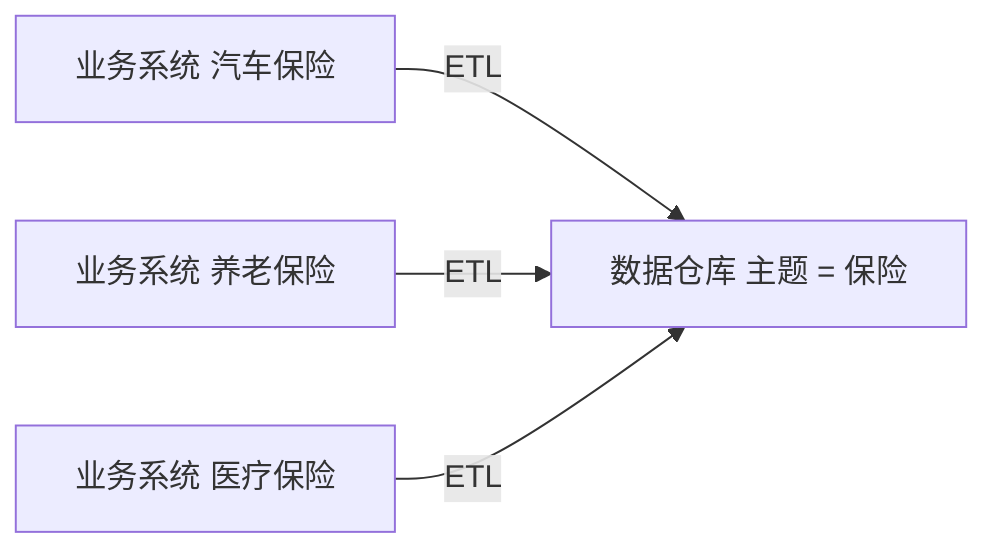

# 数据仓库的四个基本特征：面向主题、集成、非易失、时变

从 Hadoop 三件套转进 Hive 之前，得先把「数据仓库」这个概念立稳。不少人第一次接触数仓时的困惑都集中在几个问题上：数据进去以后还能不能改？为什么要按主题建库建表？业务库里的数据是怎么跑进来的？这些问题在数据仓库的四个基本特征里都有答案。

## 先给结论

- 数据仓库（Data Warehouse，简称 DW）的目的是构建面向分析的集成数据环境，它本身不生产数据、也不消费数据，所以叫仓库而不叫工厂。
- 四个基本特征：面向主题、集成、非易失（不可更新）、时变，这是面试高频题，也决定了数仓的建库建表方式。
- 非易失说的是不做实时更新：数据进仓后长期保留，只有查询和少量加载，没有日常的改与删。
- 时变补上另一半：数据并非永不变，而是按天、周、月、季度、年的周期整体追加更新。
- 多源异构的数据能进同一个仓，靠的是 ETL：抽取、转换、加载。

## 数仓是仓库，不是工厂

数据仓库主要用来存数据，而这些数据是为了分析而汇集的。通过分析，企业得到决策依据和分析报告，所以一句话概括：数仓为分析而生。

它有两句关键的「不」。**不生产数据**：仓里的数据全部来自外部，比如业务型数据库里的订单与用户，再比如爬虫收集来的外部数据。**不消费数据**：分析的时候，数仓只负责把数据提供给上层应用，自己不做业务加工。仓库只管存货与出货，货物是别人造的，也是别人取用的，这就是它与工厂的本质区别。

## 面向主题：按分析领域组织数据

面向主题是四个特征里最需要转念的一个。业务数据库是按业务流程组织的，订单一张表、库存一张表、用户一张表，各服务各的事；数仓是按分析需求组织的，分析哪个领域，就把那个领域相关的数据全部拉到一起。

这个「领域」就是主题。零售商做分析，可能面向产品、库存、客户这些主题；保险企业做分析，主题可能是客户、合约、索赔。以保险主题为例，它的数据来自三个业务系统：



三个业务系统的数据经过 ETL 汇进同一个主题，分析保险时不必再跨系统拼数据。主题是分析需求导向的抽象概念，同一条数据可以服务多个主题，这是它与业务表最大的不同。

## 集成：先 ETL 统一格式，再入仓

集成的含义不是简单堆放。上图的三个业务系统，开发时间不同、团队不同，数据的格式很可能对不上：同样一个客户标识，这边是手机号，那边是证件号；同样一个日期，格式五花八门。直接混在一起没法分析。

所以要经过一个统一处理的过程：把分散独立的业务数据库数据抽取出来，做清理、转换，统一格式后汇总装载进数仓，得到一致、完整的数据。这个过程就是 ETL，三个字母分别是 Extract（抽取）、Transform（转换）、Load（加载）。ETL 保证的是数仓数据的一致性，它是数仓建设与日常维护里的核心工作，后面的分层课还会回到它。

## 非易失与时变：不实时更新，但周期性追加

非易失（不可更新）要对着业务库来理解。业务库直面线上交易，数据必须实时更新，比如订单表要跟着用户的每一次下单即时变化：

```sql
-- 业务型数据库：订单状态随业务操作实时更新（示例）
UPDATE order_info SET status = 'PAID', pay_time = '2026-11-04 10:00:00'
WHERE order_no = '20261104001';
```

数仓不一样。它保存的是一段时间的历史数据，作用是支撑查询与分析，所以不需要实时更新。数据一旦进入数仓，一般会被较长时间地保留，很少出现修改和删除操作，主要动作就是查询。

但「不实时更新」不等于「永远不变」。历史数据不跟上现实，分析结论就会过时，所以时变特征补上了更新节奏：在时间维度上，数据按天、星期、月、季度或年为单位整体追加进数仓。典型做法是给表按日期分区，每天把当天数据整体装载一次：

```sql
-- 数仓侧：按天分区追加，不修改历史分区（按本课写法补全的示例）
LOAD DATA INPATH '/input/orders/2026-11-04'
INTO TABLE ods_order PARTITION (dt = '2026-11-04');
```

两个特征合起来才是完整口径：非易失管的是「没有实时的增删改」，时变管的是「有周期性的整体追加」，更新的单位是天、周、月这个量级，而不是一笔事务的毫秒级。

## 常见误区

- **把非易失理解成数据永不变化。** 非易失排除的是实时的行级更新与删除，时变特征下数据仍按周期整体追加，长期不更新反而跟不上分析需求。
- **把主题等同于业务模块。** 订单模块、库存模块是按业务流程切的；主题按分析需求切，数据跨应用系统，产品主题里既可能有订单数据也可能有客服数据。
- **以为数仓是用来取代业务库的。** 两者分工明确，业务库管实时事务，数仓管历史分析，没有谁替代谁。
- **以为 ETL 是一次性工程。** 数据源每天都在产生新数据，ETL 是持续运行的例行过程，它的稳定性决定了数仓的新鲜度。

## 面试可能被问到的问题

1. 面试官追问：「说一下数据仓库的定义和四个基本特征。」
   答：数据仓库是面向分析的集成数据环境，目的是支撑管理决策与生成分析报告。四个特征是面向主题、集成、非易失、时变：按分析主题组织数据，多源数据经 ETL 统一入仓，进仓后不做实时更新只供查询，并随时间按周期整体追加。
2. 面试官追问：「怎么理解数仓不生产数据也不消费数据？」
   答：不生产，指数据全部来自外部业务库、日志、爬虫等来源；不消费，指数仓只向上层分析提供数据，本身不承载业务操作。这两个「不」把它与业务系统、与工厂区分开。
3. 面试官追问：「非易失和时变是不是矛盾？」
   答：不矛盾，两者约束的动作不同。非易失说的是没有实时的行级增删改，查询是主要操作；时变说的是按天、周、月、季度、年等周期做整体数据追加。一个是「不实时更新」，一个是「周期性加载」。
4. 面试官追问：「什么是 ETL，为什么数仓必须有它？」
   答：ETL 是抽取、转换、加载。各业务系统的数据格式不一致，直接汇总无法分析，必须先抽取出来，清理转换成统一格式再装载进数仓，这样才能保证数仓数据的一致性与完整性。
5. 面试官追问：「面向主题与数据库面向业务，区别体现在哪？」
   答：数据库按业务流程组织表，服务交易与操作；数仓按分析领域组织数据，一个主题汇集该领域跨系统的相关数据。比如保险主题把车险、养老险、医疗险三个业务系统的数据集成到一起分析。

## 配套资料

- 讲义：`materials/docs/04/智慧学成-第2章-数据仓库.md`，其「数据仓库概念」与「数据仓库的特点」两节给出了四特征的书面定义，与本课口径一致。
- 讲义：`materials/docs/04/智慧学成-第2章-ETL.md`，ETL 概念的完整表述。
- 文中两条 SQL 为按本课写法补全的示例，本课视频为概念讲解，无配套源码。
