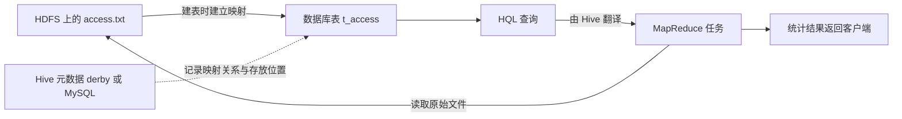

# Hive 入门：把 SQL 翻译成 MapReduce 的数据仓库工具

统计「每个用户今天访问了多少次」，手上有 Hadoop 就得动用 MapReduce：Mapper 里把用户 ID 作为 K2、整行数据作为 V2，让相同的键聚到同一个集合，Reducer 里对每组计数，再加上 JobMain 提交，一个简单需求要写三个类。而 HDFS 上躺着的不过是一个格式规整的文本文件，字段固定、分隔符固定。Hive 要消除的就是这个落差：让会 SQL 的人直接分析 HDFS 上的数据文件，翻译成 MapReduce 的活它来干。

## 先给结论

- Hive 是基于 Hadoop 的数据仓库工具，由 Facebook 为解决海量日志数据分析而开发，后来开源给 Apache 软件基金会。
- 它做两件事：把结构化的数据文件映射成一张数据库表，再提供类 SQL 查询功能；本质是将 SQL 转换为 MapReduce 任务进行运算，底层数据存储由 HDFS 提供。
- 定位一句话：Hive 是把 SQL 翻译成 MapReduce 的工具，甚至可以说它就是 MapReduce 的一个客户端。
- 学习成本低是核心卖点：操作接口采用类 SQL 语法，不写 Java 也能完成 Hadoop 上的数据统计。
- 底层走 MapReduce 决定了它适合离线批量统计分析，不适合对延迟敏感的实时查询。

## 从一个文件到一张表

HDFS 上有一个结构化数据文件 access.txt，每行一条网站访问记录，依次是用户 ID、用户名、访问时间，字段间用逗号分隔：

```text
1,jack,12:30
2,tom,13:20
1,jack,15:20
2,tom,18:40
```

只要文件有固定格式，Hive 就能把它映射成一张数据库表。建表动作本身也是一句 SQL：

```sql
create table t_access(id, name, date)
```

白板示例省略了字段类型，映射建立之后，这张表与文件之间就有了对应关系。谁来记住这个对应关系？答案是 Hive 的元数据。元数据专门有地方存储，里面记录三类信息：表与数据文件之间的映射、表字段与文件字段之间的映射、表数据文件的存放位置。默认情况下元数据存在 Hive 自带的 derby 数据库里，derby 有缺陷，一般换成 MySQL 来存，安装环节会实际操作一遍。

有了表，就能用类 SQL 对文件做查询。Hive 的类 SQL 叫 HQL，也可以叫 Hive SQL，它与标准 SQL 相似度很高，大部分写法一样，只有细节差别。统计两个用户各自的访问次数：

```sql
select name, count(*) from t_access group by id;
```

白板这句按 ID 分组计数，更严谨的写法把分组字段写全：

```sql
select id, name, count(*) from t_access group by id, name;
```

文件、表、元数据、HQL 与 MapReduce 之间的关系如下：



从左往右读这张图：文件先被映射成表，映射关系进元数据；HQL 提交后被翻译成 MapReduce 任务，任务反过来读 HDFS 上的原始文件，结果回到客户端。整条链路里 Hive 没有存过一行业务数据，它做的是映射与翻译。

## 为什么学习成本低

**第一，直接用 Hadoop 的门槛太高。** 人员学习成本太大，项目周期往往又要求太短，用 MapReduce 实现复杂查询逻辑的开发难度更大。多表关联加分组统计的需求，用 MR 写出来就是 Mapper、Reducer、JobMain 加一堆样板代码，改一个统计口径等于改一遍代码。

**第二，Hive 把门槛降到了 SQL。** 操作接口采用类 SQL 语法，提供快速开发的能力；避免了去写 MapReduce，减少开发人员的学习成本；写好的 HQL 由 Hive 自动变成 MapReduce 任务，同样的统计功能，一条带 group by 的查询就替代了三个类。

**第三，功能扩展方便。** 框架没覆盖的特殊逻辑可以做成用户自定义函数，按自己的需求实现数据运算，写好之后在 SQL 里直接调用。

## 三个特点

- 可扩展：Hive 可以自由扩展集群规模，一般不需要重启服务。原因在底层，HDFS 的存储可以横向扩容，MapReduce 的计算也可以横向加节点，扩存储还是扩计算都不动 Hive 本身。
- 延展性：支持用户自定义函数，根据业务需求实现自己的函数并在查询里使用。
- 容错：个别节点出现问题，SQL 查询仍可以完成执行，靠的是 MapReduce 任务级的重试机制，失败的分片换个节点重算一遍即可。

## 适合离线批处理，不适合实时

Hive 的每一个查询最终都落到 MapReduce 上执行，而 MapReduce 的代价是固定的：读文件、中间结果落盘、经过网络传输，启动开销摆在那里。这决定了 Hive 的响应是秒级到分钟级的，拿它给在线业务做实时查询是选错了工具；海量日志的离线批量统计分析才是它的主场。它与关系型数据库的逐条对比，放到 Hive 与 Hadoop 及 RDBMS 关系的讨论里再展开。

## 常见误区

- **把 Hive 当成数据库。** Hive 不存储数据本身，数据文件始终在 HDFS 上，它提供的是映射与查询能力；有 SQL 数据库的外表，应用场景却完全不同。
- **以为 Hive 让查询变快。** 它只是翻译器，执行引擎还是 MapReduce，效率不会因为套了层 SQL 而提高；它的价值是开发快，不是跑得快。
- **忽视元数据的地位。** 元数据丢了，HDFS 上的文件虽然还在，Hive 里的表就查不到了；元数据与数据文件是两套东西，前者在 MySQL 或 derby 里，后者在 HDFS 上。
- **版本随意搭配。** Hadoop 用 3.x 时 Hive 也应选 3.x，课程环境为 Hadoop 3.1.1 配 Hive 3.1.1，跨大版本混搭容易出现兼容问题。

## 面试可能被问到的问题

1. 面试官追问：「Hive 是什么？它的本质是什么？」
   答：基于 Hadoop 的数据仓库工具，Facebook 为分析海量日志数据开发，后开源给 Apache 软件基金会。它把结构化数据文件映射成数据库表并提供类 SQL 查询，本质是将 SQL 转换为 MapReduce 任务进行运算，底层数据由 HDFS 存储，可以把它理解成 MapReduce 的一个客户端。
2. 面试官追问：「为什么用 Hive 而不直接写 MapReduce？」
   答：直接用 Hadoop 面临人员学习成本太大、项目周期要求太短、MapReduce 实现复杂查询开发难度太大的问题；Hive 的操作接口是类 SQL，会 SQL 就能快速开发，MapReduce 由它自动生成，功能扩展也很方便。
3. 面试官追问：「Hive 的元数据记录了什么？存在哪里？」
   答：记录表与数据文件之间的映射、表字段与文件字段的映射、表数据文件的存放位置。默认存在 Hive 自带的 derby 数据库里，因为 derby 有缺陷，一般换成 MySQL 存储。
4. 面试官追问：「Hive 适合什么场景，不适合什么场景？」
   答：底层 MapReduce 决定了它延迟高，适合海量数据的离线批量统计分析，例如日志分析与报表加工；不适合对响应时间敏感的在线实时查询，那类需求要交给关系库或流式计算引擎。
5. 面试官追问：「Hive 有哪些特点？」
   答：可扩展，集群规模自由扩展一般不需要重启服务；延展性，支持用户自定义函数；容错性，节点出现问题 SQL 仍可完成执行。

## 配套资料

- 讲义：`materials/docs/04/智慧学成-第2章-数据仓库.md`，其「4.1 Hive 介绍」给出 Facebook 开发并开源的口径，「4 Hive 创建数据仓库」一节的 time_dim、course_dim 等真实建表 SQL 就是「文件映射成表」在真实项目里的形态。
- 本课视频为概念讲解加白板推演，无配套源码包，access.txt 数据、建表与查询语句按白板内容与主流写法补全。
