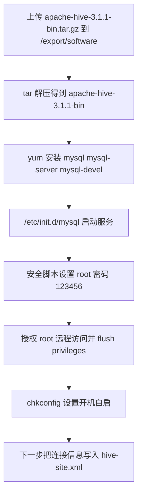

# 安装 Hive 的前置步骤：把元数据库 MySQL 装好并授权

> 🔒 安全提示：文中示例的口令/密钥均为课程教学环境演示口径，生产环境的安全要求见《安全与合规须知》。

Hive 解压完直接敲 hive 进命令行，建了几张表，第二天换个目录再启动，表全不见了。这是 derby 元数据库的经典事故。课程的做法是先把 MySQL 装好、授权好，让 Hive 的元数据从一开始就落在关系库里。这里走完 Hive 3.1.1 的解压与前置 MySQL 的安装全过程，元数据库按集群规划放在 node01 上，后续 Hive 服务也指向它。

## 先给结论

- 版本对齐是前提：Hadoop 用的是 3.x，Hive 也要选 3.x，课程为 Hadoop 3.1.1 配 Hive 3.1.1，大版本错开会出现兼容问题。
- Hive 本体安装就是解压：压缩包上传到 `/export/software/`，tar 解压到同一目录即完成。
- 元数据库不用默认的 derby：它同一时间只允许一个会话访问，且元数据目录跟着启动位置走，课程用 yum 安装 MySQL 替换。
- MySQL 装完四步收尾：启动服务、自带安全脚本把 root 密码改为 123456、授权 root 远程访问并刷新权限、设置开机自启。

## 元数据库为什么必须是 MySQL

Hive 的元数据记录表与数据文件之间的映射、表字段与文件字段的映射、数据文件的存放位置，数仓的这本账需要一个库来存。Hive 默认自带 derby，但它有两个致命缺陷：作为嵌入式数据库，同一时间只允许一个会话访问，第二个客户端连进来就被拒绝；元数据落在启动目录下的 metastore_db 目录里，换个目录启动等于换了一本账，昨天建的表今天就「消失」。MySQL 独立部署在 node01 上，支持多会话并发访问，集群里的每个节点都能连同一份元数据，这正是元数据资料库该有的形态：体量小、读写频繁、要并发。把 MySQL 装好，等于把数仓的账本先立起来。

## 解压 Hive 安装包

用 Hive 3.1.1，压缩包几百兆，提前下载好，上传到服务器 `/export/software/` 目录后解压：

```bash
cd /export/software/
tar zxvf apache-hive-3.1.1-bin.tar.gz -C /export/software/
```

解压后得到 `apache-hive-3.1.1-bin` 目录，进入其中就算安装完毕。`lib` 目录下的内容值得扫一眼：`hive-metastore-3.1.1.jar` 与 `hive-standalone-metastore-3.1.1.jar` 是元数据服务的实现，`derby-10.14.1.0.jar` 说明默认元数据库就是 derby，`datanucleus-core-4.1.17.jar` 这类 JDO 组件负责对象与关系库的映射，架构篇说的元数据存储，落在文件层面就是这些包。

## yum 安装 MySQL

元数据要换 MySQL，接下来装它。课程采用在线安装，一条命令带上客户端、服务端与开发库：

```bash
yum install mysql mysql-server mysql-devel
```

安装过程中事务摘要显示 Install 11 Package(s)、Upgrade 4 Package(s)，总下载量 12M，确认 y 后等待下载安装，结束时看到 Complete!，实际装到的是 yum 源提供的 mysql 5.1.73 系列。装完先启动服务：

```bash
/etc/init.d/mysql start
```

## 安全脚本设置 root 密码

MySQL 装完还没有密码，用它自带的设置脚本做初始化：

```bash
mysql_secure_installation
```

脚本逐项提问，课程环境的应答如下：

- Enter current password for root：装完默认无密码，直接回车。
- Set root password：回答 y，新密码设为 123456，再输入一遍确认。
- Remove anonymous users：回答 y，移除匿名用户。
- Disallow root login remotely：回答 n，这里必须写 n 才允许 root 远程登录，Hive 所在节点要跨网络连它。
- Remove test database and access to it：回答 n，保留测试库。
- Reload privilege tables now：回答 y，立即重载权限表，让前面的设置生效。

（脚本命令名按主流写法补全，视频里称为 MySQL 自带的设置脚本，交互项与应答一致。）

## 授权远程访问

安全脚本只解决了「允许不允许」，授权动作还要在 MySQL 里显式做。进入 MySQL 后开启 root 的远程访问权限并刷新：

```sql
grant all privileges on *.* to 'root'@'%' identified by '123456' with grant option;
flush privileges;
```

`root@'%'` 表示 root 可以从任意主机连接，`flush privileges` 让授权立即生效，之后 exit 退出。这两句是 Hive 各节点连得上元数据库的关键，授权语句按主流写法补全，视频里演示的是「开启远程访问权限、刷新权限」这两步操作。

## 设置开机自启

服务器重启后 MySQL 要能自己起来，否则 Hive 的元数据就断了。注册自启并验证：

```bash
chkconfig mysql on
chkconfig --list | grep mysql
```

看到 2 到 5 运行级别为 on 即生效。视频未演示这一步，按本课环境补全：服务名与启动脚本同名，若系统里服务名为 mysqld，对应执行 `chkconfig mysqld on`。

整条安装链路串起来如下：



MySQL 就绪后，元数据库的「地基」打完，下一轮配置就是把 jdbc:mysql://node01:3306 这类连接信息写给 Hive，让它真正用上这个库。

## 常见误区

- **Disallow root login remotely 答成 y。** 远程访问被关死，其他节点的 Hive 连不上元数据库；要远程访问这一项必须答 n。
- **授权后忘了 flush privileges。** 权限表没有重载，新授权不生效，表现为本机能连、远程连不上。
- **服务名想当然。** 不同系统上服务名可能是 mysql 也可能是 mysqld，启动报 unrecognized service 时，看 `/etc/init.d/` 下实际脚本名再操作。
- **忽略版本对齐。** Hadoop 2.x 配 Hive 3.x 或相反，依赖与协议都可能不兼容；先确认 Hadoop 大版本，再选同大版本的 Hive。

## 面试可能被问到的问题

1. 面试官追问：「Hive 为什么用 MySQL 替换默认的 derby？」
   答：derby 是嵌入式数据库，同一时间只允许一个会话访问，且元数据目录 metastore_db 跟着启动目录走，换目录启动就找不到表；MySQL 独立部署、支持多会话并发，适合集群共用同一份元数据。
2. 面试官追问：「Hive 的元数据都存了什么？」
   答：表与数据文件之间的映射、表字段与文件字段的映射、数据文件在 HDFS 上的存放位置，这些映射信息由元数据资料库统一管理，工程上落在 MySQL 这类关系库中。
3. 面试官追问：「如何允许 root 远程访问 MySQL？」
   答：执行 grant all privileges on *.* to 'root'@'%' identified by 对应密码 with grant option，然后 flush privileges 刷新权限；安全脚本里 Disallow root login remotely 一项要答 n。
4. 面试官追问：「Hive 版本怎么选？」
   答：与 Hadoop 大版本对齐，Hadoop 3.x 配 Hive 3.x，课程为 Hadoop 3.1.1 配 Hive 3.1.1；跨大版本混搭容易出现依赖与协议不兼容。
5. 面试官追问：「mysql_secure_installation 里都设置了什么？」
   答：设置 root 密码、移除匿名用户、决定是否禁止 root 远程登录（需要远程访问就答 n）、是否移除 test 库，最后重载权限表使设置生效。

## 配套资料

- 讲义：`materials/docs/04/智慧学成-第2章-数据仓库.md`，「4.2 创建数据库」起的全部建库建表 SQL，都建立在这次装好的元数据库与 Hive 体系之上。
- 代码：`materials/code/04/day05-Hive/`，本章资料包，含后续课程的 UDF 工程 `day05_hive_udf_test` 与 SQL 练习库 `sql_prac.sql`。
- 解压、yum 安装与服务启动命令来自本课视频操作实录；mysql_secure_installation 命令名、grant 授权语句与 chkconfig 自启设置为按本课环境（yum 安装的 MySQL 5.1.73，root 密码 123456）补全的示例。
