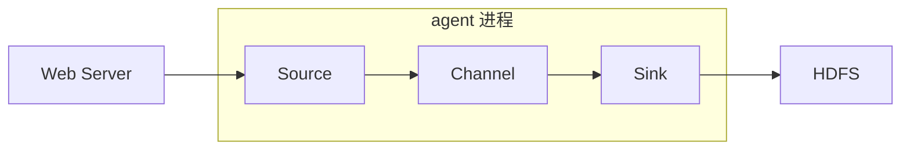
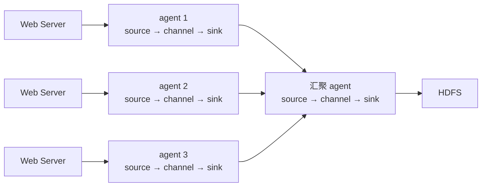

# Flume 概述与运行机制：一条 source 到 sink 的采集流水线

HDFS 负责存数据，MapReduce 负责算数据，两件事都围绕数据展开。可数据在进 HDFS 之前有一段真空地带：Web 服务器上滚动的访问日志、目录里不断生成的文件、网络端口吐出的数据包，来源分散、格式不一、持续产生，靠手工拷贝既慢又容易漏。Flume 就是补这一环的框架，可它的资料里 agent、source、channel、sink 一堆名词堆在一起，第一次接触很难分清谁管谁。把这套机制拆成三个问题，名词立刻就归位了。

## 先给结论

- Flume 是分布式、可靠、高可用的海量日志采集、聚合和传输系统，核心定位就一个词：日志采集。
- 采集的来源与去处都是可插拔的：socket 数据包、文件、目录能进，HDFS、HBase、Hive、Kafka 能出，切换场景只改配置，不写采集代码。
- 一个 agent 由 source、channel、sink 三个组件拼成：source 决定从哪采，channel 做临时缓存，sink 决定写到哪个存储系统。
- 数据在 agent 内从左到右单向流动，官网架构图 Web Server → Source → Channel → Sink → HDFS 就是最小完整链路。
- 单个 agent 不够用时多个 agent 串联：前一个 agent 的 sink 输出接到后一个 agent 的 source 输入，多路还能汇聚到中心 agent 统一落盘。

## 为什么采集环节需要专门的框架

Hadoop 体系里存和算都有人管，唯独「数据怎么进来」没人管。采集这件事看着简单，实际要做对并不容易：数据源持续产生，不能采一次就结束；来源多且分散，需要统一归集；中途不能丢数据，采一半挂掉得能恢复。这些通用能力如果每个项目自己写一遍，成本高且质量参差。

Flume 把这些能力做成了框架。它的完整定义是：Flume 是一个分布式、可靠、高可用的海量日志采集、聚合和传输的系统。它可以采集网络 socket 数据包、文件、文件夹、Kafka 等各类源数据，又能把采集到的数据输出到 HDFS、HBase、Hive、Kafka 等存储系统。使用方式也轻，只需要写一些简单的配置，Flume 就能完成数据采集功能，从网络上或日志文件里获取想要的数据，再交给下游做存储和分析。

## source、channel、sink：三个组件对应三个问题

运行机制拆开就是三个问题：数据从哪里采集、采回来的数据临时放哪、最终存入哪个存储系统。Flume 的三个组件一一对应。

**source 负责第一个问题：从哪里采集。** 它决定数据来源，从网络日志流来、从文件来、从套接字端口来，各都有对应的 source 实现，想换数据源就换 source 类型。

**channel 负责第二个问题：临时存储。** 采集到的数据先进一个类似管道的地方暂存，这个管道就是 channel，默认在内存中开辟空间做缓存。缓存是有限度的，不可能无限往里存。

**sink 负责第三个问题：存入存储系统。** channel 里的数据攒到一定数量，sink 把它取出来写到最终的存储设备上，写 HDFS、写 HBase 都由 sink 的类型说了算。

source、channel、sink 三个组件框在一起就是一个 agent，也叫 Flume 的一个实例或一个进程。官网首页那张架构图就是这个最小结构：

这张图在讲 agent 内部的数据流向：Web Server 产生日志，source 从中收取，channel 暂存缓冲，sink 拉出并写入 HDFS。关键路径一句话：数据永远从左到右单向流动，source 只管进、sink 只管出、channel 居中缓冲，三者同处一个 agent 进程。

## 可靠性：channel 缓冲加两段事务

定义里的「可靠」两个字，落在机制上就是 channel 的缓冲职责。source 把数据写入 channel、sink 从 channel 读出，写入与读出两段各自按事务方式确认：数据没有成功进入 channel，source 那一侧不算完成，不会把源头数据丢弃；数据没有成功写到目的地，sink 会重试，channel 里已有的事件也不会提前清掉。数据因此不会在组件交接处凭空消失。

channel 的实现方式决定可靠性的上限。内存 channel 开辟内存空间缓存，吞吐高，但 agent 进程一旦挂掉，缓冲里没写出的数据就丢了；对可靠性要求更高的场景可以换文件类 channel，把事件先落盘再传输。缓存再可靠也只是缓冲，channel 不能当持久存储用，数据最终必须由 sink 写进 HDFS 这类持久系统。

## 多级 agent 串联：输出接输入

单个 agent 只解决一条链路。真实环境里日志往往在多台 Web 服务器上同时产生，每台都直连 HDFS 集群既浪费连接又不好管理，中间可能还要做一次汇聚。Flume 的答案是 agent 串联：前一个 agent 的 sink 把数据发出去，后一个 agent 的 source 把它接住，前者的输出就是后者的输入。

这张图在讲多级串联拓扑：三个前端 agent 各自从 Web Server 采集，sink 输出统一接到第四个汇聚 agent 的 source，由它写入 HDFS。关键路径一句话：串联时 agent 之间靠网络传输衔接，汇聚 agent 的 source 类型要选能接收网络数据的实现，这也是后面实际搭建 agent 前必须先想清楚的问题。

## 常见误区

- **把 Flume 当存储或计算框架。** 它只负责采集与传输，存数据是 HDFS 的事，算数据是 MapReduce 与 Hive 的事；在 Flume 里做聚合分析属于方向性错误。
- **channel 当成持久存储。** channel 只是缓冲管道，内存 channel 在进程挂掉时会丢缓冲数据；数据要持久必须由 sink 写进存储系统，channel 里不宜长期积压。
- **组件类型随意混搭。** 类型确实可插拔，但要匹配数据形态：监听端口收数据用 netcat source，监控目录收文件用 spooldir source，sink 要对准目标存储系统；类型错配采不到数据，还容易误判成网络问题。
- **以为 agent 必须一个节点一个。** agent 就是一个 Flume 进程实例，一台机器可以跑多个；多 agent 串联与汇聚是常态拓扑，部署方案按数据源分布决定。

## 面试可能被问到的问题

1. 面试官追问：「Flume 是什么，解决什么问题？」
   答：Flume 是分布式、可靠、高可用的海量日志采集、聚合和传输系统，解决的是数据从产生源到存储系统之间可靠搬运的问题。它能采集 socket、文件、目录、Kafka 等源数据，输出到 HDFS、HBase、Hive、Kafka 等存储系统，使用时只需写配置。
2. 面试官追问：「一个 agent 由哪几部分组成，各自负责什么？」
   答：source、channel、sink 三个组件。source 决定从哪里采集；channel 对采集的数据做临时缓存；sink 决定数据最终写入哪个存储系统。三者组成一个 agent，即一个 Flume 进程实例。
3. 面试官追问：「数据在 agent 内部怎么流动？」
   答：单向从左到右：source 从数据源收取事件写入 channel，channel 缓冲暂存，sink 从 channel 取出写入 HDFS 等目标存储。方向不可逆，sink 只从 channel 读，source 只向 channel 写。
4. 面试官追问：「Flume 怎么保证数据不丢？」
   答：靠 channel 缓冲加两段事务：source 到 channel 的写入、channel 到 sink 的读出各自按事务确认，数据未成功进 channel 不算采集完成，未成功写出 sink 会重试。可靠性上限取决于 channel 实现，内存 channel 快但进程挂掉会丢缓冲，文件 channel 先落盘更可靠。
5. 面试官追问：「多个 agent 之间如何协作？」
   答：串联方式，前一个 agent 的 sink 输出作为后一个 agent 的 source 输入；多台采集节点的 agent 可以把输出汇聚到同一个中心 agent 的 source，由中心 agent 统一写入存储，形成多级串联拓扑。

## 配套资料

- 讲义：`materials/docs/04/采集系统部署使用说明.md`，课程项目的采集系统部署文档，业务应用通过 log4j 的 FlumeAppender 把日志交给 Flume 采集，是采集定位在真实项目里的落地场景。
- day06-Flume 资料包未包含课件源文件与配置，结构图按画面线 PPT 与 Apache Flume 官网架构图还原；channel 事务细节按 Flume 官方文档主流口径补全。
