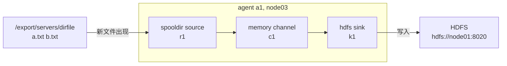
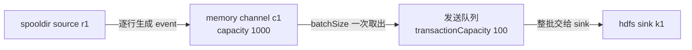
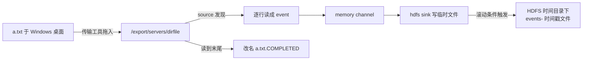

# flume案例-目录数据采集三讲：spooldir 实现流程、五段式配置逐项拆解与运行测试排错

## 先给结论

生产环境的数据更多以文件形式存在：业务日志按小时滚动落在目录里，新文件不断出现。flume案例-目录数据采集用 spooldir source 盯住一个目录，新文件一产生就采走写入 HDFS，采完的文件改名追加 `.COMPLETED` 后缀防止重复采集。全系列三讲从框架立起来到配置逐格填、再到真机验收。
实现流程讲先立骨架：配置文件五段式与 netcat 案例同构，变化全在 source 与 sink 两段，spooldir 换掉 netcat、hdfs sink 换掉 logger，channel 原样保留；目录里的文件放入后不能再修改，以点开头的隐藏文件不采集，两条禁忌先记住。
配置讲把难点拆开：source 段三个配置项盯住目录，channel 的 capacity 与 transactionCapacity 单位都是 event 且后者必须更小，hdfs sink 的 round 三件套管目录按时间分桶、roll 三件套管文件切换，是两套完全不同的滚动，batchSize 夹在中间不能越界。测试讲验收三件事：`.COMPLETED` 标记出现、HDFS 按时间目录落文件、控制台日志正常，还附带一次往已监控目录二次写同名文件的报错现场。
三讲依次是：
- 实现流程：案例场景、换两头保骨架与完成标记机制。
- 配置文件编写：source、channel、sink 三段逐项拆解与参数大小关系。
- 运行测试：启动 agent、完成标记、HDFS 验收与报错现场。

## 第1部分：Flume 目录采集案例：spooldir 盯住目录、打完成标记、把文件落到 HDFS

netcat 案例验证了 agent 链路，但生产环境里数据更多以文件形式存在：业务日志按小时滚动落在某个目录里，新文件不断出现。需求随之变成：让 Flume 盯住一个目录，新文件一产生就采走数据写入 HDFS，采完的文件还不能被重复采集。这就是 spooldir（目录采集）案例要解决的事，配置骨架与 netcat 案例相同，变化全在 source 与 sink 的类型上。

### 案例场景与三步实现框架

node03 上有个目录 `/export/servers/dirfile`，目录下的文件随时变化：第一个时间点出现 a.txt，第二个时间点出现 b.txt。要做的就是通过 Flume 采集这个目录中文件的变化，有新文件产生就采集文件数据，放到 HDFS 上。

netcat 案例已经跑通过整条链路，这个案例的实现框架完全一样，总体分三步。

**第一步，写一个配置文件**，如 `xxx.conf`，在文件里配置 source、channel、sink 三个组件。**第二步，启动一个 Flume agent 实例**，实例起来就开始工作。**第三步，运行测试**，往目录里放文件看效果。后两步都是固定操作，重点是第一步。

配置文件内部又分五部分：配置三个组件的名字；分别配置 source；配置 channel；配置 sink；把 source、channel 和 sink 组合在一起。这套五段式在 netcat 案例里写过一遍，这里只是替换其中两段的类型。



这张图在讲本案例的链路：目录文件进入 spooldir source，经 memory channel 缓冲，由 hdfs sink 写进 HDFS。关键路径一句话：与 netcat 案例相比，只有两头变了，数据入口从 TCP 端口换成目录，出口从控制台日志换成 HDFS 文件。

### 配置文件：换两头，保骨架

资料包没有附带这个案例的配置文件，下面按画面线流程图与 Flume 1.8.0 官方文档的主流写法补全一份可直接运行的方案：

```properties
# 定义这个agent中各组件的名字
a1.sources = r1
a1.sinks = k1
a1.channels = c1

# 描述和配置source组件: r1, 监控目录
a1.sources.r1.type = spooldir
a1.sources.r1.spoolDir = /export/servers/dirfile
a1.sources.r1.fileSuffix = .COMPLETED
a1.sources.r1.fileHeader = true

# 描述和配置sink组件: k1, 写入HDFS
a1.sinks.k1.type = hdfs
a1.sinks.k1.hdfs.path = hdfs://node01:8020/flume/dirfile
a1.sinks.k1.hdfs.filePrefix = events-
a1.sinks.k1.hdfs.fileType = DataStream
a1.sinks.k1.hdfs.rollInterval = 30
a1.sinks.k1.hdfs.rollSize = 0
a1.sinks.k1.hdfs.rollCount = 0
a1.sinks.k1.hdfs.useLocalTimeStamp = true

# 描述和配置channel组件, 内存存储
a1.channels.c1.type = memory
a1.channels.c1.capacity = 1000
a1.channels.c1.transactionCapacity = 100

# 描述和配置source channel sink之间的连接关系
a1.sources.r1.channels = c1
a1.sinks.k1.channel = c1
```

source 段是本案例的核心。type 写 spooldir，指定它去监控 `spoolDir` 指向的目录；`fileSuffix` 定义采集完成后的文件后缀，默认就是 `.COMPLETED`，写出来是为了说明意图；`fileHeader = true` 会把文件名放进 event 的 header 里，下游想知道数据来自哪个文件时靠它。

sink 段从 logger 换成 hdfs。`hdfs.path` 指定落盘目录，集群的文件系统地址是 `hdfs://node01:8020`，与课程 Hadoop 3.1.1 环境的 core 配置一致；`filePrefix` 给落盘文件加前缀；`fileType = DataStream` 让文件按普通文本写，不设这项默认是 SequenceFile 二进制格式，cat 出来没法看；三个 roll 参数控制文件滚动，`rollInterval = 30` 表示每 30 秒关掉当前文件开新文件，`rollSize` 与 `rollCount` 置 0 表示不限大小与条数；`useLocalTimeStamp = true` 让时间类路径变量用本地时间。

channel 段与连线段和 netcat 案例逐字相同，memory channel 的 capacity 1000、transactionCapacity 100，连接关系依旧是 source 认 channel、sink 认 channel。

### 完成标记：.COMPLETED 是怎么出现的

agent 启动后，spooldir source 会周期性扫描监控目录，工作机制是一个文件状态流转：


这张图在讲一个文件从出现到退出监控的完整生命周期：新文件放入目录后被 source 发现，内容逐行读成 event 推进 channel；读到底后 source 给文件名追加 `.COMPLETED`，下次扫描看到这个名字就跳过，数据不会重复进 HDFS。

所以这个案例的测试方式与 netcat 不同：不再用 telnet 发文本，而是往目录里放文件。用 `mv` 把 a.txt 移进 dirfile，稍等片刻目录里出现 `a.txt.COMPLETED`，HDFS 的 `/flume/dirfile` 下出现带 `events-` 前缀的文件，三步实现就算验证完成。

这份机制顺带带来一条硬约束：spooldir 假定「放进目录的文件是完成的」，它以文件名判断是否采集过。文件放入后如果还在被编辑追加，source 与改名的标记就会对不上，报错并暂停采集；测试时用 `mv` 成品文件进目录，不要在监控目录里用 vim 或重定向边写边采。以点开头的隐藏文件也会被直接忽略。

### 与 netcat 案例的差异

两个案例摆在一起，变化点收敛为三处。

**数据入口不同。** netcat source 监听 TCP 端口收一行行文本，适合模拟网络数据；spooldir source 监控目录收整个文件，适合日志文件这类批量落地的数据。

**数据出口不同。** logger sink 只把 event 打到控制台，用来验证链路；hdfs sink 把数据真正写进存储系统，采集结果能被 Hive 等下游使用。

**验证方式不同。** netcat 案例在控制台看 event 的 header 与 body；spooldir 案例看两处：目录里文件名是否变成 `.COMPLETED`，HDFS 上是否出现落盘文件。

channel 类型、连线写法、启动命令结构都不变：`bin/flume-ng agent -c conf -f conf/xxx.conf -n a1 -Dflume.root.logger=INFO,console`，换的只是 `-f` 指向的配置文件。五段式配置骨架是通用的，学一个案例等于学会一类案例。

## 第2部分：spooldir 采集配置逐项拆解：spoolDir、容量参数与 hdfs sink 的两套滚动

目录采集案例的框架已经立起来了：spooldir 盯住目录、逐行封装 event、打 `.COMPLETED` 标记、经 hdfs sink 落进 HDFS。框架能不能跑起来，全看那份配置文件怎么填。这个案例的配置行数不少，难点不在语法，而在几组参数的区分：capacity 与 transactionCapacity 差在哪，round 与 roll 是两套完全不同的滚动，batchSize 为什么不能随意设大。按五段式的顺序，把每一格填进去。

### 配置文件骨架：从命名三组件开始

在服务器上进入 Flume 1.8.0 的安装目录，在 conf 下新建配置文件：

```bash
cd /export/servers/apache-flume-1.8.0-bin/conf
vim spooldir.conf
```

第一段把三个组件的名字定下来：

```properties
# 定义这个agent中各组件的名字
a1.sources = r1
a1.sinks = k1
a1.channels = c1
```

`a1` 是 agent 的名字，启动实例时用 `-n a1` 与它对上；`r1`、`k1`、`c1` 分别是 source、sink、channel 的编号，后面每一行配置都靠这组名字挂接。这三个名字在 netcat 案例里写过一遍，原样搬来。

### source 段：三个配置项盯住一个目录

```properties
# 描述和配置source组件: r1, 监控目录
# 注意：不能往监控目录中重复写同名文件
a1.sources.r1.type = spooldir
a1.sources.r1.spoolDir = /export/servers/dirfile
a1.sources.r1.fileHeader = true
```

`type = spooldir` 是固定写法，这个名字不能随手编：它就是为「监控目录下文件变化」专门提供的 source 类型。`spoolDir` 填监控目录的绝对路径，`/export/servers/dirfile`。`fileHeader = true` 把文件名放进 event 的 header，下游想知道某行数据来自哪个文件时，从这里取。

讲义在这段上专门加了一行注释：不能往监控目录中重复写同名文件。原因藏在完成标记机制里：spooldir 以文件名判断文件是否采集过，采完的文件被改名追加后缀，这个后缀由 `fileSuffix` 控制，默认值就是 `.COMPLETED`，所以配置里没有这一行，走的是默认。同名文件再次出现时，它与已有的 `.COMPLETED` 标记对不上，source 直接报错。这条注释是本案例第一个埋伏，实测篇会撞上它。

### channel 段：两个容量参数的单位都是 event

```properties
# 描述和配置channel组件, 内存存储
a1.channels.c1.type = memory
a1.channels.c1.capacity = 1000
a1.channels.c1.transactionCapacity = 100
```

`type = memory` 表示数据临时存在内存里。channel 存数据的单位是 event，一条数据一个 event，event 由 header 头部与 body 正文两部分组成，一行日志粗略对应一个 event。所以 `capacity = 1000` 的意思是这个 channel 总共最多存 1000 个 event。

`transactionCapacity = 100` 是另一码事。数据从 channel 流向 sink 时，不是把 channel 里的东西全部倒过去，中间有一个发送队列，一次最多装 100 个 event。两个参数的关系因此确定：capacity 是仓库的容量，transactionCapacity 是发货队列的容量，仓库必须比队列大。队列大小设得合适，向 sink 传数据的效率会更高。

sink 段还有一个 `batchSize`，把三者的关系一次说清。batchSize 是 sink 一次从 channel 取出、放进发送队列的 event 个数；transactionCapacity 是队列本身的大小；capacity 是整个 channel 的大小。大小关系是 `batchSize ≤ transactionCapacity ≤ capacity`，取值时不能越界，不小心设反了，agent 启动或运行时会报错。



这张图在讲 channel 内部的容量模型：仓库、发货队列、每次取货量三层。关键路径一句话：event 先按 capacity 上限囤在 channel，sink 按 batchSize 取出放进 transactionCapacity 大小的队列，再整批发给 sink，三层谁都不能比谁大。

### sink 段：时间转义、目录滚动与文件滚动

sink 的配置项多，从画面线逐行还原讲义原版如下：

```properties
# 描述和配置sink组件: k1, 写入HDFS
a1.sinks.k1.type = hdfs
a1.sinks.k1.channel = c1
a1.sinks.k1.hdfs.path = hdfs://node01:8020/spooldir/files/%y-%m-%d/%H%M/
a1.sinks.k1.hdfs.filePrefix = events
a1.sinks.k1.hdfs.round = true
a1.sinks.k1.hdfs.roundValue = 10
a1.sinks.k1.hdfs.roundUnit = minute
a1.sinks.k1.hdfs.rollInterval = 3
a1.sinks.k1.hdfs.rollSize = 20
a1.sinks.k1.hdfs.rollCount = 5
a1.sinks.k1.hdfs.batchSize = 1
a1.sinks.k1.hdfs.useLocalTimeStamp = true
# 生成的文件类型，默认是 SequenceFile，可用 DataStream，则为普通文本
a1.sinks.k1.hdfs.fileType = DataStream
```

**路径与时间转义。** `hdfs.path` 的前缀 `hdfs://node01:8020` 是课程集群 Hadoop 3.1.1 的文件系统地址，NameNode 在 node01。路径尾部的 `%y`、`%m`、`%d`、`%H`、`%M` 是时间转义符，落盘前分别被替换成两位年份、月、日、24 小时制小时、分钟，于是 HDFS 上出现两级时间目录，后一级还会随时间推进不停换新目录。

**round 三件套管目录滚动。** `round = true` 打开按时间分桶，`roundValue = 10`、`roundUnit = minute` 表示时间戳先向下对齐到 10 分钟一档，再去替换转义符。效果是 `%H%M` 这一级目录 10 分钟才换一个：10:20 开始的十分钟里，数据都进同一个目录，下一个 10 分钟才开新目录。

**roll 三件套管文件滚动。** 数据不会永远堆在一个文件里，条件满足就关掉当前文件、开一个新文件。`rollInterval = 3` 按 3 秒滚动；`rollSize = 20` 是临时文件大小达到 20 字节就滚动；`rollCount = 5` 是临时文件攒够 5 个 event 就滚动。这里的「文件」指 HDFS 上的临时文件，sink 写数据时先建一个 `.tmp` 临时文件，滚动条件触发后临时文件才变成正式文件。三个条件谁先触发谁生效，也可以只设一个，其余交给默认值。

**batchSize 与时间戳。** `batchSize = 1` 表示 sink 一次只从 channel 取一个 event，逐条送，配合上面 tiny 的滚动阈值，是教学环境为了快速看到滚动效果的做法。`useLocalTimeStamp = true` 让时间转义使用本地时钟；不设的话 sink 默认从 event header 里取时间戳，数据没有时间戳头时会直接报错。

**文件格式。** `fileType = DataStream` 把落盘文件按普通文本写；默认值 SequenceFile 是二进制格式，在 HDFS 上 cat 出来没法看。`filePrefix = events` 给正式文件统一加前缀，HDFS 上会看到 `events-` 开头的文件名。

### 落地：监控目录手工建，HDFS 目录自动建

配置内容粘贴进 `spooldir.conf` 后，从上到下检查一遍有没有漏行。监控目录本机不存在，需要手工创建：

```bash
mkdir -p /export/servers/dirfile
```

HDFS 侧的 `/spooldir/files` 及其时间子目录不用预建，hdfs sink 写入第一份数据时会自动创建。至此三步实现里的第一步完成，配置文件就绪、监控目录就绪，接下来启动 agent 实例做运行测试。

## 第3部分：目录采集运行测试：a.txt 进目录、.COMPLETED 出现、HDFS 落文件，还有一次报错现场

配置文件写完只是纸面工作，spooldir 案例是否真的跑通，要看三件事同时发生：放入目录的文件被改名打上 `.COMPLETED` 标记、HDFS 按时间目录出现落盘文件、控制台日志正常滚动。实际操作时还会撞上一个意外的报错现场，恰好把 spooldir 的禁忌演示了一遍。

### 启动 agent

进入 Flume 安装目录执行启动命令：

```bash
cd /export/servers/apache-flume-1.8.0-bin
bin/flume-ng agent -c conf -f conf/spooldir.conf -n a1 -Dflume.root.logger=INFO,console
```

`-c conf` 指定框架自带的配置目录，`-f` 指向刚写好的业务配置文件，`-n a1` 对应配置里的 agent 名，`-Dflume.root.logger=INFO,console` 把 INFO 级日志打到控制台。回车后控制台滚出 source、channel、sink 依次启动的日志，然后进程阻塞不动，这不是卡死：spooldir 是被动等文件的 source，监控目录里没有新文件，它就闲着。

### 放入文件，看完成标记

向监控目录添加文件用最直接的方式：借助 Windows 与 Linux 之间的文件传输工具，把桌面上的 a.txt 拖进 `/export/servers/dirfile`。生产环境里这一步是业务进程把成品日志文件移动进采集目录，测试时用拖拽模拟等价。

稍等片刻刷新目录，文件名从 `a.txt` 变成了 `a.txt.COMPLETED`。这个改名就是 spooldir 的核心机制在起作用：source 发现新文件，逐行读取封装成 event 推进 channel，读到文件末尾后追加 `.COMPLETED` 后缀，下次扫描看到这个名字就跳过，一个文件只采一次。

### 去 HDFS 验收数据

打开 HDFS 的 Web 管理页面（Hadoop 3.x 默认 9870 端口），按配置文件里 `hdfs.path` 的层级找：根目录下的 `spooldir`，进去有 `files`，再进去是日期目录，日期目录下是时分目录，形如 `1020`，里面躺着两个文件，文件名形如 `events-1557455020423`，正是 `events` 前缀加时间戳。

点开内容核对：第一个文件里是 aa、bb 两行，第二个文件是剩余的 cc，与 a.txt 的三行内容完全对上，数据确实采到了。a.txt 为什么变成两个 HDFS 文件？回看配置：`rollInterval = 3`、`rollSize = 20`、`rollCount = 5`，任一条件触发就滚动出新文件，20 字节、5 个 event 的阈值对三行文本来说太容易触发。阈值调大或只按时间滚动，文件数量会明显收敛。



这张图在讲一次完整的采集旅程：文件进目录、被读走、落 HDFS、被打标记。关键路径一句话：HDFS 上看到文件且目录里出现 `.COMPLETED`，两个现象同时成立，目录采集才算验证通过。

### 一次真实的报错现场

测试过程里控制台其实弹了一条报错：

```text
Could not find file: /export/servers/dirfile/a.txt (No such file or directory)
```

回看操作就明白了：a.txt 被拖了两次。第一次拖入后 source 正在读取文件，第二次拖入把文件覆盖、文件名瞬间变动，source 手里正读着的文件找不到了，于是抛出这个异常。数据本身没有丢，HDFS 上两个文件内容完整，误伤的只是日志。

这个现场把 spooldir 的一条硬约束演成了实景：**监控目录里的文件，放入之后不能被动。**同一种禁忌还有更常见的触发方式，往已经采集完成的目录里再次放入同名文件。这时文件名与已存在的 `.COMPLETED` 标记直接冲突，Flume 判定这是重复文件，抛异常并中断采集，不把文件挪走就不会恢复。两种表现、同一个规范：监控目录只进成品文件，成品文件进了目录就不再改动，同名文件绝不二次放入。规避手法也很朴素，文件在目录外生成，生成完用 `mv` 一次性移入。

### 收尾判断

三件事对上号，测试就算完成：目录里 `a.txt.COMPLETED` 出现，说明文件被完整采过；控制台滚动日志持续输出，说明 agent 活着；HDFS 时间目录里出现 `events-` 文件，说明数据真正落地。`.COMPLETED` 从此就是这批数据的退休证明，看到它不需要任何补救动作。

## 常见误区

- **在监控目录里直接编辑文件。** spooldir 按「放入即完成」设计，对已出现文件的修改会导致读取异常、采集中断；成品文件用 `mv` 移入，生成过程放在目录外。
- **把 `.COMPLETED` 当异常标志。** 追加这个后缀是采集完成的正常标记，代表数据已安全写入 channel；看到它应该高兴而不是回滚。
- **hdfs sink 不设 fileType。** 默认 SequenceFile 是二进制格式，HDFS 上 cat 出来全是乱码；要看文本内容加 `hdfs.fileType = DataStream`。
- **滚动参数放任不管。** rollInterval、rollSize、rollCount 任一条件满足就开新文件，全按默认跑小文件会爆炸，拖垮 NameNode；按数据量选择按时间滚动还是按大小滚动。
- **把 transactionCapacity 设得比 capacity 大。** 队列比仓库还大，channel 一旦存不下 event，source 端 put 会被拒绝甚至抛异常；正确关系是 batchSize 不超过 transactionCapacity，transactionCapacity 不超过 capacity。
- **把 round 与 roll 混为一谈。** round 是目录层面的时间分桶，roll 是文件层面的切换条件，两者互不替代；只设 roll 不设 round，目录会按转义符的粒度生成，只设 round 不设 roll，单文件会一直变大。
- **把 rollSize 的单位当成 KB。** rollSize 的单位是字节，`rollSize = 20` 就是 20 字节，教学阈值看起来夸张是故意的；生产上按数据节奏换算成字节再设。
- **漏掉 useLocalTimeStamp。** 默认从 event header 取时间戳，spooldir 产生的 event 没有这个头，路径转义会报错；用本地时间就显式置 true。
- **不建监控目录直接启动。** spooldir 不会替你创建 spoolDir，目录不存在时 agent 起不来，启动前先 `mkdir -p`。
- **把 `.COMPLETED` 当错误去处理。**改名追加后缀是采集完成的正常标记，表示数据已安全进入 channel，删掉它反而会让文件被当作新文件再采一遍，造成 HDFS 重复数据。
- **在监控目录里边写边采。**用 vim、重定向在已入目录的文件上继续追加，source 与改名标记对不上，轻则报 `Could not find file`，重则采集中断；生成过程放在目录外，成品再移入。
- **看到报错就认定数据丢了。**拖拽竞态引发的 `Could not find file` 不影响已成功采走的数据，先去 HDFS 核对内容再下结论。
- **把上传工具的临时名当正常文件。**部分传输工具边传边改名，source 可能读到半路文件消失的现场；先用工具传到目录外，再 `mv` 进监控目录最稳。

## 面试可能被问到的问题

1. 面试官追问：「spooldir source 如何避免重复采集？」
   答：靠文件改名机制。source 逐行读完一个文件后，给文件名追加 `.COMPLETED` 后缀；扫描时只认没带标记的文件，已标记的直接跳过，一个文件只采一次。

2. 面试官追问：「spooldir 对被监控目录里的文件有什么约束？」
   答：文件放入后不可再修改，spooldir 假定放入即完成，修改会导致读取错误并中断采集；以点开头的隐藏文件不采集；文件名一旦被标记 .COMPLETED 就退出监控。

3. 面试官追问：「spooldir 和 netcat 各适合什么场景？」
   答：netcat 监听 TCP 端口，收一行文本一个 event，适合网络数据或模拟发送测试；spooldir 监控目录，适合日志文件持续落地后整文件采集的场景，两者只是 source 类型不同，channel 与 sink 配置可复用。

4. 面试官追问：「hdfs sink 的三个 roll 参数怎么理解？」
   答：rollInterval 按时间滚动，rollSize 按单文件字节数滚动，rollCount 按事件条数滚动，任一条件满足就关闭当前文件开新文件；按数据节奏设置，例如只按时间每 30 秒滚动，其余置 0，避免 HDFS 上产生大量小文件。

5. 面试官追问：「hdfs sink 写出的文件为什么用 DataStream 而不是默认格式？」
   答：默认 fileType 是 SequenceFile，二进制存储适合 MapReduce 直接读，但人工查看与 Hive 外表加载文本都不方便；DataStream 按原样文本写入，配合按天分目录的策略，下游用 load 加载很直接。

6. 面试官追问：「目录采集案例里 memory channel 有什么风险？」
   答：memory channel 数据在内存，agent 进程挂掉时未写出的 event 会丢；文件量大、可靠性要求高时换 file channel，事件先落盘再传输，代价是吞吐下降。

7. 面试官追问：「memory channel 的 capacity 和 transactionCapacity 有什么区别？」
   答：capacity 是 channel 的总容量，决定内存里最多囤多少个 event；transactionCapacity 是一次事务推给 sink 的队列大小，必须小于 capacity。前者管囤货，后者管发货节奏，两者单位都是 event。

8. 面试官追问：「hdfs sink 的 round 和 roll 分别控制什么？」
   答：round 控制目录的时间分桶，roundValue 与 roundUnit 决定时间戳对齐的粒度，例如每 10 分钟换一个时间目录；roll 控制文件切换，rollInterval、rollSize、rollCount 任一条件满足就关闭当前文件开新文件，目的是控制 HDFS 上文件的数量与大小。

9. 面试官追问：「hdfs.path 里的 %y-%m-%d 这类转义符由谁解析？为什么要配 useLocalTimeStamp？」
   答：由 hdfs sink 在落盘前解析，用 event 的时间把转义符替换成真实目录名。默认时间来自 event header 的 timestamp，spooldir 采集的 event 没有这个头，需要 useLocalTimeStamp 置 true 改用 agent 所在机器的本地时间。

10. 面试官追问：「batchSize 为什么不能超过 transactionCapacity？」
   答：batchSize 是 sink 一次从 channel 取出放进发送队列的 event 数，队列本身只有 transactionCapacity 那么大，取出超过队列容量就放不下。两者还都必须小于 channel 的 capacity，三层大小关系写反，运行时会报错。

11. 面试官追问：「spooldir 的 fileSuffix 不配置会怎样？」
   答：走默认值 `.COMPLETED`，采集完成的文件名会追加这个后缀，作为已采集标记防止重复读取。显式配置只是换个后缀名，机制不变，改名的时机都是文件内容读到末尾之后。

12. 面试官追问：「怎么判断一个文件已经被 spooldir 采集完成？」
   答：看文件名。spooldir 把文件内容逐行读完并写入 channel 后，给文件名追加 `.COMPLETED` 后缀，后续扫描看到带标记的文件直接跳过，所以改名出现即代表采集完成且不会重复采集。

13. 面试官追问：「往已监控目录二次放入同名文件会发生什么？」
   答：文件名与已有的 .COMPLETED 标记冲突，Flume 判定为重复文件抛出异常，采集中断，直到文件被挪走才恢复。规范是成品文件移入目录后不再改动，同名文件不二次放入。

14. 面试官追问：「Could not find file 这个报错一般是什么原因？」
   答：source 正在读取的文件在读取过程中被改名、覆盖或移走，文件句柄失效。常见诱因是测试时对同一文件重复上传、业务进程在监控目录里直接滚动写文件，把文件移出再读、目录外生成成品可以规避。

15. 面试官追问：「三行文本为什么在 HDFS 上变成两个文件？」
   答：hdfs sink 有文件滚动机制，rollInterval、rollSize、rollCount 任一条件满足就关闭当前文件开新文件。教学配置把阈值设得很小，三行数据足以触发滚动；生产上按数据量调大阈值，避免小文件过多。

16. 面试官追问：「spooldir 案例的验证要检查哪几处？」
   答：三处。监控目录里文件是否改名出现 .COMPLETED；控制台是否有异常日志；HDFS 上按 hdfs.path 时间转义生成的目录里是否出现带前缀的落盘文件。三处都对上，链路才算通。

## 配套资料

- 集群 HDFS 文件系统地址 `hdfs://node01:8020` 来自课程真实讲解：`materials/code/04/day02-HDFS/day02/讲义/Note02.md`。
- 本课资料包未包含 spooldir 案例的配置文件，source、sink、channel 配置按画面线流程图与 Flume 1.8.0 官方文档主流写法补全，示例为按本课写法补全。
- 讲义：`materials/docs/04/采集系统部署使用说明.md`，采集系统在课程项目中的部署背景，可对照理解文件采集落 HDFS 的业务场景。
- 代码：`materials/code/04/day06-Flume/`，本课资料包未附带 spooldir 案例的配置文件，上述配置按视频画面逐行还原，`rollInterval = 3`、`rollSize = 20`、`rollCount = 5`、`batchSize = 1` 等均为画面原值，示例为按本课写法补全。
- 代码：`materials/code/04/day02-HDFS/day02/讲义/Note02.md`，集群文件系统地址 `hdfs://node01:8020` 的出处，与 Hadoop 3.1.1 环境的 core 配置一致。
- 讲义：`materials/docs/04/采集系统部署使用说明.md`，课程采集系统的部署背景，可对照理解文件采集落 HDFS 的业务场景。
- 代码：`materials/code/04/day06-Flume/`，本课资料包未附带 spooldir 案例的配置文件，`spooldir.conf` 按视频画面逐行还原，示例为按本课写法补全。
- 讲义：`materials/docs/04/采集系统部署使用说明.md`，课程采集系统的部署与业务背景，文件采集落 HDFS 对应的真实生产场景可对照查阅。
- 代码：`materials/code/04/day02-HDFS/day02/讲义/Note02.md`，HDFS 文件系统地址与集群环境口径的出处。
