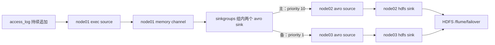
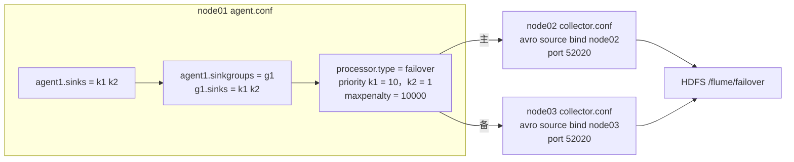
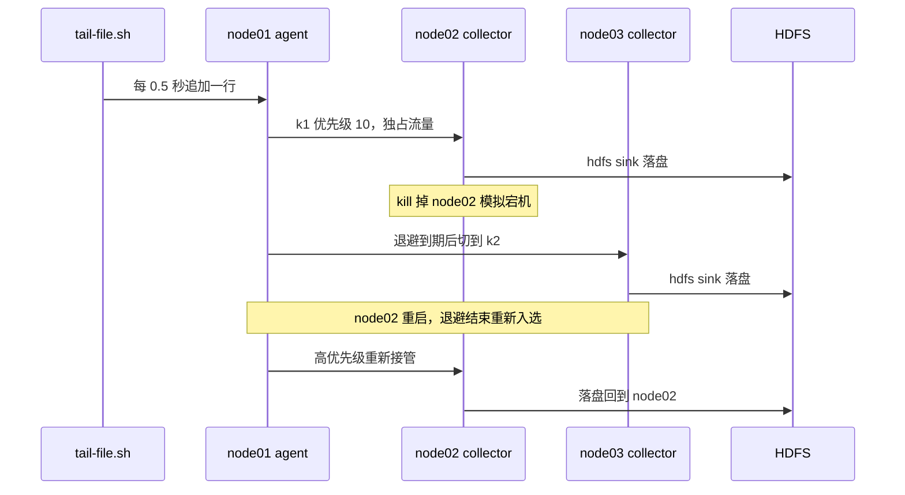

# Flume 高可用 failover 实战：一主两从模型、配置逐项落盘与 kill 演练

## 先给结论

- 模型是「一主两从」：node01 采集、node02 与 node03 收集，node01 的两个 sink 编进一个 sinkgroup，同一时刻只有一个在收数据，主备由 priority 决定，数字大者优先。
- failover 不是双写也不是负载均衡：备用节点平时空转待命，追求可用性；轮转分摊是 `load_balance` 的语义，两者 processor.type 不同。
- 配置四类键缺一不可：`sinkgroups = g1` 声明组、`g1.sinks = k1 k2` 圈成员、`processor.type = failover` 指定策略、`processor.priority.*` 与 `maxpenalty` 传参；priority 必须写在 sinkgroups 路径下，写到 sink 名下是无效配置且不报错。
- maxpenalty 单位毫秒，封顶失败 sink 的退避重试间隔；两个 sink 必须指向不同节点，指向同一台等于没有备用。
- 演练节奏：先起收集层再起采集层；正常态只有 priority 10 的 node02 收数据，kill 掉后 node03 短暂空窗（退避重试期）后接管，node02 恢复要等退避期耗尽才重新接管。
- 切换不丢数的原理：发送失败时事务不提交，event 留在上游 channel，切换后从 channel 续传；memory channel 的掉电窗口依然存在，要跨进程崩溃的完整性得换 file channel。
- 对账口径：停稳所有进程后，源文件总行数与 HDFS 目录行数相等才算链路完整，进程运行中行数永远对不齐。

## 第1部分：flume高可用-failover-模型分析

级联链路好看用，却有个致命假设：中间那台 agent 必须一直活着。node02 一挂，上游 sink 连不出去，整条采集链路就地瘫痪，恢复前所有日志都堵在 channel 里。高可用方案要治的就是这个单点：多准备一台收集器，主节点故障时另一台立刻顶上，采集方全程无感。这一课先把三台机器各起一个 Flume 实例的 failover 模型搭清楚，把「谁挂了、谁顶上、怎么决定谁先上」这三个问题在模型层面讲透，配置与实测留给后面两篇。

### 角色分配：一主两从
三台机器在模型里的分工用一张表定下来：

| 名称 | HOST | 角色 |
|---|---|---|
| Agent1 | node01 | Web Server，日志产生方 |
| Collector1 | node02 | AgentMstr1，收集器一号 |
| Collector2 | node03 | AgentMstr2，收集器二号 |

node01 站在业务一侧，扮演 Web Server 的角色，agent 盯着本机日志文件采集新增数据；node02 与 node03 是两个地位对等的收集器，各起一个 Flume 实例，等着一号采集器把数据送过来。每台机子上都要有 Flume，node02 与 node03 前面的案例里已经装好，node01 缺的安装包从现有节点拷一份即可。

### 需求拆解：「或」字是题眼
需求只有两句话：node01 去采集一个文件的新增数据；node01 采集数据之后发送给 node02 或 node03 的 Flume agent。

第一句指向熟悉的路径，一提文件新增数据就是 `tail -F` 加 exec source 的组合。第二句的关键在「或」这个字：不是把同一份数据同时发给两台，而是任意时刻只发给其中一台，正常情况下走主收集器，主收集器挂掉才改走备用。这正是 failover 的语义，故障转移，一台出故障，另一台立刻作为补充上位。两台收集器之间没有主从状态同步，谁在干活全由 node01 侧的发送策略决定，模型简单，故障面也小。

### 两个 agent 的组件分工
按级联的套路把每台机器的三个组件填出来：



这张图在讲三台机器的数据流与主备分叉点：分叉不出现在 channel 里，而是出现在 node01 的 sink 出口上，由故障转移处理器裁决走哪一支。关键路径一句话：node01 是 exec source 加 memory channel 加两个 avro sink，node02 与 node03 是一模一样的 avro source 加 memory channel 加 hdfs sink，落盘目录相同，于是任意时刻只有一台收集器在往 `/flume/failover` 写文件。

与级联案例相比，node01 侧多出来的东西不是组件类型，而是数量：sink 从一个变成两个，k1 发 node02，k2 发 node03。两个 sink 不能各发各的，那样数据就重复了，得把它们编进一个组里统一调度，这个组就是 sinkgroup，组内的调度策略就是下一节要讲的 failover 处理器。

把三台机器的组件落成配置骨架，长这个样子（轮廓示意，逐行完整文件见配置篇，示例为按本课写法补全）：

```properties
# node01：采集层，source 读文件，两个 sink 编组发下游
agent1.sources.r1.type = exec
agent1.channels.c1.type = memory
agent1.sinks = k1 k2
agent1.sinkgroups.g1.processor.type = failover

# node02 与 node03：收集层，配置同构，只有 bind 一行之差
a1.sources.r1.type = avro
a1.sinks.k1.type = hdfs
```

### 切换是怎么发生的
Flume 对这种「多个 sink 出口、同一时刻只用一个」的场景提供了现成的处理器，配置里写作 `processor.type = failover`，对应实现类是 FailoverSinkProcessor。它的裁决规则有三条。

**第一，优先级定主次。** 组内每个 sink 都标一个 priority 数值，数字大的优先级高。node02 标 10，node03 标 1，两个都健康时 node02 拿到全部流量，node03 闲着待命，这就是「或」字的落地方式。

**第二，故障触发切换。** 活跃 sink 发送失败，比如下游进程被杀、连接被拒，处理器把它移入失败队列并开始退避，退避时长从短到长递增，上限由 `maxpenalty` 控制。与此同时，队列里剩下的最高优先级 sink 立刻接手，切换不需要人工干预，延迟就是一次重试探测的时间。

**第三，恢复后自动回落。** 挂掉的节点重新拉起后，它的退避计时结束，处理器把它放回候选队列；只要它没有再次失败，而且优先级仍然最高，它就重新成为活跃 sink，流量自动切回去。整个过程主备身份只由「健康状态加优先级」这两个条件决定，没有额外的人工标记。
## 第2部分：flume高可用-failover-配置文件编写

failover 模型画起来只有三条数据流，落到配置上却是三个 agent 各一份文件，其中 node01 那份藏着全套方案里唯一的陌生语法：sinkgroups。这一课把三台机器的配置文件逐一写出来，重点拆 sinkgroup 的声明、成员圈定、故障转移处理器与优先级参数，写完这三份文件，集群就只剩启动与验证了。

### 第一步：补齐 node01 的 Flume 与数据目录
node02 与 node03 在前面的案例里已经装好 Flume，node01 还是空白的。Flume 解压即用，在 node02 上把安装目录连同测试数据一起拷过去：

```bash
cd /export/servers
scp -r apache-flume-1.8.0-bin/ node01:$PWD
scp -r shells/ taillogs/ node01:$PWD
```

第二条命令把脚本目录 shells 与日志目录 taillogs 一并传过去，node01 采集的对象就是 taillogs 里的 `access_log`。目录拷贝要带 `-r`，`$PWD` 让目标路径与当前路径保持同名，两台机器的目录结构一致，后面排查问题时少一个变量。

### node01 的 agent.conf：两个 sink 一个组
在 node01 的 conf 目录下新建 `agent.conf`，agent 起名 agent1：

```properties
#agent1 name
agent1.channels = c1
agent1.sources = r1
agent1.sinks = k1 k2

#set channel
agent1.channels.c1.type = memory
agent1.channels.c1.capacity = 1000
agent1.channels.c1.transactionCapacity = 100

# Describe/configure the source
agent1.sources.r1.channels = c1
agent1.sources.r1.type = exec
agent1.sources.r1.command = tail -F /export/servers/taillogs/access_log

##set sink1
agent1.sinks.k1.channel = c1
agent1.sinks.k1.type = avro
agent1.sinks.k1.hostname = node02
agent1.sinks.k1.port = 52020

##set sink2
agent1.sinks.k2.channel = c1
agent1.sinks.k2.type = avro
agent1.sinks.k2.hostname = node03
agent1.sinks.k2.port = 52020

#agent1 sinkgroups
agent1.sinkgroups = g1
agent1.sinkgroups.g1.sinks = k1 k2
agent1.sinkgroups.g1.processor.type = failover
agent1.sinkgroups.g1.processor.priority.k1 = 10
agent1.sinkgroups.g1.processor.priority.k2 = 1
agent1.sinkgroups.g1.processor.maxpenalty = 10000
```

channel 段的画面没有完整拍到，容量参数按课程统一的 memory channel 写法补全；其余段落与画面一致。逐项过一遍，重点全在 sink 与 sinkgroups 两段。

**命名段先立两个 sink。** `agent1.sinks = k1 k2` 一行声明了两个 sink，这是与级联案例最直观的差异。k1 与 k2 都是 avro 类型，分别指向 node02 与 node03 的 52020 端口，hostname 用主机名而非 IP，前提是三台机器的 `/etc/hosts` 里已配好主机名映射，环境搭建篇的 hosts 表在这里直接生效。

**sinkgroup 四类键一个不能少。** `agent1.sinkgroups = g1` 先声明有一个组叫 g1；`agent1.sinkgroups.g1.sinks = k1 k2` 把两个 sink 圈进组里；`processor.type = failover` 给组指定故障转移策略；最后三条 `processor.*` 是传给策略的参数。把两个 sink 圈进组，等于收走了它们各自为政的发散权，改由处理器统一决定哪个 sink 出数据。

**priority 定主备。** `priority.k1 = 10`、`priority.k2 = 1`，数字大者优先级高，健康状态下 node02 独享流量，node03 待命。数值本身没有单位，只用来比大小，两台的取值拉开即可。

**maxpenalty 管退避上限。** 单位毫秒，10000 即 10 秒。一个 sink 失败后进入退避重试节奏，间隔逐次拉长，最长不超过这个值；设得太小会对一个刚崩的下游狂打重试，设得太大则恢复接管的反应变慢，10 秒是教学里偏保守的取值。



这张图在讲三份配置文件之间的对应关系：node01 的组参数决定流量走向，node02 与 node03 的文件只负责把收到的数据落盘。关键路径一句话：上游的 `hostname` 加 `port` 与下游的 `bind` 加 `port` 两两对齐，组参数只管「发到哪边」，不管「怎么落盘」。

### node02 与 node03 的 collector.conf
收集器的配置文件名为 `collector.conf`，agent 起名 a1，node02 上的内容如下：

```properties
#set Agent name
a1.sources = r1
a1.channels = c1
a1.sinks = k1

#set channel
a1.channels.c1.type = memory
a1.channels.c1.capacity = 1000
a1.channels.c1.transactionCapacity = 100

# avro source 接收上一跳 agent 发来的数据
a1.sources.r1.type = avro
a1.sources.r1.bind = node02
a1.sources.r1.port = 52020
a1.sources.r1.channels = c1

##set sink to hdfs
a1.sinks.k1.type = hdfs
a1.sinks.k1.hdfs.path = hdfs://node01:8020/flume/failover/
a1.sinks.k1.hdfs.fileType = DataStream
a1.sinks.k1.hdfs.writeFormat = TEXT
a1.sinks.k1.hdfs.rollInterval = 10
a1.sinks.k1.channel = c1
```

bind 是这台收集器对外的门牌：avro source 绑定自己的主机名 node02 与 52020 端口，正好接住上游 k1 的 `hostname = node02` 加 `port = 52020`。sink 段两台机器完全一致，都往 `hdfs://node01:8020/flume/failover/` 落盘，`fileType = DataStream` 加 `writeFormat = TEXT` 保证写出的是可读文本，`rollInterval = 10` 滚动偏快，演示期小文件偏多，生产上要加大周期或加 round 分桶。画面里 sink 段还有一行 `hdfs.filePrefix`，抽帧辨识不出原值，按时间戳前缀写法补全为 `%y-%m-%d` 即可，不配则走默认前缀。

node03 的文件与这份只有一行之差：

```properties
# node03 的 collector.conf，其余与 node02 相同
a1.sources.r1.bind = node03
```

两台收集器配置高度同构正是 failover 模型的要求：备用节点必须随时能顶替主节点做一模一样的事，任何一台单独看都是完整的采集端，差异只体现在门牌号上。别忘了 `a1.sinks.k1.channel = c1` 这条连线要写对，组件名对不上，agent 启动即失败。

### priority 与 maxpenalty 的语义再压实
参数写在配置里只是几行字，行为要落到 FailoverSinkProcessor 的运行逻辑上：启动时它把组内健康的 sink 排进候选队列，priority 最大的成为活跃 sink；发送失败时，该 sink 带着初始惩罚值进入失败队列，之后按翻倍节奏重试，惩罚值封顶 maxpenalty；惩罚期结束且重试通过，sink 回到候选队列，如果它的 priority 仍是全场最大，活跃身份立即易主。

这套逻辑解释了两个容易被问的细节。其一，maxpenalty 越小，故障 sink 重试探测越频繁，切换恢复越快，但对一个仍然故障的下游产生更多无效请求；其二，切换发生的唯一条件是活跃 sink 发送失败，备用节点从不主动抢流量，两台同时健康时永远是 priority 大者在发。
## 第3部分：flume高可用-failover-测试运行

模型和配置都就位了，failover 到底灵不灵，得亲手把主收集器杀掉看一眼。这一课按顺序启动三台机器的 agent，先确认正常态下流量只走高优先级的 node02，再模拟 node02 宕机观察 node03 顶上，最后重启 node02 看它如何重新接管。切换的两处关键现象，一处是切换瞬间的短暂空窗，一处是恢复后的自动回落，都能在控制台日志里找到对应证据。

### 启动顺序：先收集后采集
三台机器依次起 agent。node03 先起：

```bash
cd /export/servers/apache-flume-1.8.0-bin
bin/flume-ng agent -n a1 -c conf -f conf/collector.conf -Dflume.root.logger=DEBUG,console
```

node02 用同一条命令启动，配置文件同名同位置，唯一差别是它读到的 `bind = node02`。两台收集器起来后，最后在 node01 上启动采集端：

```bash
cd /export/servers/apache-flume-1.8.0-bin
bin/flume-ng agent -n agent1 -c conf -f conf/agent.conf -Dflume.root.logger=DEBUG,console
```

先起下游的理由在级联案例里出现过：上游的 avro sink 启动就要向外建连，下游没监听就只会刷连接失败日志。node01 启动日志里能看到两个 sink 组件先后 started，随后它就守在 exec source 上等文件变化。

### 正常态：流量只在 node02
向被监控文件灌数据。脚本随 taillogs 目录一并拷到了 node01，进入目录直接运行：

```bash
cd /export/servers/taillogs
sh tail-file.sh
```

脚本内部用绝对路径往 `/export/servers/taillogs/access_log` 追加时间行，从哪个目录运行都不影响行为，每 0.5 秒一行持续写出。此时三台机器的状态：node01 的 DEBUG 控制台不断滚出 exec source 产生的 event；node02 的控制台同步滚动，avro source 报告收到 event 批次，hdfs sink 反复走「创建临时文件、重命名转正」的流程；node03 的控制台一动不动。



这张图在讲一次完整的故障演练里数据流向的三段变化：主节点正常、主节点宕机切备、主节点恢复回落。关键路径一句话：流向的每次变化都由 node01 侧的 failover 处理器裁决，下游两台自始至终只是被动接数据，谁在干活动静全看上游把包发给了谁。

### 切换演练：干掉 node02
node02 的 agent 是教学里前台运行的进程，直接在它的终端按 Ctrl+C 就算宕机；要用命令杀也行：

```bash
# 在 node02 上模拟宕机（按画面演示的「把进程干掉」补全）
ps -ef | grep flume | grep -v grep
kill -9 进程号
```

杀掉后盯三块屏幕：node02 的输出立刻静止；node01 的日志出现发送失败的报错并进入重试；几秒之内 node03 的控制台开始滚动，avro source 报告收到 event 批次，hdfs sink 开始建临时文件。流量已经从 node02 切到 node03，这就是故障转移的全部含义，没有人工操作，没有改配置，没有重启链路。

切换不是零延迟的。node01 侧的 k1 失败后进入退避队列，处理器按退避节奏探测，探测到 k2 可用后立刻切换，所以从杀进程到 node03 出数据之间有一段空窗，量级正好落在 maxpenalty 给出的上限内。空窗期间新写入文件的行没有丢，它们压在 node01 的 memory channel 里，等 k2 通道打通后续传过去。

### 恢复回落：node02 重启后重新接管
把 node02 的 agent 按原命令再拉起来，观察到一个反直觉的现象：两台收集器的控制台一度都不动了。这不是卡死，node01 的 k2 还在正常发，只是脚本流量小，恰好处在批次间隙；更重要的是 node02 刚回来时还压着退避惩罚期，处理器不会让它立刻抢流量。等惩罚期结束，node02 以更高的优先级回到候选队列第一位，活跃身份立即易主，node02 的控制台恢复滚动，node03 重新归回待命状态。

这一段把 failover 的完整生命周期走完了：主备身份不是写死的标记，而是「健康状态加优先级」动态算出来的结果，故障时让位，恢复时回归，两边始终只有一台在干活。

### 补做一次不丢数验证
课程演示止步于肉眼看两台收集器轮流滚动，切换窗口的数据完整性值得补一个对账实验，步骤如下：

```bash
# 1. 先停掉灌数据脚本，再依次 Ctrl+C 停掉三个 agent
# 2. 统计被监控文件的总行数
wc -l /export/servers/taillogs/access_log
# 3. 统计 HDFS 上 failover 目录全部文件的总行数
hdfs dfs -cat /flume/failover/* | wc -l
```

两个数字对得上，说明切换前由 node02 落盘的行与切换后由 node03 落盘的行合起来一行不缺。对账要在脚本与 agent 全部停稳之后做，进程还在跑时文件与落盘都在增长，数字对不上不能归咎于丢数。还要说明一个前提：三台机器的 channel 都是 memory，进程被 kill -9 的瞬间若恰好有 event 在缓冲里，理论上有丢失窗口；教学流量小、切换快，观察不到缺口，生产环境换成 file channel 才能把这个窗口关死。这一节不在原视频演示范围内，是按同一套环境补做的验证，结论与 failover 处理器的事务语义一致。
## 常见误区

- **把 failover 当成双写。** 同一时刻组内只有一个活跃 sink 在发数据，两台收集器里的 HDFS 文件是切换前后的产物，不是两份拷贝；要「每台都发一份」的冗余方案是另一种架构，不是 failover 处理器的行为。
- **把 failover 当成负载均衡。** 均衡策略是 processor.type 的另一种取值 load_balance，多个 sink 轮流分摊流量；failover 从不均摊，永远优先级最高者独占。
- **以为 priority 数值小者优先。** 数字大者优先级高，priority 10 压过 priority 1；把两台的值标反，备用节点会在主节点活着的时候抢走流量。
- **以为高可用等于不丢数。** failover 保证的是链路可用性，切换窗口内的数据先压在 node01 的 channel 里不丢，但 memory channel 遇上 node01 自己崩溃照样丢，完整性与可用性是两个正交的指标。
- **只写 processor 参数，漏掉组声明与成员圈定。** 没有 `agent1.sinkgroups = g1` 与 `g1.sinks = k1 k2`，处理器找不到服务对象，failover 完全不生效，两个 sink 也不会按预期工作。
- **把 priority 写到 sink 自己名下。** 正确的键是 `agent1.sinkgroups.g1.processor.priority.k1`，写在 `agent1.sinks.k1.priority` 上是无效配置，Flume 不认识这个参数也不报错，主备关系静默失效。
- **两个 sink 指向同一个节点。** k1 与 k2 的 hostname 都写 node02，备用节点形同虚设，node02 一挂照样全链路中断，主备必须指向不同的下游。
- **collector 的 bind 写成别人的地址。** avro source 绑定的是本机监听地址，node02 的文件里写 node03 或 node01，启动即绑定失败；bind 与上游对应 sink 的 hostname 取同一个值，指的就是本机。
- **看到 node03 在收数据就以为配置错了。** 正常态只有 priority 10 的 node02 在收，node03 收数据只发生在 node02 失效之后，那正是 failover 生效的表现，不是 priority 写反。
- **把切换空窗当成链路故障。** 空窗是失败 sink 的退避重试期，node01 日志里的发送失败报错与重试记录就是证据，maxpenalty 之内必有结果，不在此期间反复重启 agent 反而搅乱退避节奏。
- **重启 node02 时换了配置或端口。** 主备互替的前提是两边配置同构，重启时改了 bind 或端口，接管后的行为就与主节点时代不一致，排查成本陡增；原命令原文件重启即可。
- **对账时机不对就断言丢数。** 脚本与 agent 还在运行时行数永远对不齐，统计前必须先停稳所有进程；killed 掉进程瞬间 memory channel 的在途数据是唯一的理论丢失点，教学口径下可忽略，生产要靠 file channel。

## 面试可能被问到的问题

1. 面试官追问：「Flume 的 failover 高可用方案里，数据会同时发给两台收集器吗？」
   答：不会。两个 sink 编进一个 sinkgroup，组内同一时刻只有一个活跃 sink，由 failover 处理器按优先级选出。备用收集器平时空转待命，主收集器故障时才接管，所以 HDFS 上看到的是先后落盘，不是两份重复数据。

2. 面试官追问：「failover 和 load_balance 处理器的区别是什么？」
   答：failover 做主备，按 priority 选一个活跃 sink，故障时切换，恢复后回落，追求可用性；load_balance 做分摊，把流量轮转或随机分给多个健康 sink，追求负载均衡。两者的 processor.type 不同，选型看目标是容灾还是扩容。

3. 面试官追问：「主备切换的依据是什么？为什么不是两台轮流来？」
   答：依据是组内 sink 的 priority 与实时健康状态。priority 数值大的 sink 在健康时独占流量；它失败后进入带退避的失败队列，最高优先级的健康 sink 顶上。轮流分摊是 load_balance 的语义，failover 的目标是让备用节点随时保持可接管状态而不是消耗流量。

4. 面试官追问：「挂掉的收集器恢复之后，数据会立刻切回去吗？」
   答：不会立刻。失败的 sink 要在失败队列里等退避时长耗尽才回到候选队列，退避上限由 maxpenalty 控制，之后若健康且优先级最高则重新接管。实际观察到的现象是恢复后短暂沉寂几秒，随后流量自动回到高优先级节点。

5. 面试官追问：「这套模型里最可能丢数据的环节在哪？」
   答：在采集方与收集方的 memory channel 上。切换窗口内数据压在 node01 的 channel 里不会丢，但任何一跳的 agent 进程崩溃，内存里的缓冲就没了。要跨进程崩溃的完整性，得换 file channel，failover 本身只解决链路可用性。

6. 面试官追问：「配置一个能生效的 failover，最少要写哪几组键？」
   答：四组。`sinkgroups = g1` 声明组，`g1.sinks` 圈定成员 sink，`processor.type = failover` 指定策略，`processor.priority.<sink名>` 给每个 sink 标优先级。maxpenalty 可选，不配走默认值 30000 毫秒，但组声明与优先级缺失时主备关系无法建立。

7. 面试官追问：「priority 的数字大小和主备是什么关系？」
   答：数字大者优先级高，健康状态下数字最大的 sink 独占流量，其余待命。priority 只用于比较，没有单位；把主节点的值标小，会导致备用节点在主节点健康时抢先接管。

8. 面试官追问：「maxpenalty 的单位是什么？设大设小有什么影响？」
   答：毫秒。它封顶失败 sink 的退避重试间隔，失败后惩罚值逐次翻倍，最大不超过 maxpenalty。设小了切换与恢复反应快，但对仍故障的下游产生更多无效重试；设大了恢复接管慢，故障窗口被拉长。

9. 面试官追问：「两个 avro sink 为什么必须指向不同节点？」
   答：failover 要防的是单点故障，两个 sink 指向同一台机等于没有备用，下游一挂链路依然中断。指向不同节点后，任意一台收集器宕机，处理器都能把流量切到另一台。

10. 面试官追问：「node02 与 node03 的 collector.conf 几乎一样，为什么这样设计？」
   答：主备节点要能无缝互替，配置必须同构，落盘目录、sink 参数、channel 完全一致，唯一的差异是 avro source 的 bind 绑本机主机名。这样切换发生时，上层看到的落盘结果完全相同，数据语义不因主备易主而改变。

11. 面试官追问：「failover 切换发生时，上游会不会丢数据？数据去了哪里？」
   答：不丢。上游 sink 发送失败时事务不提交，event 留在上游 channel 里，处理器切换到备用 sink 后继续从 channel 取数发送。数据缓冲在上游 channel，切换只是换了一条出口通道，前提是 channel 有足够容量扛住切换窗口的积压。

12. 面试官追问：「为什么主节点恢复后没有立刻接管流量？」
   答：失败的 sink 进入失败队列后带着退避惩罚值，恢复进程不等于惩罚清零，要等退避计时耗尽才回到候选队列。之后因为它优先级最高，活跃身份立即易主。观察到恢复后短暂静止属于正常现象。

13. 面试官追问：「怎么判断当前流量走的是哪台收集器？」
   答：看两台收集器的控制台，收到 event 批次与 hdfs sink 建文件日志的那台就是活跃节点；也可以看 HDFS 目录里新文件的产生节奏，或者看上游日志里当前活跃 sink 的名字。多看一处，避免单点误判。

14. 面试官追问：「kill -9 和 Ctrl+C 停 agent 有什么区别？」
   答：Ctrl+C 是中断信号，JVM 走正常退出流程；kill -9 强制终止，进程没有机会清理。对 memory channel 来说两者都意味着内存缓冲不再可用，未送达的数据会丢；差别在于 file channel 场景下，优雅退出能把资源与状态收干净，kill -9 则依赖下次启动时的恢复逻辑。

15. 面试官追问：「怎么设计一个实验证明 failover 期间不丢数？」
   答：停稳所有进程后对账。先统计源文件总行数，再统计 HDFS 目标目录全部文件行数，两个数字相等即链路完整。要注意统计前必须停掉写入与采集，否则数字动态变化；若上游用 memory channel 且进程被强杀，在途缓冲存在理论丢失窗口，严格实验应换 file channel。

16. 面试官追问：「演示时为什么用 DEBUG 日志级别？」
   答：DEBUG 级别下 avro source 会打印收到的 event 批次，sink 会打印发送与切换细节，肉眼能直接看到流量从一台收集器换到另一台的全过程。生产环境默认 INFO 就够，排查主备切换问题时再临时调高。

## 配套资料

- 代码：`materials/code/04/day06-Flume/`，本课资料包为空（0 个文件），模型与角色分配按视频画面还原，配置文件与启动命令的完整还原见后续两篇，示例为按本课写法补全。
- 讲义：`materials/docs/04/采集系统部署使用说明.md`，采集系统的部署说明与业务背景，failover 模型守护的正是这套日志采集链路的持续可用。
- 代码：`materials/code/04/day06-Flume/`，本课资料包为空（0 个文件），`agent.conf` 按视频画面逐行还原（两个 avro sink 与 sinkgroups 各键均为画面原值，channel 段容量参数按课程统一写法补全），`collector.conf` 按画面还原，filePrefix 一行抽帧无法辨识、按主流写法补全并已注明。
- 讲义：`materials/docs/04/采集系统部署使用说明.md`，采集系统的部署说明与业务背景，三节点 failover 集群守护的是这套链路的持续可用。
- 代码：`materials/code/04/day06-Flume/`，本课资料包为空（0 个文件），启动命令与观测现象按视频画面还原，kill 与对账两个步骤画面未入帧，按同一套环境的主流写法补全并已注明。
- 讲义：`materials/docs/04/采集系统部署使用说明.md`，采集系统的部署说明与业务背景，故障演练守护的正是这套行为日志采集链路的持续可用。
