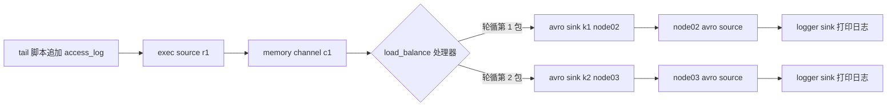

# 把 failover 换成 load_balance：让两台收集器平分流量

failover 模式有个天然的性格缺陷：主收集器独占全部流量，备收集器常年空转等故障。node02 一个人扛下 100 兆数据，node03 只盯着它什么时候挂。数据量一大，主节点的压力与备节点的闲置同样扎眼。负载均衡就是冲着这个问题来的：让 node02 与 node03 同时接数据，100 兆数据对半劈，各拿 50 兆，两台机器的压力均等，高可用也从「备份」升级成「分担」。这一课把三台机器的配置写出来，改动其实集中在一个点上。

## 先给结论

- sinkgroups 骨架原封不动，`processor.type` 从 `failover` 改成 `load_balance`，其余组件与 failover 案例完全同构。
- failover 的 `priority` 与 `maxpenalty` 在这里全部退场，换成 `selector`（发包策略）与 `backoff`（故障隔离）。
- `selector.type = round_robin` 是轮循发包，也可以选 `random` 随机发包；两台收集器各收一包轮流交替。
- `backoff = true` 时，发送失败的 sink 会在 `selector.maxTimeOut` 指定的时长内被隔离，不再被选中。
- `selector.maxTimeOut` 的单位是毫秒，10000 即 10 秒，Flume 1.8.0 的默认值是 15000。

## 从独占到平摊：只动处理器这一层

对比上一课的 failover 配置，改动的范围非常小。两组配置放在同一屏看得最清楚：

```yaml
# failover 写法（上一课）
a1.sinkgroups.g1.sinks = k1 k2
a1.sinkgroups.g1.processor.type = failover
a1.sinkgroups.g1.processor.priority.k1 = 10
a1.sinkgroups.g1.processor.priority.k2 = 1
a1.sinkgroups.g1.processor.maxpenalty = 10000

# load_balance 写法（本课）
a1.sinkgroups.g1.sinks = k1 k2
a1.sinkgroups.g1.processor.type = load_balance
a1.sinkgroups.g1.processor.backoff = true
a1.sinkgroups.g1.processor.selector = round_robin
a1.sinkgroups.g1.processor.selector.maxTimeOut = 10000
```

处理器的类型决定组内两个 sink 的相处模式：`failover` 按优先级分主备，高分者独占；`load_balance` 按策略分流量，成员平权。所以 `priority` 这类主备语义的配置在这里没有意义，必须换成 `selector` 与 `backoff` 这类流量语义的配置。换掉处理器的类型，等于换了整个组的决策大脑，组外的 channel、source、sink 全部照旧。

## node01 的采集端配置

在 node01 的 `conf` 目录下新建 `load_balancer_client.conf`，全文如下：

```yaml
# agent name
a1.channels = c1
a1.sources = r1
a1.sinks = k1 k2
# set sink group
a1.sinkgroups = g1
# set channel
a1.channels.c1.type = memory
a1.channels.c1.capacity = 1000
a1.channels.c1.transactionCapacity = 100
# source：tail 命令监控文件新增内容
a1.sources.r1.channels = c1
a1.sources.r1.type = exec
a1.sources.r1.command = tail -F /export/servers/taillogs/access_log
# set sink1：发往 node02
a1.sinks.k1.channel = c1
a1.sinks.k1.type = avro
a1.sinks.k1.hostname = node02
a1.sinks.k1.port = 52020
# set sink2：发往 node03
a1.sinks.k2.channel = c1
a1.sinks.k2.type = avro
a1.sinks.k2.hostname = node03
a1.sinks.k2.port = 52020
# set sink group
a1.sinkgroups.g1.sinks = k1 k2
# set load balance
a1.sinkgroups.g1.processor.type = load_balance
a1.sinkgroups.g1.processor.backoff = true
a1.sinkgroups.g1.processor.selector = round_robin
a1.sinkgroups.g1.processor.selector.maxTimeOut = 10000
```

结构上与 failover 的采集端逐行对应：exec source 盯同一个被监控文件，两个 avro sink 分别指向 node02 与 node03 的 52020 端口，两个 sink 共用同一块 memory channel。真正的差异只在 sinkgroups 那五行的语义。

## selector 与 backoff：负载均衡的发动机

`selector` 决定从 channel 里取出的每个 event 发给谁。`round_robin` 是轮循：第 1 包给 k1，第 2 包给 k2，第 3 包回到 k1，两台收集器像发牌一样轮流接数据；`random` 则每次随机挑一个成员。教学演示选轮循，因为轮流交替在日志里肉眼可见，随机策略需要跑一阵才能看出均摊趋势。

`backoff` 决定失败成员的下场。不开 backoff 时，轮循轮到一台挂掉的收集器，这批 event 还是会先撞上去，发送失败后整批退回 channel 重试，链路吞吐跟着抖动；打开 backoff 后，被判定失败的 sink 进入退避状态，在 `maxTimeOut` 时长内直接从候选名单里除名，流量全部流向健康成员，隔离期满再给它试探的机会。这套机制与 failover 的退避队列思想同源，只是退避期满后它不独占，而是回到轮循队列里继续分活。



这张图在讲 node01 侧处理器对每个 event 的裁决路径。关键路径一句话：channel 只有 c1 一条，分流发生在 sink 之后的发送环节，processor 每取出一批 event 就按轮循顺序挑一个 sink 发出去，所以「负载均衡」均衡的是出口流量，不是 channel 内部。

## node02 与 node03 的收集端配置

两台收集器的配置同构，各自新建 `load_balancer_server.conf`：

```yaml
a1.sources = r1
a1.sinks = k1
a1.channels = c1
# source：接收 node01 发来的 avro 数据
a1.sources.r1.type = avro
a1.sources.r1.channels = c1
a1.sources.r1.bind = node02
a1.sources.r1.port = 52020
# sink：把收到的数据以日志形式输出
a1.sinks.k1.type = logger
# channel
a1.channels.c1.type = memory
# 组装
a1.sources.r1.channels = c1
a1.sinks.k1.channel = c1
```

node03 的唯一差别是 `bind = node03`，其余逐行相同。收集端这次用 logger sink 而不是 hdfs sink，收到的 event 直接打印到控制台，DEBUG 日志级别下能看到每条数据的 header 与 body，两台机器谁在收、收了多少，一眼可见。演示负载均衡现象，logger 比落 HDFS 直观得多，生产上再把 logger 换回真正的落盘 sink 即可。

## 常见误区

- **把 maxTimeOut 当成秒来理解。** 口播里把它说成「单位是秒」，Flume 1.8.0 的实现里它是毫秒，10000 就是 10 秒。按秒理解去估算故障隔离窗口，量级会差一千倍，调参时先回到源码注释确认单位。
- **以为不开 backoff 也能自动避让故障。** 不开 backoff 的轮循会照常轮到故障节点，那批数据先失败再退回重试，切换延迟由发送超时决定而不是退避节奏决定；backoff 才把「隔离」做成了显式机制。
- **两台收集器 bind 写成同一主机名。** server 配置是复制粘贴出来的，改文件名忘了改 bind，两台 agent 去监听同一个地址端口，后启动的一台起不来或者流量全被一台接走。
- **残留的 priority 与 maxpenalty 没有清理。** 处理器换成 load_balance 后这些主备语义的配置不再生效，留着不影响运行，但会误导后来维护配置的人，改处理器类型时顺手删干净。

## 面试可能被问到的问题

1. 面试官追问：「load_balance 和 failover 在配置上的核心区别是什么？」
   答：sinkgroups 骨架相同，差异集中在 processor 参数。failover 配 priority 与 maxpenalty，按优先级分主备，主节点独占流量；load_balance 配 selector 与 backoff，成员平权，按策略分摊流量。处理器类型一换，组内决策逻辑整个换掉，组外组件不变。
2. 面试官追问：「round_robin 和 random 两种 selector 怎么选？」
   答：round_robin 严格轮流，长期观测下各节点流量绝对均等，适合同规格节点；random 随机挑选，大量请求下靠概率趋近均等，实现更简单。要可预期的均匀分布选轮循，要减少维护状态选随机。
3. 面试官追问：「backoff 的作用是什么，不开会怎样？」
   答：backoff 把发送失败的 sink 隔离 maxTimeOut 毫秒，期间不把流量派给它。不开 backoff 时轮循照样轮到故障节点，数据先失败再退回重试，产生不必要的超时等待与吞吐抖动。开了以后故障隔离显式化，链路切换更快。
4. 面试官追问：「负载均衡模式下有一台收集器挂了，数据会丢吗？」
   答：不丢。event 从 channel 取出时走事务，发送失败事务不提交，数据退回 channel，backoff 把故障 sink 隔离后，后续批次全走健康节点。前提是上游 channel 容量能扛住切换窗口的积压。
5. 面试官追问：「为什么演示时收集端用 logger sink？」
   答：logger 把收到的 event 直接打印到控制台，DEBUG 级别下 header 与 body 都可见，两台机器轮流收包的现象肉眼可证。落 HDFS 的验证手段慢且绕，教学场景先用 logger 验证行为，生产上替换为真正的落盘 sink。

## 配套资料

- 代码：`materials/code/04/day06-Flume/`，本课资料包为空（0 个文件），三份配置文件按视频画面逐行还原，画面线里 sink2 的 hostname 拼写残缺处按 Flume 配置规范修正。
- 讲义：`materials/docs/04/采集系统部署使用说明.md`，采集系统部署与业务背景，负载均衡分担的正是这套行为日志采集链路的传输压力。
