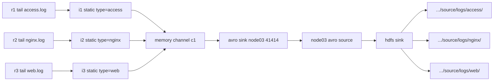

# 静态拦截器实战：三个 source 打三类标记，HDFS 按 header 分目录

模型分析课把「打标记再分流」的思路讲透了，落到工程上就是三台机器三份配置：node01 与 node02 各一份采集端文件，一个 agent 带三个 exec source，每个 source 挂一个静态拦截器盖 type 章；node03 一份汇总端文件，avro source 接全量，hdfs sink 的路径里埋一个取 header 的变量。这一课逐份写出配置，顺带处理复制配置时踩到的中文注释乱码坑，再把自定义拦截器的 Java 接入路径补全出来。

## 先给结论

- 采集端一个 agent 带 `r1 r2 r3` 三个 source，分别盯 `access.log`、`nginx.log`、`web.log`，共用一个 memory channel，发往 node03 的 41414 端口。
- 每个 source 挂一个 static 拦截器：`interceptors.i1.type = static` 加 `key = type` 加 `value = access` 这类三行配置，一次只能加一个 header。
- node03 的 hdfs sink 路径写 `hdfs://node01:8020/source/logs/%{type}`，百分号加大括号是取 header 键的语法，按值动态建目录。
- 讲义里 node03 出现过的时间戳拦截器两行，路径不含日期变量，本链路可省。
- 自定义拦截器走 Java：实现 `Interceptor` 与它的 `Builder`，jar 放 `plugins.d` 或 `lib`，type 写 Builder 类全名。

## node01 的采集端配置

在 node01 的 conf 目录下新建 `exec_source_avro_sink.conf`，42 行的文件里核心内容如下：

```yaml
# Name the components on this agent
a1.sources = r1 r2 r3
a1.sinks = k1
a1.channels = c1
# source r1：盯 access.log，挂拦截器 i1 打 access 标记
a1.sources.r1.type = exec
a1.sources.r1.command = tail -F /export/servers/taillogs/access.log
a1.sources.r1.interceptors = i1
a1.sources.r1.interceptors.i1.type = static
a1.sources.r1.interceptors.i1.key = type
a1.sources.r1.interceptors.i1.value = access
# source r2：盯 nginx.log，挂拦截器 i2 打 nginx 标记
a1.sources.r2.type = exec
a1.sources.r2.command = tail -F /export/servers/taillogs/nginx.log
a1.sources.r2.interceptors = i2
a1.sources.r2.interceptors.i2.type = static
a1.sources.r2.interceptors.i2.key = type
a1.sources.r2.interceptors.i2.value = nginx
# source r3：盯 web.log，挂拦截器 i3 打 web 标记
a1.sources.r3.type = exec
a1.sources.r3.command = tail -F /export/servers/taillogs/web.log
a1.sources.r3.interceptors = i3
a1.sources.r3.interceptors.i3.type = static
a1.sources.r3.interceptors.i3.key = type
a1.sources.r3.interceptors.i3.value = web
# sink：发给 node03
a1.sinks.k1.type = avro
a1.sinks.k1.hostname = node03
a1.sinks.k1.port = 41414
# channel
a1.channels.c1.type = memory
a1.channels.c1.capacity = 20000
a1.channels.c1.transactionCapacity = 10000
# 组装：三个 source 与一个 sink 全部接到 c1
a1.sources.r1.channels = c1
a1.sources.r2.channels = c1
a1.sources.r3.channels = c1
a1.sinks.k1.channel = c1
```

与以往案例最大的不同在声明行：`a1.sources = r1 r2 r3` 跟了三个名字。三个 source 各盯一份日志，各自挂一个拦截器，写完 `a1.sources.r1.channels = c1` 这类连线后全部汇进 c1，sink 再从 c1 取数发出。一个 channel 供三个 source 写入的拓扑在这份配置里第一次出现，连线四行一行都不能少。

## static 拦截器的官方语义

写配置前教师带着翻了一遍官方文档的 Static Interceptor 一节：它允许用户给所有 event 追加一个静态键值对，当前实现一次只能指定一个 header，需要多个 header 时把多个 static 拦截器链起来。配置项四个：

| 属性 | 默认值 | 含义 |
| --- | --- | --- |
| type | 无 | 组件类型名，必须写 static |
| preserveExisting | true | header 已有同名键时是否保留原值 |
| key | key | 要创建的 header 键名 |
| value | value | 键对应的静态值 |

`preserveExisting` 默认 true 是个容易被忽略的细节：如果 event 的 header 里已经有 `type` 这个键，static 拦截器不会覆盖它。想让拦截器强制改写同名键，要显式配 `preserveExisting = false`。本案例里三个 source 的 event 都是新生成的，header 为空，三行配置各自盖各自的章，互不干扰。

## 复制到 node02 与踩到的注释坑

node02 的配置与 node01 完全相同，直接用 scp 拷过去：

```bash
scp exec_source_avro_sink.conf node02:$PWD
```

`$PWD` 让目标落在与源端相同的目录。坑出现在打开文件之后：中文注释在两台机器的终端编码不一致时显示成一串乱码，更麻烦的是个别行被挤得走样，`source r1` 的配置行被并进了注释里，整个 source 静默失效。教师当场把乱码行删掉重新粘贴，又把文件整个重传了一遍才稳定。这段插曲给出的工程习惯是：跨机器分发的配置文件要么保证两边编码一致，要么少用中文注释，配置行的完整性比注释的可读性重要得多。

## node03 的汇总端配置

node03 作为服务器 C，接收 node01 与 node02 的全部输出，按拦截器标记分目录落 HDFS。配置文件按画面与主流写法还原如下：

```yaml
a1.sources = r1
a1.sinks = k1
a1.channels = c1
# avro source 接收上游数据
a1.sources.r1.type = avro
a1.sources.r1.channels = c1
a1.sources.r1.bind = node03
a1.sources.r1.port = 41414
# 画面片段里出现过的时间戳拦截器两行，本链路路径未用日期变量，可省：
# a1.sources.r1.interceptors = i1
# a1.sources.r1.interceptors.i1.type = timestamp
a1.channels.c1.type = memory
# hdfs sink：路径里的 %{type} 读取 header 的 type 值，按值建目录
a1.sinks.k1.type = hdfs
a1.sinks.k1.channel = c1
a1.sinks.k1.hdfs.path = hdfs://node01:8020/source/logs/%{type}
a1.sinks.k1.hdfs.filePrefix = log-
a1.sinks.k1.hdfs.fileType = DataStream
a1.sinks.k1.hdfs.writeFormat = TEXT
a1.sinks.k1.hdfs.rollInterval = 10
a1.sinks.k1.hdfs.useLocalTimeStamp = true
```

整份文件的重心在 `hdfs.path` 那一行。`%{type}` 的百分号加大括号语法表示从 event 的 header 里取键 `type` 的值，取到 access 就进 `source/logs/access/`，取到 nginx 或 web 就进对应目录，三个类型的数据在同一台汇总机上自动分家。bind 写 node03 与端口 41414 和上游 sink 的指向一一对应，画面里教师演示时说过绑定地址写 IP 或主机名皆可，写主机名不容易出错。讲义里带的时间戳拦截器两行，教师明确说这条链路用不上可忽略，原因正是路径里没有 `%Y%m%d` 这类日期变量；`useLocalTimeStamp` 留着作兜底开关，路径哪天加了日期变量也不用回补。



这张图在讲标记从写入到消费的全链路：三个 source 各自盖章，同一条 channel 汇流，node03 落盘时按章分目录。关键路径一句话：标记在 node01 与 node02 的拦截器里产生，在 node03 的路径变量里消费，中间的 avro 传输只搬运不解读。

## 想自定义拦截器时的 Java 路径

static 拦截器只能加固定键值对，要按 body 内容决定标记就得自己写。Flume 1.8.0 的接入方式是实现 `Interceptor` 接口并配一个 `Interceptor.Builder`：

```java
package com.study.flume.interceptor;

import org.apache.flume.Context;
import org.apache.flume.Event;
import org.apache.flume.interceptor.Interceptor;

import java.util.ArrayList;
import java.util.List;
import java.util.Map;

public class LogTypeInterceptor implements Interceptor {

    private String typeValue;

    public LogTypeInterceptor(String typeValue) {
        this.typeValue = typeValue;
    }

    @Override
    public void initialize() {
        // 组件启动时调用一次
    }

    @Override
    public Event intercept(Event event) {
        Map<String, String> headers = event.getHeaders();
        headers.put("type", typeValue);
        event.setHeaders(headers);
        return event;
    }

    @Override
    public List<Event> intercept(List<Event> events) {
        List<Event> out = new ArrayList<Event>();
        for (Event e : events) {
            Event r = intercept(e);
            if (r != null) {
                out.add(r);
            }
        }
        return out;
    }

    @Override
    public void close() {
        // 组件关闭时调用一次
    }

    /** Flume 通过 Builder 创建拦截器实例，配置里的参数从 Context 读入 */
    public static class Builder implements Interceptor.Builder {

        private String typeValue;

        @Override
        public void configure(Context context) {
            typeValue = context.getString("value", "access");
        }

        @Override
        public Interceptor build() {
            return new LogTypeInterceptor(typeValue);
        }
    }
}
```

工程打成 jar 后部署到 Flume 安装目录：放在 `plugins.d/logtype-interceptor/lib/` 下最规范，插件目录按名隔离互不污染；图省事直接丢进 `lib/` 也生效。配置里的 type 从内置别名换成 Builder 类的全名，`value` 从 Context 传进去：

```yaml
a1.sources.r1.interceptors = i1
a1.sources.r1.interceptors.i1.type = com.study.flume.interceptor.LogTypeInterceptor$Builder
a1.sources.r1.interceptors.i1.value = access
```

两个工程细节容易栽跟头。其一，header 的值只能是字符串，往里塞复杂对象没有出路，序列化经 avro 传输时 header 的键值对原样到达下游，body 是字节流，自定义拦截器改 body 时 getBytes 要指定字符集，否则中文日志跨机传输后乱码。其二，打 jar 时不要把 flume-ng-core 这类 Flume 自带依赖打进去，用 provided 作用域，依赖冲突会让拦截器在启动时报类找不到。

## 常见误区

- **路径变量语法写错。** `%{type}` 是 hdfs sink 取 header 的正确写法，写成 `${type}` 或 `%type` 都取不到值，HDFS 上会真的生成一个名字里带花括号的目录，看到目录名诡异先回头查路径模板。
- **指望一个 static 拦截器加两个 header。** 官方明确一次只能指定一个键值对，想同时加 type 与地区两个标记，就链式配两个 static 拦截器，`interceptors = i1 i2` 按顺序生效。
- **preserveExisting 没配就把已有键改了或没改。** 默认 true 时同名键保留原值，static 静默失效；想强制覆盖必须显式写 false，排查「标记没生效」时先看 header 里是不是已经有同名键。
- **跨机器复制的配置文件混入中文注释。** 两端编码不一致时中文注释乱码，严重时把相邻配置行挤进注释里，source 静默失效且不报错；本课踩到的就是这个坑，分发配置要么统一编码要么写英文注释。
- **自定义拦截器的 jar 塞进了 Flume 自带依赖。** flume-ng-core 打进 jar 会与安装目录里的版本冲突，打包用 provided，部署进 plugins.d 按目录隔离最稳。

## 面试可能被问到的问题

1. 面试官追问：「static 拦截器的配置有哪几项，默认行为是什么？」
   答：type、preserveExisting、key、value 四项。type 必须是 static；preserveExisting 默认 true，header 已有同名键时保留原值不覆盖；key 与 value 是要追加的键值对。一次只能追加一个 header，多个标记要链式多个拦截器。
2. 面试官追问：「hdfs sink 怎么按 header 把数据分到不同目录？」
   答：路径模板里写 `%{键名}`，sink 落盘时从 event 的 header 取对应值拼接目录。案例里拦截器打了 type=access、nginx、web 三种标记，路径写 `source/logs/%{type}`，就按值建出三个目录分别落盘。
3. 面试官追问：「一个 agent 的三个 source 能共用一个 channel 吗？」
   答：能。channel 是组件间的缓冲区，多个 source 写入、多个 sink 读取都合法，配置里每个组件用 `channels` 或 `channel` 连线即可。本课三个 source 连一个 memory channel，channel 按事务粒度隔离各组件的读写。
4. 面试官追问：「自定义拦截器怎么接入 Flume？」
   答：实现 `Interceptor` 接口与它的 `Builder`，Builder 的 configure 从 Context 读配置参数。工程打 jar 后放 `plugins.d/<插件名>/lib/` 或安装目录 `lib/`，配置里 `type` 写 Builder 类的全名，参数按 `interceptors.i1.<参数名>` 传进去。
5. 面试官追问：「header 跨 agent 传输时会丢吗？」
   答：不会。header 与 body 一起经 avro RPC 序列化传输，标记在 source 侧写入后在下游 source 原样读出，中间组件只搬运不解读。约束是 header 值必须是字符串，且各方编码一致，改 body 时指定好字符集。
6. 面试官追问：「时间戳拦截器什么时候必须配？」
   答：hdfs 路径里用了 `%Y%m%d` 这类日期变量、而 event 头里没有 timestamp 时必须配，否则落盘报缺 timestamp 且失败。本课路径只有 `%{type}` 没有日期变量，所以讲义里的那两行可以省。

## 配套资料

- 代码：`materials/code/04/day06-Flume/`，本课资料包为空（0 个文件），采集端与汇总端配置按视频画面逐行还原（r1 段拦截器三行画面未完整入帧，按 r2 与 r3 的同构写法补全；node03 的 filePrefix 抽帧无法辨识，按主流写法补全并已注明），Java 示例为按 Flume 1.8.0 官方接口补全的可编译实现。
- 代码：`materials/code/04/buried/`，用户行为埋点工程，被采集日志的生产方，`OuLogType` 枚举里预留了「通过 Flume 缓存到 HDFS」的存储类型。
- 讲义：`materials/docs/04/采集系统部署使用说明.md`，采集系统的部署说明与业务背景，拦截器标记服务的正是这套行为日志的分类入库。
