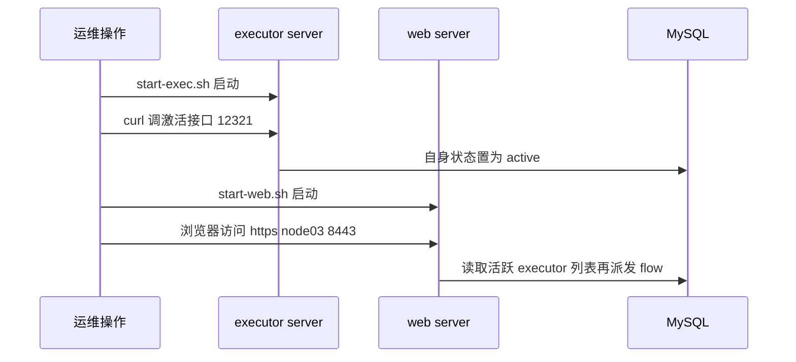

# Azkaban two server 模式收官：插件编译、服务激活与五类 job 实跑

two server 模式的部署最容易停在「配置都改完了，任务却怎么都跑不起来」的位置：executor 进程明明在，页面提交的 flow 却永远卡在准备状态。原因通常不在那两份 `azkaban.properties`，而在 executor 还差一个没编译的 C 插件、少一次激活。这一课把安装的最后两步补完，让 web 与 executor 真正协同起来，随后在这个环境里依次跑通单一 command 任务、依赖任务、HDFS 任务、MapReduce 任务、Hive 任务，最后配一次定时调度。环境沿用前几讲：node03 单机部署，MySQL 里 azkaban 库与业务账号已就绪，keystore 已生成，两份 `azkaban.properties` 已按 SSL 与 MySQL 口径改完。

## 先给结论

- executor 缺插件是 two server 模式最常见的「半启动」原因：把源码里的 `execute-as-user.c` 拷进 `plugins/jobtypes`，用 gcc 编译成二进制，再 `chown root` 加 `chmod 6650`，两步都不能少。
- `commonprivate.properties` 最终保留三行：`execute.as.user=false`、`memCheck.enabled=false`、`azkaban.native.lib` 指向 jobtypes 目录。
- 启动有顺序：`start-exec.sh` 起 executor，curl 调激活接口，`start-web.sh` 起 web；executor 不激活，web 派发任务时找不到执行器，flow 永远等不到执行。
- 五类任务本质都是 `type=command`：Hadoop、Hive 命令写绝对路径，jar 与 sql 资源必须和 job 文件打进同一个 zip。
- 依赖用 `dependencies=job 名` 声明，定时调度在 Execute Flow 页左下角 Schedule 里填分与时；排障固定看四处：Flow Log、Job List、Detail、History。

## executor 插件补齐：一个 C 文件的编译与授权

安装进行到第六步，讲义标题是「azkaban executor server 安装 第二步：添加插件」。要添加的是 `execute-as-user.c`，它是 Azkaban 官方提供的本地包装程序：job 以指定系统用户身份执行时，executor 通过它完成用户切换。编译产物里没有现成的二进制，源文件在编译主目录的 `az-exe-utils` 下，逐层进到 `src` 就能看到，把它拷贝到 executor 的插件目录：

```bash
cp execute-as-user.c /export/servers/azkaban-exec-server-3.51.0/plugins/jobtypes/
cd /export/servers/azkaban-exec-server-3.51.0/plugins/jobtypes/
ls
```

`ls` 确认 `execute-as-user.c` 已就位，接着装编译器并编译：

```bash
yum -y install gcc-c++
gcc execute-as-user.c -o execute-as-user
chown root execute-as-user
chmod 6650 execute-as-user
```

`gcc` 的 `-o` 参数指定输出文件名，编译后得到二进制可执行文件 `execute-as-user`。`chown root` 把属主改成 root，`chmod 6650` 是关键一步：四位权限的首位 6 是 setuid 与 setgid 特殊位，普通用户执行这个文件时会临时以属主 root 的身份运行，这正是它能替 job 完成用户切换的前提。执行完 `ls` 会发现文件名变成红色，红色就是特殊权限位的标志。找不到源文件时别慌，从编译主目录一层层往下走：`az-exe-utils` 进 `src`，C 文件就在里面；现场有人手快把 `cd src` 敲成别的字符，终端回一句 No such file or directory，重新敲对即可，这一步纯粹是找文件，拷贝到 jobtypes 目录后源文件目录就不再参与后续流程。

第七步修改插件配置文件：

```bash
cd /export/servers/azkaban-exec-server-3.51.0/plugins/jobtypes/
vim commonprivate.properties
```

最终文件保留三行：

```properties
# job 以提交 Azkaban 的用户身份执行，不切换系统用户
execute.as.user=false
# 跳过空闲内存检查
memCheck.enabled=false
# execute-as-user 可执行文件所在目录
azkaban.native.lib=/export/servers/azkaban-exec-server-3.51.0/plugins/jobtypes
```

三行各有分工。第一行是模板自带的，保持原样，单机学习环境让 job 以当前用户直接执行最省事。第二行关闭空闲内存检查，与 solo 模式里改的是同一个开关，机器内存不达标时任务提交了也不会被执行。第三行告诉插件去哪里找刚编译出的 `execute-as-user`，路径指向 jobtypes 目录本身。

## 启动与激活：两个进程都要「叫醒」

配置全部完成后进入启动环节，顺序是先 executor、再激活、最后 web：

```bash
cd /export/servers/azkaban-exec-server-3.51.0
bin/start-exec.sh
curl -G "node03:12321/executor?action=activate" && echo
cd ../azkaban-web-server-3.51.0/
bin/start-web.sh
```

讲义模板里激活命令写作 `node03:$(./executor.port)/executor?action=activate`，`$(./executor.port)` 的含义是从文件里读端口，实际环境并没有这个文件，直接替换成 executor 的默认通信端口 12321 即可。激活这一步不能省：executor 进程启动后默认处于未激活状态，不会从数据库认领任何任务，激活接口把它的状态置为 active，命令返回 success 才算生效。这是 two server 模式独有的动作，solo 模式里 web 与 executor 合在一个进程，不存在这个问题。

激活失败时的排查有个固定套路：curl 长时间无响应，先用 `jps` 确认 `AzkabanExecutorServer` 是否真的起来了，再用 `telnet node03 12321` 探端口；端口不通，多半是 executor 没启动成功或端口被占用；端口通但激活报错，回到 executor 的配置里核对安装篇强调过的三条一致性红线（SSL 两端同开、keystore 同文件、回访地址与 SSL 端口吻合）。两个进程分属两个目录、各挂各的启动脚本，重启或停服互不影响，web 重启不会打断 executor 正在执行的 job，这正是 two server 模式相对 solo 的核心价值。

`jps` 里应同时看到 `AzkabanExecutorServer` 与 `AzkabanWebServer` 两个进程。浏览器访问 `https://node03:8443`，注意协议是 https 而不是 http，端口是 8443 而不是 8081，登录账号密码仍是 azkaban。能进主页，two server 模式的安装就宣告结束。



这张图在讲启动顺序背后的依赖关系。关键路径是 executor 必须先激活、web 才有可用的执行器可派发；两个进程的全部协同都经过 MySQL，executor 激活的本质就是把自己的活跃状态写进数据库。

## 单一 command job：先跑通一条 echo

第一个任务与 solo 模式练过的一样，目的是验证 two server 的整条链路。桌面新建 `mycommand.job`，用 Notepad++ 打开、编码转 UTF-8、写两行：

```properties
# mycommand.job
type=command
command=echo 'hello world'
```

`type=command` 表示执行一条 shell 命令，`command` 后面就是命令内容。文件压成 zip 包（Azkaban 只认 zip，且 job 文件必须在压缩包根目录），页面上 Create Project 新建工程 `mycommand`（工程名不能带空格），upload 传包，Execute Flow 立即执行，确认框点 continue。稍等片刻状态变绿，Flow View 里的 Flow Log 记录着 flow 开始、提交 job、结束的流水，点开任务能看到 `hello world` 的真实输出。

这条 echo 在 solo 模式跑过一次，two server 模式再跑一遍，验证的东西不一样：solo 里 web 与 executor 是同一个进程，任务天然有人接；two server 里任务要经 web 写库、executor 认领、子进程执行、日志回库四道手续，任何一道断了页面都会给脸色。绿色 success 出现，说明四个环节全部打通，后面所有任务都走这条已经验证过的路。还有一个概念从这里开始建立：job 的工作目录就是它随 zip 上传后被解压到的位置，后面 MapReduce 任务里 jar 写相对路径能生效，依据正是工作目录里躺着那个 jar。

## 依赖 job：dependencies 串起执行顺序

第二个任务演示多个 job 之间的依赖。写两个文件：

```properties
# foo.job
type=command
command=echo foo
```

```properties
# bar.job
type=command
command=echo bar
dependencies=foo
```

`bar.job` 最后一行 `dependencies=foo` 是全部关键：等号右边是它依赖的 job 名，即 `foo.job` 去掉后缀的名字。两个文件一起打成 `foo_bar.zip`，新建工程 `foo_bar_project` 上传。上传后页面能看到两个 job，bar 上带着对 foo 的依赖标记；右键单个 job 可以 enable 或 disable，把暂时不想跑的任务禁用掉，flow 执行时会跳过禁用的节点。点 Execute Flow，Azkaban 先跑 foo，foo 成功后自动触发 bar：


flow 就是一张任务有向无环图，dependencies 是画边的语法。把依赖写成环，提交时会被直接拒绝，Azkaban 不允许无解的执行顺序。依赖还可以串成链：再写一个 `baz.job` 声明 `dependencies=bar`，三个任务就按 foo、bar、baz 的顺序依次执行，一条 ETL 流水线的骨架就这样搭出来。页面上的 enable 与 disable 是任务级开关，调试流水线时先把下游任务 disable，单独验证上游逻辑，跑通了再放开，比重传 zip 快得多。

## HDFS 操作任务：命令必须写绝对路径

第三个任务让 Azkaban 去 HDFS 上建目录：

```properties
# fs.job
type=command
command=/export/servers/hadoop-3.1.1/bin/hdfs dfs -mkdir /azkaban
```

命令从 `/export/servers/hadoop-3.1.1/bin/hdfs` 开始写全路径，这是 command 类任务的通用要求：executor 调起的是非交互子进程，环境变量与登录 shell 不同，PATH 里没有 hadoop，相对路径找不到命令。打 zip、建工程 `fs_project`、上传、执行，Flow Log 里能看到 HDFS 命令的输出，HDFS 创建目录需要一点时间，日志没动静就点刷新。执行完打开 HDFS 页面，根目录下多出 azkaban 目录，说明调度任务操作 HDFS 没有问题。前提是 Hadoop 集群处于运行状态，job 本身不做集群保活。

## MapReduce 任务：jar 与 job 同包上传

第四个任务执行一个真正的 MapReduce 程序，用 Hadoop 自带的求圆周率示例：

```properties
# mr.job
type=command
command=/export/servers/hadoop-3.1.1/bin/hadoop jar hadoop-mapreduce-examples-3.1.1.jar pi 3 5
```

命令解读三层：`hadoop jar` 执行一个 jar 包；jar 名写相对路径，因为上传后它与 job 文件同在工作目录；`pi 3 5` 是程序参数，3 表示 map task 个数，5 是采样个数，采样越多圆周率算得越准，计算时间也越长。`pi` 程序用蒙特卡洛方法估算圆周率：向正方形里随机撒点，统计落入内切圆的比例，比例乘以 4 就是近似值，参数 5 控制的正是撒点数量，想精度高就调大它。jar 从 `/export/servers/hadoop-3.1.1/share/hadoop/mapreduce/` 目录取出，用传输工具下载到桌面，与 `mr.job` 一起打成 `mr.zip`，建工程 `mr_project` 上传执行。

这一讲现场翻车两次，都值得记。第一次执行结果是 failed，点开 Detail 看日志，报错指向无法启动 container，根因是三台机器系统时间不同步（当时没联网，与阿里云时间服务器失去联系），逐台联网执行时间同步命令后重跑成功。计算结果在 Job List 的 Detail 里看，翻到计数器末尾就是求出的圆周率近似值，5 个采样精度很低，把参数调大值会更准。

## Hive 任务：hive -f 执行脚本

第五个任务执行一段 Hive SQL，脚本与 job 文件配合：

```sql
-- hive.sql
create database if not exists azhive;
use azhive;
create table if not exists aztest(id string, name string) row format delimited fields terminated by '\t';
```

```properties
# hive.job
type=command
command=/export/servers/apache-hive-3.1.1-bin/bin/hive -f hive.sql
```

`hive -f` 表示不进交互命令行、直接执行脚本。这里又踩了一个典型坑：第一次 command 只写到 Hive 安装根目录，少了 `bin/hive` 这一级，executor 把目录当程序去运行，日志报无法运行程序一类的错误；把命令补成 `bin/hive -f hive.sql`，重新打包、删掉旧工程重建上传，执行成功。验证方式是登进 Hive 客户端：`show databases` 能看到 azhive，`use azhive` 后 `show tables` 有 aztest，脚本里两件事都办完了。执行日志开头一长串 `SLF4J: Class path contains multiple SLF4J bindings` 属于类路径上多套日志绑定冲突的警告，不影响任务结果，看到它不必当错误处理。顺带把 `hive -f` 与 `hive -e` 分清：`-f` 执行整个脚本，`-e` 直接执行一小段 SQL 字符串，任务里要跑多行建库建表语句，用 `-f` 配脚本最合适。画面线把库名与表名抄录成 archive 与 azttest，按口播还原为 azhive 与 aztest。脚本里 `fields terminated by '\t'` 的分隔符约定与课程数仓建表脚本完全一致，后面做数据入仓时文件分隔符要与之对齐。

## Schedule 定时调度：填一次分与时，天天自动跑

定时调度不需要新任务，用之前的 `mycommand` 工程即可。点开工程，Execute Flow 页面的左下角有 Schedule 入口，弹出的表单按分、时、日、月、周五个字段组织（另有年字段），底层就是五段式 cron 的思路。想每天凌晨两点半跑一次，分钟填 30，小时填 2，其余留空，页面下方会预览出接下来每个执行点的具体日期时间，13 号 2:30、14 号 2:30 依次排开，确认无误点 Scheduling 提交。保存后回到工程的 Schedule 列表页，能看到这条定时流水的首次执行时间与下一次执行时间，随时可以进列表调整或删除。页面填 30 与 2，等价于 cron 表达式 `30 2 * * *`，这一换算按主流写法补充，方便与 Linux crontab 的知识对齐。

Schedule 与 Execute Flow 的分工可以这样记：Execute Flow 是手动触发一次，Schedule 是把同一条 flow 交给时间表自动触发，两者产生的执行记录都进 History，定时任务失败同样按上一节的路径排查。日与周两个字段平时留空表示每天，只想工作日执行时把周字段限定即可，具体取值以页面提示为准。

## 执行日志怎么看：四处入口按序排查

Azkaban 的日志分散在四处，排查时按固定顺序走。**第一处 Flow Log。** flow 级别的流水，记录开始、提交 job、结束，flow 卡住或整体失败先看这里；日志窗口不自动滚动，等一会儿点一次刷新。**第二处 Job List。** 任务列表以时间轴展示每个 job 的状态与耗时，谁慢、谁没跑一目了然，多任务流水线里它比 Flow Log 更直观。**第三处 Detail 与 Job Log。** 点进具体 job，能看到命令内容与标准输出、错误栈，报错的第一段往往就写明原因，时间不同步、命令路径错、权限不足都在这里现形；MapReduce 任务的计数器与结果也从这个入口翻出来。**第四处 History。** 保存每次执行的历史记录，回溯昨天的失败、对比两次执行的差异都靠它。失败后的标准动作是：读 Detail 定位原因，修 job 或补环境，重新打包上传（页面对同一工程再次 upload 即覆盖旧版本，课程现场为干净起见选择删工程重建，两种做法都成立），再 Execute Flow 重跑。

## 常见误区

- **executor 起了就以为万事大吉。** 未激活的 executor 不认领任务，flow 永远停在准备状态且页面无报错。启动后必须 curl 一次激活接口，返回 success 才算就绪。
- **命令写相对路径。** `hdfs dfs`、`hive` 这类命令在 executor 的子进程里找不到，必须从安装目录的 bin 写全；jar 包除外，它与 job 文件同在工作目录，写相对路径即可。
- **资源文件与 job 分开打包。** `hadoop-mapreduce-examples-3.1.1.jar`、`hive.sql` 必须和 job 文件打进同一个 zip，job 里引用的名字与包内文件名一致；分两个包上传，任务执行时找不到资源。
- **依赖 job 分包上传。** foo 与 bar 要放进同一个 zip，Azkaban 以一次上传为单位解析 flow，分包后依赖关系建立不起来。
- **集群时间不同步硬跑 MR。** 时间偏差会导致 container 无法启动，任务反复 failed。三台机器都执行时间同步，再重跑。
- **改了 job 直接看结果。** 修改后的文件要重新打包上传才生效；上传时注意 zip 里 job 在根目录、编码是 UTF-8，这三点任何一处出问题都会让修改看起来「不生效」。

## 面试可能被问到的问题

1. 面试官追问：「two server 模式下，一个 flow 从页面提交到执行完成的完整链路是怎样的？」
   答：浏览器把执行请求提交给 web server，web 将 flow 的执行记录写入 MySQL；executor 从数据库认领任务，为每个 job 调起子进程执行 command 命令，捕获输出与退出码；状态与日志再经数据库回到页面。两个进程不直接通信，全部协同靠同一套 MySQL 表。
2. 面试官追问：「executor 为什么启动后还要激活，不激活会怎样？」
   答：executor 进程启动后默认是非活跃状态，不参与任务认领。用 curl 调 `executor?action=activate` 接口把状态置为 active 后，web 派发 flow 时才会选中它。不激活则页面提交的任务永远停在准备状态，这是 two server 模式部署最高频的坑。
3. 面试官追问：「dependencies 的执行机制是什么，环形依赖怎么办？」
   答：executor 在派发前解析 flow 的依赖图，入度为零的 job 先执行，某 job 成功后其下游节点的依赖计数减一，减到零即触发。依赖构成环时图无解，Azkaban 在解析阶段直接报错拒绝上传，不会带病执行。
4. 面试官追问：「command job 里跑 Hadoop 或 Hive 命令要注意什么？」
   答：命令写绝对路径，因为 executor 子进程的 PATH 与登录 shell 不同；所需的 jar、sql 等资源与 job 文件打进同一个 zip；文件用 UTF-8 编码；依赖的集群服务要处于运行状态。五类任务（shell、HDFS、MR、Hive、脚本）本质都是同一个 type=command。
5. 面试官追问：「Azkaban 任务失败了，你的排查路径是什么？」
   答：先看 Flow Log 确认 flow 级别的中断点，再看 Job List 定位失败的 job，然后进 Detail 读 Job Log 的报错首段，常见原因有时间不同步导致 container 起不来、命令路径错、资源缺失、权限不足。修复后重新打包上传，从 History 或页面重新触发执行。
6. 面试官追问：「定时调度怎么配，与 cron 什么关系？」
   答：在 Execute Flow 页面左下角 Schedule 里按分、时、日、月、周填写，底层对应五段式 cron，分钟 30 小时 2 等价于 `30 2 * * *`，即每天凌晨两点半。保存后工程 Schedule 列表会显示首次与下一次执行时间，支持随时调整或删除。

## 配套资料

- 本课（day07-Azkaban）无 job 配套源码包，job 文件与配置按视频画面逐行还原；激活命令的端口写法、Schedule 等价 cron 表达式为按主流写法补全，正文已注明。
- 代码：`materials/code/04/_散落资料/` 下的 Hive 建库建表脚本与 Spark 离线统计脚本（course_visit_fact、course_visit_process 两个 shell），建表统一使用 `ROW FORMAT DELIMITED FIELDS TERMINATED BY '\t'`，与本课 hive.sql 的分隔符约定一致；那两个 shell 正是可被 command job 调度的真实业务脚本形态。
- 讲义：`materials/docs/04/智慧学成-第2章-数据仓库.md`，分层数仓的作业链路背景，本课跑通的调度能力后续正是用来编排这类逐层加工作业。
