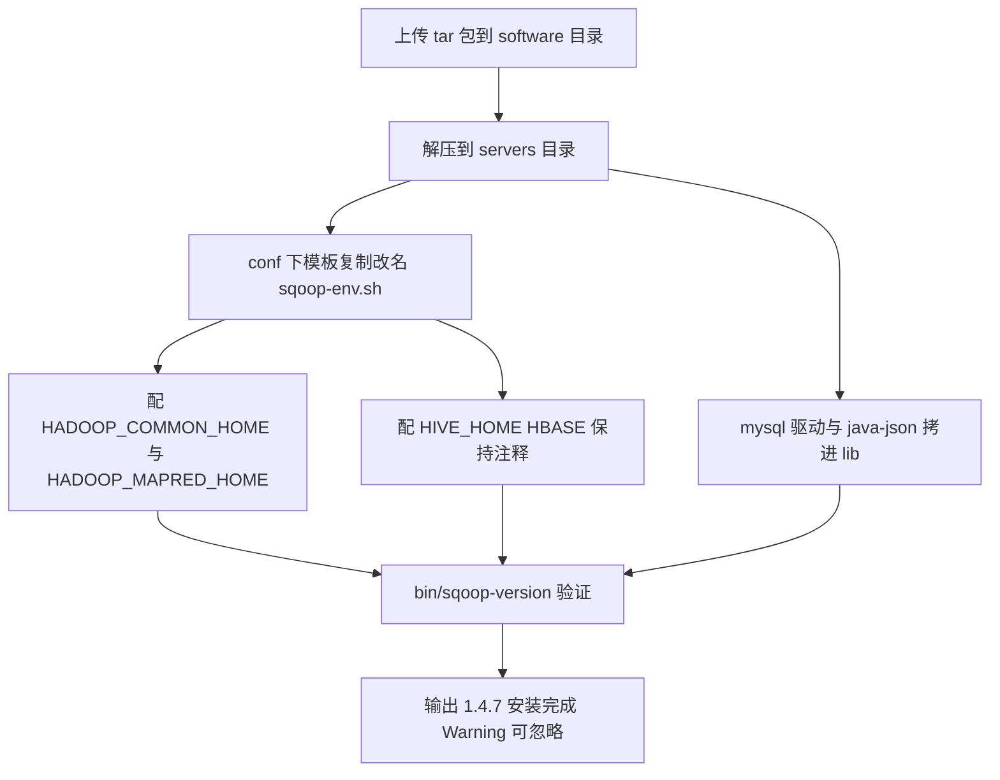

# Sqoop 1.4.7 安装实录：模板改名、三处路径与两个依赖包

Sqoop 的安装步骤不多，坑却很集中：有人卡在 `bin/sqoop-version` 刷出的一串 Warning 以为装失败了，有人模板忘了改名导致环境变量全是空的。这一课把 Sqoop 1.4.7 在 node03 上装到验证通过，全程四步：上传解压、模板改名配置、拷依赖包、跑版本验证。装之前先明确版本口径：Sqoop 分 1.x 与 2.x 两代，企业主流是 1.x，这里用的就是 Sqoop 1 的 1.4.7 版本，安装包为 `sqoop-1.4.7.bin__hadoop-2.6.0.tar.gz`。

## 先给结论

- 下载地址在 Apache 归档站 `archive.apache.org/dist/sqoop/1.4.7`，包解压到 `/export/servers`，目录沿用课程环境 `/export/software` 收包、`/export/servers` 安装的约定。
- `conf/sqoop-env-template.sh` 必须复制改名为 `sqoop-env.sh` 才会被加载，模板文件本身永远不生效。
- 环境变量配三个：`HADOOP_COMMON_HOME`、`HADOOP_MAPRED_HOME` 同指 Hadoop 安装根目录，`HIVE_HOME` 指 Hive 安装目录；不装 HBase 就让它保持注释。
- 两个 jar 拷进 `lib`：`mysql-connector-java-5.1.40.jar` 与 `java-json.jar`，缺了驱动包连 MySQL 的所有命令都跑不了。
- `bin/sqoop-version` 输出里的 hbase、hcatalog、accumulo、zookeeper 提示是 Warning 不是 Error，对应组件没装而已，看到 `Running Sqoop version: 1.4.7` 即安装成功。

## 第一步：下载解压，认准 1.4.7

官方归档站给出各版本下载路径，Sqoop 1 用 `http://archive.apache.org/dist/sqoop/1.4.7` 下的 `sqoop-1.4.7.bin__hadoop-2.6.0.tar.gz`，Sqoop 2 在 1.99.x 系列下，想体验可以自行下载。把安装包上传到集群：

```bash
cd /export/software/
# 上传 sqoop-1.4.7.bin__hadoop-2.6.0.tar.gz 后解压
tar -zxvf sqoop-1.4.7.bin__hadoop-2.6.0.tar.gz -C ../servers/
cd ../servers/sqoop-1.4.7.bin__hadoop-2.6.0/
ls
```

解压出来的目录名带着 `.bin__hadoop-2.6.0` 后缀，表示它是针对 Hadoop 2.6 编译的二进制包，与集群的 Hadoop 3.1.1 配合使用没有问题。目录名里是双下划线，屏幕投出的字符容易看成单下划线，后续命令一律以解压后的实际目录名为准， Tab 键补全最省心。`ls` 能看到 bin、conf、lib 等标准结构，与 Hadoop、Hive 的布局一脉相承。

## 第二步：模板改名，配置三个路径

Sqoop 的配置在 `conf` 目录：

```bash
cd /export/servers/sqoop-1.4.7.bin__hadoop-2.6.0/conf/
ls
cp sqoop-env-template.sh sqoop-env.sh
vim sqoop-env.sh
```

`ls` 会看到 `sqoop-env-template.sh` 模板。改名这一步是硬要求：Sqoop 启动脚本只认 `sqoop-env.sh` 这个名字，模板文件的任何内容修改都不会被加载，忘记改名时的典型现象是命令能跑但环境变量全空。改名后编辑，配置三处路径：

```bash
#Set path to where bin/hadoop is available
export HADOOP_COMMON_HOME=/export/servers/hadoop-3.1.1
#Set path to where hadoop-*core.jar is available
export HADOOP_MAPRED_HOME=/export/servers/hadoop-3.1.1
#Set the path to where bin/hbase is available
#export HBASE_HOME=
#Set the path to where bin/hive is available
export HIVE_HOME=/export/servers/apache-hive-3.1.1-bin
```

三个变量的含义分开说。`HADOOP_COMMON_HOME` 指向 Hadoop 安装根目录，Sqoop 把命令翻译成 MapReduce 作业时要用 Hadoop 的运行时；`HADOOP_MAPRED_HOME` 指向 MapReduce 相关类所在位置，课程环境里它与 `HADOOP_COMMON_HOME` 是同一个目录，因为两者都在 Hadoop 根目录下；`HIVE_HOME` 配上后才能把数据导入 Hive 表，路径按集群现有 Hive 安装位置填。`HBASE_HOME` 所在行保持注释，集群没装 HBase，取消注释反而会在启动时报找不到路径。

三个路径都是从已有集群布局里拷来的，现场就因为一次拷贝串行改过一遍。拷完别急着保存退出，逐个确认目录真实存在，路径错了 Sqoop 不会在安装期报错，而是等到真正执行导入时才发作，排查成本翻倍。

## 第三步：两个依赖包拷进 lib

Sqoop 安装包不带 MySQL 驱动，也不带它依赖的 JSON 处理包，需要手动补进 `lib` 目录：

```bash
cd /export/servers/sqoop-1.4.7.bin__hadoop-2.6.0/lib/
# 上传 mysql-connector-java-5.1.40.jar 与 java-json.jar
rz
ls
```

`mysql-connector-java-5.1.40.jar` 是 JDBC 驱动，Sqoop 通过它连 MySQL，缺了它所有带 `--connect jdbc:mysql://` 的命令都会报找不到合适的 driver；`java-json.jar` 是 Sqoop 内部处理 JSON 的依赖包。两个包都可以在课程资料里找到，放进 lib 后 Sqoop 的依赖就齐了。驱动包的版本要匹配 MySQL 服务端，5.1.x 驱动对应课程环境的 MySQL 没有问题，换 MySQL 8 的环境时驱动与连接串都要相应调整。

## 第四步：验证安装

```bash
cd /export/servers/sqoop-1.4.7.bin__hadoop-2.6.0/
bin/sqoop-version
```

有个小细节值得记：讲义上验证这一步的 cd 路径写的是 `sqoop-1.4.6-cdh5.14.0`，那是旧环境的目录名，现场把它改成实际的 1.4.7 目录再执行。资料里出现与现状不符的版本号很常见，执行时永远以磁盘上的真实目录为准。

输出先是几行 Warning，随后是版本信息：

```text
Warning: /export/servers/sqoop-1.4.7.bin__hadoop-2.6.0/bin/../hbase does not exist! HBase imports will fail.
Please set $HBASE_HOME to the root of your HBase installation.
Warning: /export/servers/sqoop-1.4.7.bin__hadoop-2.6.0/bin/../hcatalog does not exist! HCatalog jobs will fail.
Warning: /export/servers/sqoop-1.4.7.bin__hadoop-2.6.0/bin/../accumulo does not exist! Accumulo imports will fail.
Please set $ACCUMULO_HOME to the root of your Accumulo installation.
2019-05-12 19:57:59,375 INFO sqoop: Sqoop: Running Sqoop version: 1.4.7
```



这张图是安装的完整路径，两条支线（配环境变量与补依赖包）互不依赖，可以并行完成，最后在版本验证处汇合。输出的那几行 Warning 逐条解读：Sqoop 启动时检查 HBase、HCatalog、Accumulo、Zookeeper 的安装目录，没装就提醒对应功能不可用，集群不用这些组件时 Warning 永远都在，当作背景噪音即可。真正判断安装成败只看一行 INFO：`Running Sqoop version: 1.4.7` 出现，Sqoop 就绪。

## 常见误区

- **模板忘改名。** 只在 `sqoop-env-template.sh` 里改了半天，环境变量一个都没生效。必须 `cp sqoop-env-template.sh sqoop-env.sh`，改副本的名字。
- **把 Warning 当安装失败。** hbase、accumulo 不存在只是功能缺失提醒，不是错误；因为 Warning 反复重装浪费时间，是新手最常见的弯路。
- **`HADOOP_COMMON_HOME` 指错层级。** 要指 Hadoop 安装根目录 `/export/servers/hadoop-3.1.1`，指到 bin 或 conf 层级时，启动不报错，导入时才失败。
- **缺驱动包硬连库。** lib 里没有 `mysql-connector-java` 时，`list-databases`、`import` 全部报找不到合适的 driver，且报错信息不直接指向驱动缺失，容易误判成连接串写错。
- **照抄资料里的版本路径。** 讲义与网上资料里的目录名可能来自旧版本，命令里的路径一律以集群实际目录为准，用 Tab 补全避免手打。

## 面试可能被问到的问题

1. 面试官追问：「安装 Sqoop 的核心步骤有哪些？」
   答：解压安装包、把 `sqoop-env-template.sh` 改名为 `sqoop-env.sh` 并配置 `HADOOP_COMMON_HOME`、`HADOOP_MAPRED_HOME`、`HIVE_HOME` 三个路径、把 MySQL 驱动与 `java-json.jar` 拷进 lib、用 `bin/sqoop-version` 验证。核心思想是 Sqoop 自己很轻，它依赖 Hadoop 运行时和目标数据库的驱动。
2. 面试官追问：「sqoop-env.sh 为什么要从模板复制，直接改模板不行吗？」
   答：启动脚本按固定文件名加载 `sqoop-env.sh`，模板名不会被读取，直接改模板等于白改。这也是 Hadoop、Hive 等组件的通用习惯，`*_template` 或 `*.template` 文件都只是样例，启用前先复制改名为正式配置文件。
3. 面试官追问：「为什么 Sqoop 要额外拷 MySQL 驱动包？」
   答：Sqoop 通过 JDBC 连接关系库，Apache 出于许可考虑不在发行包里捆绑 MySQL 驱动，需要手动把 `mysql-connector-java` 放进 lib。缺驱动时所有 `--connect jdbc:mysql://` 的命令报找不到合适的 driver。
4. 面试官追问：「`sqoop-version` 输出一堆 does not exist 的 Warning，怎么处理？」
   答：逐条对应 HBase、HCatalog、Accumulo、Zookeeper 组件的安装目录检查，未安装对应组件时属预期现象，保持注释或按需配置即可。判别标准是看日志级别：Warning 表示功能缺失提醒，ERROR 才代表流程中断，安装成败以 `Running Sqoop version` 一行 INFO 为准。
5. 面试官追问：「Sqoop 1.4.7 的包名带 bin__hadoop-2.6.0 后缀，是什么意思？」
   答：表示这是针对 Hadoop 2.6 编译的官方二进制包，区别于源码包。与更高版本的 Hadoop 3.x 搭配使用是社区常见组合，Sqoop 通过环境变量指向实际 Hadoop 安装目录来适配，后缀不代表只能跑在 Hadoop 2.6 上。

## 配套资料

- 本课（Sqoop 安装）无配套源码包，命令按视频画面逐行还原；下载链接、目录名双下划线写法与 Warning 解读为按主流写法补全，正文已注明。
- 讲义：`materials/docs/04/采集系统部署使用说明.md`，同一集群环境的部署口径（node01 至 node03 主机与 `/export/software`、`/export/servers` 目录约定），Sqoop 的落位与 Flume、Hive 等组件保持一致。
- 讲义：`materials/docs/04/智慧学成-第2章-数据仓库.md`，集群内 Hive 与分层数仓的背景资料，`HIVE_HOME` 指向的正是这条链路使用的 Hive 环境。
