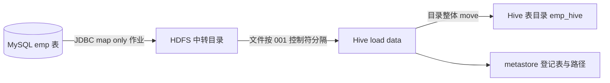

# Sqoop 导入 Hive：拷 jar、建表、--hive-import 一次跑通

> 🔒 安全提示：文中示例的口令/密钥均为课程教学环境演示口径，生产环境的安全要求见《安全与合规须知》。

上一课把关系表导进了 HDFS，但数仓的分析都发生在 Hive 里，先导 HDFS 再手工建表 load 是两步走，天天导入谁也受不了。Sqoop 对此提供了 `--hive-import`，把建表与装载合并成一条命令。环境沿用上一课的 Sqoop 1.4.7 与 Hive 3.1.1，命令连接的演示库是画面上的 MySQL（账号密码 root），课程集群内 MySQL 的 root 密码为 123456，替换连接串与密码即可，命令模板完全一致。

## 先给结论

- 导入 Hive 有一个硬前置：把 Hive 安装目录 `lib` 下的 `hive-exec-3.1.1.jar` 拷进 Sqoop 的 `lib`，Sqoop 才有能力与 Hive 对话。
- 核心四件套：`--hive-import` 声明导入 Hive、`--hive-table` 指定库与表、`--hive-overwrite` 覆盖旧数据、`--delete-target-dir` 清理 HDFS 中转目录。
- 目标表可以提前建好，也可以交给 Sqoop 自动创建：加 `--hive-database` 指定目标库，表名沿用 MySQL 表名，结构与字段个数自动对齐。
- 字段分隔符选 `'\001'`，即 Hive 默认分隔符，建表的 ROW FORMAT 与导入参数必须同值，文件才能被表正确解析。
- 底层仍是先写 HDFS 再 load 进表目录，理解这个中转，三个参数各自管什么就清楚了。

## 前置动作：给 Sqoop 补一个 Hive 的 jar

Sqoop 1.4.7 的发行包按 Hadoop 2.6 打包，里面没有带 Hive 相关的类。`--hive-import` 执行时要调用 Hive 的接口生成建表语句、向 metastore 登记表，这些能力都在 `hive-exec` 包里，所以先把 Hive 安装目录 `lib` 下的这个 jar 拷到 Sqoop 的 `lib`：

```bash
cp /export/servers/apache-hive-3.1.1-bin/lib/hive-exec-3.1.1.jar /export/servers/sqoop-1.4.7.bin_hadoop-2.6.0/lib/
```

拷完即生效，Sqoop 启动时会加载 `lib` 下的全部 jar。缺这一步的典型现象：命令走到最后的 HiveImport 阶段报找不到类，前面导 HDFS 一切正常，卡在入仓这最后一截。

让 Sqoop 找到 Hive 还有两条路：把 Hive 的 `conf/hive-site.xml` 拷到 Sqoop 的 `conf` 目录，或者配好 `HIVE_HOME` 环境变量、保证 `hive` 命令可用。画面上演示的是拷 jar 这一条，另外两条按主流写法补充，任选其一配齐即可。

## 准备目标库与表：分隔符选 \001

进 Hive 命令行建库建表：

```sql
create database sqoopothive;
use sqoopothive;
create external table emp_hive(
  id int,
  name string,
  deg string,
  salary int,
  dept string
) row format delimited fields terminated by '\001';
```

`\001` 是 ASCII 的 ^A 控制字符，Hive 建表不写 ROW FORMAT 时的默认字段分隔符。选它的理由很实际：业务数据里几乎不会出现这个字符，比逗号、`\t` 都安全，不会因为字段内容本身带分隔符而错位。键盘直接敲打不出这个字符，建表语句里按八进制转义写成 `'\001'`。

分隔符怎么选，课程真实数仓给了另一个参照：配套建库建表脚本按 `data_agency`、`data_dimen`、`data_subject` 等业务库组织，维度表与事实表统一用 `ROW FORMAT DELIMITED FIELDS TERMINATED BY '\t'` 建外部表，数据落在 `/user/hive/external/` 之下。选 `\001` 还是 `\t` 并不重要，重要的是 Hive 端建表与 Sqoop 端导入必须是同一个值。

## 第一条 --hive-import

```bash
bin/sqoop import \
--connect jdbc:mysql://192.168.1.7:3306/userdb \
--username root \
--password root \
--table emp \
--fields-terminated-by '\001' \
--hive-import \
--hive-table sqoopothive.emp_hive \
--hive-overwrite \
--delete-target-dir \
-m 1
```

逐段读：`--connect` 加账号三件套、`--table emp` 定位 MySQL 侧数据源，与导 HDFS 完全一致；`--fields-terminated-by '\001'` 让产出的文件按 `\001` 分隔，对齐建表约定；`--hive-import` 声明导入 Hive；`--hive-table sqoopothive.emp_hive` 指定目标库与目标表；`--hive-overwrite` 表示表里已有数据时覆盖写入；`--delete-target-dir` 表示 HDFS 中转目录已存在则先删；`-m 1` 单 map 执行。

控制台先滚出一段与导 HDFS 一模一样的输出（map only 作业、JDBC 读表、写 HDFS），结尾多出一段 Hive import，由 Sqoop 调用 Hive 完成装载。跑完进 Hive 验证：

```sql
show tables in sqoopothive;
select * from sqoopothive.emp_hive;
```

五条员工数据全部查出，与 MySQL 的 emp 表内容一致，导入完成。

## 更省事的姿势：自动建表

提前建表不是必须的。第二条命令连建表都省掉：

```bash
bin/sqoop import \
--connect jdbc:mysql://192.168.1.7:3306/userdb \
--username root \
--password root \
--table empconn \
--hive-import \
--hive-database sqoopothive
```

只指定 `--hive-database` 目标库：Sqoop 按 MySQL 表的元数据生成建表 DDL，在 `sqoopothive` 库里创建同名表 `empconn`，字段名与字段个数和 MySQL 一致，分隔符用 Hive 默认的 `\001`，与它写入的文件天然匹配。演示时特意换了第二张表 empconn，画面 PPT 的模板命令写的是 `--table emp`，替换表名即可。

跑完在 Hive 里 `show tables` 能看到 `empconn`，`select *` 查出的数据与 MySQL 全量一致。两种方式的取舍：字段类型简单、想省事，用自动建表；对表属性有要求，比如要建外部表、要按天落分区、要指定存储格式，就提前手动建表再导入，Sqoop 只负责装载数据。带分区的表用 `--hive-partition-key` 与 `--hive-partition-value` 指定本次导入落到哪个分区，这两个参数画面未演示，按主流写法补充。

## 本质：先导 HDFS，再 load 进表



这张图把 `--hive-import` 拆成两段：前半段与上一课的导 HDFS 完全相同，数据先落进一个中转目录；后半段不是复制，而是 Hive 的 load，把目录整体 move 进表目录，metastore 里登记表与路径。Hive 表的数据本身就是 HDFS 目录，所谓入仓只是换了个归属。

理解了这个中转，三个参数就串起来了：`--delete-target-dir` 管中转目录，已存在会报错，重跑先删；`--hive-overwrite` 管表目录，覆盖旧数据；`--fields-terminated-by` 管文件内容，必须与建表 ROW FORMAT 一致，否则 move 进表目录之后整表字段错位。

## 常见误区

- **不拷 jar 直接 `--hive-import`。** 报错发生在最后的 HiveImport 阶段而不是 JDBC 读取阶段，容易误判成数据问题；先把 `hive-exec` jar 拷进 Sqoop 的 `lib`。
- **建表分隔符与导入分隔符对不上。** 建表用 `\t` 而导入用默认 `\001`，查询时整列错位或全为 null；两边用同一个值。
- **把 `--hive-overwrite` 与 `--delete-target-dir` 混为一谈。** 前者覆盖 Hive 表数据，后者删除 HDFS 中转目录；重复执行的导入通常两个都要带上。
- **以为自动建表会建成带分区的外部表。** Sqoop 自动生成的 DDL 只有基础列定义，产出内部表、无分区；有分区或存储格式要求时提前手动建表。

## 面试可能被问到的问题

1. 面试官追问：「Sqoop `--hive-import` 的底层流程是什么？」
   答：分两段。先把数据按普通 import 写进一个 HDFS 中转目录，再通过 Hive 的 load 机制把目录 move 进 Hive 表目录并在 metastore 登记表。没有真正的数据复制，Hive 表就是中转目录换了个归属，所以文件分隔符必须与建表的 ROW FORMAT 一致。
2. 面试官追问：「为什么分隔符选 `\001`？」
   答：`\001` 是 ASCII 的 ^A 控制字符，是 Hive 不指定 ROW FORMAT 时的默认字段分隔符。业务文本里几乎不会出现这个字符，能避免字段内容包含逗号或制表符导致的切分错位，同时与 Sqoop 默认写入格式天然一致。
3. 面试官追问：「`--hive-overwrite` 和 `--delete-target-dir` 有什么区别？」
   答：`--hive-overwrite` 决定导入时是否清空 Hive 表里已有的数据；`--delete-target-dir` 决定 HDFS 中转目录已存在时是否先删除。前者作用于表，后者作用于中转目录，重复执行的导入命令一般两个参数同时带。
4. 面试官追问：「导入 Hive 之前需要满足哪些条件？」
   答：Sqoop 的 `lib` 下要有 Hive 的 `hive-exec` jar，或保证 `HIVE_HOME` 可用、`hive-site.xml` 在 Sqoop 的 `conf` 下；Hive 服务可用，目标库提前建好或授权 Sqoop 自动建表；建表分隔符与 `--fields-terminated-by` 约定一致。
5. 面试官追问：「自动建表和手动建表怎么选？」
   答：字段类型简单、一次性导入，用 `--hive-database` 自动建表最省事，Sqoop 按 MySQL 元数据生成同名同结构的内部表。需要外部表、分区、自定义存储格式或生命周期管理时，提前手动建表再导入，Sqoop 只负责把数据 load 进去。

## 配套资料

- 本课（Sqoop 导入 Hive）无配套源码包，命令按视频画面逐行还原；`hive-site.xml`、`HIVE_HOME` 两条前置与 `--hive-partition-key`、`--hive-partition-value` 的说明为按主流写法补充，正文已注明。
- 代码：`materials/code/04/_散落资料/` 下的 Hive 建库建表脚本，真实数仓按 `data_agency`、`data_dimen`、`data_subject` 等库组织，维度表与事实表统一 `ROW FORMAT DELIMITED FIELDS TERMINATED BY '\t'` 建外部表，与画面演示的 `\001` 同属「建表与导入分隔符一致」这一约定（源文件名带的推广后缀在正文一律略去）。
- 讲义：`materials/docs/04/智慧学成-第2章-数据仓库.md`，数仓分层与建表规范的完整背景。
