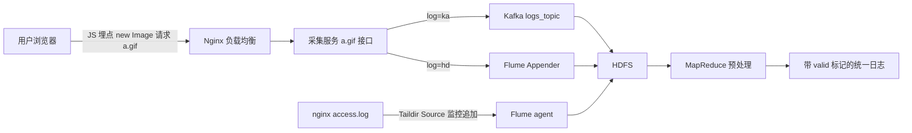

# 网站流量日志分析第一步：用 Flume 采集访问日志，用 MapReduce 洗出统一格式

网站流量分析要出 PV、UV、来源分布这些指标，前提是先有一份格式统一、标记干净的访问日志。真实环境里拿到的是一台台 Web 服务器上的 `access.log`：一行里混着静态资源请求、304 与 404 状态码、字段残缺的脏行，时间还是带 +0000 时区的美式格式。这样的数据直接灌进 Hive，后面每一条统计 SQL 都得先做防御性判断。这一课解决两件事：日志怎么从 Web 服务器旁边汇进 HDFS，以及进仓之前怎么把它洗成带有效性标记的统一格式。这两件事分别对应数据处理流程链路里的采集环节与预处理环节，是后面 PageView、Visit 两个点击流表模型的地基。

## 先给结论

- 采集端选 Flume 的 Taildir Source：既能监控目录下的多个文件，又能实时读取文件追加的内容，比 Spooling Directory Source 与 Exec Source 都更契合 nginx 日志持续追加写的场景。
- Taildir 的 `positionFile` 按文件记录读取偏移量，agent 重启后从上次的偏移继续读，断点续传靠它实现。
- 原始日志共 10 个字段，预处理要过滤三类东西：列数不足的残行、状态码大于等于 400 的错误请求、js/css/图片这类没有分析价值的静态资源。
- 预处理用只有 Mapper 的 MapReduce 作业实现：WeblogParser 负责解析一行文本，WeblogBean 承载字段并用 `valid` 布尔值打有效性标记，输出字段之间用 `\001` 分隔。
- 课程配套的真实工程走 JS 埋点：页面用 1x1 的 Image 对象请求 `a.gif`，采集服务把请求参数拼成一行日志，经 Kafka 或 Flume Appender 落进 HDFS，与教学线殊途同归。

## 采集这一步在解决什么问题

访问日志长在 Web 服务器本地。一台 nginx 还好说，集群部署、多级负载均衡时日志分散在每台机器上，分析程序不可能挨台登录去读文件。采集系统的职责就是把这些分散的日志汇聚到 HDFS 这样的共享存储里，供后续计算统一读取。按来源划分，系统日志可以归为三类：用户行为日志（用户使用系统过程中的一串操作）、业务变更日志（某个业务对象由 A 状态变成 B 状态）、系统运行日志（服务器资源与中间件的定时采集），流量分析项目主要吃的是第一类。

Flume 的 agent 由 Source、Channel、Sink 三个组件搭起来：Source 决定从哪里读数据，Channel 是内存或文件级别的缓冲，Sink 决定写到哪里。用 Flume 采集的核心工作就是改配置文件，把三个组件配好直接启动，三个组件里最关键的是 Source，因为数据形态不同，Source 的选型完全不同。

针对监控日志文件这个需求，早期有两个常见选择，都不理想。Spooling Directory Source 只能监控一个目录下新增的完整文件，要求文件写入后不再改动，对 nginx 这种持续追加写同一个文件的场景不适配。Exec Source 可以执行一条 `tail -F` 命令追踪单个文件的内容变化，但它在 agent 重启后不知道上次读到哪里，丢数据或重复采集都难以避免。Flume 1.6 之后提供了 Taildir Source，把两边的长处合在一起：支持监控目录下的多个文件，支持实时读取文件追加的内容，还自带断点续传。

## Taildir Source 的核心配置

对照 Flume 1.8 官方文档的 Taildir Source 一节，核心配置长这样：

```properties
al.sources = r1
al.sources.r1.type = TAILDIR
al.sources.r1.channels = c1
# positionFile 记录每个文件的读取位置，是断点续传的检查点
al.sources.r1.positionFile = /var/log/flume/taildir_position.json
# 文件组列表：fl1 监控单个文件，fl2 可用正则匹配 test2 下文件名带 log 的全部文件
al.sources.r1.filegroups = fl1 fl2
al.sources.r1.filegroups.fl1 = /var/log/test1/example.log
al.sources.r1.filegroups.fl2 = /var/log/test2/xxx.log
```

三个容易踩的点藏在配置里。**第一，filegroups 必须写绝对路径。** 相对路径会相对 agent 的启动目录解析，换个目录启动 agent 就什么都采不到。**第二，文件组支持正则。** fl2 的路径可以写成 `/var/log/test2/.*log.*` 这样的正则，test2 下文件名含 log 的文件全部纳入监控，nginx 按天切割日志文件时正好用得上。**第三，positionFile 是检查点文件。** 它以 JSON 格式记录每个被监控文件的 inode 与 offset，上次读到第 500 行，重启后从第 501 行接着读，断点续传就建立在这个文件之上。

Channel 用课程环境常见的 memory channel 即可，Sink 配 HDFS sink 写入按日期组织的目录。memory channel 吞吐高、配置简单，agent 进程挂掉时未落盘的数据会丢，适合能容忍少量丢失的演示场景；对可靠性要求高的生产采集会在内存通道与文件通道之间做权衡，文件通道把事件先落本地磁盘再转发，丢失窗口更小但吞吐低一截。HDFS sink 负责把事件写成文件，路径通常带日期变量，按天滚动生成目录，下游按天取数正好对齐。positionFile 本身是一个 JSON 结构，每个被监控文件占一条记录，inode 标识文件身份、偏移量记录已读位置，agent 周期性地把位置快照写回去，重启时从快照恢复继续读。演示环境没有现成的 nginx 服务器，课程资料里直接准备好了一份采集完成的 `access.log`，作为后续预处理与分析环节的输入。

## 一行 nginx 访问日志里有什么

打开 `access.log`，一行就是一次 HTTP 请求，字段之间以空格分隔。抽一行典型记录：

```text
58.215.204.118 - - [18/Sep/2013:06:51:35 +0000] "GET /wp-includes/js/jquery/jquery.js?ver=1.10.2 HTTP/1.1" 304 0 "http://blog.51cto.com/xuedeti/dat" "Mozilla/5.0 (Windows NT 5.1) rv:25.0 Gecko/20100101 Firefox/25.0"
```

按顺序拆开一共 10 个字段：访客 ip 地址；访客用户信息，匿名为 `--`；请求时间，带 +0000 时区的美式日期；请求方式 GET；请求的 url；请求所用协议 HTTP/1.1；响应码，200 代表成功、304 代表浏览器缓存重新验证；返回的流量字节数；访问来源 referer，即从哪个页面跳转过来；浏览器 user-agent。课程讲义里对这 10 个字段有一份逐项的口径记录。

观察整份文件会得到两个事实。一是脏数据多：有些行字段残缺，有些行状态码是 404 甚至 500，请求时间偶尔是非法值。二是请求构成复杂：用户打开一个页面，浏览器会顺带请求 js、css、图片等一堆静态资源，这些请求对前端调试有意义，对流量分析完全是噪音。原始数据的格式不能满足分析需求，接下来的预处理就是对它做清洗、去脏与格式统一。

两条采集链路放进一张图里看：



教学线靠 Flume agent 盯 nginx 的日志文件；真实工程线是页面主动上报，采集服务收到 `a.gif` 请求后把参数落成一行日志，经 Kafka 缓冲解耦再进 HDFS。两条线最终在 HDFS 汇合，交给同一套预处理程序。

## 预处理要洗掉什么

课程把数据预处理过程画成一条链：原始日志 → 数据清洗 → 用户识别 → 会话识别 → 路径补全 → 按 user 会话分文件。清洗是第一环，用户识别与会话识别会在后面两篇的 PageView、Visit 表模型里继续做。落到这一步，具体要洗三类东西。

**第一，残缺行与错误行。** 按空格切分后列数不足 11 的一行直接判无效；时间解析不出来置为 invalid；响应状态码大于等于 400（404 地址错误、500 服务器异常）的请求同样不是有效分析数据。

**第二，无分析意义的静态资源请求。** js、css、图片、about 页这类路径维护在一个 pages 集合里，请求路径命中集合就打上无效标记。这个集合在 Mapper 的 `setup` 方法里初始化，`setup` 在作业启动时执行一次，天然适合放这种全作业共用的常量。

**第三，格式不统一。** 美式时间转本地时间；user-agent 本身含空格，按空格切分后是一串碎片，要把第 11 列之后的碎片拼回一个完整字段；输出时字段之间用 `\001` 分隔，`\001` 是不可见控制字符，编辑器里显示成 SOH，选它做分隔符是因为它几乎不可能出现在正常日志内容里，不会和业务数据打架。

洗完之后的数据长什么样，直接决定下游好不好用。打开第一次预处理作业的输出文件，每行仍然是 9 列：首列 true 或 false，随后 8 个字段以 `\001` 连接，时间已经从 `18/Sep/2013` 这类美式格式转成了本地格式。翻几页能看到 false 的行，可能是响应码 404 的错误请求，也可能是命中 pages 集合的静态资源请求。有效行与无效行同文件共存是刻意的：清洗只负责下结论，不负责销毁证据，复盘某一天为什么 PV 异常时，把 false 的行捞出来看一眼就有线索。

## WeblogBean 与 WeblogParser：一行日志怎么变成对象

本课的预处理工程没有随资料提供源码包，以下代码按课件画面与主流写法补全，包名统一为 `com.study.clickstream`。WeblogBean 是实现 Writable 接口的值对象，第一个字段 `valid` 专门承载这一行是否合法的判断结论，其余字段与 nginx 日志的 10 列一一对应（请求方式与协议并进 request 简化处理）：

```java
package com.study.clickstream;

import org.apache.hadoop.io.Writable;

import java.io.DataInput;
import java.io.DataOutput;
import java.io.IOException;

/**
 * 原始访问日志的值对象：一行 nginx 日志解析后的全部字段
 */
public class WeblogBean implements Writable {
    private boolean valid = true;        // 判断数据是否合法
    private String remote_addr;          // 访客 ip 地址
    private String remote_user;          // 访客用户信息
    private String time_local;           // 访问时间与日期
    private String request;              // 请求的 url
    private String status;               // 响应码
    private String body_bytes_sent;      // 返回的流量字节数
    private String http_referer;         // 访问来源，从哪个页面跳转过来
    private String http_user_agent;      // 访客浏览器信息

    @Override
    public void write(DataOutput out) throws IOException {
        out.writeBoolean(valid);
        out.writeUTF(remote_addr == null ? "" : remote_addr);
        out.writeUTF(remote_user == null ? "" : remote_user);
        out.writeUTF(time_local == null ? "" : time_local);
        out.writeUTF(request == null ? "" : request);
        out.writeUTF(status == null ? "" : status);
        out.writeUTF(body_bytes_sent == null ? "" : body_bytes_sent);
        out.writeUTF(http_referer == null ? "" : http_referer);
        out.writeUTF(http_user_agent == null ? "" : http_user_agent);
    }

    @Override
    public void readFields(DataInput in) throws IOException {
        valid = in.readBoolean();
        remote_addr = in.readUTF();
        remote_user = in.readUTF();
        time_local = in.readUTF();
        request = in.readUTF();
        status = in.readUTF();
        body_bytes_sent = in.readUTF();
        http_referer = in.readUTF();
        http_user_agent = in.readUTF();
    }

    // 输出格式：valid 在首列，其余字段以 \001 连接
    @Override
    public String toString() {
        return valid + "\001" + remote_addr + "\001" + remote_user + "\001"
                + time_local + "\001" + request + "\001" + status + "\001"
                + body_bytes_sent + "\001" + http_referer + "\001" + http_user_agent;
    }
    // 各字段的 getter 与 setter 省略
}
```

WeblogParser.parser 把一行文本拆进这个 bean，合法性判断全部在解析过程中完成：

```java
public static WeblogBean parser(String line) {
    WeblogBean bean = new WeblogBean();
    String[] arr = line.split(" ");
    // 按空格切分后不足 11 列，说明这行日志残缺，直接判无效
    if (arr.length > 11) {
        bean.setValid(true);
        bean.setRemote_addr(arr[0]);
        bean.setRemote_user(arr[1]);
        // 第 3 列去掉左方括号后是带 +0000 的美式时间，转成本地时间
        String time_local = formatDate(arr[3].substring(1));
        if (null == time_local || "".equals(time_local)) {
            time_local = "-invalid_time-";
            bean.setValid(false);
        }
        bean.setTime_local(time_local);
        bean.setRequest(arr[6]);
        bean.setStatus(arr[8]);
        bean.setBody_bytes_sent(arr[9]);
        bean.setHttp_referer(arr[10]);
        // user-agent 自带空格，第 12 列之后的碎片要拼回一个字段
        if (arr.length > 12) {
            StringBuilder sb = new StringBuilder();
            for (int i = 11; i < arr.length; i++) {
                sb.append(arr[i]).append(" ");
            }
            bean.setHttp_user_agent(sb.toString());
        } else {
            bean.setHttp_user_agent(arr[11]);
        }
        if ("".equals(bean.getHttp_user_agent())) {
            bean.setHttp_user_agent("unknown");
        }
        // 404、500 这类错误响应不算有效分析数据
        if (Integer.parseInt(bean.getStatus()) >= 400) {
            bean.setValid(false);
        }
    } else {
        bean.setValid(false);
    }
    return bean;
}
```

两个细节值得留意。时间字段 `arr[3]` 带左方括号，先 `substring(1)` 去掉再转格式，转不出来就把 valid 置 false 并塞入 `-invalid_time-` 占位；user-agent 走的是「先切分、再回拼」的路子，前 11 列按分隔规则拆出来，尾部碎片拼回去保证最后一个字段语义完整。`filterStaticResource` 是同一个类里的另一个静态方法，逻辑很直：bean 有效且请求路径命中 pages 集合时，把 valid 置 false。

## 预处理作业：只有 Mapper 的 MapReduce

作业主类 WeblogPreProcess 实现 Tool 接口，入口用 ToolRunner 启动：

```java
public static void main(String[] args) throws Exception {
    Configuration configuration = new Configuration();
    int run = ToolRunner.run(configuration, new WeblogPreProcess(), args);
    System.exit(run);
}
```

run 方法里输入输出分别用 TextInputFormat 与 TextOutputFormat，Mapper 用静态内部类 WeblogPreProcessMapper，键值类型是 `Mapper<LongWritable, Text, Text, NullWritable>`。有两处与常规作业明显不同：其一，不设置 Reducer，预处理只做逐行判断，不需要按 key 归并，也就省掉一次 shuffle；其二，输出路径先判断存在再删除，作业可以重复提交：

```java
static class WeblogPreProcessMapper extends Mapper<LongWritable, Text, Text, NullWritable> {
    // 存放无分析意义的路径分类，命中即过滤
    Set<String> pages = new HashSet<>();
    Text k = new Text();
    NullWritable v = NullWritable.get();

    @Override
    protected void setup(Context context) throws IOException, InterruptedException {
        pages.add("about");
        pages.add("black-ip-list");
        pages.add("cassandra-cluster");
        pages.add("finance-rhive-repurchase");
        pages.add("hadoop-family-roadmap");
        pages.add("hadoop-hive-intro");
        pages.add("hadoop-zookeeper-intro");
        pages.add("hadoop-mahout-roadmap");
    }

    @Override
    protected void map(LongWritable key, Text value, Context context)
            throws IOException, InterruptedException {
        String line = value.toString();
        WeblogBean weblogBean = WeblogParser.parser(line);
        // 过滤 js/图片/css 等静态资源请求
        WeblogParser.filterStaticResource(weblogBean, pages);
        k.set(weblogBean.toString());
        context.write(k, v);
    }
}
```

map 方法拿到一行文本后只做两件事：parser 解析出 bean 并打上 valid 标记，filterStaticResource 判断请求路径是否命中 pages 集合，命中就置 false。注意这里没有用 `if (!weblogBean.isValid()) return;` 提前丢弃，而是把 true 和 false 的行都写出去：清洗阶段先打标记不删除，下一个作业在输入侧只挑 true 的行，false 的行留档备查。这种「先标记后淘汰」的分层做法让每个作业的输入输出都完整可追溯，出了问题随时可以回上一份产出重新算。

输出文件里每行首列就是 valid 布尔值，中间以 `\001` 分隔，用文本编辑器打开时 `\001` 显示为 SOH。这份带标记的统一日志，就是下一篇 PageView 作业的输入。

## 真实工程对照：JS 埋点与采集服务

教学线监控现成的日志文件，工程线要自己生成数据。课程配套的采集系统走 JS 埋点方案：在页面里加载一段埋点 js，用户访问页面时构造参数，用 Image 对象发起请求上报。课程访问量的埋点代码：

```javascript
// 课程访问量埋点
var params = {};
params.cid = generateUUID();        // 课程 id
params.time_dim_id = "_";           // 时间维度 id
params.sid = getSid();              // session id，从 cookie 取
params.uip = "_";                   // 用户 ip，由后台获取
params.uid = generateUUID();        // 用户 id
params.ua = navigator.userAgent;    // 浏览器版本
params.t = new Date().getTime();    // 当前毫秒值
params.log = "ka";                  // 指定日志接收方
// 通过 1x1 的 Image 对象请求后端脚本
var img = new Image(1, 1);
img.src = 'http://xc-online:12100/a.gif?' + getArgs(params);
```

用图片打点而不是 AJAX，是因为 img 的 GET 请求天然允许跨域，不受浏览器同源策略限制，服务端返回一个 1x1 的 gif 就行，不干扰页面渲染。采集服务 buried 是一个 Spring Boot 工程，端口 12100，埋点接口接收上报并按参数分流：

```java
@RestController
public class BuriedController {

    @Autowired
    private OuLogService logService;

    // log=ka 走 Kafka，log=hd 走 Flume 再进 HDFS
    @RequestMapping(value = "a.gif", params = "log=ka")
    public String aGifKafka(HttpServletRequest request) {
        final Logger logger = logService.getLogger(OuLogType.KAFKA);
        logger.info(getParameters(request));
        return "a.gif";
    }

    @RequestMapping(value = "a.gif", params = "log=hd")
    public String aGifHdfs(HttpServletRequest request) {
        final Logger logger = logService.getLogger(OuLogType.FLUME);
        logger.info(getParameters(request));
        return "a.gif";
    }

    // 遍历请求参数拼成一行：uip 用请求头里的真实 ip，其余参数按顺序以 \t 连接
    private String getParameters(HttpServletRequest request) {
        String ip = request.getHeader("X-Real-IP") == null
                ? request.getRemoteHost() : request.getHeader("X-Real-IP");
        StringBuffer sbf = new StringBuffer("");
        final Enumeration<String> names = request.getParameterNames();
        while (names.hasMoreElements()) {
            final String key = names.nextElement();
            if (key.equals("log")) continue;
            if (key.equals("uip")) {
                sbf.append(ip).append("\t");
            } else {
                sbf.append(request.getParameter(key)).append("\t");
            }
        }
        return sbf.substring(0, sbf.length() - "\t".length());
    }
}
```

参数里的 `log` 决定日志去向：`log=ka` 走 KafkaAppender 写进 Kafka 的 topic，`log=hd` 走 Flume Appender 由 Flume 送到 HDFS。OuLogService 用 log4j2 的 API 动态创建 Appender，Kafka 地址与 topic 从配置读取，对应配置项 `xc.kafka.host` 与 `xc.kafka.topic`。埋点服务前面挡一层 nginx 做负载均衡，upstream 配三台采集服务，`proxy_set_header` 把 `X-Real-IP` 带上，接口端才能拿到访客真实 ip，否则读到的是 nginx 自己的地址。这条链路产出的同样是行式文本，落进 HDFS 后接的还是同一套预处理。

埋点日志和 nginx 访问日志是两种格式。nginx 日志按空格分隔、字段固定 10 个；埋点日志按 `\t` 分隔，字段由埋点 js 决定：sid、uid、cid、ua、t。前者是被动记录服务端收到了哪些请求，后者是主动上报用户在页面里做了什么，浏览器端的信息（屏幕分辨率、来源页、时间戳）都能带上。采集侧的解析逻辑因此要分开写，落到 HDFS 后再按各自的格式走预处理。

session 字段的来源是两条线的分水岭。教学线没有 cookie 可用，只能用 ip 加 30 分钟时间窗近似划分会话，一个出口 NAT 后面挂几十个人时会被算成一个访客；工程线在页面里用 cookie 维护了 sid，每次上报都带着，会话划分直接按 sid 分组，准确得多。这也是后面 PageView 模型选择按 ip 分组、工程方案直接按 sid 分组的根本原因。

Kafka 在工程线里的位置值得说一句。采集服务把日志写进 Kafka 而不是直接写 HDFS，一是削峰，流量突增时 Kafka 先顶住，落盘程序按自己的节奏消费；二是解耦，下游可以有多个订阅方，实时分析与离线分析各取所需；三是缓冲，HDFS 短暂不可写时数据堆在 Kafka 里不丢。教学线没有这层缓冲，Flume 的 channel 承担同样的角色，只是容量与持久化能力弱一些。

## 常见误区

- **把 Exec Source 当可靠采集。** `tail -F` 不落盘读取位置，agent 一重启位置就没了，要么漏采要么重复；要断点续传就得用带 `positionFile` 的 Taildir Source。
- **filegroups 写相对路径。** source 按启动目录解析相对路径，换个人换个目录启动 agent，监控立刻落空；一律写绝对路径。
- **拿原始日志直接入仓。** 404、500 与静态资源请求混在明细里，PV 会明显虚高；必须在预处理阶段用 `valid` 标记与 pages 集合把它们挡在仓外。
- **split 之后直接取 `arr[11]` 当 user-agent。** user-agent 里自带空格，会把最后一列切成多份，直接取下标要么越界要么只拿到半截；列数大于 12 时要把尾部拼回一个字段。
- **清洗作业写了 Reducer。** 逐行打标记不需要按 key 归并，多一次 shuffle 只费资源不换价值；不设置 Reducer，Mapper 直接落盘。

## 面试可能被问到的问题

1. 面试官追问：「Taildir Source 和 Spooling Directory Source、Exec Source 的区别？」
   答：Spooling Directory Source 只监控目录新增文件，要求文件写完不再改动，不适合 nginx 持续追加写的场景；Exec Source 用 tail -F 追踪单文件内容但不记录位置，重启会丢位置；Taildir Source 两者兼顾，支持目录下多文件的正则监控、实时读取追加内容，positionFile 记录偏移量实现断点续传。
2. 面试官追问：「Taildir Source 的断点续传是怎么实现的？」
   答：它维护一个 JSON 格式的 positionFile，记录每个被监控文件的 inode 与已读偏移量。agent 运行期间持续刷新这个文件，重启后按记录的 offset 继续读，不重不漏；文件被切割或轮转时按 inode 区分新旧文件。
3. 面试官追问：「预处理为什么只用 Mapper 不用 Reducer？」
   答：清洗是逐行判断，行与行之间没有按 key 聚合的需求，引入 Reducer 只会多一次 shuffle 的网络与排序开销；省掉 Reducer 后作业更简单，失败重跑也快。后面需要按 ip 或 session 聚合的 PageView、Visit 作业才真正用到 Reducer。
4. 面试官追问：「怎么判断一行日志是无效数据？」
   答：三条规则：按空格切分后列数小于等于 11 视为残缺行；时间字段解析失败置为 invalid；响应状态码大于等于 400 视为错误请求。判断结论写进 WeblogBean 的 valid 字段随行输出，下游作业按需筛选，原始行保留可追溯。
5. 面试官追问：「JS 埋点为什么用 1x1 的 Image 对象上报？」
   答：img 的 GET 请求天然允许跨域，不触发同源策略限制，也不需要 CORS 预检；返回 1x1 的 gif 对页面渲染零影响；实现成本远低于 AJAX 方案，老浏览器兼容性也好。
6. 面试官追问：「埋点服务前置 nginx 后，服务端为什么从请求头拿 ip？」
   答：经过反向代理后 getRemoteHost 拿到的是 nginx 的地址，必须在 nginx 里用 proxy_set_header 把真实客户端 ip 写进 X-Real-IP 请求头，服务端优先读这个头，读不到再回退 getRemoteHost，两层兜底。

## 配套资料

- 讲义：`materials/docs/04/采集系统部署使用说明.md`，JS 埋点参数与代码、nginx 负载均衡配置、buried 采集服务的部署全链路。
- 讲义：`materials/docs/04/智慧学成-第2章-ETL.md`，ETL 的抽取、转换、加载口径，脏数据分类（错误数据、不完整数据、重复数据）与格式转换规范。
- 代码：`materials/code/04/buried/`，采集服务源码：埋点接收接口 BuriedController、动态创建 Kafka 与 Flume Appender 的 OuLogService、`application.properties` 里的 `xc.kafka.host` 与 `xc.kafka.topic` 配置。
- 代码：`materials/code/04/buried-point/`，被埋点的前端工程，页面模板引入埋点 js 脚本。
- 说明：Taildir Source 配置与 nginx 日志 10 字段口径来自课件画面；WeblogBean、WeblogParser、WeblogPreProcess 的本课工程源码未随资料提供，正文代码为按画面演示与主流写法补全，包名 `com.study.clickstream`。
