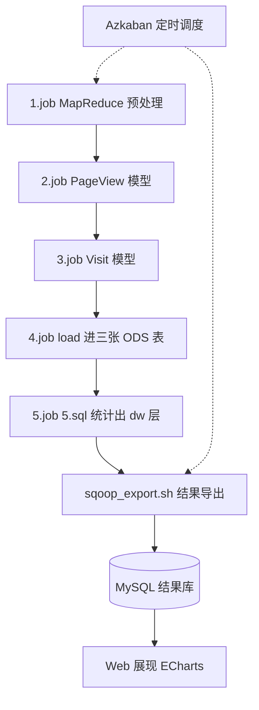

# 网站流量日志分析的入仓与收口：Hive 分区表、HQL 统计与 Sqoop 回 MySQL

> 🔒 安全提示：文中示例的口令/密钥均为课程教学环境演示口径，生产环境的安全要求见《安全与合规须知》。

三个 MapReduce 跑完，手上有三份结果：清洗后的统一日志、PageView 模型、Visit 模型，都是 HDFS 上的行式文本文件。数据还得进 Hive 才好分析，分析的统计结果还得回到 MySQL 才能供报表展示，整条链还得有人按时按序把它跑起来。这一课是流量分析项目的收口：建库建表、load 数据、写 HQL 出各维度统计、Sqoop 导出结果，最后把全部动作串成 Azkaban 的 job 流水线。

## 先给结论

- 三张 ODS 表对应三份 MapReduce 输出：`ods_weblog_origin`、`ods_click_pageviews`、`ods_click_stream_visit`，字段分隔符全部是 `\001`，都带 `datestr` 分区列。
- 数据导入用 `load data local inpath ... overwrite into table ... partition(datestr=...)`，overwrite 保证同分区重跑不翻倍。
- 分析遵循分层：origin 贴源不动，detail 在 origin 上拆出年月日时，dw 层出聚合结果（每小时 pv、每天 pv、人均浏览页数），复杂口径可关联时间维表。
- 结果导出用 Sqoop export，`--fields-terminated-by '\001'` 必须与 Hive 表分隔符一致，脚本收日期参数保证可按天重跑。
- 全链路封装成 1 到 5 号 job 加导出脚本，dependencies 声明依赖，打成 zip 交给 Azkaban 定时调度。

## 入仓第一步：建库建表

建表语句与 MapReduce 输出的列序一一对应，分隔符与预处理约定的 `\001` 一致。在 Hive 命令行里先建专用库再建三张表：

```sql
create database if not exists weblog;
use weblog;

-- 原始访问日志表：对应预处理作业输出，9 列
drop table if exists ods_weblog_origin;
create table ods_weblog_origin(
valid string,
remote_addr string,
remote_user string,
time_local string,
request string,
status string,
body_bytes_sent string,
http_referer string,
http_user_agent string)
partitioned by (datestr string)
row format delimited
fields terminated by '\001';

-- 点击流 pageviews 表：对应 PageView 作业输出，11 列
drop table if exists ods_click_pageviews;
create table ods_click_pageviews(
session string,
remote_addr string,
remote_user string,
time_local string,
request string,
visit_step string,
page_staylong string,
http_referer string,
http_user_agent string,
body_bytes_sent string,
status string)
partitioned by (datestr string)
row format delimited
fields terminated by '\001';

-- 点击流 visit 表：对应 Visit 作业输出，8 列
drop table if exists ods_click_stream_visit;
create table ods_click_stream_visit(
session string,
remote_addr string,
inTime string,
outTime string,
inPage string,
outPage string,
referral string,
pageVisits int)
partitioned by (datestr string)
row format delimited
fields terminated by '\001';
```

三张表就是三条加工线的快照：origin 装「清洗后的明细」，pageviews 装「会话流的访问级明细」，visit 装「会话级汇总」。`datestr` 分区列是按天组织的抓手，每跑完一天的批处理就往对应分区里装一天的数据，查询时按分区裁剪，重算时按分区覆盖。

课程演示现场在这里翻过一次车：没先执行 `use weblog`，三张表全建进了 default 库，只能 drop 掉重建。教训很实在，Hive 的建表语句永远落在当前会话的 database 上，建表前先确认 `show tables` 里查的是哪个库。顺手记下另一类报错：查询时把表名拼错，Hive 会抛 `Error 10001: Table not found`，用 `show tables` 核对拼写即可。

## 数据就位：从 MapReduce 输出到 Hive 表

数据导入前先把三份输出文件放到一个统一目录。课程的整理方式是在服务器上建 `/export/servers/weblogdatas` 目录，把三个作业的输出文件分别重命名后上传：清洗结果命名为 `weblog_origin`，PageView 结果命名为 `pageView`，Visit 结果命名为 `visit`。然后用 load 语句进表：

```sql
load data local inpath '/export/servers/weblogdatas/weblog_origin'
overwrite into table ods_weblog_origin partition(datestr='20130918');

load data local inpath '/export/servers/weblogdatas/pageView'
overwrite into table ods_click_pageviews partition(datestr='20130918');

load data local inpath '/export/servers/weblogdatas/visit'
overwrite into table ods_click_stream_visit partition(datestr='20130918');
```

`load data local inpath` 从客户端本地路径复制文件进表目录并挂到指定分区；`overwrite` 会先清掉该分区旧数据再写入，同一天重跑不会出现数据翻倍。导完先验数据：

```sql
select * from ods_weblog_origin limit 10;
```

查询明细必须带 `limit`，这份数据量很大，全量 select 会把终端刷到停不下来。调试阶段的另一个提效开关是本地模式，让 Hive 对小任务不再提交集群：

```sql
set hive.exec.mode.local.auto=true;
```

还有一种数据就位方式不走本地上传：先在 HDFS 上按用途建好目录，用 `hdfs dfs -put` 把文件放进去，再让表指向这些目录：

```bash
hdfs dfs -mkdir -p /weblog/preprocessed
hdfs dfs -mkdir -p /weblog/clickstream/pageviews
hdfs dfs -mkdir -p /weblog/clickstream/visits
hdfs dfs -put part-m-00000 /weblog/preprocessed
hdfs dfs -put part-r-00000 /weblog/clickstream/pageviews
```

两种方式的差别在「复制还是移动」：`load data local` 是复制，本地文件还在；`load data inpath` 加载 HDFS 路径是移动，原目录数据会消失。若把表建成外部表再指定 `location`，表与数据目录解耦，删表不删数据，生产数仓更常用外部表；课程演示用的是 load 进内部表的写法，两条路按场景选。

## 分层分析：从 origin 到 detail 再到 dw

分析环节按需求写 HQL，资料里的脚本从第 4 号到第 8 号全是基于 Hive 的统计，覆盖小时级 pv、天级 pv、来源统计、级联求和等口径。直接在 origin 上做统计有个问题：时间字段是一整串 `2013-09-18 06:51:35`，每条查询都要现场解析。所以正式分析前先加工一层 detail，把年、月、日、时拆成独立列（本课资料脚本提供该层，建表示例为按本课写法补全）：

```sql
-- detail 层：在 origin 基础上拆出时间粒度列
create table if not exists ods_weblog_detail(
valid string, remote_addr string, remote_user string, time_local string,
request string, status string, body_bytes_sent string, http_referer string,
http_user_agent string,
year string, month string, day string, hour string)
partitioned by (datestr string)
row format delimited fields terminated by '\001';

insert overwrite table ods_weblog_detail partition(datestr='20130918')
select valid, remote_addr, remote_user, time_local, request, status,
       body_bytes_sent, http_referer, http_user_agent,
       substr(time_local, 1, 4), substr(time_local, 6, 2),
       substr(time_local, 9, 2), substr(time_local, 12, 2)
from ods_weblog_origin
where datestr = '20130918';
```

有了 detail，聚合就是干净的 group by。第一组口径是 pv 统计，pv 即 Page View，页面访问次数：

```sql
-- 计算该处理批次（一天）中各小时的 pvs
drop table if exists dw_pvs_everyhour_oneday;
create table if not exists dw_pvs_everyhour_oneday
(month string, day string, hour string, pvs bigint)
partitioned by (datestr string)
row format delimited fields terminated by '\001' stored as textfile;
insert into table dw_pvs_everyhour_oneday partition(datestr='20130918')
select a.month, a.day, a.hour, count(*) as pvs
from ods_weblog_detail a
where a.datestr = '20130918'
group by a.month, a.day, a.hour;

-- 计算每天的 pvs
drop table if exists dw_pvs_everyday;
create table if not exists dw_pvs_everyday(pvs bigint, month string, day string);
insert into table dw_pvs_everyday
select count(*) as pvs, a.month, a.day
from ods_weblog_detail a
group by a.month, a.day;
```

第二组口径带访问者维度。人均浏览页数先按访客聚合再求均值；访客去重数（uv）用 `count(distinct ...)`（uv 示例为按本课写法补全）：

```sql
-- 人均浏览页数：先按访客求 pv，再对访客求均值
drop table dw_avgpv_user_everyday;
create table dw_avgpv_user_everyday(day string, avgpv string);
insert into table dw_avgpv_user_everyday
select '20130918', sum(b.pvs) / count(b.remote_addr)
from (
  select remote_addr, count(1) as pvs
  from ods_weblog_detail
  where datestr = '20130918'
  group by remote_addr
) b;

-- 当天去重访客数 uv
select count(distinct remote_addr) as uv
from ods_weblog_detail
where datestr = '20130918';
```

来源维度同样值得单独一张表：统计每小时各来访 url 产生的 pv 数，能看出外部流量从哪些页面导入。资料脚本里给了表名与口径（示例按本课写法补全）：

```sql
-- 统计每小时各来访 url 产生的 pv 数
drop table if exists dw_pvs_referer_everyhour;
create table dw_pvs_referer_everyhour(
referer_url string, hour string, pvs bigint);
insert into table dw_pvs_referer_everyhour
select http_referer, hour, count(*)
from ods_weblog_detail
where datestr = '20130918'
group by http_referer, hour;
```

口径再复杂一些就轮到级联求和：既要每小时小计又要全天合计时，用 rollup 一条语句同时给出各层汇总，免得重复扫表。多维度统计还有一种组织方式：与时间维表关联查询。时间维表是按年月日时建好的 dim 表，明细表只存基础时间列，层级信息从维表 join 带出来，改口径时不用改明细加工逻辑。课程的真实项目（智慧学成数仓）里就是 `data_dimen.time_dim` 这样的外部表，关联示例为按本课写法补全：

```sql
-- 与时间维表关联：维表带出年份层级，按维表口径聚合
insert overwrite table dw_pvs_everyhour_oneday partition(datestr='20130918')
select t.year, a.day, a.hour, count(*) as pvs
from ods_weblog_detail a
join data_dimen.time_dim t
  on a.month = t.month and a.day = t.day and a.hour = t.hour
where a.datestr = '20130918'
group by t.year, a.day, a.hour;
```

分析产出的 dw 表全部留在 Hive 里，量小、口径稳定，是导出环节的输入。

## Sqoop 导出：结果回 MySQL

统计结果要给业务方看，可视化程序查的是 MySQL 而不是 Hive。Sqoop export 把 Hive 表（本质是 HDFS 上的文件）按分隔符切成行，翻译成 INSERT 写进 MySQL 目标表。课程给的导出脚本骨架：

```bash
#!/bin/bash
# 取昨天日期，支持传参指定某一天，方便按天重跑
if [ $# -eq 1 ]; then
  cur_date=$(date --date="$1" +%Y-%m-%d)
else
  cur_date=$(date -d'1 day' +%Y-%m-%d)
fi
year=$(date --date="$cur_date" +%Y)
month=$(date --date="$cur_date" +%m)
day=$(date --date="$cur_date" +%d)
echo "cur_date:"$cur_date
echo 'sqoop start'
$SQOOP_HOME/bin/sqoop export \
  --connect "jdbc:mysql://hadoop03:3306/weblogview" \
  --username root \
  --password 123456 \
  --table dw_pvs_everyday \
  --columns pvs,month,day \
  --fields-terminated-by '\001' \
  --export-dir /user/hive/warehouse/weblog.db/dw_pvs_everyday
```

MySQL 端预先建好结果库（演示中命名为 `weblogview`）与结果表，导完两张表立即可查：人均浏览页数表对应 `dw_avgpv_user_everyday`，每天页面访问信息表对应 `dw_pvs_everyday`。两个参数决定成败：`--fields-terminated-by '\001'` 必须与 Hive 建表分隔符一致，不一致就整行错列；`--columns` 的顺序必须与 MySQL 表列序或显式列名匹配。脚本开头收日期参数是刻意设计，某一天的数据异常时，传参数单独重导那一天，不用全量重来。

课程的真实工程里这一步由 NiFi 承担：SelectHiveQL 查询 dw 结果表，PutSQL 写入 MySQL，与 Sqoop export 思路一致，只是把「跑脚本」换成了「挂流程」。

## 串成流水线：Azkaban 五个 job

从 MapReduce 预处理到导出 MySQL 是十几个动作的严格序列，靠人按序执行早晚会漏。课程把全部动作写成 5 个 job 加 shell 脚本，打成 zip 上传 Azkaban 定时调度：

```properties
# 1.job：MapReduce 预处理（清洗）
type=command
command=sh 1.sh

# 2.job：PageView 模型，依赖预处理完成
type=command
command=sh 2.sh
dependencies=1

# 3.job：Visit 模型，依赖 PageView 完成
type=command
command=sh 3.sh
dependencies=2

# 4.job：三份模型数据 load 进 Hive 表
type=command
command=sh 4.sh
dependencies=3

# 5.job：Hive 统计分析出 dw 层结果
type=command
command=sh 5.sh
dependencies=4
```

每个 job 的 command 是一段 shell。脚本先设好环境变量与日期变量，再执行对应动作；1 到 3 号分别调 `hadoop jar` 跑三个 MapReduce 作业（预处理 WeblogPreProcess、PageView、Visit），4 号执行 load（画面脚本中 Hive 用绝对路径调用，路径按部署环境替换）：

```bash
#!/bin/bash
# 0.sh：环境与日期变量
export JAVA_HOME=/export/servers/jdk1.8.0_141
export HADOOP_HOME=/export/servers/hadoop-2.6.0-cdh5.14.0
export PATH=$HADOOP_HOME/bin:$HADOOP_HOME/sbin:$JAVA_HOME/bin:$PATH
day01=$(date -d'1 day' +%Y%m%d)

#!/bin/bash
# 4.sh：三张 ODS 表按分区 load 数据
ods_weblog_origin="weblog.ods_weblog_origin"
ods_click_pageviews="weblog.ods_click_pageviews"
ods_click_stream_visit="weblog.ods_click_stream_visit"
HQL_origin="load data inpath \"$log_pre_output\" overwrite into table $ods_weblog_origin partition(datestr='$day01')"
echo $HQL_origin
hive -e "$HQL_origin"
HQL_pvs="load data inpath \"$pageView\" overwrite into table $ods_click_pageviews partition(datestr='$day01')"
hive -e "$HQL_pvs"
HQL_vst="load data inpath \"$visit\" overwrite into table $ods_click_stream_visit partition(datestr='$day01')"
hive -e "$HQL_vst"
```

5 号 job 用 `hive -f 5.sql` 执行统计脚本，内容就是上一节那些建表加插入语句：统计一天访问量、每小时访问量、计算每天 pv。5 号之后再接一个 Sqoop 导出脚本，结果就落进 MySQL。全链路画出来：



五个 job 加导出脚本按依赖串成一条线，Azkaban 每天定时触发。任何一环失败，修好后单独重跑该 job 即可，前面已完成的环节不必重来，这正是整条流水线的设计铁律：每一步做成可重跑的原子任务。

## 常见误区

- **建表前不切库。** 建表语句落在当前 database 上，忘了 `use weblog` 三张表就进 default 库；`show tables` 确认库再动手。
- **同分区重跑用 into。** `insert into` 与 `load ... into` 是追加，重跑一次数据翻倍；批处理脚本里一律 `overwrite`，同分区幂等。
- **Sqoop 导出分隔符与 Hive 表不一致。** Hive 内部表用 `\001`，Sqoop 不指定 `--fields-terminated-by '\001'` 就按默认切，MySQL 端整行错列；列顺序同理要与目标表对齐。
- **分析 SQL 直接扫 origin。** 时间粒度字段每条现场 substr 一遍，重复劳动且慢；先做 detail 层拆好年月日时，dw 层只做聚合。
- **明细查询不加 limit。** 全量 select 在大表上刷屏拖垮终端；验数据永远先 `limit`。
- **load data inpath 当复制用。** 从 HDFS 路径 load 是移动语义，源目录数据会消失；要保留原文件用 `load data local` 或外部表。

## 面试可能被问到的问题

1. 面试官追问：「ODS 表为什么都带 datestr 分区列？」
   答：离线分析按天批处理，分区即天。查询带分区条件时 Hive 只扫对应分区目录，数据裁剪直接生效；重算某一天就覆盖对应分区，天然幂等；存储上一天一个目录，排查与治理都按天定位。
2. 面试官追问：「load data local inpath 和 load data inpath 的区别？」
   答：前者从客户端本地文件系统复制数据进表目录，本地文件保留；后者加载的路径在 HDFS 上，语义是移动，加载后原目录数据消失。跨节点提交时 local 指的是提交客户端的路径，要注意文件确实在执行机器上。
3. 面试官追问：「Sqoop export 的底层原理是什么？」
   答：export 启动一个只有 Map 阶段的 MapReduce 作业，读取 HDFS 上的数据文件，按指定分隔符解析行，并行生成 INSERT 语句通过 JDBC 批量写入 MySQL。map 数决定并行连接数，写入前目标表要先建好；失败重跑容易造成重复行，生产上常用 staging 表先中转再原子切换。
4. 面试官追问：「origin、detail、dw 三层各干什么，能不能压成一层？」
   答：origin 贴源保存清洗后明细，detail 补时间粒度等解析列，dw 出聚合结果。压成一层短期可行，代价是每次统计都重复解析时间字段、口径改动要动明细逻辑、出问题无法分层定位。分层是职责分离，层数按项目规模取舍。
5. 面试官追问：「这条链路的调度为什么用 Azkaban 而不是 crontab？」
   答：五个 job 之间有严格依赖，crontab 只管定时不管依赖，上一环失败下一环照跑会产出脏结果。Azkaban 用 dependencies 声明拓扑顺序，失败即中断下游，重跑单个 job 即可恢复；作业打包上传、界面可见状态，维护成本低。
6. 面试官追问：「分析结果为什么导 MySQL 而不直接让报表查 Hive？」
   答：结果表是聚合后的小表，业务方高频点查，MySQL 的并发点查与现成生态适合；Hive 适合批量扫描，报表高峰直查会冲击数仓资源。导出是单向收口，明细永远留在数仓里。

## 配套资料

- 讲义：`materials/docs/04/智慧学成-第2章-数据仓库.md`，数仓分层（ODS、DW 的 DWD 与 DWM、APP）与维度建模，detail 与 dw 层组织的完整规范。
- 讲义：`materials/docs/04/智慧学成-第2章-ETL.md`，ETL 加载方式（全量加载与增量加载）与结果回写的工程口径。
- 代码：`materials/code/04/_散落资料/` 下的 Hive 建库建表脚本（`data_dimen.time_dim` 等维表的外部表写法）与 `课程访问量-Hive-To-Mysql` NiFi 流程模板（Hive 结果回写 MySQL 的真实工程对照），源文件名带的推广后缀在正文一律略去。
- 说明：三张 ODS 建表语句、load 语句、每小时 pv 与人均浏览页数 SQL、Sqoop 导出脚本骨架与 Azkaban job 链均按课件画面抄录整理；`ods_weblog_detail` 建表插入、uv 统计与时间维表关联示例为按本课写法补全。
