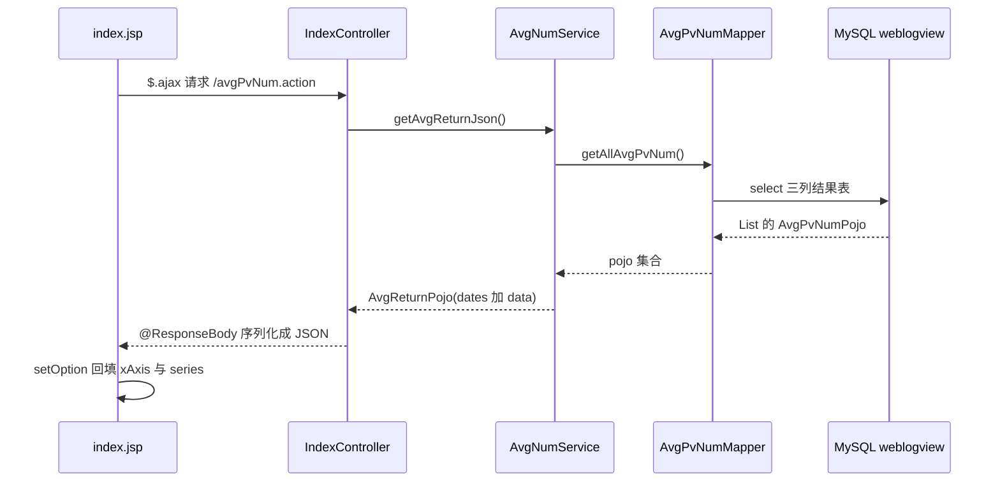

# 统计结果搬上图：三层架构出 JSON，ajax 喂 ECharts 跑通闭环

> 🔒 安全提示：文中示例的口令/密钥均为课程教学环境演示口径，生产环境的安全要求见《安全与合规须知》。

上一课的静态示例证明了「给数组就出图」，但真实的报表页面不能把数字写死在代码里。`weblogview` 库里躺着 Sqoop 导出的两张结果表，一张是每天的页面平均访问量，一张是一周内各页面的访问参数（pv、独立访客、新独立访客），它们要变成页面上的柱状图和折线图，中间必须有人把「查库」到「喂图」这段路打通。本课用一套传统的三层架构加 ajax 把这条链完整搭出来。

## 先给结论

- 闭环只有一环套一环的四段：页面发 ajax 请求 `.action` 路径，Controller 调 Service，Service 调 Mapper 查 MySQL，结果按 ECharts 需要的形状拼成两个数组返回。
- 返回给图表的数据形状是定死的：`dates` 一个数组对应 `xAxis.data`，数值数组对应 `series.data`；后端对象就按这个形状设计，两个 `List<String>` 装进一个返回 pojo。
- Controller 方法上加 `@ResponseBody`，对象由 Spring MVC 自动序列化成 JSON 返回；漏了它，返回值会被当成视图名去找 JSP。
- MyBatis 只写 Mapper 接口和 XML 映射，接口的实现由动态代理在运行时生成，方法名对应 XML 里的 statement id。
- 访问入口是 `/index.action` 先回页面，页面再自己发 ajax 拉数据；直接访问 `.action` 数据接口只会看到一串 JSON。

## 整条链路怎么转

页面上的两个图分别对应两个数据接口：柱状图吃 `/avgPvNum.action`，折线图吃 `/flowNum.action`。以柱状图为例，一次请求从页面到数据库再回来：



关键路径在于形状转换发生在 Service 层：数据库查出来的是一行一行的 pojo，ECharts 要的是两个平行数组，Service 遍历集合把日期塞进 `dates`、数值塞进 `data`，前端拿到就是现成的 `option` 原料。

## 后端三层：Controller、Service、Mapper

工程按 `com.study.weblog` 组织三层包：`controller` 放接口入口，`service` 放业务，`mapper` 放数据访问，`pojo` 放实体。Controller 是最薄的一层，只做转发（代码按画面线抄录，包名按规范改写）：

```java
@Controller
public class IndexController {

    @Autowired
    private AvgNumService avgNumService;

    // 跳转首页，页面里的 ajax 再去请求数据接口
    @RequestMapping("/index.action")
    public String skipIndex() {
        return "index";
    }

    // 数据接口：返回的对象直接序列化成 JSON
    @RequestMapping("/avgPvNum.action")
    @ResponseBody
    public AvgReturnPojo getAvgPvNum() {
        AvgReturnPojo returnPojo = avgNumService.getAvgReturnJson();
        return returnPojo;
    }
}
```

两个方法两种返回，体现了 Spring MVC 的一套约定：返回字符串走视图解析器，找到 `/WEB-INF/jsp` 下的 `index.jsp` 渲染页面；返回对象加 `@ResponseBody`，走消息转换器直接写 JSON 到响应体。页面要的是图，数据接口要的是 JSON，一个 Controller 各管一段。

返回对象的形状就是图表的形状。`AvgReturnPojo` 只有两个集合（按画面线抄录）：

```java
package com.study.weblog.pojo;

import java.util.List;

public class AvgReturnPojo {
    // 横轴日期数组，对应 xAxis.data
    private List<String> dates;
    // 数值数组，对应 series.data
    private List<String> data;

    public List<String> getDates() { return dates; }
    public void setDates(List<String> dates) { this.dates = dates; }
    public List<String> getData() { return data; }
    public void setData(List<String> data) { this.data = data; }
}
```

数据库那一行行的记录对应 `AvgPvNumPojo`，三个成员变量 `id`、`dateStr`、`avgPvNum` 与结果表的三列一一对应（`toString` 等样板方法略）。Service 的实现类承担形状转换，遍历查询结果拆成两个集合：

```java
@Service
public class AvgNumServiceImpl implements AvgNumService {

    @Autowired
    private AvgPvNumMapper avgPvNumMapper;

    @Override
    public AvgReturnPojo getAvgReturnJson() {
        // 从结果表取出全部记录
        List<AvgPvNumPojo> pojoList = avgPvNumMapper.getAllAvgPvNum();
        AvgReturnPojo returnPojo = new AvgReturnPojo();
        List<String> dates = new ArrayList<>();
        List<String> data = new ArrayList<>();
        // 一行记录拆成两个数组各一个元素
        for (AvgPvNumPojo pojo : pojoList) {
            dates.add(pojo.getDateStr());
            data.add(pojo.getAvgPvNum());
        }
        returnPojo.setDates(dates);
        returnPojo.setData(data);
        return returnPojo;
    }
}
```

持久层用 MyBatis，只有接口没有实现类：

```java
package com.study.weblog.mapper;

import java.util.List;

public interface AvgPvNumMapper {
    List<AvgPvNumPojo> getAllAvgPvNum();
}
```

接口对应的 SQL 写在 `resources` 下的映射 XML 里，statement id 与方法名对齐（XML 为按本课写法补全，表结构按画面线实体字段整理）：

```xml
<mapper namespace="com.study.weblog.mapper.AvgPvNumMapper">
    <!-- 查询日均访问量结果表：id、日期、平均访问量三列 -->
    <select id="getAllAvgPvNum" resultType="com.study.weblog.pojo.AvgPvNumPojo">
        select id,
               date_str    as dateStr,
               avg_pv_num  as avgPvNum
        from t_avg_pv_num
        order by date_str
    </select>
</mapper>
```

结果表正是 Sqoop 导出环节写进 `weblogview` 库的数据，查询端只做简单的全表读取加排序，复杂的口径都在 Hive 分析层算完了，这是「重计算放数仓、轻查询给报表」的直接体现。

## 前端：ajax 拉数据回填 setOption

页面侧的套路固定：`init` 先建实例，`$.ajax` 拉数据，`success` 回调里 `setOption` 回填。柱状图的回填代码按画面线抄录：

```javascript
$.ajax({
    type: "post",
    url: "<%=basePath%>/avgPvNum.action",
    dataType: "json",
    success: function(data) {
        myChart.setOption({
            xAxis: {
                data: data.dates
            },
            series: [{
                // 根据名字对应到相应的系列
                name: 'PV',
                data: data.data
            }]
        });
        // 数据加载完成后再调用 hideLoading 方法隐藏加载动画
        myChart.hideLoading();
    }
});
```

页面加载时先给空 `option` 加 `showLoading` 占位，数据回来后 `setOption` 只更新 `xAxis.data` 与 `series.data` 两项，图例、标题等其余配置保持不动，这正是 `setOption` 合并语义的价值：前后两次配置各管各的，互不覆盖。部署后打开页面，柱状图按结果表数据竖起来，悬浮可见日期与数值（演示数据里出现 `20130919`、`13.40`、`17.60` 这样的日均访问量）。

## 第二张图：一周访客趋势折线图

折线图走同一套三层，只是数据更宽：一周访客量表含日期、pv 数、独立访客数、新独立访客等列，页面要同时画「独立访客」与「新独立访客」两条线。标题、图例与工具箱配置按画面线抄录：

```javascript
title: {
    text: '近一周访客数量变化趋势',
    subtext: '动态数据'
},
tooltip: {
    trigger: 'axis'
},
legend: {
    data: ['独立访客', '新独立访客']
},
toolbox: {
    show: true,
    feature: {
        mark: { show: true },
        dataView: { show: true, readOnly: false },
        magicType: { show: true }
    }
},
```

`trigger: 'axis'` 让悬浮时同一日期下两条线的数值一起弹出；`toolbox` 在图右上角挂了一组小工具，`dataView` 可以直接看原始数据，`magicType` 能在柱状图与折线图之间切换。数据接口 `FlowNumMapper.getAllFlowNum()` 查表后同样在 Service 拆集合，返回对象换成 `FlowReturnPojo`，三个集合 `dates`、`uvs`、`new_uvs` 对应页面的三个数组。回填时给 `series` 数组一次放两个元素：

```javascript
$.ajax({
    type: "post",
    url: "<%=basePath%>/flowNum.action",
    dataType: "json",
    success: function(data) {
        myChart4.setOption({
            xAxis: { data: data.dates },
            series: [{
                name: '独立访客',
                data: data.uvs
            }, {
                name: '新独立访客',
                data: data.new_uvs
            }]
        });
        myChart4.hideLoading();
    }
});
```

两个系列的 `name` 与 `legend.data` 完全对应，图例点击即可切换显隐。到这里，从 MySQL 结果表到两类图表的闭环全部走通：关系库里的临时统计结果，经三层架构出 JSON，由 ECharts 成图。

## 部署与联调时的两个现场坑

演示现场翻过的车值得复述。**第一，访问路径写错。** 部署完直接访问 `/avgPvNum.action`，浏览器吐出一串 JSON 而不是页面。数据接口本来就是给 ajax 调的，人的入口是 `/index.action`，先回页面，页面里的脚本自己去请求数据。**第二，热部署时序。** 改完代码热部署后直接刷新页面，图表没更新，实际是浏览器缓存了旧请求结果，强刷或重启验证。工程层面的启示是：页面与数据接口是两个 URL，联调报错时先分清错在「页面没出」还是「数据没来」，浏览器地址栏直接访问数据接口看 JSON，是最快的二分定位法。

MySQL 连接按集群部署填写，示例为按本课写法补全的连接信息（主机、账号按环境替换）：

```properties
jdbc.driver=com.mysql.cj.jdbc.Driver
jdbc.url=jdbc:mysql://node01:3306/weblogview?useSSL=false
jdbc.username=root
jdbc.password=123456
```

## 常见误区

- **忘写 `@ResponseBody`。** 返回对象会被 Spring MVC 当成视图名去解析，页面报视图找不到；只要返回 JSON，方法上必须挂这个注解。
- **把数据接口当页面入口。** 直接访问 `/avgPvNum.action` 只见 JSON；入口永远是跳页面的 `/index.action`，数据由页面里的 ajax 二次拉取。
- **JSON 字段名与前端取值对不上。** 序列化后的字段名由 getter 推导，`getDates` 出 `dates`；后端改字段名前端就拿 `undefined`，`setOption` 静默渲染出空图。前后端的数据契约要先定死。
- **`series.name` 与 `legend.data` 不一致。** 多系列折线图图例空白或点击无效，两边名字逐字对齐即可；`new_uvs` 这类蛇形命名与前端期望字段名同理。
- **数据未到就渲染完整图。** 依赖接口的图先 `showLoading` 占位，`success` 里再 `setOption` 加 `hideLoading`；同步思维写前端会出现「图有了数据没到」的空壳。

## 面试可能被问到的问题

1. 面试官追问：「@ResponseBody 是怎么把对象变成 JSON 的？」
   答：Spring MVC 的返回值处理器识别到该注解后，不再走视图解析，而是交给消息转换器（如 Jackson 的转换器）把对象按请求的 Accept 头序列化成 JSON 写进响应体。能转什么类型取决于类路径上的转换器，引入 Jackson 依赖即可覆盖 pojo 到 JSON 的映射。
2. 面试官追问：「为什么返回两个集合的 pojo，而不直接返回 List 加实体类？」
   答：ECharts 的 `xAxis.data` 与 `series.data` 是两个独立数组，直接给行式列表前端还得自己遍历拆分。后端按图表的数据形状出契约，前端拿到即用，这是接口设计「按消费方形状出数据」的典型体现。
3. 面试官追问：「Mapper 接口没有实现类，为什么能查库？」
   答：MyBatis 在运行时用动态代理生成实现，代理对象根据「接口全限定名加方法名」找到 XML 里对应的 statement，把方法调用翻译成 SQL 执行并映射结果。所以 namespace 必须等于接口全名，statement id 必须等于方法名，这是约定式开发的根基。
4. 面试官追问：「页面要同时展示 pv 与 uv 两类指标，怎么组织图表与接口？」
   答：接口按维度返回多组数组，前端一个实例配多个 series，`legend.data` 列出全部系列名，`tooltip` 用 `trigger: 'axis'` 让同一横坐标下各系列一起提示。如果两类指标数量级差异大，再考虑双 y 轴。
5. 面试官追问：「报表发现某天数据错了，这条链路怎么修复？」
   答：从上游修起：修正 Hive 对应分区后重算 dw 层，Sqoop 用 overwrite 重新覆盖导出那一天，前端无需改动，刷新即是新数据。每一段都可按天幂等重跑，正是数仓链路把「修复」变成「重算」的价值。

## 配套资料

- 代码：`materials/code/04/_散落资料/` 下的 `课程访问量-Hive-To-Mysql` NiFi 流程模板，统计结果写 MySQL 的真实工程对照，本课结果表的数据来源侧；源文件名带的推广后缀在正文一律略去。
- 讲义：`materials/docs/04/智慧学成Web业务后台搭建手册.md`，分析结果落地业务库后由 Web 后台出 API 给前端展示的完整工程范式。
- 说明：Controller、两个返回 pojo、Mapper 接口、前端两段 ajax 与图表头部配置按画面线抄录，源码包名按规范改写为 `com.study.weblog`；Service 实现类、MyBatis 映射 XML、结果表结构与数据源配置为按本课写法补全。
