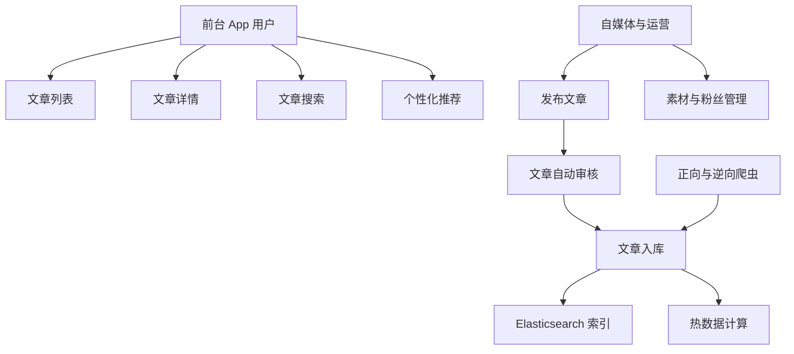
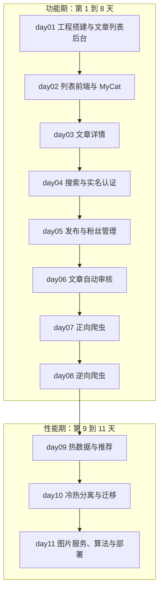

# 对标资讯流 App 的微服务实战：头条类项目 11 天课程大纲总览

阶段四的流量日志分析是离线数仓，数据按天批处理，产出是报表；阶段五换一个世界：做一个类资讯流 App 的完整后台，移动端用户随时随地刷文章，后台要在高并发下完成内容的获取、审核、检索、推荐与展示。开课第一天先把 11 天的全景讲清楚，知道每一段在练什么，后面的日子才不会学成组件罗列。

## 先给结论

- 项目定位是对标主流资讯流 App 的社交媒体项目，技术组合是微服务加大数据：后端主骨架 Spring Boot 2.0 加 Spring Cloud，前台用 Vue 与 Weex，移动端刷资讯、后台管内容。
- 数据侧多组件分工明确：MySQL 主存储，MyCat 分库分表，Redis 承热数据，HBase 承冷数据，MongoDB 存半结构化数据，Elasticsearch 负责搜索。
- 11 天分两大段：前 8 天把功能做全（列表、详情、搜索、发布、审核、爬虫），后 3 天做性能（热数据、冷热分离、图片服务与部署）。
- 每个组件都挂在一个业务问题下面：MyCat 挂在数据量增长，Kafka 挂在审核解耦，HBase 挂在冷热分离，学的不是组件，是「用什么解决什么」。

## 项目定位：一个资讯流 App 的后台长什么样

背景不复杂：智能手机普及之后，人们习惯在碎片时间里用手机获取资讯，移动资讯客户端的需求越来越高，头条类资讯项目正是这个背景下立项的。它采用当下主流的微服务加大数据技术架构，核心目标一句话：获取最新最热的新闻资讯，通过大数据分析用户喜好，做精准推送。

拆成功能域看，系统有两个端与一条内容链。两个端：前台 App 给用户刷文章，后台管理给自媒体与运营发布、管理内容；一条内容链：文章从发布进入系统，经自动审核入库存检索，再按用户喜好推荐出去。整张业务全景：

关键路径是「生产到消费」这条主线：发布与爬虫产出内容，审核保证合规，入库支撑检索与推荐，最后由列表与详情页触达用户。day01 资料包里带了前后台两套项目原型 HTML，先翻原型再定接口，是本项目从第一天就贯彻的工作方式。

## 技术栈总览：组件挂在业务问题上

按领域把 11 天会用到的技术归拢成一张表，每行回答「这个组件替谁干活」：

| 领域 | 组件 | 在项目里干什么 |
|---|---|---|
| 微服务骨架 | Spring Boot 2.0、Spring Cloud | 全部后台服务的基础框架与服务治理 |
| 数据访问 | MyBatis-Plus（工程统一封装） | 各业务模块的持久层与通用配置封装 |
| 前端 | Vue、Weex、ECharts | 文章列表前端、移动端跨端、图文报表 |
| 关系库与分库分表 | MySQL、MyCat | 主存储；数据量上来后做分库分表 |
| 缓存与热数据 | Redis | 登录态、热文章、结合 Trie 做搜索联想 |
| 消息与流计算 | Kafka、Kafka Stream | 文章自动审核的异步解耦、热文章实时计算 |
| 检索 | Elasticsearch | 文章搜索、分词与索引创建、联想优化 |
| 文件存储 | FastDFS | 图片素材保存，与 Redis 整合做图片服务 |
| 冷数据 | HBase | 冷热分离后历史文章的分层存储 |
| 半结构化存储 | MongoDB | 评论类数据的存取封装 |
| 任务与协调 | ZooKeeper、Quartz | 分布式主键生成、爬虫调度 |
| 爬虫 | WebMagic、IP 代理池 | 从内容站正向抓取与逆向更新文章 |
| 部署 | Docker、Shell | 生产部署方案与运维脚本 |

两点提醒帮这份表立得住。**其一，这是清单不是教学顺序。** MyBatis-Plus、Redis 这类基础件从 day01 就在用，HBase 到 day10 才登场；表按领域组织，学的时候跟着业务走。**其二，部分组件的落地代码在各天资料里能找到实物**，比如 Kafka 的封装工具类、Kafka Stream 的流处理配置、HBase 与 MongoDB 的存取封装，后面配套资料一节给了对应位置。

## 11 天路线图：先功能，再自动化，后性能

| 天 | 业务模块 | 关键技术点 |
|---|---|---|
| day01 | 项目搭建与文章列表后台 | Spring Boot 2.0 加 Spring Cloud、JavaConfig 封装、数据库设计与建模 |
| day02 | 文章列表前端 | Vue 与 Weex 跨端框架、MyCat 在项目中的使用 |
| day03 | 文章详情前后端 | ZooKeeper 完成分布式主键生成 |
| day04 | 文章搜索与实名认证 | Elasticsearch 索引创建与分词 |
| day05 | 发布文章与粉丝管理 | FastDFS 保存图片、ECharts 图文报表与 Vue 整合、通用功能前后端封装 |
| day06 | 文章自动审核 | Kafka 生产者与消费者封装、云内容审核接口调用 |
| day07 | 数据自动化之正向爬虫 | WebMagic 加 Quartz 实战、IP 代理池管理 |
| day08 | 逆向爬虫与操作自动化 | 逆向抓取更新已爬文章、WebSocket 使用 |
| day09 | 性能提升之热数据 | 登录与 NoSession、JWT 加 Spring Cache、按用户推荐文章、Kafka Stream |
| day10 | 性能提升之冷热分离 | 冷热数据分层存储改造、HBase 封装、迁移方案设计与实施 |
| day11 | 图片服务、算法与部署 | Trie 加 Redis 搜索联想、加密算法、Docker 与 Shell 部署、项目总结 |

三个阶段各有主线。**功能期（1 到 8 天）** 把一个资讯平台必备的业务块逐个做出来，每块都是「前端页面加后端服务加存储」的完整纵切；**自动化** 藏在功能期后半（审核、爬虫），让机器替代人工干重复活；**性能期（9 到 11 天）** 转向架构治理：热数据进 Redis 加 Kafka Stream，冷数据迁 HBase，最后图片服务、算法优化与生产部署收尾。学法上最忌跨天攒进度：每天结束时当天的模块要能跑，环境问题当天清零，性能期的改造才有地基。

## 把大纲读成一张能力地图

11 天走完，能拿得出手的能力分三层。业务层：能独立搭出资讯流应用的后台，从原型、建模到接口联调全流程走通。组件层：对 Kafka、Elasticsearch、FastDFS、HBase 这批中间件，能说出「什么业务问题驱动引入、引入后怎么封装、边界在哪」。架构层：能讲清楚热冷分离、自动审核、爬虫体系这些方案的取舍，这是面试里把项目讲出彩的底气。带着这三层预期进 day01，学习目标那一课的五条清单就不再抽象。

## 常见误区

- **当成纯 CRUD 项目学。** 前 8 天确实大量增删改查，但审核、爬虫、热冷分离才是区别简历含金量的部分；后半程掉的课没法靠 CRUD 经验补。
- **背组件 API 当学会。** 面试问的是「为什么在这个项目用 Kafka 而不是直接线程池」，答案在业务问题里，不在注解参数里。
- **把 Weex 说成 Vue。** Weex 是阿里的移动端跨端框架，语法与 Vue 一致，但渲染目标是原生组件；两个词在简历与面试里是两个考点。
- **第一天就上分库分表。** 团队规约是单表超过 500 万行或 2GB 才推荐分库分表，MyCat 到 day02 才引入；上来就拆是过度设计，先把规约与建模做扎实。
- **把冷热分离理解成删数据。** 冷数据是分层存储到 HBase 并设计迁移方案，查询侧要能路由；删掉的历史数据既丢失了分析价值也丢掉了合规依据。

## 面试可能被问到的问题

1. 面试官追问：「用一分钟介绍这个项目的整体架构。」
   答：这是一个对标主流资讯流 App 的社交媒体项目，微服务加大数据架构。后台用 Spring Boot 2.0 加 Spring Cloud 拆分服务，MySQL 加 MyCat 分库分表做主存储，Redis 承热数据，HBase 承冷数据，Elasticsearch 做文章搜索，Kafka 负责审核解耦与热文章流计算，FastDFS 存图片，配合爬虫体系补充内容源。业务上覆盖发布、审核、检索、推荐到展示的完整内容链。
2. 面试官追问：「为什么引入 MyCat，应用层感知得到吗？」
   答：单表数据量增长超过规约阈值（500 万行量级）后，B 树索引与单机容量都吃紧。MyCat 作为数据库中间件承接分库分表与读写规则，应用层仍然连接 MyCat 的逻辑库，SQL 写法基本不变，感知主要在分片键选择与跨片查询的限制上。
3. 面试官追问：「Kafka 在项目里承担哪几类职责？」
   答：两类。一是文章自动审核的异步解耦，发布事件进 topic，消费者完成审核流程，削峰且解耦；二是 Kafka Stream 对用户行为做实时流计算，产出热文章数据供推荐使用。项目资料里对应有生产者、消费者与 Stream 的封装工具类。
4. 面试官追问：「冷热分离的方案怎么设计？」
   答：先定冷热判定标准（时间与访问频次），再做分层存储，冷数据迁入 HBase，热数据留在 MySQL 与 Redis；关键是迁移方案的设计与实施，包括迁移任务怎么跑、增量怎么处理、查询侧怎么按冷热路由，迁移过程要可回滚可校验。
5. 面试官追问：「文章详情的分布式主键为什么用 ZooKeeper 方案？」
   答：详情页内容被多个服务实例并发生成，数据库自增在分库分表下会冲突。ZooKeeper 的有序节点特性可以协调出全局唯一 id，方案简单且与项目里已有的协调组件复用；对比雪花算法，它少了一步时钟依赖的讨论，代价是依赖集群可用性。
6. 面试官追问：「爬虫模块怎么处理合规与稳定性？」
   答：只抓公开内容并遵守目标站的 robots 约束，控制抓取频率；稳定性上用 IP 代理池轮换出口避免被封，正向爬虫用 WebMagic 加 Quartz 调度，逆向部分负责更新已抓取文章，抓取与更新通过消息解耦。

## 配套资料

- 代码：`materials/code/05/头条day01/`，内层资料目录含数据库规范设计说明书、PowerDesigner 使用手册与前后台项目原型 HTML；原始目录与文件名冠以项目原名，正文统一以「头条类资讯项目」指代。
- 代码：`materials/code/05/头条day02/`，资料目录下有 mycat 相关配置（`schema.xml`、`rule.xml`、`server.xml`、`sequence_db_conf.properties`）与 weex 组件示例。
- 代码：`materials/code/05/头条day07/` 与 `materials/code/05/头条day12/`，分别是 Kafka 封装工具类与 Kafka Stream 流处理封装；`materials/code/05/头条day14/` 是 HBase 与 MongoDB 存取封装，对应大纲中审核、热数据与冷热分离各环节的实物。
- 说明：11 天路线图与技术栈全貌按大纲画面线与各天资料整理，个别组件的落地细节以对应天的章节为准。
