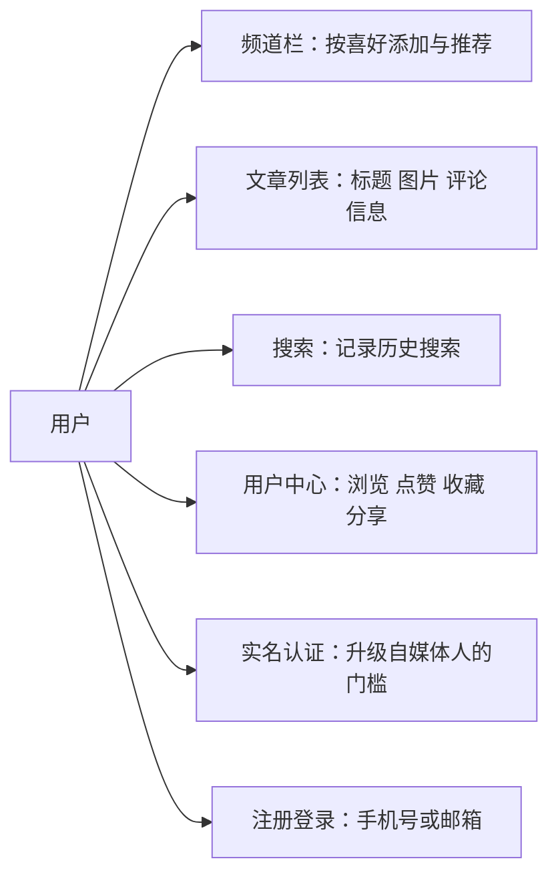
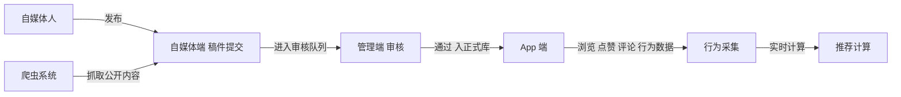

# 把需求写成指标：性能需求与交互需求拆解

功能清单对齐之后，需求还剩两块硬骨头：性能需求与交互需求。性能需求最容易被写成「系统要快、要稳定」，这种没有数字的话既无法验收，也无法倒推架构；交互需求则容易被画成一条从头到尾的直线，漏掉中间的治理环节。这节课把量级与响应时间一项项钉死，再看一条内容在三个端之间的完整旅程。

## 先给结论

- 量级指标三层：用户亿级注册、百万级活跃用户同时在线；文章日增百万、永久存储；行为日增 10 亿、永久存储。
- 响应时间预算：App 首页不超过 2 秒，其他页不超过 3 秒；自媒体端与管理端不超过 5 秒。
- 交互主线：自媒体人经自媒体端提交稿件，爬虫抓取的内容同样进入审核链，两路稿件在管理端审核，通过后进入正式库供 App 端消费。
- 用例图是每端的功能契约：App 端、自媒体端、Admin 端各一张，用户与模块的关联关系一目了然。
- 指标背后的技术答案（缓存、消息队列、搜索引擎、分布式存储）在后续各天落地，本课先把需求立住。

## 用例图：每端一张的契约

课件在功能需求里给每一端配了用例图，作用是清晰描述用户与各模块的关联关系。App 端的用例图把功能点挂在用户身上：频道栏、文章列表、搜索功能、用户中心、实名认证、注册登录；Admin 端的用例图围绕超级管理员展开，挂的是公告管理、敏感词管理、用户管理、内容管理、数据统计、评论管理、用户审核、内容审核。自媒体端同样有自己的一张。App 端那张可以简化如下：



读用例图有两个要点。**每条用例都带着数据要求。** 文章列表要显示标题、图片、评论信息，还要监控文章在 App 内的预期行为；用户中心要收集浏览时间、是否喜欢这类行为信息。功能与数据在用例图里就是绑定的，后面的埋点与表设计都从这里来。**实名认证是角色升级的闸门。** 用户完成身份证或手机号认证后即可成为自媒体人发布文章，这条用例把消费端与生产端连了起来。

## 三层量级与一个响应预算

性能需求在课件里按层级列，翻译成一张表：

| 需求层级 | 指标 | 对系统的压力点 |
|---|---|---|
| 用户层级 | 支持亿级用户，百万级活跃用户同时在线 | 并发读与高可用 |
| 文章层级 | 支持日增百万文章，数据永久存储 | 存储容量与写入吞吐 |
| 行为层级 | 支持日增 10 亿行为数据，永久存储 | 极端写压力与实时计算 |
| 性能需求 | App 首页不超过 2 秒，其他页不超过 3 秒；自媒体端与管理端不超过 5 秒 | 接口响应时间预算 |

数字要会读。亿级用户、百万在线意味着单机单库从第一天起就出局，读请求必须可横向扩展，服务不能有单点，高可用不是口号，是被量级逼出来的底线。日增百万文章、永久存储意味着存储只增不减，按单表 500 万行或 2GB 的分库分表阈值倒推，拆分只是时间问题。日增 10 亿行为数据是最狠的一条，这个写压力同步落库任何关系型数据库都扛不住，必须走异步化。响应预算上，首页 2 秒是体验底线，刷资讯的场景里首页慢一秒，用户就滑走了；后台 5 秒宽松一些，因为后台是重操作低频场景，但不能拿这句话当页面慢的借口。

## 需求倒推技术：每条指标都有去处

指标钉死之后，技术选型就有了推导路径，而不是拍脑袋堆组件。**读多写少的首页与详情，靠缓存扛。** 百万同时在线下，热文章的读取不能次次穿透到数据库，热数据进缓存是响应预算能达标的前提。**日增 10 亿的行为写入，靠消息队列削峰。** 行为先落消息队列，消费端再按自己的节奏入库与计算，削峰填谷之外，还把采集动作与业务逻辑解耦。**搜索，必须走搜索引擎。** 资料里的数据库规范设计说明书索引规约写得明确：页面搜索严禁左模糊或者全模糊，如果需要请走搜索引擎来解决。理由是 B 树索引的最左前缀特性，左边的值不确定时索引失效：

```sql
-- 走不了索引：左模糊，规范说明书明令禁止
select * from article where title like '%推荐%';

-- 能走索引：前缀匹配，且 varchar 索引须指定长度
select * from article where title like '推荐%';
```

所以 App 端的文章搜索注定要交给 Elasticsearch 这类全文检索引擎，这是需求推出来的结论，不是追新。**日增百万文章的永久存储，靠分库分表加分层存储。** 建表规约同时要求，存储长度超过 5000 的字符串定义成 text 并独立成表，避免影响其他字段的索引效率，正文类内容天然适合独立出去，量大之后走向分布式存储与冷热分离：

```sql
-- 正文独立成表：超长文本不与标题、状态等高频字段同表
-- （示例为按本课写法补全，独立成表条款引自规范说明书建表规约原文）
create table article_content(
  article_id bigint not null comment '文章id',
  content longtext comment '正文，独立成表避免拖累主表索引',
  constraint pk_article_content_id primary key (article_id)
) comment '文章正文表';
```

课件把「怎么达到这些需求」的实现放到后续各天去讲，这里先把需求记牢：后面每个技术组件出场时，都能对应回今天的一条指标。

## 交互需求：一篇文章的旅程

交互需求描述三个端之间的协作链路。用户登录 App 查看文章，文章从哪里来：自媒体人先发布文章，进入自媒体端；稿件提交审核，审核通过后 App 端即可查看。除了自媒体人，爬虫系统也会到公开技术社区抓取文章，同样进入审核链，通过后才能在 App 端展示。



这条链有两个读法。**审核是所有内容进入正式库的唯一通道。** 不管内容来自作者还是爬虫，跳过审核就是合规事故。**行为采集是链路的隐藏支线。** App 端的每次浏览与互动都变成行为数据进入推荐计算，交互需求与性能需求里那条日增 10 亿的指标在这里会合。

## 常见误区

- **把「快」当需求。** 没有数字的性能需求无法验收，快必须写成首页 2 秒、其他页 3 秒这样的可测指标，再拆到接口与压测用例上。
- **只盯平均响应时间。** 亿级用户下长尾请求才是体验杀手，验收要看 P95、P99 分位，平均数达标不代表首页不卡。
- **把永久存储理解成不停加盘。** 只增不减的数据要按阈值拆分、按冷热分层；靠加盘硬扛，索引与备份迟早失控。
- **交互链路里漏掉审核。** 画链路图时只画发布到展示，忘了中间的治理关卡；审核缺席，合规与质量都没了抓手。

## 面试可能被问到的问题

1. 面试官追问：「这个项目的性能需求有哪些数字？」
   答：用户层面支持亿级注册用户、百万级活跃用户同时在线；文章层面支持日增百万并永久存储；行为层面支持日增 10 亿行为数据并永久存储；响应时间上 App 首页不超过 2 秒、其他页不超过 3 秒，自媒体端与管理端不超过 5 秒。
2. 面试官追问：「日增 10 亿行为数据，存储方案怎么设计？」
   答：写入侧先过消息队列削峰，消费端异步落库，避免峰值直接压垮数据库；存储上按时间维度分表分片，行为数据只增不改，适合追加型存储与冷热分层；计算侧用流计算实时产出热数据，供推荐使用。
3. 面试官追问：「为什么文章搜索不用 MySQL 的 like？」
   答：规范说明书明确页面搜索严禁左模糊或全模糊，因为 B 树索引有最左前缀特性，左边不确定时索引失效，模糊匹配会退化成全表扫描；like 也做不好分词与相关性排序。所以搜索走 Elasticsearch 这类全文检索引擎，MySQL 只负责结构化存储。
4. 面试官追问：「响应时间指标是怎么定出来的？」
   答：按端与页面重要度定预算：App 首页是产品门面且高频访问，定 2 秒；其他页 3 秒；后台两端是低频重操作场景，定 5 秒。指标定了之后要拆到接口并做压测验证，超预算的接口进入优化清单。
5. 面试官追问：「交互需求里，审核为什么必须放在正式库之前？」
   答：正式库是 App 端唯一取数的地方，审核作为进入正式库的唯一通道，保证用户看到的每条内容都过了合规关；自媒体内容与爬虫内容一视同仁。如果审核后置，违规内容会先到达用户，事后撤回的代价远大于事前拦截。

## 配套资料

- 代码：`materials/code/05/头条day01/`，内层资料目录含数据库规范设计说明书（建表规约、索引规约与分库分表阈值条款为原文引用）与前后台项目原型 HTML；原始目录与文件名冠以项目原名，正文统一以「头条类资讯项目」指代。
- 说明：本课为需求讲解，无源码包；`article_content` 建表示例为按本课写法补全，左模糊与前缀匹配的 SQL 说明引自规范说明书索引规约条款。
