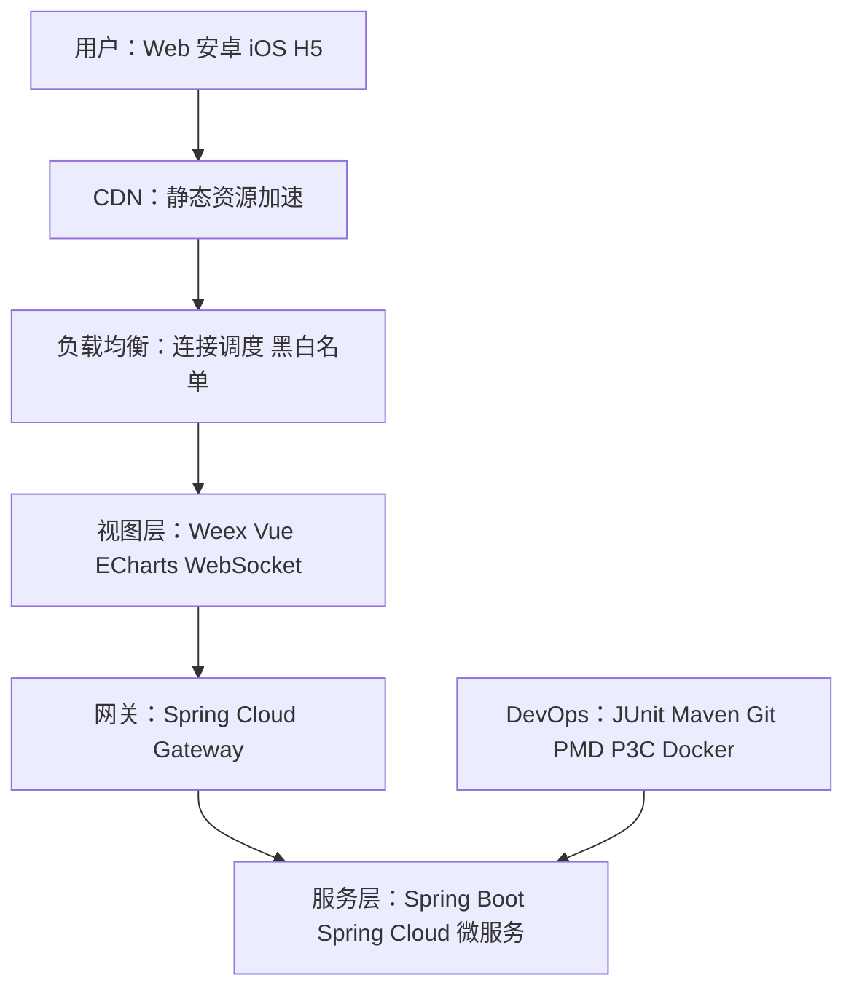
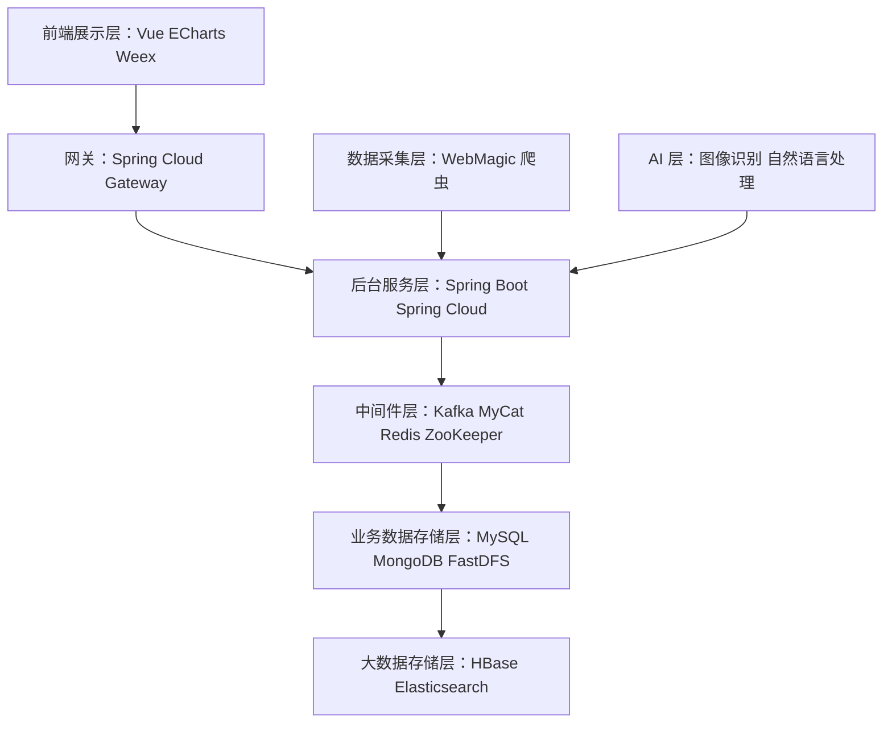

# 技术栈总览：每样技术替哪个需求干活

背组件清单是记不住技术栈的，十几个组件名背完第二天就混。正确的记法是分层加挂靠：先记住课件的三张图（基础六层、服务四层、技术栈分布），再给每样技术挂上一个具体的业务问题。这节课把两张主图走一遍，落到「什么需求用什么技术」的对应表上，与性能需求课里那些指标一一对上号。

## 先给结论

- 课件把技术栈画成三张图：基础六层覆盖用户侧到部署，服务四层覆盖后台与数据，技术栈分布给出全栈九层的全景。
- 前端按端分工：App 端 Weex 加 Vue 加 WebSocket，自媒体端 Vue 加 ECharts，管理端 Vue 加 ECharts 加 WebSocket。
- 后台主骨架是 Spring Boot 加 Spring Cloud 的微服务，统一入口是 Spring Cloud Gateway 网关；数据访问用 MyBatis-Plus 做统一封装。
- 存储按数据特征分工：MySQL、MongoDB、Redis、Elasticsearch、HBase、FastDFS 各管一类数据；中间件层是 Kafka、MyCat、ZooKeeper 加 Redis。
- 每样技术都对应一条需求指标，学的不是组件，是「用什么解决什么」。

## 基础六层：从用户到部署的一条链

基础六层讲的是请求抵达后台之前与代码产出之后的部分，从上往下过一遍。**最上层是 CDN。** 静态资源如 HTML、CSS、JSON、图片放到 CDN 上，用户就近加速访问。**第二层是负载均衡。** 它承担网络连接的调度，还能配置黑名单与白名单，把恶意流量挡在门外。**视图层按端分工。** App 端用 Weex 加 Vue 完成移动端开发，并集成 WebSocket 实现实时消息推送，文章推荐与私信都走这条实时通道；自媒体端用 Vue 加 ECharts，做粉丝画像与数据统计的图表；管理端在 Vue 加 ECharts 之外也挂了 WebSocket。Weex 是阿里出品的跨终端框架，一套代码可以部署到安卓、iOS 与 H5，这是要自研 App 又不想养三端团队的标准解法。**网关层是 Spring Cloud Gateway。** 微服务架构的统一入口，服务路由、流量控制、熔断降级这些能力网关天然支持，客户端不必感知后面有多少个服务。**持续集成侧的配套。** 单元测试用 JUnit 加 Maven 集成实现自动化；静态代码扫描用 PMD 与 P3C，PMD 出自 Apache，P3C 是在 PMD 基础上做的规范增强；版本管理用 Git；整个项目最终用 Docker 部署，配合 Shell 与 Jenkins 做持续集成。



关键路径是用户请求经 CDN 与负载均衡进入视图层，过网关落到微服务，DevOps 体系从代码侧保障质量；网关在这里是唯一的流量入口。

## 服务四层：后台的分工

服务四层是后台的主场。**微服务层。** 用 Spring Boot 快速构建工程，结合 Spring Cloud 全家桶实现个人中心、自媒体、管理中心等微服务，这是后台的骨架；服务治理还包含注册中心与配置中心，它们和网关一起构成服务的治理面。**中台层。** Kafka 与 MyCat 挂在中台：Kafka 负责系统间消息通知、与客户端的消息通知以及实时数据计算；MyCat 负责分库分表，提升数据层性能。**数据层。** MySQL、MongoDB、HBase、Redis、ZooKeeper、FastDFS、Elasticsearch 都在这一层，分工在下一节展开。**周边能力。** 爬虫用 WebMagic 完成内容自动化采集；云端 AI 服务（课件示例为百度 AI）提供图像识别、自然语言处理与图片审核能力，文章审核里图片那一步就靠它；监控体系为微服务保驾护航；Spark、Hive 这类大数据计算组件属于第二阶段，第一阶段只需认识名字。任务调度方面，爬虫的定时抓取由 Quartz 承担，ZooKeeper 则专注分布式协调一类任务。

## 存储与中间件：谁替哪条指标扛活

数据层的分工要回到需求上，每一行都能对回性能需求课的指标：

| 组件 | 所在层 | 解决什么需求 |
|---|---|---|
| MySQL | 业务数据存储 | 结构化主存储，建表规约先行 |
| MyCat | 中间件 | 分库分表，扛日增百万文章的容量增长 |
| Redis | 中间件 | 缓存热数据，扛百万在线的读压力与 2 秒首页预算 |
| Kafka | 中间件 | 消息通知与实时计算，扛日增 10 亿行为的写入削峰 |
| Elasticsearch | 大数据存储 | 全文检索，规范说明书禁左模糊后搜索的正解 |
| HBase | 大数据存储 | 海量与冷数据的分层存储，第一阶段落地的唯一大数据件 |
| MongoDB | 业务数据存储 | 评论类半结构化数据的存取 |
| FastDFS | 文件系统 | 图片素材存储，另有图片格式处理技术做封面加工 |
| ZooKeeper | 中间件 | 分布式协调，含分布式 id 一类任务 |

课件还有一张技术栈分布图，把上面的组件按九层再摆一遍：前端展示层、后台服务层、数据采集层、中间件层、业务数据存储层、大数据存储层、大数据应用层、知识图谱层、AI 层。大数据应用层与知识图谱层的 Spark、Hive、Neo4j 等组件在第一阶段不涉及，大数据存储层里第一阶段只上 HBase，其余留到第二阶段。九层全景可以简化成依赖关系：



箭头表示上层依赖下层，实际调用细节在各天落地时展开；这张图的作用是记住每层有哪些候选组件，遇到需求时知道去哪一层找工具。

技术栈落到工程里，最直观的就是依赖清单（示例为按本课写法补全，版本以各天落地为准）：

```xml
<!-- 主骨架与核心组件依赖，day01 起逐步引入 -->
<dependencies>
    <dependency>
        <groupId>org.springframework.boot</groupId>
        <artifactId>spring-boot-starter-web</artifactId>
    </dependency>
    <dependency>
        <groupId>org.springframework.cloud</groupId>
        <artifactId>spring-cloud-starter-gateway</artifactId>
    </dependency>
    <dependency>
        <groupId>com.baomidou</groupId>
        <artifactId>mybatis-plus-boot-starter</artifactId>
    </dependency>
    <dependency>
        <groupId>org.springframework.boot</groupId>
        <artifactId>spring-boot-starter-data-redis</artifactId>
    </dependency>
    <dependency>
        <groupId>org.springframework.kafka</groupId>
        <artifactId>spring-kafka</artifactId>
    </dependency>
</dependencies>
```

网关的三端路由配置同理，一个入口把 App、自媒体与管理端的请求分发给各自的微服务（示例为按本课写法补全）：

```yaml
spring:
  cloud:
    gateway:
      routes:
        - id: app-route            # App 端接口
          uri: lb://app-service
          predicates:
            - Path=/api/app/**
        - id: wemedia-route        # 自媒体端接口
          uri: lb://wemedia-service
          predicates:
            - Path=/api/wemedia/**
        - id: admin-route          # 管理端接口
          uri: lb://admin-service
          predicates:
            - Path=/api/admin/**
```

## 常见误区

- **把技术栈当背诵清单。** 面试问的是「为什么这里用 Kafka 而不是线程池」，答案在业务问题里；只背组件名，答不出引入理由。
- **把 Weex 说成 Vue。** Weex 是跨终端框架，渲染目标是原生组件；Vue 是前端框架，两者语法相近但定位与考点不同。
- **把二阶段组件当一期任务。** Spark、Hive、Neo4j 一期不落地，大数据存储一期只上 HBase；一上来就学，只会挤占内容链的工期。
- **把网关当可选件。** 微服务架构下没有统一入口，鉴权、路由、限流与黑白名单就得每个服务各做一遍；网关是分工，不是装饰。

## 面试可能被问到的问题

1. 面试官追问：「一分钟概括项目的技术栈。」
   答：前端按端分工，App 端用 Weex 加 Vue 加 WebSocket 跨端开发，自媒体与管理端用 Vue 加 ECharts；后台以 Spring Boot 加 Spring Cloud 微服务为骨架，Spring Cloud Gateway 做统一网关；存储上 MySQL 主存储加 MyCat 分库分表，Redis 承热数据，MongoDB 存评论类数据，Elasticsearch 做检索，HBase 承冷数据，FastDFS 存图片；中间件层 Kafka 负责消息与实时计算，ZooKeeper 做分布式协调；爬虫用 WebMagic，部署用 Docker。
2. 面试官追问：「为什么一个项目要用这么多存储？」
   答：因为数据特征不同。MySQL 管结构化业务数据；Redis 管高频读的热数据；Elasticsearch 管需要分词与相关性排序的搜索；MongoDB 管模式灵活的半结构化数据；HBase 管量极大、写入吞吐高的冷数据；FastDFS 管图片这类文件。按特征选型，才能同时满足性能与成本。
3. 面试官追问：「Kafka 在项目里承担什么职责？」
   答：三类：系统间消息通知、面向客户端的消息通知、实时数据计算。前两类是消息解耦与削峰，日增 10 亿级的行为数据靠它挡住写入峰值；实时计算侧把行为流式加工成热数据，供推荐使用。
4. 面试官追问：「网关解决了什么问题，为什么不在每个服务里自己实现？」
   答：网关统一承接路由转发、鉴权、限流、熔断与黑白名单，客户端只认一个入口。这些横切能力若在每个服务里重复实现，策略不一致且维护成本高；集中到网关后，服务只关心业务逻辑。
5. 面试官追问：「哪些技术第一阶段不会用到？」
   答：大数据应用层的 Spark、Spark Streaming、Hive，知识图谱层的 Neo4j，以及大数据存储层除 HBase 之外的 Sqoop、Kettle、Hadoop 都属第二阶段；第一阶段先掌握内容链与 HBase，二期组件认识名字、知道解决什么问题即可。

## 配套资料

- 代码：`materials/code/05/头条day01/`，内层资料目录含数据库规范设计说明书、PowerDesigner 使用手册与前后台项目原型 HTML；原始目录与文件名冠以项目原名，正文统一以「头条类资讯项目」指代。
- 说明：本课为技术栈总览，无源码包；依赖清单与网关路由示例为按本课写法补全，技术栈分层口径按课件画面线（基础六层、服务四层、技术栈分布）与口播整理。
