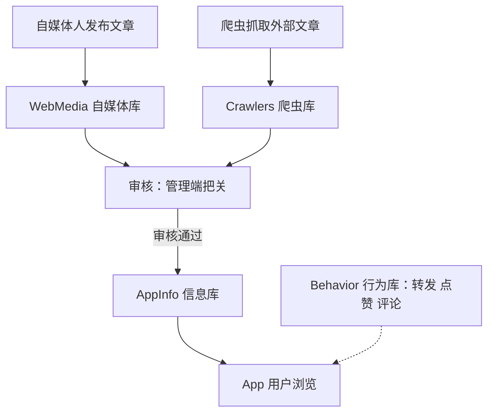

# 数据库设计落地：ER 图建模、五库拆分与 117 张表一次导完

拿到一个资讯类项目，很多人想的是直接写 `CREATE TABLE`，结果建出来的表字段随意命名、缺注释、到处物理外键，等数据量上来再想分库就晚了。环境搭建的第一课不从代码开始，从数据库开始：先把业务抽象成实体模型，再按规范把表建出来，最后把整套脚本导进库里。这一课走完，117 张表就能安安稳稳躺在库里等业务课逐个认领。

## 先给结论

- ER 图用 PowerDesigner 的物理模型来画，业务被划成九个内容块，抽完实体可以一键生成建表 SQL，这套建模思路比手写 SQL 先行更稳。
- 建表与索引要对着数据库规范设计说明书来：`is_xxx tinyint(1)` 表达是否、主键 `pk_` 前缀、唯一索引 `uk_` 前缀、普通索引 `idx_` 前缀、小数一律 decimal。
- 库按业务拆成五个：App 信息库、用户行为库、自媒体库、爬虫库、后台管理库，拆库的目的是分摊服务器的访问压力。
- 全库采用逻辑外键加冗余设计，不建物理外键约束，用空间换查询速度。
- 导入路径：新建数据库 `leadnews`，字符集必须选 `utf8mb4`，执行 SQL 脚本后刷新，117 张表一次到位。

## 用 PowerDesigner 把业务画成 ER 图

ER 图就是实体联系图，一句话说清它的作用：把需求里那些「人、文章、评论」这类名词抽成实体，把实体之间的关系画出来，后面的建表就有了图纸。课件把当前业务的 ER 图按内容分成九块，包括 App 信息、基础数据字典、用户行为、文章发布、文章编辑、自媒体人信息（自媒体人的内容里也包含其文章）、自媒体端管理，以及定时任务相关信息。每块对应一类业务实体，抽实体的过程就是为建表提供依据的过程。

画图用的工具是 PowerDesigner，它是一款数据库建模工具，能从概念数据模型和物理数据模型两个层次做设计。**建表靠物理模型。** 在物理模型里点「表」图标就能创建表，编辑时表名可以写中文别名，字段名必须是英文；主键可以设置自增。**关联靠连线。** 用户与订单是一对多关系，在物理模型里拉一条连接线，双击连线就能配置关联，生成 `FK_Reference_1` 这类外键引用。**出活靠生成。** 关系都设置完，按 `Ctrl + G` 打开 Database 菜单的 Generate Database，选 MySQL，就能生成建表脚本。课件演示生成的脚本长这样：

```sql
drop table if exists t_order;
drop table if exists t_user;
/* Table: t_order */
create table t_order (
  id int not null auto_increment comment '主键自增',
  t_u_id int comment '用户ID',
  order_name varchar(100) comment '订单名称',
  order_status int comment '订单状态',
  create_time datetime comment '创建时间',
  update_time datetime comment '更新时间',
  primary key (id)
) ENGINE=InnoDB DEFAULT CHARSET=utf8mb4;
```

这个演示脚本有两个值得注意的地方：每个字段都带 comment，对应规范说明书「表中每个字段都应当解释该字段的含义」这条强制规约；`t_u_id` 这种字段名直接体现了来源表的痕迹，正是逻辑外键的写法雏形。

## 规范条款怎么落到表上

建模工具解决「画」，规范说明书解决「对」。资料包里的数据库规范设计说明书只讲两块：建表规约与索引规约，参照的是阿里的开发规范，当前大量企业都在遵循，这个项目也是照着做的。落到实操上有几条出现频率最高：

**是否字段有固定写法。** 表达是与否概念的字段必须用 `is_xxx` 命名，类型 `tinyint(1)`，1 表示是，0 表示否，例如逻辑删除字段 `is_deleted`。**索引命名有前缀。** 主键索引叫 `pk_字段名`，唯一索引叫 `uk_字段名`，普通索引叫 `idx_字段名`，看到索引名就知道类型。**数值类型有红线。** 小数类型必须用 decimal，禁止 float 和 double，因为后两者存储时有精度损失，比较时可能得出错误结果。**每张表必备 id 字段**，且字段含义靠 comment 说明，说明书给的正例是：

```sql
comment_num int(11) DEFAULT '0' COMMENT '评论数'
```

索引侧同样有几条硬规约：业务上唯一的字段（含组合）必须建唯一索引，否则应用层校验做得再全也会有脏数据；超过三个表禁止 join，被关联字段的数据类型必须绝对一致；varchar 字段建索引必须指定索引长度，按区分度决定；页面搜索严禁左模糊和全模糊，这类需求应该走搜索引擎解决。还有一条直接约束本课动作的：**单表行数超过 500 万行或者单表容量超过 2GB，才推荐进行分库分表**，预计三年到不了这个量级的表，建表时就不要急着拆。

## 五库拆分与文章数据流

ER 图抽完实体，接下来是分库。项目按业务拆出五个库，拆库的动机很直接：不同业务的读写压力不同，分摊到不同库可以降低单台服务器的访问压力。

| 库 | 存什么 |
|---|---|
| AppInfo 信息库 | 用户信息、文章信息、用户动态、用户评论、用户认证等 |
| Behavior 行为库 | 用户的转发、点赞、评论等行为数据 |
| WebMedia 自媒体库 | 自媒体人发布的文章、账号信息、数据统计、粉丝相关信息 |
| Crawlers 爬虫库 | 从外部技术社区（如 CSDN）爬取的文章，先落这里 |
| Admin 后台管理库 | 后台管理员相关信息 |

文章数据是整个系统的核心数据，它的流转路线决定了很多后续设计。文章的来源有两路：自媒体人发布和爬虫抓取。两路走的是同一条规则：**先进自己的业务库，审核通过之后才允许进入 App 信息库，用户看到的文章全部来自 App 信息库。** 下图把这条流转画了出来：



关键路径在审核那一跳：没过审核的文章永远留在自媒体库或爬虫库里，用户侧不可见。这条规则是后面内容审核课程的业务前提，也是行为库虚线挂在用户侧的原因，行为数据跟着用户在 App 侧产生。

## 冗余设计：用空间换查询时间

这个项目全部采用逻辑外键，没有任何物理主外键约束。这样做一方面是为了查询更快，不用维护约束检查；另一方面分库之后跨库的物理外键本身就无法成立。冗余是配套手段，课件用订单查用户名这个例子讲得非常清楚：

**传统做法只存 ID。** 订单表里存一个用户 ID，想查「这笔订单是谁的」就要拿 ID 去关联用户表，多一次查询。**冗余做法连名称一起存。** 保存订单的时候把用户 ID 和用户名称都写进订单表，之后查订单直接拿到用户名，用户表完全不用碰。规范说明书对冗余字段也给了边界：冗余的对象必须是不频繁修改的字段，且不能是 varchar 超长字段或 text 字段，用户名称恰好两条都满足。什么时候值得冗余，就看这个字段是否高频读取、是否基本一成不变。

## 导入脚本：四步落库

设计讲完就是动手导入。步骤按画面线整理如下：把资料中的 SQL 脚本解压出来；打开 Navicat 连接 MySQL，新建数据库，库名 `leadnews`；字符集一栏注意下拉框，不要选第一个 `utf8`，要选第二个 `utf8mb4`，排序规则对应选一个；确定之后右键运行 SQL 文件，选中脚本执行，刷新即可看到全部表。对应的建库语句是：

```sql
create database leadnews default character set utf8mb4;
```

执行完刷新，117 张表一次导入。第一次看到这个数量不用慌，也不需要现在逐张研究，讲到某一具体业务时才会展开对应表的结构、字段和关系，现在只要表都能进库，这一步就算完成。从导入结果里能看到 `ap_article`、`ap_user_feedback` 这类 `ap_` 前缀的表；按业务板块整理，核心表大致是 `ap_user` 用户、`ap_article` 文章、`ap_channel` 频道、`ap_author` 作者、`ap_comment` 评论这几张，后续文章列表、用户行为、评论等课程都会围绕它们展开（完整表清单以脚本为准）。

## 常见误区

- **字符集选了第一个 utf8。** MySQL 里的 `utf8` 实际最多三字节，存不下 emoji 等四字节字符，必须选 `utf8mb4`；导入前选错，后面文章内容带表情符号就会报错或丢字。
- **预计达不到量级就提前分库分表。** 规范给的阈值是单表 500 万行或 2GB，达不到就先不分；一上来就拆，查询、事务、跨库 join 的复杂度全是自己的负担。
- **手痒补物理外键。** 项目口径是逻辑外键加冗余，查询更快且为分库留了余地；建物理外键会拖慢写入，分库后也无法跨库生效。
- **只导表不接规范。** 表导进去了，新字段却随手用 float、不写 comment、索引随手命名，等遇到精度错误或慢查询再回改，字段改名在预发布环境根本做不了。

## 面试可能被问到的问题

1. 面试官追问：「为什么不建物理外键，用逻辑外键不怕数据不一致吗？」
   答：项目采用逻辑外键加冗余设计，不用物理外键约束主要为了查询性能和分库扩展：物理外键每次写入都有约束检查开销，分库之后跨库外键根本无法建立。一致性靠应用层写入逻辑和冗余字段的选型约束保证，冗余只选不频繁修改、非超长的字段，例如把用户名称随订单落库，查询就不再关联用户表。
2. 面试官追问：「单表多大才需要分库分表？」
   答：规范建议单表行数超过 500 万行或单表容量超过 2GB 才推荐分库分表。如果预计三年后的数据量到不了这个级别，建表时就不要拆，拆得越早，join、事务、跨库查询的复杂度来得越早。
3. 面试官追问：「is_deleted 这种字段为什么规定 tinyint(1)？varchar 不行吗？」
   答：是否语义只有两个值，tinyint(1) 一个字节就够，配合 is_xxx 命名让语义固定：1 是、0 否。用 varchar 存 yes、no 既浪费空间，又没法利用规范里统一的无符号约定，做统计和过滤时也不如数字类型直接。
4. 面试官追问：「文章为什么不在自媒体库里直接给用户看，要绕一次审核？」
   答：文章来源有两路，自媒体人发布和爬虫抓取，内容质量不可控。统一规则是先落各自业务库，审核通过才进 App 信息库，用户只从 App 信息库读文章。这样用户侧数据源单一、内容风险前置拦截，爬虫库和自媒体库相当于待发布区。
5. 面试官追问：「varchar 上建索引为什么必须指定索引长度？」
   答：索引长度与区分度是一对矛盾，全字段建索引浪费空间还拖慢更新。经验上长度 20 的索引区分度就能到 90% 以上，可以用 count(distinct left(列名, 长度))/count(*) 实测后选一个合适的长度，既省空间又保住检索效率。

## 配套资料

- 代码：`materials/code/05/头条day01/`，内层资料目录含数据库规范设计说明书、PowerDesigner 使用手册与前后台项目原型 HTML；原始目录与文件名冠以项目原名，正文统一以「头条类资讯项目」指代。
- 说明：数据库导入脚本与完整建表 SQL 不在本课资料包内，文中脚本片段为按画面线与规范说明书条款补全；五库划分、核心表清单按课件画面线与口播整理。
