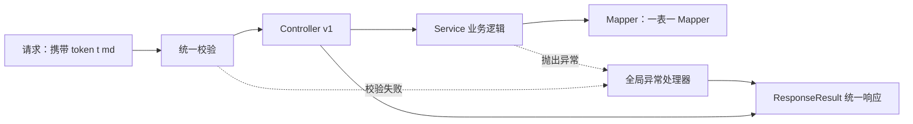

# 后台接口开发规范：分层原则、统一响应与版本化 URL

> 🔒 安全提示：文中示例的口令/密钥均为课程教学环境演示口径，生产环境的安全要求见《安全与合规须知》。

工程导进来了，最想做的事就是立刻写 Controller。但一个十几人的项目如果每个接口的返回结构、路径写法、错误码各自发挥，前端对接时就会陷入「这个接口返回的是对象还是列表」「这个失败 code 是 0 还是 -1」的泥潭。这一课把项目里已经立好的规矩过一遍：怎么分层、按什么顺序开发、URL 与请求头怎么约定、响应与错误码怎么统一。规矩立住了，后面每一天的接口开发都是照图施工。

## 先给结论

- 设计自表现层向下、开发自持久层向上：先写 dao，再写 service，最后写 controller。
- 单一职责是硬要求，一个 Mapper 只对应一张表，功能单一明确，维护与替换才方便。
- 接口版本双保险：包名加 `v1`，URL 也加 `/api/v1/xxx`，为升级维护与 AB 测试留后路。
- 响应统一用 `ResponseResult`，错误码统一定义在 `AppHttpCodeEnum`，不许接口各自造返回结构。
- 自增 ID 出网前要混淆加密，日期字段统一 13 位时间戳，URL 全小写下划线分隔。

## 开发原则：设计向下、开发向上

分层设计的原则是自上而下推：先定表现层的接口长什么样，再定服务层的业务，最后落持久层的表与 SQL。真正动手写代码的顺序要反过来，因为上层调用下层，下层没就绪上层就是空中楼阁，所以按 dao、service、controller 的顺序逐层开发。配套两条约束：**单一职责。** 类或方法提供的功能要单一明确，这是高内聚低耦合的直接体现，一个类包揽增删改查加统计加导出，后期维护与替换都是灾难。**一表一 Mapper。** 一个 Mapper 文件对应一张表，不在里面操作多张表，关联查询场景除外；这条约束保证 Mapper 与表的对应关系干净，排查 SQL 问题时定位极快。**依赖方向。** 上层依赖下层，且依赖接口而非实现，dao 与 service 都先定义接口再写实现类，替换实现时上层代码不动。

## 开发步骤：六步从类定义到单元测试

每个接口的开发步骤是固定的六步。第一步明确类定义，哪些类是重用的（已有类尽量复用，不要再造）、哪些是新增的；第二步明确主键规则，项目里主键有两种：MySQL 自增主键，以及基于 ZooKeeper 的分布式主键，雪花算法的生成方式在第三天展开；第三步 Mapper 实现，涉及 MyCat 分库时还要明确 dataNode 属于哪个节点，在对应节点下插入主键 ID，这部分第二天集成 MyCat 时细讲；第四步 Service 实现业务逻辑；第五步在 apis 工程定义 `@Api` 接口，由具体微服务的 Controller 实现；第六步单元测试验证功能可用。接口定义与实现分离，正是「apis 定义、微服务落地」这个工程结构的落点。

## 接口版本规范：包名与 URL 双重标注

接口可能会有多个版本并存，项目用两处标注把版本钉死。**包名加版本。** 微服务下访问 controller 的包路径带版本号，如 `com.study.headline.article.controller.v1`，出 v2 时并列一个 `controller.v2` 包。**URL 加版本。** 访问具体方法的映射路径同样带版本：

```java
package com.study.headline.article.controller.v1;

import com.study.headline.model.common.dtos.ResponseResult;
import org.springframework.web.bind.annotation.*;

@RestController
@RequestMapping("/api/v1/article")
public class ArticleController {

    /**
     * 保存文章草稿
     */
    @PostMapping("/save")
    public ResponseResult save(@RequestBody ArticleDto dto) {
        // service 层处理业务，这里只做转发与组装
        return ResponseResult.okResult();
    }
}
```

双重标注的理由有两个：升级维护时旧版接口可以继续在线上跑，新版并行开发，流量切完再下线旧版；AB 测试时不同版本路径天然分开，方便按版本灰度。没有这层约定，接口一升级就只能改方法内部逻辑，前后端一起冒险。

## 统一响应与错误码枚举

响应格式的规范只有一句话：只接受 `ResponseResult`，code 码统一在 `AppHttpCodeEnum` 里定义。所有接口返回同一个壳，前端只认一套字段：

```java
package com.study.headline.model.common.dtos;

import com.study.headline.model.common.enums.AppHttpCodeEnum;
import lombok.Data;

@Data
public class ResponseResult<T> {
    private Integer code;        // 错误码，取值来自 AppHttpCodeEnum
    private String errorMessage; // 提示信息
    private T data;              // 业务数据

    public static ResponseResult okResult() {
        return result(AppHttpCodeEnum.SUCCESS, null);
    }

    public static ResponseResult errorResult(AppHttpCodeEnum enums) {
        return result(enums, null);
    }

    public static ResponseResult result(AppHttpCodeEnum enums, T data) {
        ResponseResult result = new ResponseResult();
        result.setCode(enums.getCode());
        result.setErrorMessage(enums.getErrorMessage());
        result.setData(data);
        return result;
    }
}
```

错误码收口成一个枚举，新增状态码只改一处：

```java
package com.study.headline.model.common.enums;

import lombok.AllArgsConstructor;
import lombok.Getter;

@Getter
@AllArgsConstructor
public enum AppHttpCodeEnum {
    SUCCESS(200, "操作成功"),
    SERVER_ERROR(500, "服务器出小差了，请稍后再试"),
    PARAM_INVALID(400, "请求参数格式不正确"),
    FAIL(-1, "操作失败");

    private final int code;
    private final String errorMessage;
}
```

业务失败不再手写 code 与 message，直接 `return ResponseResult.errorResult(AppHttpCodeEnum.PARAM_INVALID);`，前端按 code 分支处理，语义在两边完全一致。

## 请求头约定与全局兜底

接口通用规范里对传输细节做了成体系的约定，这些条目在联调时天天要对照：

| 条目 | 约定 |
|---|---|
| ID 混淆 | 请求与响应中连续增长的自增 ID 需混淆加密后再传输 |
| Date 格式化 | 时间字段统一转成 13 位毫秒时间戳，不传格式化字符串 |
| 字符编码 | 请求与响应字符集统一 UTF-8 |
| 支持多格式 | 响应支持 JSON 与 XML，由请求头 Accept 决定，以 JSON 为主 |
| URL 格式 | 全小写字符，多个单词用下划线分隔 |
| token | 请求头携带用户令牌，JWT 格式 |
| t | 请求头携带当前请求时间，用于请求时效判断 |
| md | 请求头携带参数签名，查询串排序后 MD5 加密 |

自增 ID 直接暴露在互联网上会泄露业务量（今天的订单号能推算明天的量级），所以出网前用 AES 混淆成字符串，工具在 utils 工程里，本课稍后就会讲到。全局异常与统一校验是响应规范的兜底配套，让任何一处抛出的异常都翻译成 `ResponseResult` 而不是堆栈页（工程内完整落地见后续课程，以下为按主流写法补全的可运行示例）：

```java
package com.study.headline.common.exception;

import com.study.headline.model.common.dtos.ResponseResult;
import com.study.headline.model.common.enums.AppHttpCodeEnum;
import org.springframework.validation.FieldError;
import org.springframework.web.bind.MethodArgumentNotValidException;
import org.springframework.web.bind.annotation.ExceptionHandler;
import org.springframework.web.bind.annotation.RestControllerAdvice;

@RestControllerAdvice
public class GlobalExceptionHandler {

    /** 参数校验失败：取第一条校验消息返回 */
    @ExceptionHandler(MethodArgumentNotValidException.class)
    public ResponseResult handleValid(MethodArgumentNotValidException e) {
        FieldError fe = e.getBindingResult().getFieldError();
        String msg = fe == null ? AppHttpCodeEnum.PARAM_INVALID.getErrorMessage() : fe.getDefaultMessage();
        return ResponseResult.result(AppHttpCodeEnum.PARAM_INVALID, msg);
    }

    /** 兜底：未捕获异常统一转为服务器错误码 */
    @ExceptionHandler(Exception.class)
    public ResponseResult handleException(Exception e) {
        return ResponseResult.errorResult(AppHttpCodeEnum.SERVER_ERROR);
    }
}
```

Controller 上加 `@Validated` 或参数上加 `@Valid`，配合 dto 字段的校验注解，非法参数在进入业务逻辑前就被拦下。整条链路如下图：



正常路径一路向下，异常路径虚线汇到全局处理器，最后都从 `ResponseResult` 出口返回；前端只需要解析一种结构。

## 常见误区

- **接口直接返回实体或 Map。** 绕开 `ResponseResult` 各自造返回结构，前端每个接口写一套解析逻辑；正解是所有接口统一返回壳，业务数据放进 data。
- **错误码随手写魔法数字。** `return` 里直接给 `-2`、`5001` 这类字面量，没人说得清含义；code 必须收口到 `AppHttpCodeEnum`，注释写清触发场景。
- **URL 用大写驼峰。** `/api/v1/saveArticle` 违反全小写下划线约定，应写成 `/api/v1/save_article`；客户端对 URL 大小写的处理不一致时极易踩坑。
- **新版本直接改旧方法。** 不加 v2 包与 v2 路径，在 v1 方法里改逻辑，线上旧客户端当场出问题；版本并存与 AB 测试全靠双重版本标注。

## 面试可能被问到的问题

1. 面试官追问：「为什么开发顺序是自底层向上，设计却是自顶层向下？」
   答：设计自上而下是先明确对外契约，接口形态决定服务层职责，服务层职责决定数据层结构；开发自下而上是因为上层依赖下层，dao 与 service 就绪后 controller 才有可调用的能力，按依赖方向推进能让每一层写完就能被上一层验证。
2. 面试官追问：「一个 Mapper 为什么只允许操作一张表？」
   答：Mapper 与表一一对应是单一职责的落地，SQL 归属清晰，出现慢查询或数据问题时定位快；跨表需求由 service 层组合多个 Mapper 完成，只有明确的多表关联场景才允许在 Mapper 里写关联，避免 Mapper 变成大杂烩。
3. 面试官追问：「接口 URL 里为什么都要带版本号？」
   答：两个目的。升级维护：v1 与 v2 并存，旧客户端继续走 v1，新功能在 v2 迭代，流量切换后再下线旧版；AB 测试：按版本路径分流灰度，两版行为可对比。双重标注指包名 controller.v1 与映射路径 /api/v1/xxx 同时携带版本。
4. 面试官追问：「自增 ID 为什么要混淆，不混淆会怎样？」
   答：连续自增的 ID 出网会泄露业务规模与增速，例如订单号能推算每天单量，也可能被恶意遍历抓取。混淆用 AES 加密成无规律字符串返回，前端传回时解密还原，工具是 utils 工程里的 IdUtils，能加密就能解密。
5. 面试官追问：「请求头里的 t 和 md 分别防什么？」
   答：t 存当前请求时间，服务端用它判断请求时效，超出窗口的请求视为过期重放直接拒绝；md 是参数签名，把查询串排序后做 MD5，服务端用同样规则重算比对，防参数被篡改。两者配合 token 一起构成接口的基本安全层。

## 配套资料

- 代码：`materials/code/05/头条day01/`，内层资料目录含数据库规范设计说明书、PowerDesigner 使用手册与前后台项目原型 HTML；原始目录与文件名冠以项目原名，正文统一以「头条类资讯项目」指代。
- 说明：`ResponseResult`、`AppHttpCodeEnum` 的完整源码与全局异常处理器不在本课资料包内，文中类为按画面线规范表与主流写法补全的可运行示例，包名统一改写为 `com.study.headline`；规范条目（ID 混淆、时间戳、请求头、版本标注）按课件画面线整理。
