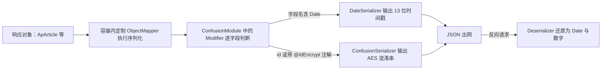

# Jackson 全局定制：ID 混淆与 13 位时间戳的自动序列化

接口通用规范里有两条几乎每个接口都会碰到：自增 ID 在网络上传输不安全，1、2、3 这样连着排暴露在公网，必须加密处理；日期字段不能直接传格式化字符串，要统一转成 13 位毫秒时间戳。麻烦在于这两条都是双向的：后台到前台是加密输出，前台传回后台还要解密还原，日期同样一来一回两个方向。要是在每个接口的每个字段上手写转换，几十个接口下来就是灾难。common 工程的 jackson 包把这两条规范做成了全局自动化：所有响应对象经过统一出口时自动完成序列化与反序列化，业务代码一行不用改。

## 先给结论

- 两个方向都要处理：序列化（出网）把 Date 转成 13 位时间戳、把数字 ID 加密成混淆字符串；反序列化（入网）反向还原成 Date 与数字。
- 组件共九件：`IdEncrypt` 自定义注解、`DateSerializer` 与 `DateDeserializer`、`ConfusionSerializer` 与 `ConfusionDeserializer`、两个 Modifier 过滤器、`ConfusionModule` 模块、`InitJacksonConfig` 配置类。
- 字段自动识别：名为 id 的字段自动走混淆，非 id 字段（如 authorId、channelId）加 `@IdEncrypt` 注解也走混淆；日期字段按字段名识别输出时间戳。
- 生效方式是 `@Configuration` 加 `@Bean ObjectMapper`，注册 `ConfusionModule` 后接管整个框架的 JSON 转换。

## 两条规范为什么手工实现不动

先看问题本身。ID 混淆的加密解密在 utils 工程里已经有现成工具，`IdUtils` 拿到一个 Long 型 ID，先补齐 16 位再走 AES 加密，返回一串无规律的字符串；解密方向成对提供，字符串进来还原成 Long。日期与时间戳的互转更简单，`Date` 对象调一次 `getTime()` 就是 13 位时间戳，反过来 `new Date(时间戳)` 就是日期对象。单点操作都不难，难在规模化：文章、频道、用户、行为几十个响应对象，每个对象里若干个 id 字段和 Date 字段，手工转换意味着每一处出口都写一遍，漏一处就有一条规范失效。

解决思路是把判断逻辑下沉到 JSON 序列化的公共通道里。项目里所有接口的出入 JSON 都经过 Jackson 的 `ObjectMapper`，只要在 `ObjectMapper` 上注册一套「按字段特征自动选择转换器」的规则，规范就变成了全局默认行为。九个组件正是围绕这个通道分工的：

| 组件 | 职责 |
|---|---|
| `IdEncrypt` | 自定义注解，作用在需要混淆的非 id 属性上，位于 model 包 |
| `DateSerializer` | 日期序列化输出，转 13 位时间戳 |
| `DateDeserializer` | 时间戳反序列化输入，还原成日期 |
| `ConfusionSerializer` | 序列化自增数字，输出 AES 混淆串 |
| `ConfusionDeserializer` | 反序列化混淆串，还原成数字 |
| `ConfusionSerializerModifier` | 过滤序列化处理的字段，决定谁用哪个转换器 |
| `ConfusionDeserializerModifier` | 过滤反序列化处理的字段 |
| `ConfusionModule` | 把注解与修改器注册进 Jackson 的模块 |
| `InitJacksonConfig` | 提供自动化配置的 `ObjectMapper`，让各框架自动处理日期与 ID |

## 序列化方向：时间戳与混淆串怎么写出来

序列化器本体都很短。日期序列化器拿到 Date 对象直接取毫秒值写入：

```java
package com.study.headline.common.jackson;

import com.fasterxml.jackson.core.JsonGenerator;
import com.fasterxml.jackson.databind.JsonSerializer;
import com.fasterxml.jackson.databind.SerializerProvider;
import java.io.IOException;
import java.util.Date;

public class DateSerializer extends JsonSerializer<Object> {
    @Override
    public void serialize(Object value, JsonGenerator jsonGenerator,
                          SerializerProvider serializers) throws IOException {
        if (value != null) {
            // Date 直接取毫秒值，即 13 位时间戳
            jsonGenerator.writeNumber(((Date) value).getTime());
            return;
        }
        serializers.defaultSerializeValue(value, jsonGenerator);
    }
}
```

数字混淆序列化器把值转成 Long 后交给 `IdUtils` 加密：

```java
public class ConfusionSerializer extends JsonSerializer<Object> {
    @Override
    public void serialize(Object value, JsonGenerator jsonGenerator,
                          SerializerProvider serializers) throws IOException {
        if (value != null) {
            // 补齐 16 位后 AES 加密，输出无规律字符串
            jsonGenerator.writeString(IdUtils.encryptNumber(Long.valueOf(value.toString())));
            return;
        }
        serializers.defaultSerializeValue(value, jsonGenerator);
    }
}
```

`IdUtils.encryptNumber` 就是工具类一课里 `encrypt(Long)` 方法的本尊，实现是 `String.format("%016d", number)` 补位后走 AES；解密方向的 `decryptLong` 拿字符串还原成 Long，两端对称。顺带说一个被这个设计规避掉的隐患：JavaScript 的 Number 只有 53 位安全整数精度，后端 Long 型主键一旦超过 `2^53 - 1`（雪花算法生成的 ID 必然超过）就会在前端精度失真，主流的兜底方案是 `@JsonSerialize(using = ToStringSerializer.class)` 把 Long 转字符串输出；这里的 AES 混淆把数字变成字符串，精度问题顺带消失，一举两得。

## 反序列化方向：进来的数据怎么还原

前台把混淆串和时间戳传回来时，方向反转，走的是两个反序列化器。按口播逻辑补全的可运行实现如下：

```java
public class DateDeserializer extends JsonDeserializer<Object> {
    @Override
    public Object deserialize(JsonParser p, DeserializationContext ctxt) throws IOException {
        // 13 位时间戳还原成 Date，0 值视为空
        long ts = p.getLongValue();
        return ts == 0 ? null : new Date(ts);
    }
}

public class ConfusionDeserializer extends JsonDeserializer<Object> {
    @Override
    public Object deserialize(JsonParser p, DeserializationContext ctxt) throws IOException {
        // AES 混淆串还原成数字
        String src = p.getText();
        try {
            return IdUtils.decryptLong(src);
        } catch (Exception e) {
            throw new RuntimeException("id 混淆串还原失败", e);
        }
    }
}
```

出网用序列化器，入网用反序列化器，同一字段一来一回各自有出口，业务层拿到的始终是干净的 Date 与数字类型。

## 过滤字段：Modifier 决定谁走哪条路

转换器写好了，问题是 Jackson 怎么知道哪个字段该用哪个。`ConfusionSerializerModifier` 继承 Jackson 原生的 `BeanSerializerModifier`，在序列化前把字段清单过一遍：

```java
public class ConfusionSerializerModifier extends BeanSerializerModifier {
    @Override
    public List<BeanPropertyWriter> changeProperties(SerializationConfig config,
                                                     List<BeanPropertyWriter> writers) {
        for (BeanPropertyWriter writer : writers) {
            String name = writer.getName();
            // 名为 id 的字段，或标注了 @IdEncrypt 的字段，自动混淆
            if ("id".equalsIgnoreCase(name)
                    || writer.getAnnotation(IdEncrypt.class) != null) {
                writer.assignSerializer(new ConfusionSerializer());
            } else if (name.contains("Date")) {
                // 字段名含 Date 的输出 13 位时间戳
                writer.assignSerializer(new DateSerializer());
            }
        }
        return writers;
    }
}
```

规则一目了然：id 字段不需要任何注解，全项目所有主键自动混淆；其他属性想要混淆，加一个 `@IdEncrypt` 注解即可。以文章表为例，id 自动处理，而作者 id、频道 id 这类外键引用同样是连续增长的数字，想混淆就在实体上加注解：

```java
package com.study.headline.model.article.pojos;

import com.study.headline.model.common.dtos.IdEncrypt;
import lombok.Data;

@Data
public class ApArticle {
    private Integer id;          // 主键，自动混淆
    private String title;
    @IdEncrypt
    private Long authorId;       // 非 id 属性，注解触发混淆
    private String authorName;
    @IdEncrypt
    private Integer channelId;
    private String channelName;
    private Short layout;
    private Byte flag;
    private String images;
    private String labels;
    private Integer likes;
    private Integer collection;
}
```

为什么 `@IdEncrypt` 要强调用在非 id 属性上？因为 id 已经被字段名规则自动覆盖，注解是给 authorId、channelId 这类「名字不带 id 但同样是自增外键」的字段准备的。反序列化方向的 `ConfusionDeserializerModifier` 结构相同，把对应的反序列化器赋给这些字段，两侧对称。

## 生效机制：模块注册与 ObjectMapper 装配

最后一个问题是这套规则什么时候生效。串联九件套的是 `ConfusionModule`，它继承 Jackson 的 `SimpleModule`，在构造时把两个 Modifier 挂进来；而让模块真正被框架使用的是 common 工程里的配置类（按画面线整理，包结构按工程口径归位）：

```java
package com.study.headline.common.init;

import com.fasterxml.jackson.databind.ObjectMapper;
import org.springframework.context.annotation.Bean;
import org.springframework.context.annotation.Configuration;

@Configuration
public class InitJacksonConfig {

    @Bean
    public ObjectMapper objectMapper() {
        ObjectMapper objectMapper = new ObjectMapper();
        objectMapper = ConfusionModule.registerModule(objectMapper);
        return objectMapper;
    }
}
```

`@Configuration` 与 `@Bean` 意味着项目启动时这个类被扫描进来，返回的 `ObjectMapper` 进入 Spring 容器，替换掉 Spring Boot 默认提供的那一个。此后 Spring MVC 对所有 `@ResponseBody` 响应做 JSON 转换时用的都是这个定制版 `ObjectMapper`，模块里注册的 Modifier 在每个字段上生效。整条链路如下图：



关键路径是字段判断发生在公共出口而不是业务代码里：Modifier 按字段名与注解分派转换器，时间戳与混淆串从同一个 `ObjectMapper` 流出去，反向请求再从同一个入口流回来。

## 常见误区

- **在字段上到处加 `@JsonFormat`、`@JsonSerialize`。** 这类字段级注解能解决单点问题，但几十个对象重复标注等于把全局规范打散；正解是 Modifier 全局分派，字段注解只留给个别需要特殊格式的特例。
- **只有出网没有入网。** 只写序列化器，前端把混淆串传回来时 Jackson 无法把它绑到 Long 字段上，直接抛类型异常；序列化与反序列化必须成对提供。
- **混淆工具与序列化职责混在一起。** AES 细节放在 `IdUtils`，序列化器只做转发，两者职责分离；把加密代码抄进序列化器里，工具类改动时所有出口要跟着改。
- **拿明文 Long 直接出网。** 超 53 位的雪花 ID 到前端精度失真，且连续增长的规律一并暴露；要么走本工程的 AES 混淆，要么至少用 `ToStringSerializer` 转字符串，不能裸传数字。

## 面试可能被问到的问题

1. 面试官追问：「后端 Long 型 ID 传给前端为什么会精度丢失，怎么解决？」
   答：JavaScript 的 Number 是 IEEE 754 双精度浮点数，只有 53 位安全整数精度，超过 `2^53 - 1` 的 Long 值在 JS 里四舍五入失真，雪花 ID 必然超限。解决方案有三类：字段或全局把 Long 序列化成字符串（ToStringSerializer）、像本工程一样把 ID 混淆成加密字符串、或者用 Jackson 的全局 Long 转 String 配置，核心都是不让 Long 以数字形态出网。
2. 面试官追问：「Jackson 的序列化和反序列化分别怎么定制？」
   答：序列化继承 `JsonSerializer` 并实现 serialize 方法，反序列化继承 `JsonDeserializer` 实现 deserialize 方法；字段级用 `@JsonSerialize`、`@JsonDeserialize` 注解指定，全局则通过 `SimpleModule` 注册 `BeanSerializerModifier` 与 `BeanDeserializerModifier`，在 `changeProperties` 里给 Bean 属性批量赋转换器，模块再由容器内的 `ObjectMapper` 装配生效。
3. 面试官追问：「BeanSerializerModifier 是在什么时机介入的？」
   答：Jackson 为每个类构建序列化元数据时会给属性列表装配 BeanPropertyWriter，Modifier 的 changeProperties 恰好在这个阶段被回调，可以在属性写器上 assignSerializer 替换默认行为；也就是说分派发生在序列化执行之前，每个类只判断一次，运行时零反射查找开销。
4. 面试官追问：「为什么通过 @Bean 替换 ObjectMapper 就能影响所有接口？」
   答：Spring MVC 的消息转换器 MappingJackson2HttpMessageConverter 默认持有容器中的 ObjectMapper 引用，`@ResponseBody` 响应的 JSON 转换都经过它。配置类把定制版 ObjectMapper 注册为容器 Bean，替换默认实例后所有走这个转换器的响应自动带上模块规则，Controller 与 Service 感知不到任何变化。
5. 面试官追问：「ID 混淆用 AES 加密后，性能损耗怎么评估？」
   答：AES 是对称加密，单次加密微秒级，对一篇几十字段的响应对象来说开销可忽略；真正的成本在于加密后字符串比原数字长（补齐 16 位加 Base64 编码），网络与存储体积略增。列表页大量 ID 场景可以评估改用可逆性弱一点的短混淆或字符映射，但安全性要求高的金融、电商项目仍以 AES 这类标准算法为主。

## 配套资料

- 代码：`materials/code/05/头条day01/`，内层资料目录含数据库规范设计说明书、PowerDesigner 使用手册与前后台项目原型 HTML；原始目录与文件名冠以项目原名，正文统一以「头条类资讯项目」指代。
- 说明：jackson 包九个组件的源码不在本课资料包内，文中类为按画面线代码片段整理补全的可运行版本（`BeanSerializerModifier` 的方法签名按 Jackson 原生 API 修正，反序列化器为按口播逻辑补全），包名统一改写为 `com.study.headline`；组件清单、`@IdEncrypt` 注解语义与 `ApArticle` 字段按课件画面线整理。
