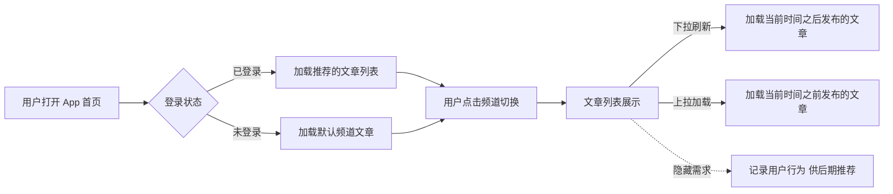

# App 端文章列表：需求分析与支撑它的四张表

环境搭建收尾，项目进入第一个真实业务：App 端的文章列表。项目是移动端资讯应用，首页主体就是一条不断往下滑的文章流，前端负责渲染，后台只需提供接口把文章信息吐回去。一个看似普通的列表，背后要回答三个问题：登录与未登录分别看什么内容，往下滑动怎么继续加载，哪些表在支撑这条流。这一课不写代码，把需求与表结构掰清楚，后面接口定义与工程搭建才有靶子。

## 先给结论

- 列表按三种场景加载：已登录加载推荐文章，未登录加载默认频道文章，点击频道标签按所选频道重新加载。
- 下拉刷新加载当前时间之后发布的最新文章，上拉加载加载当前时间之前发布的文章，时间就是滚动分页的锚点，接口参数里它叫 `maxTime`。
- 一个隐藏需求：列表加载的同时要记录用户行为，这是后期推荐功能的数据基础。
- 四张表支撑这条业务线：`ap_article` 文章信息主表、`ap_user_article_list` 用户文章列表、`ap_show_behavior` 展现行为表、`ap_behavior_entry` 行为实体表。
- 文章数据的直接来源是 `ap_article` 按 `channel_id` 查询，单次条数由接口参数控制。

## 首页文章流的三条加载路径

用户打开 App 首页看到的动作顺序，画成一张加载路径图：



三条路径各有一条数据来源。已登录用户从推荐侧取数：`ap_user_article_list` 表存的是用户与文章的关联，`user_id` 对上 `article_id`，登录后按当前用户查这张表就能拿到推荐结果；未登录用户没有身份，走默认频道的规则查 `ap_article`；点击「推荐」「视频」「热点」「社会」这类频道标签时，`channel_id` 变了，列表就按新频道重新查一遍。行为记录是旁路：每次加载都在后台默默落一条行为数据，用户无感知，但它是推荐功能赖以运转的原材料。

## 上拉与下拉：maxTime 锚点的雏形

移动端信息流不用页码分页，用时间做游标。下拉刷新的动作意图是「给我更新的内容」，加载的是当前时间之后发布的文章；上拉加载的动作意图是「往下翻历史」，加载的是当前时间之前发布的文章。两个方向共用一个锚点时间 `maxTime`：往下翻时把已加载内容里发布时间最小的一条传上去，接口查发布时间早于它的下一批；刷新时把已知最新时间传上去，接口查发布时间晚于它的那一批。锚点在数据里随列表返回，前端记住第一条与最后一条的时间，两个方向就都有了参照。这套语义在接口定义课展开成具体参数，这里先建立直觉：信息流的分页边界来自数据本身，不来自页码。

## ap_article：从始至终的核心表

文章信息表是整个项目分量最重的一张表，从文章发布到列表展示再到数据分析都会用到，字段按画面线整理如下：

| 字段 | 类型 | 说明 |
|---|---|---|
| id | int(11) | 主键，11 位自增 |
| title | varchar(50) | 文章标题 |
| author_id | int(11) | 文章作者 ID |
| author_name | varchar(20) | 作者昵称 |
| channel_id | int(10) | 文章所属频道 ID |
| channel_name | varchar(10) | 频道名称，如 java、php、大数据 |
| layout | tinyint(1) | 布局：0 无图文章，1 单图文章，2 多图文章 |
| flag | tinyint(3) | 标记：0 普通文章，1 热点文章，2 置顶文章，3 大V文章 |
| images | varchar(1000) | 文章图片，多张逗号分隔 |
| labels | varchar(500) | 文章标签，最多 3 个，逗号分隔 |
| likes / collection / comment / views | int(5) | 点赞、收藏、评论、阅读数量 |
| province_id / city_id / county_id | int(11) | 省市区，支持按地域条件查询 |
| created_time | datetime | 创建时间 |
| publish_time | datetime | 发布时间 |
| sync_status | tinyint(1) | 同步状态 |
| origin | tinyint(1) | 来源：自媒体人或爬虫 |

把这张表的骨架还原成建表语句（节选核心字段，完整表结构以资料包内的数据库规范设计说明书为准）：

```sql
-- ap_article 文章信息表核心字段节选，按画面线字段表整理
CREATE TABLE `ap_article` (
  `id`           INT(11)       NOT NULL AUTO_INCREMENT COMMENT '主键',
  `title`        VARCHAR(50)   NOT NULL COMMENT '标题',
  `author_id`    INT(11)       DEFAULT NULL COMMENT '文章作者ID',
  `author_name`  VARCHAR(20)   DEFAULT NULL COMMENT '作者昵称',
  `channel_id`   INT(10)       DEFAULT NULL COMMENT '文章所属频道ID',
  `channel_name` VARCHAR(10)   DEFAULT NULL COMMENT '频道名称',
  `layout`       TINYINT(1)    DEFAULT NULL COMMENT '0 无图 1 单图 2 多图',
  `flag`         TINYINT(3)    DEFAULT NULL COMMENT '0 普通 1 热点 2 置顶 3 大V',
  `images`       VARCHAR(1000) DEFAULT NULL COMMENT '图片 多张逗号分隔',
  `labels`       VARCHAR(500)  DEFAULT NULL COMMENT '标签 最多3个 逗号分隔',
  `likes`        INT(5)        DEFAULT NULL COMMENT '点赞数量',
  `collection`   INT(5)        DEFAULT NULL COMMENT '收藏数量',
  `comment`      INT(5)        DEFAULT NULL COMMENT '评论数量',
  `views`        INT(5)        DEFAULT NULL COMMENT '阅读数量',
  `province_id`  INT(11)       DEFAULT NULL COMMENT '省',
  `city_id`      INT(11)       DEFAULT NULL COMMENT '市',
  `county_id`    INT(11)       DEFAULT NULL COMMENT '区县',
  `created_time` DATETIME      DEFAULT NULL COMMENT '创建时间',
  `publish_time` DATETIME      DEFAULT NULL COMMENT '发布时间',
  `sync_status`  TINYINT(1)    DEFAULT NULL COMMENT '同步状态',
  `origin`       TINYINT(1)    DEFAULT NULL COMMENT '来源：自媒体人或爬虫',
  PRIMARY KEY (`id`),
  -- 列表主查询按频道过滤再按发布时间排序，联合索引直接命中
  KEY `idx_channel_publish` (`channel_id`, `publish_time`)
);
```

几个字段值得展开。**layout 决定前端卡片样式。** 无图、单图、多图三种布局对应信息流里三种卡片形态，前端按这个值选择渲染模板。**flag 是内容等级标记。** 普通文章之外，点击、转发量高的内容会被运营设置为热点、大V或精品，置顶内容混排在信息流里也靠这个标记区分，接口侧不需要单独的置顶查询，返回标记由前端处理展示位置。**images 与 labels 用逗号分隔存单字段。** 展示型字段不做按图片、按标签维度的条件查询，单字段存储省一次关联查询。**created_time 与 publish_time 是两个时间。** 创建是入库动作，发布是对外可见动作，自媒体场景允许存草稿与定时发布，两个时间可以差很远；信息流的时间轴锚在 publish_time 上。origin 字段标来源，自媒体人发文与爬虫抓取的内容最终都进这张表，后期处理策略不同。

## 推荐与行为：另外三张表的位置

`ap_user_article_list` 是推荐结果的落地表，它存的是「把哪篇文章推荐给了哪个用户」；行为侧两张表配合使用，`ap_behavior_entry` 定位行为主体，`ap_show_behavior` 记录具体动作。三张表的骨架如下（节选核心字段，按画面线字段表整理）：

```sql
-- APP 用户文章列表：推荐系统的输出落地
CREATE TABLE `ap_user_article_list` (
  `id`             INT(11)   NOT NULL AUTO_INCREMENT COMMENT '主键',
  `user_id`        INT(11)   DEFAULT NULL COMMENT '用户ID',
  `channel_id`     INT(11)   DEFAULT NULL COMMENT '频道ID',
  `article_id`     INT(11)   DEFAULT NULL COMMENT '文章ID',
  `is_show`        TINYINT(1) DEFAULT NULL COMMENT '是否展示',
  `recommend_time` DATETIME  DEFAULT NULL COMMENT '推荐时间',
  `is_read`        TINYINT(1) DEFAULT NULL COMMENT '是否阅读',
  `strategy_id`    INT(5)    DEFAULT NULL COMMENT '推荐算法',
  PRIMARY KEY (`id`)
);

-- 行为实体表：行为挂设备还是挂用户，由 type 决定
CREATE TABLE `ap_behavior_entry` (
  `id`           INT(11)     NOT NULL AUTO_INCREMENT COMMENT '主键',
  `type`         TINYINT(1)  DEFAULT NULL COMMENT '实体类型 0 终端设备 1 用户',
  `entry_id`     INT(11)     DEFAULT NULL COMMENT '实体ID',
  `created_time` DATETIME    DEFAULT NULL COMMENT '创建时间',
  `burst`        VARCHAR(40) DEFAULT NULL COMMENT '分片',
  PRIMARY KEY (`id`)
);

-- 文章展现行为表：哪篇文章被谁看到、看后点没点
CREATE TABLE `ap_show_behavior` (
  `id`           INT(11)    NOT NULL AUTO_INCREMENT COMMENT '主键',
  `entry_id`     INT(11)    DEFAULT NULL COMMENT '实体ID',
  `article_id`   INT(11)    DEFAULT NULL COMMENT '文章ID',
  `is_click`     TINYINT(1) DEFAULT NULL COMMENT '是否点击',
  `show_time`    DATETIME   DEFAULT NULL COMMENT '文章加载时间',
  `created_time` DATETIME   DEFAULT NULL COMMENT '登录时间',
  PRIMARY KEY (`id`)
);
```

`ap_user_article_list` 里的 strategy_id 记录用的是哪路推荐算法，is_read 记录是否已读，登录用户的首页列表就是按 user_id 从这里取 article_id，再回 `ap_article` 取文章详情。行为侧，`ap_behavior_entry` 的 type 区分实体类型：0 终端设备，1 用户；未登录的行为挂在设备维度，登录后挂在用户维度，行为数据从装机那天就开始积累。`ap_show_behavior` 的 is_click 记录是否点击，show_time 记录文章加载时间。两张表合起来，给后期的热门推荐与个性化推荐铺好数据底座。

## 常见误区

- **列表排序用 created_time。** created_time 是后台入库时间，内容可能囤稿后发布，时间轴会与用户感知错位；信息流排序与锚点一律用 publish_time。
- **频道过滤拿 channel_name 做比较。** 频道名是可改的文案，字符串比较效率还差；查询条件一律用 channel_id，名称仅作展示。
- **把 ap_user_article_list 当收藏表。** 它是推荐系统的输出，存的是系统与用户的关联，带推荐算法 strategy_id；用户主动的收藏、点赞另有行为类表承接，职责不能混。
- **忽略隐藏需求不落行为数据。** 推荐冷启动没有历史行为就无数据可用；展现行为表要在列表接口上线时跟着记录，事后补数据代价极高。

## 面试可能被问到的问题

1. 面试官追问：「信息流分页为什么用时间锚点而不是页码？」
   答：信息流实时变化，新文章不断插入，页码分页会出现重复或漏读，第 2 页可能是第 1 页看过的内容；时间游标的分页边界来自上一页最后一条的发布时间，数据再变也不漂移，实现上只要一个范围条件加排序。
2. 面试官追问：「flag 用一个字段存多种标记，为什么不多建几列？」
   答：普通、热点、置顶、大V属于同一维度的内容等级，tinyint 加枚举值够用且不膨胀表结构；查询按等值过滤可走索引。如果标记之间需要自由叠加组合，才考虑位运算或独立关联表。
3. 面试官追问：「images 与 labels 逗号分隔存一个字段，这是好设计吗？」
   答：字段纯展示、不需要按图片或标签维度做条件查询时，单字段逗号分隔省一次关联查询，是务实取舍；一旦出现「按标签检索文章」的需求，就必须把标签独立成表，逗号分隔无法高效支撑反向查询。
4. 面试官追问：「未登录用户的行为怎么记录？」
   答：行为实体表的 type 支持 0 终端设备、1 用户两种实体，未登录按设备 ID 记录 entry_id，登录后切换为用户维度。行为数据在注册前就开始积累，注册后可与用户关联，推荐系统不缺冷启动素材。
5. 面试官追问：「created_time 与 publish_time 为什么要两个字段？」
   答：created_time 记录入库时间，publish_time 记录对外可见时间。自媒体场景允许存草稿与定时发布，两个时间可以差很远；信息流排序与上拉下拉的锚点用 publish_time，后台管理列表才看 created_time。

## 配套资料

- 代码：`materials/code/05/头条day01/`，内层资料目录含数据库规范设计说明书、PowerDesigner 使用手册与前后台项目原型 HTML（可对照前台原型的首页信息流页面）；原始目录与文件名冠以项目原名，正文统一以「头条类资讯项目」指代。
- 说明：四张表结构不在本课资料包内，字段与类型按画面线表格整理，语义按口播口径展开；文中建表语句为按字段表还原的节选示例，完整建表以资料包内数据库规范设计说明书为准，资料包内无工程源码。
