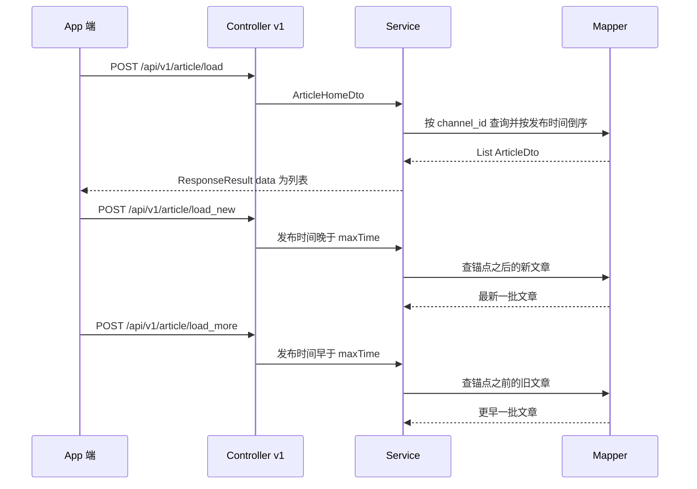

# 文章列表接口定义：load 三兄弟与时间锚点参数

需求与表都清楚了，按接口开发规范先定契约再写代码：apis 工程定义接口，微服务的 Controller 落地实现。文章列表拆成三个列表接口加一个行为接口：首次进入的 load、下拉刷新的 load_new、上拉加载更多的 load_more，外加记录行为的 behavior。这一课把每个接口的路径、入参、出参定死，前后端拿着契约就能并行开工，之后的工程搭建与代码编写只是把契约翻译成实现。

## 先给结论

- 三个列表接口共用一套入参 `ArticleHomeDto`：`channelId` 决定查哪个频道，`maxTime` 是时间锚点，`size` 限制单次条数。
- 路径统一为 `POST /api/v1/article/load`、`/load_new`、`/load_more`，包名与 URL 双重版本标注，呼应接口开发规范课的约定。
- 出参统一 `ResponseResult<List<ArticleDto>>`，壳走全局响应规范，文章视图对象放进泛型列表。
- `maxTime` 的方向语义：load_new 查发布时间晚于锚点的最新文章，load_more 查发布时间早于锚点的更早文章，load 首次加载不依赖方向。
- behavior 接口负责保存用户操作行为，与列表接口职责分离。

## 四个接口：一张表定清楚

| 接口 | 触发场景 | 查询语义 |
|---|---|---|
| load | 进入页面首次加载，或切换频道 | 登录按用户推荐取数，未登录按默认频道取数，按发布时间倒序取最新一批 |
| load_new | 下拉刷新 | 发布时间晚于 maxTime |
| load_more | 上拉加载更多 | 发布时间早于 maxTime |
| behavior | 浏览、点击等用户操作 | 保存行为记录 |

load 有两种身份。登录时从请求头 token 解出用户信息作为查询条件，走推荐数据；未登录不需要任何身份参数，直接加载默认频道数据。两者都返回列表且有条数限制，按 size 分批；频道切换也是 load 的职责，「推荐」「视频」「热点」「社会」这类标签对应不同 channel_id，点谁就按谁的频道重新查一遍。

## 时间锚点：maxTime 决定查哪一段

画一条时间轴把方向语义钉死。用户进入页面时记下时间 A，滚动一段时间后到达时间 B。下拉刷新要的是最新内容，把当前时间作为 maxTime 传上来，查询发布时间晚于它的文章，也就是锚点之后新发布的；上拉加载更多要的是更早内容，把已加载列表里发布时间最小的一条作为 maxTime 传上来，查询发布时间早于它的文章。一句话概括：晚于锚点是刷新，早于锚点是续读。首次进入的 load 不走方向判断，按发布时间倒序取最新 size 条，maxTime 允许为空；锚点本身随响应下发，前端记住第一条与最后一条的时间，两个方向就都有了参照。这套语义与 Mapper 层的 SQL 写法无关，方向判断永远是这两条。

## 入参与出参的落地代码

入参是一个纯参数对象（DTO 源码不在资料包内，按接口定义文档口径与主流写法补全）：

```java
package com.study.headline.model.article.dtos;

import lombok.Data;
import java.util.Date;

@Data
public class ArticleHomeDto {
    private Integer channelId;  // 频道 ID，切换频道时变化
    private Date maxTime;       // 时间锚点，下拉与上拉的方向判断全看它
    private Integer size;       // 单次加载条数，分页上限
}
```

Controller 定义在 article 微服务的 `controller.v1` 包下，三个方法共用入参（ArticleDto 与 service 下一课实现）：

```java
package com.study.headline.article.controller.v1;

import com.study.headline.model.article.dtos.ArticleHomeDto;
import com.study.headline.model.common.dtos.ResponseResult;
import org.springframework.web.bind.annotation.PostMapping;
import org.springframework.web.bind.annotation.RequestBody;
import org.springframework.web.bind.annotation.RequestMapping;
import org.springframework.web.bind.annotation.RestController;
import java.util.List;

@RestController
@RequestMapping("/api/v1/article")
public class ArticleHomeController {

    /** 首次加载：登录走推荐，未登录走默认频道 */
    @PostMapping("/load")
    public ResponseResult<List<ArticleDto>> load(@RequestBody ArticleHomeDto dto) {
        return ResponseResult.okResult(articleHomeService.load(dto));
    }

    /** 下拉刷新：加载 maxTime 之后发布的最新文章 */
    @PostMapping("/load_new")
    public ResponseResult<List<ArticleDto>> loadNew(@RequestBody ArticleHomeDto dto) {
        return ResponseResult.okResult(articleHomeService.loadNew(dto));
    }

    /** 上拉加载更多：加载 maxTime 之前发布的文章 */
    @PostMapping("/load_more")
    public ResponseResult<List<ArticleDto>> loadMore(@RequestBody ArticleHomeDto dto) {
        return ResponseResult.okResult(articleHomeService.loadMore(dto));
    }
}
```

出参里的 `ArticleDto` 是返回给前端的文章视图对象，字段按信息流卡片裁剪：id、title、layout、flag、images、labels、publishTime、channelId、channelName 等。ID 与日期的传输规则不用在 DTO 上做任何处理，jackson 全局序列化课已经把 id 自动混淆、publishTime 自动转 13 位时间戳做成了全局行为，DTO 保持干净。整个接口的调用时序如下：



首屏先拿最新一批，两个方向的续载共用同一套 DTO 与响应壳，前端对三个接口的解析逻辑完全一致。

## 版本约定与规范呼应

接口定义处处对齐规范课立过的规矩。请求方式用 POST，结构化参数走请求体反序列化；URL 全小写、单词下划线分隔；`/api/v1` 与包名 `controller.v1` 双重版本标注，为升级并存与 AB 测试留路；behavior 接口同样按此规范定义，保存用户操作行为，与列表接口职责分离，行为记录失败不应影响列表主流程。对照六步开发法，本课完成的是「明确类定义」这一步：入参出参类已定，接口已在 apis 层面约定，剩下的 Mapper、Service 实现属于后面的步骤。

## 常见误区

- **maxTime 传格式化字符串。** 时间字段统一 13 位毫秒时间戳，反序列化自动还原 Date；传「2026-01-01 12:00:00」这类字符串走不进统一口径，还容易在时区上翻车。
- **用页码分页替代时间锚点。** 信息流持续插入新内容，页码会漂移，第 2 页可能重复第 1 页；游标分页的边界由数据本身决定，不重复也不漏。
- **size 不设上限。** 前端传 size 等于一万服务端也照查，一次拉全量拖垮接口；服务端要给 size 设默认值与上限，超限按上限处理。
- **三个接口各自造参数类。** 入参完全一致，区别只在查询方向，共用 `ArticleHomeDto` 即可；每个接口一套 DTO 会让联调字段对不上，解析逻辑也重复三份。

## 面试可能被问到的问题

1. 面试官追问：「下拉刷新与加载更多为什么拆成两个接口，而不是一个接口加个类型参数？」
   答：两个方向的查询语义、锚点方向与排序方向都相反，拆开后接口职责单一，日志与排查清晰；入参共用 ArticleHomeDto，成本并未增加。合并成 loadType 参数也可行，但每处实现都要写分支判断，可读性下降。
2. 面试官追问：「首次进入没有历史数据，锚点怎么定？」
   答：首次 load 不依赖锚点，按发布时间倒序取最新 size 条，maxTime 允许为空；响应把第一条与最后一条的时间带给前端，下拉用最新一条的时间，上拉用最早一条的时间，续载方向自然确定。
3. 面试官追问：「为什么用 POST 而不是 GET？」
   答：入参是结构化 DTO 且含日期对象，走请求体统一反序列化；GET 拼查询串对复杂对象不友好，URL 也不该携带业务参数。规范约定接口统一 POST /api/v1，联调口径一致。
4. 面试官追问：「ArticleDto 与 ApArticle 实体是什么关系？」
   答：实体面向表，字段全且包含落库字段如 sync_status、origin；DTO 面向接口，按信息流卡片裁剪。两者分开演进互不牵连，出网字段的 ID 混淆与时间戳规则在序列化层统一处理，DTO 不感知。
5. 面试官追问：「/api/v1 的版本标注有什么工程价值？」
   答：升级时 v1、v2 并存，旧客户端继续走 v1，新功能在 v2 迭代，流量切完再下线旧版；AB 测试按路径分流灰度。包名 controller.v1 与 URL /api/v1 双重标注，规范与实现互为呼应。

## 配套资料

- 代码：`materials/code/05/头条day01/`，内层资料目录含数据库规范设计说明书、PowerDesigner 使用手册与前后台项目原型 HTML；原始目录与文件名冠以项目原名，正文统一以「头条类资讯项目」指代。
- 说明：`ArticleHomeDto`、`ArticleDto` 与 Controller 的完整源码不在本课资料包内，文中类为按画面线接口定义文档口径与主流写法补全的可运行版本，包名统一改写为 `com.study.headline`；接口清单、时间锚点语义与版本约定按口播与画面线整理。
