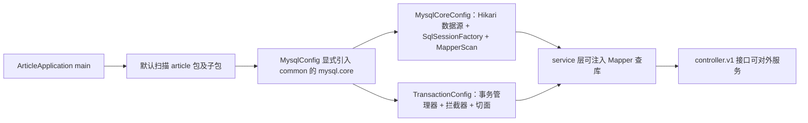

# article 微服务搭建：从空模块到跑通第一个接口

接口契约定好了，得有一个工程来兑现。聚合工程 leadnews 至今只有 common、model、utils、apis 这些共享模块，还没有任何可以启动的业务微服务。这一课创建第一个：leadnews-article，文章相关业务都落在这里。模块从零建起，依赖、包结构、引导类、配置文件逐层补齐，再用一个空接口验证整条链路能跑通，下一课的文章列表代码直接往里填。

## 先给结论

- 在聚合工程下新建 Maven 模块 `leadnews-article`（jar 打包），依赖 model、common、apis 三个内部模块，外加 web 与 test 两个 starter 和 jackson-dataformat-xml。
- web starter 必须排除默认日志绑定，否则 logback 与 log4j2 同时在场，日志体系打架。
- 包结构 `com.study.headline.article` 下分 config、service、controller.v1 三层，引导类 ArticleApplication 放包根。
- config 包里放一个 MysqlConfig，用 `@ComponentScan` 把 common 的 mysql.core 包整体引入，数据源、SqlSessionFactory、Mapper 代理与事务配置启动时一并装配。
- 根目录三份 maven properties 管环境参数，resources 下 application.properties 定端口与应用名，log4j2.xml 管日志输出。

## 建模块与依赖清单

在聚合工程 leadnews 上新建模块，名称 leadnews-article，打包方式 jar，与父工程建立父子关系，模块的版本管理交给父 pom。依赖坐标一次到位（pom 与配置文件不在资料包内，按画面线与主流写法补全的可运行版本）：

```xml
<dependencies>
    <!-- 内部三模块：实体与 pojos、通用装配、接口定义 -->
    <dependency>
        <groupId>com.study</groupId>
        <artifactId>leadnews-model</artifactId>
    </dependency>
    <dependency>
        <groupId>com.study</groupId>
        <artifactId>leadnews-common</artifactId>
    </dependency>
    <dependency>
        <groupId>com.study</groupId>
        <artifactId>leadnews-apis</artifactId>
    </dependency>

    <dependency>
        <groupId>org.springframework.boot</groupId>
        <artifactId>spring-boot-starter-web</artifactId>
        <!-- 排除默认的 logback 日志绑定，工程统一使用 log4j2 -->
        <exclusions>
            <exclusion>
                <groupId>org.springframework.boot</groupId>
                <artifactId>spring-boot-starter-logging</artifactId>
            </exclusion>
        </exclusions>
    </dependency>
    <dependency>
        <groupId>org.springframework.boot</groupId>
        <artifactId>spring-boot-starter-test</artifactId>
        <scope>test</scope>
    </dependency>
    <!-- 支持 XML 响应格式，由请求头 Accept 协商，默认 JSON -->
    <dependency>
        <groupId>com.fasterxml.jackson.dataformat</groupId>
        <artifactId>jackson-dataformat-xml</artifactId>
    </dependency>
</dependencies>
```

内部模块不写 version，聚合工程的 dependencyManagement 统一管理。jackson-dataformat-xml 不是随手加的：接口规范里响应要支持 JSON 与 XML 两种格式、以 JSON 为主，这个依赖把 XML 序列化能力补齐。IDE 偶尔出现新模块不变色的假死，Maven 面板里 reimport 一次即可恢复，依赖就能正常生效。

## 包结构与引导类

包结构按职责切三层，controller 再挂版本号子包：

```text
com.study.headline.article
├── ArticleApplication        // 引导类
├── config                    // 配置类：MysqlConfig
├── service                   // 业务代码
└── controller
    └── v1                    // 对外接口，版本号入包名
```

```java
package com.study.headline.article;

import org.springframework.boot.SpringApplication;
import org.springframework.boot.autoconfigure.SpringBootApplication;

@SpringBootApplication
public class ArticleApplication {
    public static void main(String[] args) {
        SpringApplication.run(ArticleApplication.class, args);
    }
}
```

引导类放包根，`@SpringBootApplication` 默认扫描本类所在包及子包，config、service、controller 全在覆盖范围内。controller 下的 v1 子包是接口规范课定的规矩：包名带版本，URL 也带版本，两层同时落地，出 v2 时并列一个 v2 包即可。

## 三类配置文件：环境参数、应用参数、日志

配置文件分两组。工程根目录放三份环境参数文件，与聚合工程的 Maven profile 机制衔接，新微服务把三份文件整体拷贝再改值，内容主要是各环境不同的日志级别与日志格式：

```properties
# maven_dev.properties / maven_test.properties / maven_prod.properties
# 三份键集合完全一致，值按环境轮换，构建时 filtering 替换占位符
log.level=DEBUG
log.pattern=%d{HH:mm:ss} [%t] %-5level %logger{36} - %msg%n
```

resources 目录下两个文件。application.properties 只定两件事，端口号与应用名称，值从 common 工程 config 目录的统一清单里抄，微服务各自分配、端口不得重复：

```properties
# 端口与应用名：以 common 统一清单为准，示例值按不重复原则取
server.port=9001
spring.application.name=leadnews-article
```

log4j2.xml 承接日志，root 级别引用 `${log.level}`，构建期 filtering 把当前环境的值替换进来：

```xml
<?xml version="1.0" encoding="UTF-8"?>
<configuration status="WARN">
    <appenders>
        <Console name="Console" target="SYSTEM_OUT">
            <PatternLayout pattern="%d{HH:mm:ss} [%t] %-5level %logger{36} - %msg%n"/>
        </Console>
        <RollingFile name="RollingFileInfo" fileName="logs/info.log"
                     filePattern="logs/$${date:yyyy-MM-dd}/info-%i.log">
            <PatternLayout pattern="%d{HH:mm:ss} [%t] %-5level %logger{36} - %msg%n"/>
            <Policies>
                <TimeBasedTriggeringPolicy/>
                <SizeBasedTriggeringPolicy size="100 MB"/>
            </Policies>
        </RollingFile>
    </appenders>
    <loggers>
        <logger name="org.springframework" level="INFO"/>
        <logger name="org.mybatis" level="INFO"/>
        <root level="${log.level}">
            <appender-ref ref="Console"/>
            <appender-ref ref="RollingFileInfo"/>
        </root>
    </loggers>
</configuration>
```

RollingFile 按 100 MB 切分、按日期归档到 logs 目录；spring 与 mybatis 的日志收敛到 INFO，工程自身的类按 root 级别输出，开发期 DEBUG 便于跟踪细节。

## 跨模块装配：common 的 mysql.core 怎么进场

article 工程自己不写数据源与 MyBatis 装配，全部复用 common。config 包里放一个入口类：

```java
package com.study.headline.article.config;

import org.springframework.context.annotation.ComponentScan;
import org.springframework.context.annotation.Configuration;

@Configuration
@ComponentScan("com.study.headline.common.mysql.core")
public class MysqlConfig {
}
```

`@ComponentScan` 把 common 工程的 mysql.core 包整体扫进来：事务管理配置课的 `TransactionConfig`、MySQL 环境配置课的 `MysqlCoreConfig` 都在这个包里，启动时数据源 Bean、SqlSessionFactory、事务三件套一并装配。Mapper 扫描范围由 `MysqlCoreConfig` 上的 `@MapperScan` 指向 model 工程的 mappers 包，article 的 Service 直接注入 ApArticleMapper 就能查库。整条启动装配链如下：



关键路径是两股扫描的汇合：默认包扫描覆盖业务三层，跨模块的 common 装配靠显式 `@ComponentScan` 引入，两股汇合后 service 与 controller 才拿到完整能力。

## 跑通第一个空接口

验证标准很明确：启动不报错，请求接口能拿到统一响应壳。先写一个占位 Controller，业务留到下一课填充：

```java
package com.study.headline.article.controller.v1;

import com.study.headline.model.common.dtos.ResponseResult;
import org.springframework.web.bind.annotation.PostMapping;
import org.springframework.web.bind.annotation.RequestMapping;
import org.springframework.web.bind.annotation.RestController;

@RestController
@RequestMapping("/api/v1/article")
public class ArticleHomeController {

    /** 占位实现：验证启动链路，业务代码下一课填充 */
    @PostMapping("/load")
    public ResponseResult load() {
        return ResponseResult.okResult();
    }
}
```

启动 ArticleApplication，控制台出现 Hikari 池初始化与 Mapper 代理注册的输出，说明 common 装配成功；用 POST 工具请求 `/api/v1/article/load`，拿到 code 为 200 的 ResponseResult，工程就算立住了。往后新增微服务照此模板复制：建模块、拷依赖、拷三份环境文件、建包结构与引导类、引入 common 装配、空接口验证。

## 常见误区

- **忘记排除 starter-logging。** web starter 默认带 logback，与 log4j2 并存时类路径上出现多套日志实现，slf4j 打印多绑定警告并任选其一，级别与格式配置都会失灵；引 web starter 时必须排除默认日志绑定。
- **以为默认包扫描能扫到 common。** `@SpringBootApplication` 只扫引导类所在包及子包，common 模块的配置类不在其下，不显式 `@ComponentScan` 引入，数据源与 Mapper 一个都不会装配，启动直接报找不到 Bean。
- **端口与应用名随手起。** 多个微服务端口冲突会在启动时互相踩踏；端口从 common 统一清单分配，应用名与模块保持一致，后续服务间按名寻址才不乱。
- **三份环境文件只建一份。** 三份 maven properties 键集合必须一致，缺一份时对应 profile 打包出的占位符原样保留，启动即报配置错误；新模块从既有微服务整体拷贝三份文件再改值。

## 面试可能被问到的问题

1. 面试官追问：「新建一个业务微服务，最少要做哪几步？」
   答：聚合工程下建模块并建立父子关系；pom 引内部公共模块与所需 starter，处理日志绑定冲突；定义引导类与包结构；补三份环境参数文件、应用参数与日志配置；把公共装配通过 @ComponentScan 引入；用占位接口验证启动。
2. 面试官追问：「@SpringBootApplication 的默认扫描范围是什么，跨模块配置怎么进入容器？」
   答：默认扫描引导类所在包及子包，等价于 @ComponentScan 指定该包；其他模块的配置类不在范围内，需要在本服务 config 里显式 @ComponentScan 或 @Import 引入。工程里 MysqlConfig 引 common 的 mysql.core 就是这个用法。
3. 面试官追问：「为什么 starter-web 要排除默认日志？」
   答：Spring Boot 默认用 logback，工程统一 log4j2；两套绑定并存时类路径上出现多实现，slf4j 会告警并随机选一个，日志级别与格式配置都可能不生效，所以引入 web starter 必须排除 spring-boot-starter-logging。
4. 面试官追问：「jackson-dataformat-xml 在工程里的作用？」
   答：接口规范要求响应支持 JSON 与 XML，由请求头 Accept 协商，默认 JSON。该依赖补齐 XML 序列化能力，请求头带 application/xml 时返回 XML 结构，不带则走 JSON，接口代码一行不改。
5. 面试官追问：「微服务模块间的依赖方向怎么约束？」
   答：业务服务依赖共享模块 model、common、utils、apis，共享模块绝不反向依赖业务服务，否则编译与部署都会被业务变动绑架；依赖接口而非实现，apis 工程的接口定义由各服务自己落地。

## 配套资料

- 代码：`materials/code/05/头条day01/`，内层资料目录含数据库规范设计说明书、PowerDesigner 使用手册与前后台项目原型 HTML；原始目录与文件名冠以项目原名，正文统一以「头条类资讯项目」指代。
- 说明：leadnews-article 模块的 pom、引导类、MysqlConfig 与配置文件不在本课资料包内，文中内容为按画面线与主流写法补全的可运行版本，包名统一改写为 `com.study.headline`；依赖清单（内部三模块、web 排除日志、test、jackson-dataformat-xml）、application.properties 两项与 log4j2 关键节点按画面线整理。
