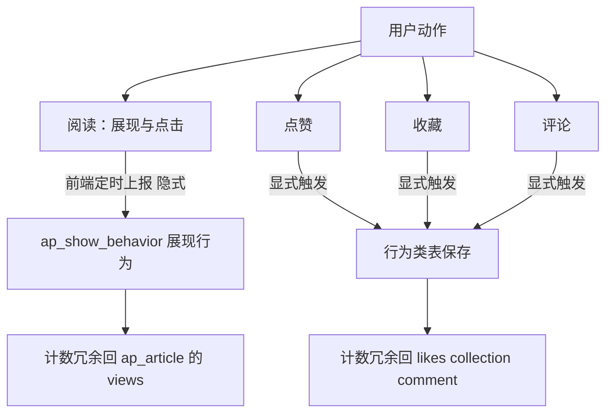

# 用户行为功能：把「谁看了什么」记下来的设计思路

列表接口跑通当天，还有一条藏在需求里的旁路要开工：行为记录。需求分析课点过一句，行为数据是推荐功能赖以运转的原材料；没有它，推荐侧永远攒不出冷启动素材。这一课只做思路分析不写实现：四类行为怎么采集、行为主体怎么定位、为什么阅读数要冗余回文章表、行为接口除了保存还要支撑什么。想清楚这些，下一课的代码就是照着图纸施工。

## 先给结论

- 行为分四类：阅读（含展现与点击）、点赞、收藏、评论；阅读是隐式行为，前端定时上报，其余是显式行为，用户主动触发。
- 行为主体由 ap_behavior_entry 定位：type 区分 0 终端设备、1 用户，entry_id 存设备 ID 或用户 ID；主体表与具体行为分离，一个行为实体可被多种用户行为引用。
- 展现行为落 ap_show_behavior：entry_id、article_id、is_click、show_time；保存前按文章 ID 查重，已存在的从列表剔除再入库。
- 阅读数等计数冗余回 ap_article 的 views、likes、collection、comment 列，列表渲染不实时聚合行为表。
- behavior 接口除了保存行为，还要支撑详情页回显：用户是否已点赞、已收藏，按钮初始态靠反查行为数据。

## 隐藏需求为什么必须跟着列表上线

接口定义课立契约时，四个接口里行为接口 behavior 单独占一席，职责是保存用户操作行为，与列表接口职责分离。把它放进首版不是锦上添花：推荐侧的 ap_user_article_list 表存「把哪篇文章推荐给了哪个用户」，这份数据没有别的来源，只能靠行为慢慢积累。冷启动阶段新用户没有任何历史，推荐系统更是全靠行为数据才能起步。

采集动作对用户完全无感。用户查看文章时，前端定时往后台传一组数据，内容就两样：设备 ID 与文章列表。后台经过业务判断后保存用户行为。上报发生在列表加载的瞬间，用户既不用点任何按钮，也感知不到记录的发生，这正是「隐藏需求」三个字的由来。

## 四类行为与两种采集方式

行为按触发方式分两派。阅读是隐式行为：文章出现在屏幕上算展现，用户点进去算点击，全程不需要用户表态，由前端定时上报；点赞、收藏、评论是显式行为，每一次都是用户主动触发的动作，走单独的保存接口。两派落表的位置不同：展现与点击进 ap_show_behavior，显式行为另有行为类表承接，各表职责不能混，需求分析课的误区清单里专门点过 ap_user_article_list 不是收藏表。

计数随之分家。阅读量记在 ap_article 的 views 列，点赞、收藏、评论分别对应 likes、collection、comment 三列，行为流水在行为表、计数冗余在文章表，两边分工后面单独展开。整个采集链路如下：



关键路径看隐式那一支：它不依赖用户配合，数据从装机那天就开始积累，是整个行为体系里唯一全天候运转的采集器。

## 行为主体：一张 entry 表解决「谁在操作」

记录行为前得先回答一个问题：这条行为挂谁头上。落库流程的前三步专门处理这件事：获取当前用户信息，获取设备 ID，然后拿用户 ID 与设备 ID 去查行为实体。注意这里是「或」的关系：未登录用户没有账号，但一定有设备 ID；登录用户可以不带设备 ID。两者必须占其一，任何一个都能定位行为主体。

行为实体落在 ap_behavior_entry 表，字段极简：type 标实体类型，0 是终端设备，1 是用户；entry_id 存实体 ID，设备维度存设备号，用户维度存用户 ID；created_time 记创建时间；还有一个分片字段，为数据量上来之后做分表预留，前期用不到。设备 ID 是手机的唯一编号，从前端或安卓、iOS 侧取到后传给后端，移动端项目天然拿到这个值，后端不必操心怎么生成。

单独设一张主体表而不是把 user_id 直接塞进行为表，是这套设计的精髓。一个主体会被多种行为反复引用：展现行为、显式行为都要挂到同一个实体上，主体表把「谁在操作」去重存储，行为表只记「做了什么」，两边用 entry_id 关联。设备维度的价值在未登录场景：没注册的用户也要按设备号积累行为，注册之后主体从设备切到用户，行为数据不中断，推荐系统从装机那一刻起就有素材可用。保存行为时传参用 DTO 承载：

```java
package com.study.headline.model.behavior.dtos;

import lombok.Data;
import java.util.List;

@Data
public class ShowBehaviorDto {
    /** 设备 ID：前端从安卓或 iOS 侧取到后传给后端 */
    private String equipmentId;
    /** 本次加载的文章 ID 列表 */
    private List<Integer> articleIds;
}
```

两张表的骨架按画面线还原如下（节选核心字段，与需求分析课的口径一致）：

```sql
-- 行为实体表：行为挂设备还是挂用户，由 type 决定
CREATE TABLE `ap_behavior_entry` (
  `id`           INT(11)     NOT NULL AUTO_INCREMENT COMMENT '主键',
  `type`         TINYINT(1)  DEFAULT NULL COMMENT '实体类型 0 终端设备 1 用户',
  `entry_id`     INT(11)     DEFAULT NULL COMMENT '实体ID',
  `created_time` DATETIME    DEFAULT NULL COMMENT '创建时间',
  `burst`        VARCHAR(40) DEFAULT NULL COMMENT '分片',
  PRIMARY KEY (`id`)
);

-- 文章展现行为表：哪篇文章被谁看到、看后点没点
CREATE TABLE `ap_show_behavior` (
  `id`           INT(11)    NOT NULL AUTO_INCREMENT COMMENT '主键',
  `entry_id`     INT(11)    DEFAULT NULL COMMENT '实体ID',
  `article_id`   INT(11)    DEFAULT NULL COMMENT '文章ID',
  `is_click`     TINYINT(1) DEFAULT NULL COMMENT '是否点击',
  `show_time`    DATETIME   DEFAULT NULL COMMENT '文章加载时间',
  `created_time` DATETIME   DEFAULT NULL COMMENT '创建时间',
  PRIMARY KEY (`id`)
);
```

## 展现行为的五步落库流程

行为实体查到之后，落一条展现行为还有两步。第四步获取前端传来的文章 ID 列表，这份列表随加载请求一起来；第五步拿文章 ID 列表和实体 ID 去 ap_show_behavior 里查，凡是在表里已经存在的 articleId，从待保存列表里剔除，剩下的再批量插入。

剔除的逻辑直白却容易想当然：一篇文章对同一主体只需一条展现记录，前端是定时上报，同一批文章会被反复推上来，不查重直接插，展现量虚高不说，行为表还会以肉眼可见的速度膨胀。先查后删再存，一次查询换来数据干净。is_click 的取值在插入时置未点击，用户后续点了对应文章再把标记翻转，展现与点击的先后关系就留在表里；show_time 记文章加载的时间，行为发生的时间轴由此可回放。behavior 接口按契约补一个占位实现，下一课把五步流程填进去：

```java
package com.study.headline.behavior.controller.v1;

@RestController
@RequestMapping("/api/v1/behavior")
public class BehaviorController {

    /** 保存用户查看文章的行为 */
    @PostMapping("/save_show_behavior")
    public ResponseResult saveShowBehavior(@RequestBody ShowBehaviorDto dto) {
        return ResponseResult.okResult();
    }
}
```

## 为什么阅读数冗余回文章表

列表页每次渲染都要展示阅读量、点赞数，如果每次都去聚合行为表，主查询之外再多一组聚合查询，而行为表的规模随曝光线性增长：一次加载一批文章就写多行，热门内容几天就能把表推到千万级，聚合一次的代价会把列表接口拖垮。

冗余是为此准备的出口。ap_article 上的 views、likes、collection、comment 四列就是四个计数器，列表查询只碰文章表，一列直读；写入侧在行为产生时异步累加计数，不阻塞主流程。这么做不是拍脑袋，day01 资料包里的数据库规范设计说明书把「字段允许适当冗余以提高查询性能，但必须考虑数据一致」列为推荐项，并给冗余字段圈了两个条件：不是频繁修改的字段，不是超长文本字段。计数列只做递增、字段又短，两条全中。

一致性的账也要算清。阅读量本就不要求精确，差一点无伤大雅，异步累加的短暂偏差可以接受；点赞、收藏这类用户会主动核对的状态，以行为表为准，计数只做展示口径，对账脚本定期校平。冗余换来的是列表查询的轻快，代价的兜底在写入侧的设计里。

## 回显需求：行为接口的第二件事

保存只是 behavior 接口的一半职责。用户二次打开同一篇文章，点赞、收藏按钮亮还是不亮，取决于行为数据里有没有这个主体对当前文章的记录；展现行为表里的 is_click 也支撑着已读标记的展示。这些按 entry_id 加 article_id 反查行为数据、把状态带回前端的需求，就是行为接口的回显。

回显决定了行为接口天然是成对的：保存动作一类，查询状态一类。回显查询路径短、频率高，按主体与文章定位单条记录，索引设计上 entry_id 建普通索引正是为此。列表主流程与行为旁路的关系也要守住：行为记录失败不能影响列表主流程，保存动作走旁路降级，列表接口不等它。

## 常见误区

- **未登录用户不记行为。** 冷启动素材全丢，新用户的兴趣画像无从谈起；设备维度的 entry 正是为此设计，行为数据从装机那天开始积累。
- **展现记录不做查重。** 前端定时上报会重复推同一批文章，不剔除会导致展现量虚高、行为表快速膨胀；先查后删再存，一步都不能省。
- **阅读数实时聚合行为表。** 列表页被聚合查询拖垮；计数冗余回文章表直读，写入侧异步累加，对账脚本校平偏差。
- **entry 表只按 entry_id 判唯一。** 设备号与用户 ID 的取值空间可能重叠，type 加 entry_id 才唯一定位一个主体；漏掉 type 的唯一约束会把设备与用户混成一人。

## 面试可能被问到的问题

1. 面试官追问：「为什么要单独一张行为实体表，行为表直接存 user_id 不行吗？」
   答：行不行是一回事，好不好是另一回事。行为主体可能是设备也可能是用户，主体表用 type 加 entry_id 统一定位，去重存储后一套 entry 被展现、点赞等多种行为引用；主体从设备切到用户时只改映射，历史行为数据原样延续。
2. 面试官追问：「未登录到登录之后，行为数据怎么衔接？」
   答：未登录行为挂在设备维度的 entry 上，登录后按用户维度另起 entry；两边通过设备号与用户 ID 的绑定关系做归并，把设备期间积累的兴趣数据划归用户，推荐画像不因注册清零。
3. 面试官追问：「冗余计数怎么保证与行为数据一致？」
   答：展示口径容忍偏差，写入侧异步累加，不追求强一致；用户会主动核对的点赞、收藏以行为表为准，定期对账校平。一致性策略跟着数据的重要性走，而不是一刀切上事务。
4. 面试官追问：「行为表数据量大了怎么办？」
   答：ap_behavior_entry 里预留的分片字段就是伏笔，按主体分片把写入打散；展现行为按时间归档，冷数据下沉；聚合统计转离线任务，不让实时接口碰全量扫描。
5. 面试官追问：「行为记录失败为什么不能影响列表主流程？」
   答：列表是主路径，行为是旁路，旁路故障不能放大成主路径故障；保存动作降级处理，失败记日志补偿，接口响应不等行为落库。这是旁路设计的基本纪律。
6. 面试官追问：「回显状态为什么不放进列表接口一起返回？」
   答：回显发生在详情页，主体是单个文章，列表是批量文章，两者频率与粒度都不同；塞进列表会让主查询多关联一层行为数据。回显单独成查询，按 entry_id 与 article_id 定位单条记录，路径最短。

## 配套资料

- 代码：`materials/code/05/头条day01/`，内层资料目录含数据库规范设计说明书（其「字段允许适当冗余以提高查询性能」条目是冗余计数的设计依据）、PowerDesigner 使用手册与前后台项目原型 HTML（可对照前台原型的主页信息流页面）；原始目录与文件名冠以项目原名，正文统一以「头条类资讯项目」指代。
- 说明：行为功能实现课才有对应代码，ShowBehaviorDto 与行为接口占位实现为按画面线与主流写法补全的可运行版本，包名统一改写为 `com.study.headline`；行为主体表与展现行为表的字段语义按口播与画面线整理，建表语句为按字段口径还原的节选，完整建表以资料包内数据库规范设计说明书为准。
