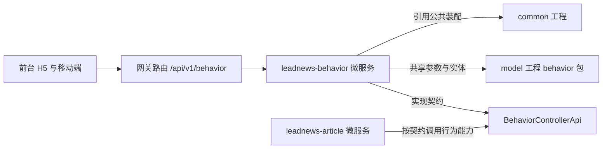

# 行为微服务进场：leadnews-behavior 工程导入与首个行为接口的定义

行为数据是推荐功能的原材料，思路分析课把四类行为的采集蓝图画完之后，落地的第一步不是写业务代码，而是把行为微服务请进聚合工程。行为采集与文章列表分属两条链路，工程也直接从资料包导入而不必从零搭建，剩下的工作只有两件：把配置与引导类补齐到能启动，把行为接口的契约定下来。工程导完、契约立好，后续的控制器、业务实现与映射文件才有落脚点。

## 先给结论

- 行为功能落在独立微服务 leadnews-behavior，工程从资料包复制进来后打开 pom 即完成导入，pom 与 leadnews-article 同构。
- 启动前的准备屈指可数：三份环境参数文件、application.properties 的端口与应用名、log4j2 日志配置、引导类，本服务分配端口 9004。
- starter-web 必须排除默认 logback 换用 log4j2，排除不干净启动时会报日志绑定冲突。
- 参数契约先行：`ShowBehaviorDto` 携带 `equipmentId` 与 `articleIds`，DTO 放 model 工程；行为实体 `ApBehaviorEntry` 也在 model 的 pojos 包里备好。
- 契约接口 `BehaviorControllerApi` 定义在 article 服务的 apis 包，方法 `saveShowBehavior` 统一返回 ResponseResult，由行为服务实现。

## 行为为什么单独占一个微服务

接口定义课立契约时，behavior 接口与文章列表接口分席而立，职责在契约层就已经切开：列表负责取数，行为负责记录。这个切分落进工程结构，就是两个微服务。行为表的规模随曝光线性增长，一次列表加载要写一批展现记录，写入模式与查询模式都和文章表完全不同，单独成服务才能各自伸缩、互不拖累。旁路的定位也是理由：行为保存失败不能拖垮列表主流程，进程级隔离让降级与补偿都有独立空间。

微服务的导入不写代码。资料包里已有现成的 leadnews-behavior 目录，整个复制到本地工程存放位置后，在 IDE 里打开该模块的 pom 文件，IDE 随即把它识别为 Maven 模块挂进聚合工程，工程树的模块名完成注册、依赖解析与编译装配一并就位。这一步的标准是看工程树里模块图标的变化：识别成功后从普通目录变成可编译的模块，颜色一变，导入就算完成。

pom 内容过一遍即可发现它与 leadnews-article 几乎同构：内部依赖 common、model、utils 三个公共模块，差异只在对外提供的业务能力。真正要动手核对的是日志排除。工程统一用 log4j2，而 spring-boot-starter-web 默认带入 logback 与一整条 log4j 桥接，两类日志实现同在类路径，启动时会报 multiple bindings 警告甚至绑定冲突，排除是必须动作：

```xml
<dependency>
    <groupId>org.springframework.boot</groupId>
    <artifactId>spring-boot-starter-web</artifactId>
    <!-- 排除默认的 logback，统一换用 log4j2 -->
    <exclusions>
        <exclusion>
            <groupId>org.springframework.boot</groupId>
            <artifactId>spring-boot-starter-logging</artifactId>
        </exclusion>
    </exclusions>
</dependency>
```

画面上的排除清单比这长得多，slf4j-api、log4j-to-slf4j、log4j-jul、log4j-1.2-api 之类的桥接逐项列出，思路都一样：把 starter-web 连带拖进来的每一根日志桥摘干净，类路径上只留 log4j2 一套实现。手写排除抓住 spring-boot-starter-logging 这个总入口通常就够，逐项列桥接是防止某些旧依赖自带 log4j 1.x 时的兜底手段。

## 四样东西启动一个微服务

导进来的是一个骨架：pom 齐了，代码与配置还是空壳。要跑起来只差四样东西，全部照着 leadnews-article 的样子搬。

**环境参数三份。** `maven_dev.properties`、`maven_test.properties`、`maven_prod.properties` 整体从 article 拷贝，键集合一字不改，值按环境轮换，构建期 Maven profile 的 filtering 负责把占位符替换成对应环境的值。

**应用参数一份。** resources 下新建 `application.properties`，只写端口号与应用名两行，值从 common 工程的统一清单里抄，behavior 分配到 9004：

```properties
# 端口与应用名：以 common 统一清单为准
server.port=9004
spring.application.name=leadnews-behavior
```

**日志配置一份。** log4j2.xml 与 article 的完全一致，root 级别引用环境参数里的 `${log.level}`，spring 与 mybatis 的框架日志收敛到 INFO。

**引导类一个。** 包根下放 `BehaviorJarApplication`，`@SpringBootApplication` 默认扫描本类所在包及子包；数据访问复用 common，config 包里的装配入口类照 article 抄一份，`@ComponentScan` 把 common 的 mysql.core 包扫进来，Mapper 扫描仍由 `MysqlCoreConfig` 指向 model 工程：

```java
package com.study.headline;

import org.springframework.boot.SpringApplication;
import org.springframework.boot.autoconfigure.SpringBootApplication;

@SpringBootApplication
public class BehaviorJarApplication {

    public static void main(String[] args) {
        SpringApplication.run(BehaviorJarApplication.class, args);
    }
}
```

启动验证的标准与 article 一样：控制台里 Tomcat 起在 9004、数据源初始化完成、没有任何绑定冲突报错。四个动作全是搬配置，真正的行为逻辑一行都还没写，但地基已经具备了对外服务的资格。

## 参数契约：一个 DTO 与一张实体表

行为接口吃进什么，参数契约先要说死。前端定时上报的内容就两样：当前设备与本次加载的文章列表。`ShowBehaviorDto` 按这两样落字段，位置在 model 工程的 behavior.dtos 包，跨服务共享的参数一律放 model，behavior 与 article 两边引同一份定义：

```java
package com.study.headline.model.behavior.dtos;

import com.study.headline.model.common.dtos.IdEncrypt;
import lombok.Data;
import java.util.List;

@Data
public class ShowBehaviorDto {
    /** 设备 ID：移动端唯一设备编号，对外传输走混淆加密 */
    @IdEncrypt
    private Integer equipmentId;
    /** 本次加载的文章 ID 列表 */
    private List<Integer> articleIds;
}
```

`@IdEncrypt` 在 jackson 序列化组件课已经立过规矩：自增 ID 走网络必须混淆，字段名不带 id 的标识字段靠注解挂混淆。设备号正属于这类敏感标识，响应序列化时输出无规律的混淆串，前端回传时再还原成数字，两端按同一套组件处理，业务代码零感知。

行为实体的 pojo 也一并备好。ap_behavior_entry 的字段语义在思路分析课拆过：type 区分实体类型，0 终端设备 1 用户；entry_id 存设备标识或用户 ID；burst 是分片预留。pojo 按同一口径映射：

```java
package com.study.headline.model.behavior.pojos;

import lombok.Data;
import java.util.Date;

@Data
public class ApBehaviorEntry {
    private Integer id;
    /** 实体类型：0 终端设备，1 用户 */
    private Short type;
    /** 实体 ID：设备维度存设备标识，用户维度存用户 ID */
    private Integer entryId;
    private Date createdTime;
    /** 分片字段，为按主体分表预留 */
    private String burst;
}
```

显式行为的参数家族（点赞、收藏、评论）都围绕「文章 ID 加操作类型」生长：articleId 是公共字段，operation 用 0 与 1 区分执行与取消，点赞类还要一个 type 区分文章点赞与评论点赞。这些 DTO 在显式行为的课程里逐个亮相，本课先把最复杂的展现 DTO 定下来。

## 契约接口：定义在调用方一侧

参数定完，接口契约落笔。`saveShowBehavior` 的定义不放 behavior 服务里，而是放在 leadnews-article 的 apis 包：行为的保存服务于文章浏览场景，article 服务后续要按这个契约调用行为能力，调用方持有契约、实现方实现契约，双方只依赖接口不依赖对方的具体结构：

```java
package com.study.headline.article.apis;

import com.study.headline.model.behavior.dtos.ShowBehaviorDto;
import com.study.headline.model.common.dtos.ResponseResult;

public interface BehaviorControllerApi {

    /**
     * 保存用户查看文章的行为
     */
    ResponseResult saveShowBehavior(ShowBehaviorDto dto);
}
```

返回值统一 ResponseResult，网关与前端只解析一种响应壳；方法注释直接写明职责，保存用户查看文章的行为。行为服务下一课建控制器来实现这个接口，映射路径沿用既定规范：类上 `/api/v1/behavior`，端点 `save_show_behavior`，controller 的 v1 子包与 URL 版本号两层同时落地。整条契约关系如下图：



契约定义在 article、实现在 behavior，两头通过接口与共享的 DTO 解耦；model 工程居中承载参数与实体，任何一侧的改动都不牵连对方的内部结构。图上的关键路径是中间那条契约线：它同时约束了调用方的期待与实现方的动作，后续逻辑测试也按契约的入参出参逐项核对。

## 常见误区

- **导入模块后 Maven 没有刷新。** 打开 pom 只是触发导入，依赖解析完成后工程树的模块图标才会变化；图标没变就编译，IDE 会把内部模块依赖当外部 jar 找，红线一片。导入后确认模块已挂进聚合工程再动手。
- **日志排除只摘 logback 不摘桥接。** 类路径上残留 slf4j-api 与 log4j 桥接时，启动会报 multiple bindings 警告，严重时绑定冲突直接失败；以 spring-boot-starter-logging 为主入口排查，异常栈里出现 log4j 1.x 类名就补对应 exclusion。
- **DTO 定义进 behavior 服务内部。** article 服务要按契约传参就必须能引用 `ShowBehaviorDto`，藏在 behavior 里等于逼调用方抄一份类，两边字段慢慢漂移；跨服务参数一律进 model 工程。
- **端口与应用名随手起。** 9004 是 common 统一清单分给 behavior 的端口，多个微服务端口冲突会在启动时互相踩踏；应用名必须与模块名一致，后续按名寻址才不乱。

## 面试可能被问到的问题

1. 面试官追问：「行为功能为什么独立成微服务，而不是塞进文章服务里？」
   答：写入模式不同是根本原因：行为表随曝光线性增长，一次列表加载写一批记录，与文章表以读为主的负载完全异构，独立部署才能各自扩容。旁路定位也是理由，行为保存失败不能放大成列表主流程故障，进程级隔离让降级与补偿有独立空间。
2. 面试官追问：「打开 pom 导入一个模块，IDE 与 Maven 分别发生了什么？」
   答：IDE 把目录识别为 Maven 模块，解析 pom 建立依赖图并挂进聚合工程的 modules；Maven 侧按继承关系解析父 pom，绑定内部模块依赖与外部 starter。模块图标变化代表识别成功，随后的编译构建都走聚合关系。
3. 面试官追问：「为什么 starter-web 要排除默认日志，排除项怎么定？」
   答：Spring Boot 默认绑定 logback，工程统一 log4j2，两套实现同在类路径会报 multiple bindings，日志门面选实现的行为不可控。排除以 spring-boot-starter-logging 为总入口，依赖树里看到哪些桥接残留再逐项补 exclusion，原则是类路径上只留一套日志实现。
4. 面试官追问：「契约接口放在调用方服务的 apis 包里，依据是什么？」
   答：契约表达的是调用方的期待，谁消费谁定义，实现方引依赖实现接口；调用方升级契约时不反向依赖实现方的发布节奏，接口与实现通过共享 model 解耦，这是接口隔离在工程结构上的落地。
5. 面试官追问：「设备 ID 这类字段为什么要加 @IdEncrypt？」
   答：设备号这类标识连续可枚举，明文传输会暴露规模与规律；jackson 序列化时 AES 混淆成无规律字符串、反序列化还原，业务代码零感知。代价主要是混淆串比数字长带来的体积增长，对行为接口这类上报场景完全可接受。
6. 面试官追问：「application.properties 里只有两行，环境差异怎么带进去？」
   答：端口与应用名是运行期属性，直接写死；环境差异参数走 Maven profile 的 filtering，构建期把环境文件中的值替换进 resources。两套机制各管一段，配置文件里看到的永远是本环境的真实值。

## 配套资料

- 代码：`materials/code/05/头条day01/`，内层资料目录含数据库规范设计说明书（微服务拆分与冗余字段设计可对照其规范条目）、PowerDesigner 使用手册与前后台项目原型 HTML（可对照前台原型的主页信息流页面）；原始目录与文件名冠以项目原名，正文统一以「头条类资讯项目」指代。
- 说明：day01 资料包不含工程 Java 源码，文中 pom 片段、配置文件、`ShowBehaviorDto`、`ApBehaviorEntry` 与契约接口为按画面线与主流写法补全的可运行版本，包名统一改写为 `com.study.headline`；端口 9004、应用名与三份环境参数文件机制按口播与画面线整理，显式行为参数家族为按课程口径的预告整理。
