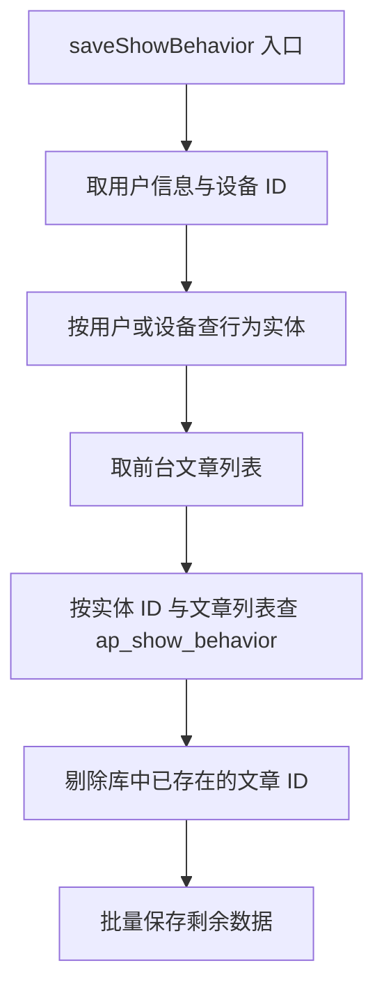

# 控制器与业务分层：行为保存链路的五步施工图

契约接口就位之后，behavior 服务内部开始施工。这一课做两件事：把控制器建起来实现契约，把服务层的执行步骤钉成注释。实现代码可以下一课再填，但步骤的先后、参数的来源、过滤的方向必须先想清楚，实现阶段只是把每条注释翻译成代码，顺序想错了，代码写得再快也是返工。

## 先给结论

- 控制器实现契约：`BehaviorController` 挂 `@RestController` 与 `@RequestMapping("/api/v1/behavior")`，方法体只做一行转发。
- 服务层面向接口：`AppShowBehaviorService` 定义 `saveShowBehavior`，`AppShowBehaviorServiceImpl` 挂 `@Service` 实现。
- 五步流程固定：取用户信息与设备 ID、按用户或设备查行为实体、取文章列表、按实体与文章列表查展现行为表、剔除已存在后批量保存。
- 查展现行为表的条件是行为实体 ID `entryId`，不是设备号，两个 ID 是本课最容易混的地方。
- 过滤方向是「从待保存列表里剔除库中已有」，先查后删再存，顺序颠倒会让重复数据落库。

## 控制器：契约的落地处

控制器只做一件事，把 HTTP 请求翻译成服务层调用。契约接口 `BehaviorControllerApi` 定义在 article 服务的 apis 包，behavior 服务建控制器实现它：

```java
package com.study.headline.behavior.controller.v1;

import com.study.headline.article.apis.BehaviorControllerApi;
import com.study.headline.model.behavior.dtos.ShowBehaviorDto;
import com.study.headline.model.common.dtos.ResponseResult;
import org.springframework.beans.factory.annotation.Autowired;
import org.springframework.web.bind.annotation.PostMapping;
import org.springframework.web.bind.annotation.RequestBody;
import org.springframework.web.bind.annotation.RequestMapping;
import org.springframework.web.bind.annotation.RestController;

@RestController
@RequestMapping("/api/v1/behavior")
public class BehaviorController implements BehaviorControllerApi {

    @Autowired
    private AppShowBehaviorService appShowBehaviorService;

    @Override
    @PostMapping("/save_show_behavior")
    public ResponseResult saveShowBehavior(@RequestBody ShowBehaviorDto dto) {
        return appShowBehaviorService.saveShowBehavior(dto);
    }
}
```

三处细节值得停一下。**实现契约接口。** implements 加上之后，契约的方法签名成为编译期约束，契约改签名而实现没跟上时编译直接报错，接口与实现的一致性由编译器看守。**路由按规范落位。** 类映射 `/api/v1/behavior` 里的 v1 是版本号，与方法上的 `save_show_behavior` 拼成完整路径；controller 的 v1 子包与 URL 版本两层同时落地，出 v2 时并列新包即可。**控制器零业务。** 参数进来直接交给服务层，返回什么原样吐出去，校验、判空、过滤全部属于服务层；控制器越薄，HTTP 层与业务层的边界越清楚。

注入的是 `AppShowBehaviorService` 接口类型而不是实现类，这一步在创建控制器时就要守住：服务层此刻只有一个空壳接口，控制器先行写完，实现类补上方法后链路自然接通，依赖的方向始终指向抽象。

## 服务层：先立接口，再立实现

服务层按规范拆两层，接口进 service 包，实现类进 service.impl。接口一行方法签名加职责注释：

```java
package com.study.headline.behavior.service;

import com.study.headline.model.behavior.dtos.ShowBehaviorDto;
import com.study.headline.model.common.dtos.ResponseResult;

public interface AppShowBehaviorService {

    /**
     * 保存用户查看文章的行为
     */
    ResponseResult saveShowBehavior(ShowBehaviorDto dto);
}
```

实现类挂 `@Service` 实现接口，方法体先把思路分析的五个步骤钉成注释，暂留空壳：

```java
package com.study.headline.behavior.service.impl;

import org.springframework.stereotype.Service;

@Service
public class AppShowBehaviorServiceImpl implements AppShowBehaviorService {

    @Override
    public ResponseResult saveShowBehavior(ShowBehaviorDto dto) {
        // 1. 获取用户信息，获取设备 id
        // 2. 根据当前的用户信息或设备 id 查询行为实体 ap_behavior_entry
        // 3. 获取前台传递过来的文章列表 id
        // 4. 根据行为实体 id 和文章列表 id 查询展现行为表 ap_show_behavior
        // 5. 数据的过滤，剔除表中已经存在的文章 id，剩余数据批量保存
        return null;
    }
}
```

步骤注释不是装饰。行为链路每一步都有前置依赖：查实体要等用户与设备就位，查展现表要等实体与文章列表就位，过滤要等展现表查询返回。注释先行等于把依赖顺序固化进代码，下一课填实现时每条注释对应一段代码，漏一步或倒一步在评审与测试时都一眼可见。

## 五步流程逐段拆解

**第一步，取用户信息与设备 ID。** 用户信息从线程上下文取，拦截器解析 token 后已把登录用户绑进当前线程，工具类随取随用；设备 ID 不用额外获取，前端随请求把它装进了 dto 的 `equipmentId` 字段。两者构成「或」的关系：登录用户有用户 ID，未登录用户一定有设备号，任何一个都能定位行为主体。

**第二步，按用户或设备查行为实体。** 查询入参两个：用户 ID 与设备号，语义是「或」，XML 侧用动态分支实现两路；查出来的 `ApBehaviorEntry` 是后续所有行为记录的锚点，展现表只认它的 `entryId`。

**第三步，取文章列表。** dto 的 `articleIds` 就是前端本次上报的批次，类型是集合，作为 Mapper 查询条件时工程口径统一转成数组往后传，细节下一课展开。

**第四步，查展现行为表。** 查询条件的两个 ID 必须分清：一个是行为实体的 ID，即 `entry.getId()`；另一个是文章 ID 集合。设备号在这里已经退场，ap_show_behavior 的 `entry_id` 列存的就是行为实体 ID，拿设备号当条件是这一课最典型的手误，讲解里专门停下来强调「这两个设备 ID 不是同一个 ID」，指的就是它。

**第五步，过滤并保存。** 查回的展现记录里已存在的文章 ID，从待保存列表里剔除，剩下的批量插入。方向不能反：是「剔除库里已有的」，不是「保留库里已有的」；也不能先存后查，重复的展现记录一旦落库，展现量虚高、表体积膨胀都发生在存的那一刻，事后清理的成本远高于事前一次查询。

整条流程的控制流如下图：



关键路径在第二到第五步的接力：行为实体是全局锚点，第二步查不到实体，后面三步全部失去入参；第四步的查询结果是第五步过滤的依据，两次查询共用同一个实体 ID。

## 行为实体 ID 与设备号：一个概念拆成两个 ID

ap_behavior_entry 把「谁在操作」去重存储，type 加 entry_id 唯一定位一个主体；ap_show_behavior 的每一行只记「哪篇文章被哪个主体看到」，外键就是 `entryId`。于是同一个请求里出现两类 ID：设备号是前端带来的原始标识，只在第一步与第二步出场；行为实体 ID 是主体表派生的关联值，从第二步查出来之后接管余下所有步骤。变量命名时把 Mapper 方法参数命名为 `entryId` 而不是 `equipmentId`，就是从源头防混：名字对了，XML 里的 `#{entryId}` 才不会拿错值。

这条设计也解释了为什么第二步的查询必须两路都支持。主体在 ap_behavior_entry 里的形态由 type 决定，0 设备 1 用户；同一个用户今天登录、明天退出，行为主体在两条形态之间切换，行为数据却要延续。查询两路并存的入口语义，正是思路分析课「用户信息或设备 ID」这条「或」关系的工程落点。

## 常见误区

- **业务逻辑写进控制器。** 判空、过滤、落库全挤在控制器方法里，HTTP 层与业务层边界糊掉；控制器只保留一行转发，业务全部下沉服务层。
- **查展现表拿设备号当条件。** ap_show_behavior 的 entry_id 存的是行为实体 ID，设备号只在查主体那一步有用；条件写错查回来永远是空，过滤失效，重复数据照插。
- **过滤方向反了。** 从待保存列表「保留」已存在 ID，等于只存重复数据、丢掉新数据；语义必须是剔除已有、保留增量。
- **注入实现类而非接口。** 控制器里 private 声明成 Impl 类型，服务层换实现或加代理时控制器跟着改；依赖接口类型，装配交给 Spring。

## 面试可能被问到的问题

1. 面试官追问：「控制器为什么实现契约接口而不是直接写？」
   答：契约由调用方持有，实现契约等于对外承诺方法签名，签名变化编译期就能暴露；同时控制器只暴露契约方法，调用方与服务方之间只有接口这一层耦合，替换实现或迁移服务时外部无感。
2. 面试官追问：「服务层为什么拆接口与实现两个类？」
   答：面向接口让调用方依赖抽象，Spring 注入、事务代理、单元测试打桩都以接口为锚；实现类可替换可增强，接口注释本身就是方法契约，步骤与出参先于实现固定下来。
3. 面试官追问：「行为实体表和展现行为表是什么关系？」
   答：主体与流水的关系。主体表把设备与用户统一成 entry 去重存储，type 加 entry_id 定位唯一主体；展现表是行为流水，外键 entryId 指回主体，一篇文章对同一主体只保留一条展现记录。
4. 面试官追问：「过滤为什么必须先查后存？」
   答：前端定时上报会重复推同一批文章，不剔除则展现量虚高、行为表快速膨胀；先按主体与文章列表查已存在记录，再从待保存列表剔除，剩下的才是真正的增量，一次查询换来数据干净。
5. 面试官追问：「步骤注释先写、实现后补的写法有什么工程价值？」
   答：把思路分析的结果固化成代码里的依赖顺序，实现阶段逐条翻译，漏步、倒步在评审时一眼可见；多人协作时注释就是验收清单，测试用例也能按步骤逐段覆盖。
6. 面试官追问：「隐式行为与显式行为在服务层设计上有什么差别？」
   答：隐式行为是纯插入链路，查重过滤后批量落库，无状态翻转；显式行为要按当前状态分支，存在则更新不存在则新增，还伴随计数冗余回写，事务边界与幂等设计都更重，两者分开建模避免互相污染。

## 配套资料

- 代码：`materials/code/05/头条day01/`，内层资料目录含数据库规范设计说明书、PowerDesigner 使用手册与前后台项目原型 HTML；原始目录与文件名冠以项目原名，正文统一以「头条类资讯项目」指代。
- 说明：day01 资料包不含工程 Java 源码，文中控制器、服务接口与实现类骨架为按画面线与主流写法补全的可运行版本，包名统一改写为 `com.study.headline`；五步流程与「设备 ID 即行为实体 ID」的澄清按口播原话整理。
