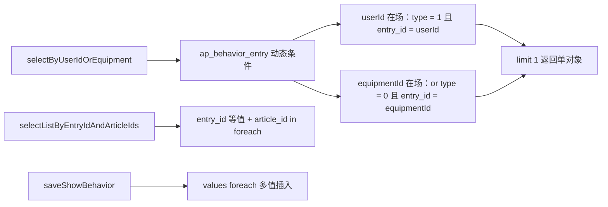

# 两份 Mapper XML：主体查询与展现行为的动态 SQL 细节

服务层的方法名与参数上一课已经立成契约，这一课把两个 Mapper 接口与两份映射文件补齐：一份管行为主体的定位查询，一份管展现行为的查询与批量插入。XML 没有编译期检查，namespace、id、参数名、foreach 的拼装全靠逐字核对，本课把每一处容易错的细节过一遍。

## 先给结论

- 多参数一律 @Param 显式命名，两个 Mapper 接口的方法全部照此办理。
- XML 放 model 工程 mapper 目录，namespace 绑接口全限定名，select 的 id 等于方法名，resultMap 与列清单从表字段逐列照抄。
- 主体查询两条动态分支：userId 在场拼 type=1 与 entry_id 等值，equipmentId 在场用 or 拼 type=0 分支，and 优先级高于 or 让两段各自成组；单对象返回加 limit 1 兜底。
- 展现查询 where `entry_id` 等值加 `article_id in`，数组条件由 foreach 拼装，括号交给 open 与 close。
- 批量插入 values 里 foreach 展开，is_click 写死 0 表示插入即未点击，show_time 与 created_time 交给数据库函数 now()。

## 接口补注解：@Param 一个都不能少

Mapper 接口方法超过一个参数时，MyBatis 默认只认 param1、arg0 这类名字，XML 里的 `#{entryId}` 会直接报参数找不到。两个接口每个方法的每个参数都补上 @Param：

```java
package com.study.headline.model.mappers.app;

import com.study.headline.model.behavior.pojos.ApShowBehavior;
import org.apache.ibatis.annotations.Param;
import java.util.List;

public interface ApShowBehaviorMapper {

    /** 按主体与文章列表查已存在的展现记录 */
    List<ApShowBehavior> selectListByEntryIdAndArticleIds(@Param("entryId") Integer entryId,
                                                          @Param("articleIds") Integer[] articleIds);

    /** 批量保存展现行为 */
    void saveShowBehavior(@Param("articleIds") Integer[] articleIds,
                          @Param("entryId") Integer entryId);
}
```

```java
package com.study.headline.model.mappers.app;

import com.study.headline.model.behavior.pojos.ApBehaviorEntry;
import org.apache.ibatis.annotations.Param;

public interface ApBehaviorEntryMapper {

    /** 按用户或设备定位行为主体 */
    ApBehaviorEntry selectByUserIdOrEquipment(@Param("userId") Long userId,
                                              @Param("equipmentId") Integer equipmentId);
}
```

接口放 model 工程的 mappers.app 包，与文章列表的 Mapper 同址，common 的 `@MapperScan` 扫的就是这个包。服务实现类上的警告照旧用 `@SuppressWarnings("all")` 压制：泛型相关的未检查警告不影响编译，但满屏黄线容易淹没真问题，压制是编辑器卫生，不是掩盖错误。XML 与接口同名，放 model 工程 resources 的 mapper 目录，建文件最快的方式是从文章列表的映射文件拷一份改名，拷完第一件事是逐个核对 namespace 与 type 的包路径，拷贝残留是 XML 报错的第一大来源。

## 主体查询 XML：两条分支定位一个主体

`ApBehaviorEntryMapper.xml` 的查询要同时服务两路参数，动态分支把决定权交给入参：

```xml
<?xml version="1.0" encoding="UTF-8"?>
<!DOCTYPE mapper PUBLIC "-//mybatis.org//DTD Mapper 3.0//EN"
        "http://mybatis.org/dtd/mybatis-3-mapper.dtd">
<mapper namespace="com.study.headline.model.mappers.app.ApBehaviorEntryMapper">

    <resultMap id="BaseResultMap" type="com.study.headline.model.behavior.pojos.ApBehaviorEntry">
        <id column="id" property="id"/>
        <result column="type" property="type"/>
        <result column="entry_id" property="entryId"/>
        <result column="created_time" property="createdTime"/>
        <result column="burst" property="burst"/>
    </resultMap>

    <sql id="Base_Column_List">
        id, type, entry_id, created_time, burst
    </sql>

    <select id="selectByUserIdOrEquipment" resultMap="BaseResultMap">
        select <include refid="Base_Column_List"/>
        from ap_behavior_entry ae
        <where>
            <if test="userId != null">
                and ae.type = 1 and ae.entry_id = #{userId}
            </if>
            <if test="equipmentId != null">
                or ae.type = 0 and ae.entry_id = #{equipmentId}
            </if>
        </where>
        limit 1
    </select>
</mapper>
```

方法名里的 Or 落到 XML 就是第二段分支的 or 连接符：userId 在场时拼「type=1 且 entry_id 等于用户 ID」的用户分支，equipmentId 在场时用 or 拼「type=0 且 entry_id 等于设备标识」的设备分支。SQL 的 and 优先级高于 or，两段条件各自成组，整句语义是「用户主体或设备主体」，与方法名的承诺一致；第二段若写成 and，登录用户同时带设备号上报时两个条件叠成恒假，查询永远为空。test 表达式是 OGNL，判断的是 @Param 标注的参数名，名字写错启动不报错、调用时才炸。

resultMap 与 `<sql>` 片段照表字段逐列抄，五列对五个属性；显式 resultMap 不依赖驼峰转换开关，换环境、换工程都不会悄悄映射成 null。返回类型是单个实体而非集合，命中多条时 MyBatis 会抛 TooManyResultsException，尾部加 limit 1 是给单对象查询的容错垫：正常情况主体本来就唯一，异常情况也只取一条不炸。

## 展现行为 XML：in 查询与批量插入

`ApShowBehaviorMapper.xml` 先立公共件，resultMap 与列清单都按 ap_show_behavior 的六个字段照抄：

```xml
<mapper namespace="com.study.headline.model.mappers.app.ApShowBehaviorMapper">

    <resultMap id="BaseResultMap" type="com.study.headline.model.behavior.pojos.ApShowBehavior">
        <id column="id" property="id"/>
        <result column="entry_id" property="entryId"/>
        <result column="article_id" property="articleId"/>
        <result column="is_click" property="isClick"/>
        <result column="show_time" property="showTime"/>
        <result column="created_time" property="createdTime"/>
    </resultMap>

    <sql id="Base_Column_List">
        id, entry_id, article_id, is_click, show_time, created_time
    </sql>

    <select id="selectListByEntryIdAndArticleIds" resultMap="BaseResultMap">
        select <include refid="Base_Column_List"/>
        from ap_show_behavior
        where entry_id = #{entryId} and article_id in
        <foreach collection="articleIds" item="item" open="(" close=")" separator=",">
            #{item}
        </foreach>
    </select>
</mapper>
```

select 的动态部分只有一个 foreach：collection 写 @Param 标注的 articleIds，item 是每次迭代的元素，open 与 close 负责括住整个列表，separator 在元素之间补逗号，拼出来的形态是 `article_id in (101, 98, 87)`。上一课的数组判空在这里兑现价值：空数组进 foreach 会拼出 `article_id in ()`，SQL 直接语法错误。列清单用 `<include>` 引入而不是 select 星号，查询只碰用得到的列，与文章列表 Mapper 的写法保持同一风格。

插入语句的 foreach 挂在 values 上，每篇文章生成一行：

```xml
<insert id="saveShowBehavior">
    insert into ap_show_behavior (entry_id, article_id, is_click, show_time, created_time)
    values
    <foreach collection="articleIds" item="item" separator=",">
        (#{entryId}, #{item}, 0, now(), now())
    </foreach>
</insert>
```

values 里的占位符逐列对应：entry_id 取方法参数 `#{entryId}`，article_id 取迭代元素 `#{item}`，is_click 写死 0，插入即未点击，用户后续点击对应文章时再翻转标记，展现与点击的先后关系留在表里；show_time 与 created_time 用数据库函数 now()，等价于 Java 侧 `new Date()` 再传参，好处是时间取自数据库时钟，应用与数据库的时钟偏差不会带进数据。一次 insert 拼 N 行 values 属于多值插入，一条语句只解析执行一次，比循环单条插入少 N 次网络往返，行为表这种批量写入场景正合适；行数失控时会撞 SQL 文本长度与 max_allowed_packet 的限制，本课一批文章列表最多几十行，安全余量充足。

两个接口、三份语句的对应关系与分支逻辑如下图：



三份语句各自对应服务层的一步：主体查询供给查实体的锚点，in 查询供给过滤的依据，多值插入承接最终保存；namespace 与接口全限定名对上、select 的 id 与方法名对上，代理对象调用方法时才能沿「全限定名加方法名」找到同 id 的语句，两条线断了任何一根，运行期都抛找不到语句的异常。

## 计数列去哪了：流水与计数的分工

ap_show_behavior 的列清单里没有 likes、views 这类计数，行为流水与计数冗余的分工在 XML 层看得最清楚：流水表只记发生了什么，一行一条展现；计数列在 ap_article 上，由显式行为（点赞、收藏、评论）的 update 语句按操作方向累加或递减，operation 0 加 1 减的分支连同「保存或更新」一起圈进事务，那些映射文件在显式行为的课程里出现。本课两份 XML 全是流水写入，恰好说明设计时把「记录动作」与「更新计数」拆成了两条独立链路，流水先行、计数随后，彼此不阻塞。

## 常见误区

- **namespace 或 select 的 id 与接口对不上。** 启动注册代理不报错，方法一调用就抛找不到语句；拷贝改名后逐字核对两处，是 XML 无编译期检查下唯一可靠的防线。
- **foreach 的 collection 名写错。** 显式 @Param 之后必须写标注名，写参数原名或默认名（数组是 array、List 是 list）都会报参数找不到。
- **select 的 foreach 漏 open 与 close。** 拼出的 in 少括号直接语法错误；括号交由 open 与 close 生成，不要在 SQL 文本里手写括号再让 foreach 补内容。
- **插入分支的 or 误写成 and。** 用户与设备两段条件叠加成恒假，登录用户的展现记录永远查空；分支之间的连接词按「或」语义选，段内的等值条件仍用 and。

## 面试可能被问到的问题

1. 面试官追问：「foreach 的 collection 属性名是怎么确定的？」
   答：参数被 @Param 标注后写标注名；未标注时 List 默认叫 list 或 collection、数组叫 array、多参数按 param1 递增。依赖默认名在参数个数变化时会错位，显式标注让接口与 XML 的对应关系一眼可见。
2. 面试官追问：「两段 if 分支之间用 or、段内用 and，怎么保证优先级不出歧义？」
   答：SQL 的 and 优先级高于 or，and 条件自动成组，整句等价于两组条件做 or；工程上更稳妥的做法是用括号显式分组或改写成 choose 分支。本例条件简单依赖优先级可读性尚可，评审时应显式核对语义。
3. 面试官追问：「时间字段为什么用 now() 而不是应用传参？」
   答：now() 取数据库时钟，免去应用与数据库之间的时钟偏差，也不用 Java 侧 new Date 再传参；代价是时间语义绑定到数据库实例，跨库分片或迁移时要统一时钟源。本课单库场景取数据库时钟最简单。
4. 面试官追问：「单对象返回为什么加 limit 1？」
   答：返回类型是实体时，MyBatis 命中多条会抛 TooManyResultsException；主体在正常数据下唯一，limit 1 是容错垫，脏数据或并发插入导致重复时也不炸，取一条按唯一语义处理。
5. 面试官追问：「多值插入和循环单条插入怎么取舍？」
   答：多值插入一条语句解析执行一次，N 行只付一次网络与解析成本，吞吐高；但 SQL 文本长度受 max_allowed_packet 限制，超大批量要分批。循环单条插入可控性好但往返多，行为流水这类中小批量首选多值插入。
6. 面试官追问：「这两份 XML 里为什么没出现 CDATA？」
   答：CDATA 解决小于号、与符号等 XML 保留字符的转义，本课 SQL 只有等值与 in，没有范围比较符；出现范围比较时才需要 CDATA 或转义实体，按需使用而不是模板化粘贴。

## 配套资料

- 代码：`materials/code/05/头条day01/`，内层资料目录含数据库规范设计说明书（多值插入与动态 SQL 的设计可对照其 SQL 规范条目）、PowerDesigner 使用手册与前后台项目原型 HTML；原始目录与文件名冠以项目原名，正文统一以「头条类资讯项目」指代。
- 说明：day01 资料包不含工程 Java 源码，文中两个 Mapper 接口与两份映射文件为按画面线与主流写法补全的可运行版本，包名统一改写为 `com.study.headline`；or 分支、limit 1、is_click 写死 0 与 now() 均按口播与画面线整理，select 的 foreach 括号由 open 与 close 提供（画面为省略形态），显式行为的计数回写 XML 按课程口径预告。
