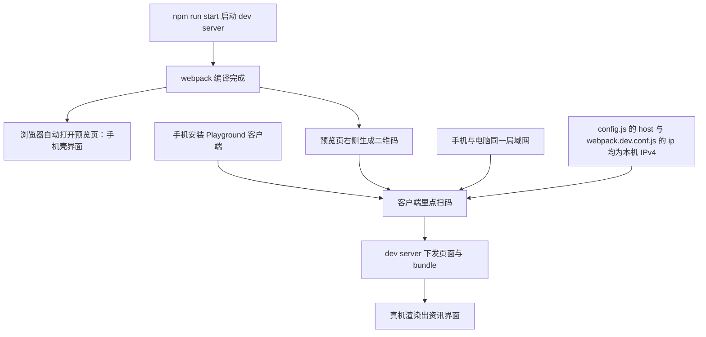

# 把 App 工程跑起来：导入、启动与真机预览的完整链路

day01 收官时留了一句伏笔：行为接口的 postman 联调放到前端工程跑起来之后。这一课就兑现前半句，把 App 前端工程在开发机上跑起来：浏览器里先看到一个手机壳里的资讯页面，再扫码把同一份页面推到真机上。全程是操作，但两个配置点值得说透：dev server 绑定的是哪个 IP，二维码扫出来为什么会白屏。想明白这两点，前端联调阶段一半以上的环境问题都能自己定位。

## 先给结论

- 导入即拷贝：把资料中的前端工程 `leadnews-app` 复制到一个干净目录，用 WebStorm 打开即可，npm 工程没有额外的导入仪式。
- 启动入口在 `package.json` 的 scripts：右键 show npm scripts 点 start，webpack 编译完成后浏览器自动打开预览页，画面地址形如 `http://192.168.253.3:8082/dist/index.html`。
- 真机预览用 weex 的 Playground 客户端扫码，两个前提：手机与电脑在同一局域网；`config/config.js` 的 host 与 `webpack.dev.conf.js` 的 ip 两处都改成本机 IPv4。
- 开发期跨域由 proxyTable 代理解决：带 `/toutiao` 前缀的请求由 dev server 同源转发到新闻站点并重写掉前缀，之后对接自己的后端接口走的是同一机制。
- 看到的页面是前端同学搭好的架子：搜索框加底部导航（首页、视频、我的等），后续业务开发都在这个架子上进行。

## 导入与启动：npm 工程的两步走

工程本体在 day02 资料的前端项目里，整个目录拷贝到一个干净的存放位置。干净目录不是洁癖：路径里带中文或空格时，部分构建工具与脚本会解析出错，报错信息又不指向路径本身，排起来极费劲。拷完用 WebStorm 打开工程目录，IDE 识别根目录的 `package.json` 自动挂为 npm 工程，不需要任何导入向导。

启动走 npm scripts。在 `package.json` 上右键选 show npm scripts，面板里点 start，等同终端执行：

```bash
# 与面板点 start 等效
npm run start
```

终端里 webpack 开始编译，进度条从百分之几十一路走完，浏览器自动弹出预览页：一个手机壳界面，顶部搜索框，底部一排导航（首页、视频、我的等），这就是前端同学预先搭好的页面架子，后续资讯列表、频道切换的业务都在它上面长出来。预览页右侧还有一张二维码，那是留给真机调试的入口。

## 两处 IP 配置：浏览器能看，真机不一定能看

预览页在电脑浏览器里正常，手机扫码却白屏，原因几乎都出在 IP 上。工程里有两处写死了主机地址，第一处在 `config/config.js`：

```javascript
const path = require('path');
const ROOT = path.resolve(__dirname, '..');
let ip = require('ip').address('WLAN');
const config = {
  root: ROOT,
  host: '192.168.253.3',
  port: 8081,
  historyApiFallback: true
};
```

第二处在 `webpack.dev.conf.js`：

```javascript
// 本机局域网 IP，按实际环境修改
let ip = '192.168.253.3';
// 备选写法：自动取 WLAN 网卡地址
// const ip = require('ip').address('WLAN');
```

为什么必须改？二维码指向的是 `host:端口` 下的页面与 bundle 地址。电脑上 `192.168.253.3` 是课程环境的本机局域网 IP，换一台机器它就指向一个不存在的地址；如果写成 `127.0.0.1` 更糟，环回地址在手机上指向手机自己。改法是先查本机 IPv4：网络属性里直接看，课程画面里查到的是 `192.168.25.3` 这类局域网地址，把它填进上面两处，保持一致。真机链路的完整依赖如下图：



图里的三个前置条件（客户端、局域网、两处 IP）缺一个，扫码就停在白屏或连接超时。手机连的 Wi-Fi 与电脑必须在同一个网段，某些路由器开了 AP 隔离也会让两台设备互相不可达，那是网络问题不是工程问题。

## 请求走哪：代理与跨域

`config/config.js` 里还有一段决定数据从哪来的配置。开发期页面要请求新闻数据，目标站点与页面不同源，浏览器会拦跨域；工程的做法是让请求先打到同源的 dev server，由 proxyTable 转发出去：

```javascript
proxyTable: {
  '/toutiao': {
    target: 'https://m.toutiao.com/', // 新闻地址
    changeOrigin: true, // 是否跨域
    pathRewrite: {
      '/toutiao': ''
    }
  }
},
autoOpenBrowser: false
```

页面里所有以 `/toutiao` 开头的请求，实际发到 dev server 同源地址，代理层再转给目标站点并按 `pathRewrite` 剥掉前缀。对浏览器来说请求始终同源，跨域检查根本不会触发；`changeOrigin` 让转发时把请求头里的 host 改写为目标站点，很多接口校验 host，不打开它代理会拿到异常响应。画面里这一处拼作 `changOrigin`，属于旧笔误，照抄到新工程会导致改写不生效，以正确拼写 `changeOrigin` 为准。

这套机制的意义不止于新闻数据：前端与自己的后端整合时，接口同样挂前缀进 proxyTable，开发期跨域就永远不出现；等上生产，代理职责移交给网关或 Nginx，前端代码一行不改。day01 的行为接口、文章列表接口接下来就按这个路数接进列表页，postman 联调的伏笔在这里兑现。

## 常见误区

- **host 保留 127.0.0.1 就去扫码。** 环回地址指向设备自身，手机访问的永远是手机而不是电脑；两处配置都要改成电脑的局域网 IPv4。
- **只改 config.js 不改 webpack.dev.conf.js。** 两处地址各管一段链路，改一漏一时预览页能开、bundle 拉不下来，真机依旧白屏。
- **把 changOrigin 照抄进新工程。** 正确属性名是 `changeOrigin`，拼错不报配置错误，表现为代理请求被目标站点拒绝，排查时先核对拼写。
- **工程放在带中文或空格的路径里。** 构建脚本对路径敏感，报错却不指向路径；拷到纯英文的干净目录再打开。
- **启动失败先怀疑页面代码。** 工程是跑通过的架子，优先核对环境：Node 与工具链版本、镜像源、`npm i` 是否完整执行，最后才看业务代码。

## 面试可能被问到的问题

1. 面试官追问：「开发期跨域怎么解决，和生产环境的方案差在哪？」
   答：开发期用 dev server 的 proxyTable，请求同源发出、由代理转发给目标服务并重写路径，浏览器不触发跨域检查；生产环境代理职责交给网关或 Nginx，或在后端统一开 CORS 响应头。两套方案的共同点是让跨域收敛在基础设施层，前端代码不感知。
2. 面试官追问：「proxyTable 的转发原理是什么？」
   答：dev server 内部起一个代理中间件，按前缀匹配请求，把请求原样转发到 target 并可做 pathRewrite 与 changeOrigin；浏览器只与同源的 dev server 通信，服务端之间的转发不受同源策略约束。它本质是开发期的反向代理。
3. 面试官追问：「真机预览为什么必须用局域网 IP？」
   答：手机与电脑是两台设备，二维码里的地址就是页面资源的来源；127.0.0.1 在手机上指向手机自己，公网 IP 又不可达，只有同一局域网内的 IPv4 能让手机访问到电脑上的 dev server，配合扫码完成真机加载。
4. 面试官追问：「前端工程怎么和后端微服务整合？」
   答：约定统一接口前缀，前端按前缀发请求，开发期由 proxyTable 把前缀代理到后端网关；后端多服务按路径或服务名分发，统一响应结构让前端一套解析逻辑通吃。联调顺序是先单接口通，再整页面通。
5. 面试官追问：「页面架子是现成的，你接手后从哪一步开始熟悉？」
   答：先看 `package.json` 的 scripts 与依赖，弄清启动与构建命令；再看 `config` 目录的代理与主机配置，弄清请求去哪；最后按页面结构找入口组件与路由，对照接口清单确认数据链路。环境跑通永远是熟悉代码的前置动作。

## 配套资料

- 代码：`materials/code/05/头条day02/`，资料目录含 mycat 相关配置；前端 app 工程本体未随资料包抽出，文中 `config.js` 与 `webpack.dev.conf.js` 的内容为画面线抄录，IP 按各自环境修改。
- 说明：工程名沿用 `leadnews-*` 口径，原始目录与文件名冠以项目原名，正文统一以「头条类资讯项目」指代；`changeOrigin` 按正确拼写书写并注明画面原值为 `changOrigin`；启动与真机调试步骤按口播与画面线整理。
