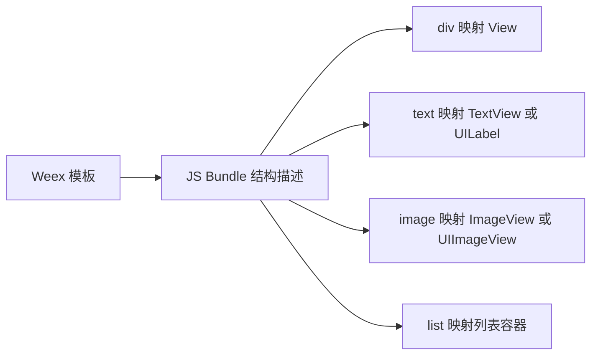

# Weex 基本组件：div、text、image 与 list 的原生约束

从 HTML 转到 Weex 的头几天最容易在三处翻车：往 div 里直接塞文字，字号小得没法看；在 a 标签里直接写文案，点击与展示表现异常；image 忘了写宽高，图片干脆不出现。这不是手误，而是渲染目标换了：Weex 组件最终映射成原生控件，HTML 里随手就能渲染的宽容在这里不存在。这一课按官方文档的组件清单，把项目中高频使用的几个组件逐个过一遍。

## 先给结论

- 页面文件仍是 template、script、style 三段式，写法是 Vue，组件却是 Weex 自定义的内置组件，不与 HTML 标签通用。
- div 是纯布局容器，文本必须包进 text 才能正常控制字号与样式。
- a 负责页面跳转，地址用 href 写死或用 :href 绑定 data 里的变量，按钮文案同样要套 text。
- image 展示单张图片，必须显式指定宽高，原生图片控件没有默认尺寸。
- 列表骨架是 list 加 cell，循环与条件过滤继续用 Vue 的 v-for 与 v-if；数据量特别大时升级 recycle-list。

## 内置组件为什么不等价于 HTML

Weex 页面的模板经编译后变成一份描述结构与数据的 JS Bundle，原生渲染器读取这份描述，把每个内置组件映射成对应平台的控件。映射关系大致如下：



同一份模板在各端有各自的控件实现，内置组件名就是这套映射的统一接口，也正因如此，组件的行为约束来自原生平台而不是浏览器。两条推论值得记住。**第一，原生平台的文本是独立控件。** Android 与 iOS 都把文本作为专门控件处理，任意容器不能直接承载文字，所以 Weex 强制文本进 text。**第二，原生控件没有浏览器的默认样式兜底。** 浏览器里 img 不写宽高还能按原图尺寸显示，原生 ImageView 没有这种默认尺寸逻辑，约束只能由开发者显式给出。

## a 与 text：跳转与文本的正确组合

官方文档给 a 的定位是用于实现页面之间的跳转，资料示例里的完整写法如下（跳转地址与文案已替换为中性占位）：

```html
<template>
  <div class="wrapper">
    <a class="button" :href="jump_url">
      <text class="text">进入资讯频道</text>
    </a>
  </div>
</template>

<script>
  export default {
    data: () => ({
      jump_url: "https://www.example.com"
    })
  }
</script>

<style scoped>
  .wrapper {
    align-items: center;
    justify-content: center;
  }
  .button {
    width: 350px;
    padding-top: 20px;
    padding-bottom: 20px;
    border-radius: 5px;
    background-color: #3eaf7c;
  }
  .text {
    font-size: 48px;
    color: #fff;
    text-align: center;
  }
</style>
```

两组细节要读明白。**其一，href 支持动态绑定。** 地址写死是初学写法，实际项目里跳转地址多来自后端配置或路由参数，data 里定义 `jump_url`，模板上写 `:href="jump_url"`，值变化页面自动跟随。**其二，text 必须在。** 直接在 a 里写文字，原生渲染层拿不到可用的文本控件，展示与样式都会异常；套上 text 后，字号、颜色、对齐才能通过 class 控制。

## div 与 image：容器与图片

div 是通用容器，职责是布局与包裹，示例里按钮的样式就挂在外层 a 上、由 div 居中承载。它自己不承载文本：直接往 div 里写一段文字，渲染出来字号极小、样式失控，把文字移进 text 后一切正常。所有页面从根节点开始就是 div 套 div，容器与内容分工明确。

image 展示单张图片，关键约束是尺寸必须显式给出：

```html
<template>
  <div class="wrapper">
    <image style="width: 200px; height: 100px" :src="logo_url"></image>
  </div>
</template>

<script>
  export default {
    data: () => ({
      logo_url: "https://cdn.example.com/logo.png"
    })
  }
</script>
```

样式里的 px 是 Weex 的逻辑单位，按 750 宽度的设计稿标注，框架负责适配到不同分辨率设备。图片地址同样可以绑定 data 变量，配合后端下发的图片域名与路径动态拼装，列表里的封面图就是这么做的。

## list 与 cell：资讯列表的骨架

文章列表是资讯应用出场率最高的页面，Weex 的 list 组件就是为长列表准备的：cell 作为列表项直接子组件可被渲染器复用，滚出屏幕的 cell 会被回收。循环与条件过滤直接沿用 Vue 指令，资料示例把这两件事都演示了：

```html
<list>
  <cell v-for="num in lists">
    <div v-if="num != 'A'">
      <text>{{num}}</text>
    </div>
  </cell>
</list>
```

```javascript
export default {
  data: () => ({
    lists: ['A', 'B', 'C', 'D', 'E', 'A']
  })
}
```

v-for 挂在 cell 上，逐项渲染 data 里的数组；v-if 挂在 cell 内的 div 上，值为 'A' 的项被过滤掉，页面只剩 B、C、D、E。把列表项里的内容换成文章数据就是列表页的雏形：标题用 text，封面与头像用 image，外层 list 负责滚动与复用，再加 loading 与 refresh 做分页（下一课展开）。

顺带区分两个滚动容器：内容少、一屏放得下时用 scroller；内容是同构的长列表时用 list 加 cell。scroller 不做列表项复用，数据量大时内存与渲染压力都会上来。

## 常见误区

- **往 div 里直接写文字。** 原生渲染层要求文本必须是 text 组件，容器直写文字字号极小且样式不可控，统一改成 text 包裹。
- **image 不写宽高。** 原生图片控件没有默认尺寸，缺宽高时图片可能不显示，尺寸写进 style 或 class。
- **把 v-for 挂在 list 上。** 循环的载体是 cell，v-for 放在 list 上会破坏列表项结构，也拿不到复用能力。
- **用 HTML 的经验套 a 标签。** HTML 里 a 可以包裹大量富内容，Weex 的 a 定位是跳转入口，内部放 text 等简单内容即可，复杂布局交给外层容器。

## 面试可能被问到的问题

1. 面试官追问：「Weex 为什么不用 HTML 标签，而是自己定义一套内置组件？」
   答：渲染目标不是浏览器而是原生控件。HTML 标签由浏览器 DOM 解释，移动端原生环境没有 DOM；Weex 定义一套与原生控件一一对应的内置组件，渲染器把 div、text、image 映射成各平台的 View、TextView、ImageView 等，才能拿到原生渲染的性能与交互。
2. 面试官追问：「为什么文本必须放在 text 组件里？」
   答：Android 与 iOS 平台上文本本身就是独立控件，没有任意容器直接渲染文字的能力。Weex 的 text 对应 TextView 与 UILabel，div 里裸写的文字没有对应控件承载，表现为字号异常、样式失控。这是跨端后必须遵守的平台约束。
3. 面试官追问：「image 不写宽高会怎样？」
   答：原生 ImageView 没有浏览器 img 按原图尺寸兜底的默认行为，不显式指定宽高时图片可能不显示或尺寸不可控。写法上把 width 与 height 放进 style，单位是 Weex 逻辑 px，按 750 设计稿标注。
4. 面试官追问：「list 和 scroller 怎么选？」
   答：scroller 适合少量内容的整体滚动，不做列表项复用；list 配合 cell 做同构长列表，滚出屏幕的 cell 可回收复用，内存与渲染压力可控。资讯流的文章列表是典型长列表场景，用 list 加 cell，再配合 loading 与 refresh 做分页。
5. 面试官追问：「Vue 的 v-for、v-if 在 Weex 里还能用吗？」
   答：能用。Weex 基于 Vue，模板编译与响应式机制全部保留，指令照常工作，资料示例正是 v-for 循环 cell、v-if 过滤特定项。变化的只有渲染层，数据驱动的开发方式与 Vue 完全一致。

## 配套资料

- 代码：`materials/code/05/头条day02/`，资料目录下有 weex 组件综合示例（`weex组件介绍.vue`），覆盖 a、text、image、list、cell、loading、refresh 与 stream 的串联写法；资料包内层目录名冠以项目原名，正文统一以「头条类资讯项目」指代。
- 说明：day02 无 Java 后端源码；跳转地址与图片地址在示例中已替换为中性占位，代码结构整理自资料示例与官方文档，其余示例为按本课写法补全。
